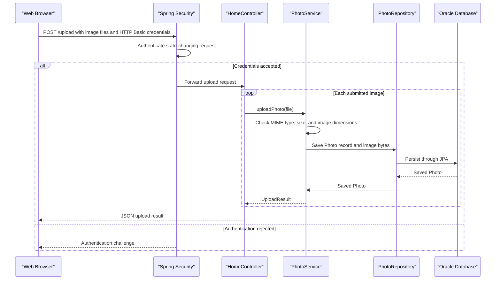

# API & Service Communication Contracts

The application exposes five browser-facing HTTP routes: gallery browsing, photo upload, detail viewing, photo deletion, and photo retrieval. Communication is synchronous HTTP within one application; no independently deployed application API or message-based integration was found.

## Service Catalog

| Service | Port | Category | Purpose |
|---|---:|---|---|
| Photo Album application | 8080 | API Layer | Renders gallery pages and handles photo operations |
| Oracle Database XE | 1521 | Infrastructure | Persists photo records and image bytes; third-party database container in Compose |

## API Endpoints Inventory

| Service | Method | Path | Request Type | Response Type |
|---|---|---|---|---|
| `HomeController` | GET | `/` | None | Thymeleaf gallery page; falls back to an empty list on retrieval error |
| `HomeController` | POST | `/upload` | Multipart `files` list | JSON map with success, uploaded photos, and failed uploads; 400 for no files |
| `DetailController` | GET | `/detail/{id}` | Path parameter `id` | Thymeleaf detail page or redirect to `/` |
| `DetailController` | POST | `/detail/{id}/delete` | Path parameter `id` | Redirect to `/` with success or error flash message |
| `PhotoFileController` | GET | `/photo/{id}` | Path parameter `id` | Photo bytes with stored MIME type; 404 if unavailable, 500 on exception |

## Management & Observability Endpoints

| Service | Endpoint | Custom Metrics |
|---|---|---|
| Photo Album application | No Spring Boot Actuator or custom health/metrics endpoint detected | None detected |

## DTOs & Contracts

`UploadResult` is a mutable service-level result object used to carry upload outcome information. The upload controller shapes its HTTP response using maps rather than a dedicated immutable response DTO. `Photo` is the service-owned persistence entity used by gallery and detail flows; see `data-architecture.md` for its model. No OpenAPI/Swagger, protobuf, or GraphQL contract files were found. Spring Boot uses Jackson for JSON serialization.

## Communication Patterns

- Controllers synchronously call `PhotoService`; `PhotoServiceImpl` synchronously calls `PhotoRepository`, which accesses Oracle through JPA/Hibernate.
- No asynchronous messaging, circuit breaker, retry policy, service discovery, or API gateway was identified.
- Docker Compose starts the application after the Oracle service reports healthy; startup and configuration details are in `configuration-inventory.md`.
- HTTP Basic authentication is configured for POST upload and deletion requests. Read-only gallery and photo retrieval requests are permitted anonymously. HTTPS/TLS is not configured in the application or Compose definition.

## Service Technology Matrix

| Service | Web | Data Access | Discovery | Gateway | Actuator | Cache | Metrics |
|---|---|---|---|---|---|---|---|
| Photo Album application | Spring MVC | Spring Data JPA / Hibernate | None | None | None detected | None detected | None detected |
| Oracle Database XE | Database service | Oracle SQL | N/A | N/A | Database health check in Compose | N/A | None detected |

## Service Communication Sequence

