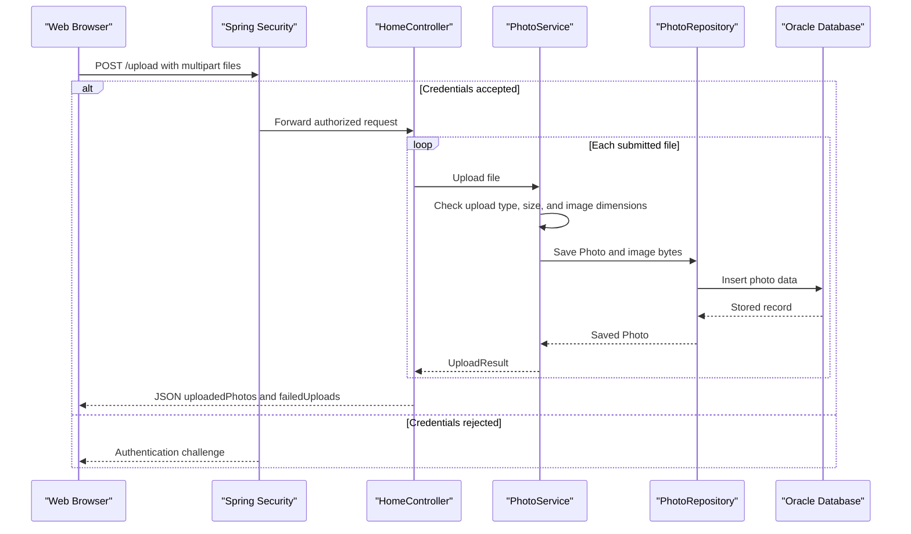

# API & Service Communication Contracts

The application exposes five browser-facing routes: server-rendered gallery and detail pages, multipart upload, deletion, and image retrieval. Requests are synchronous; there are no inter-service APIs or asynchronous messaging contracts.

## Service Catalog

| Service | Port | Category | Purpose |
|---|---:|---|---|
| photoalbum-java-app | 8080 | API Layer | Serves gallery pages, upload responses, photo files, and deletion redirects |
| oracle-db | 1521 | Infrastructure | Oracle XE persistence service from Docker Compose; not application source-built |

## API Endpoints Inventory

| Service | Method | Path | Request Type | Response Type |
|---|---|---|---|---|
| photoalbum-java-app | GET | `/` | No body | Thymeleaf gallery page; falls back to an empty gallery if retrieval fails |
| photoalbum-java-app | POST | `/upload` | Multipart `files` list | JSON map of uploaded and failed photos; 400 for no files or multipart errors |
| photoalbum-java-app | GET | `/detail/{id}` | Path parameter `id` | Thymeleaf detail page or redirect to `/` when unavailable |
| photoalbum-java-app | POST | `/detail/{id}/delete` | Path parameter `id` | Redirect to `/` with success or error flash message |
| photoalbum-java-app | GET | `/photo/{id}` | Path parameter `id` | Image resource with stored media type; 404 if missing and 500 on an unexpected error |

## Management & Observability Endpoints

| Service | Endpoint | Custom Metrics |
|---|---|---|
| photoalbum-java-app | None detected | No Spring Boot Actuator dependency or custom metrics found |

## DTOs & Contracts

`Photo` is the service-level persistence entity used by gallery and detail views. `UploadResult` is an internal service result used to report upload success or an error; upload responses are assembled as Java maps rather than dedicated API DTOs. The upload endpoint returns identifiers and photo metadata for successful files and filename/error pairs for failures. Jackson provides JSON serialization. No OpenAPI document, protobuf schema, GraphQL schema, or dedicated immutable request/response DTO was found.

## Communication Patterns

Controllers make synchronous method calls to `PhotoService`; the service calls `PhotoRepository`, which performs synchronous JPA or Oracle-native SQL operations. There are no message brokers, asynchronous event handlers, retries, circuit breakers, API gateway, service discovery, or client-side load balancing.

The application configures stateless HTTP Basic authentication. Upload and delete POST operations require authentication; other routes are permitted. TLS termination is not configured in the application and must be provided externally if required. Docker Compose waits for the Oracle health check before starting the application; see `configuration-inventory.md` for startup details.

## Service Technology Matrix

| Service | Web | Data Access | Discovery | Gateway | Actuator | Cache | Metrics |
|---|---|---|---|---|---|---|---|
| photoalbum-java-app | Spring MVC | Spring Data JPA / Hibernate | None | None | None detected | None detected | None detected |
| oracle-db | Database service | Oracle SQL | N/A | N/A | Container health check | N/A | N/A |

## Service Communication Sequence

