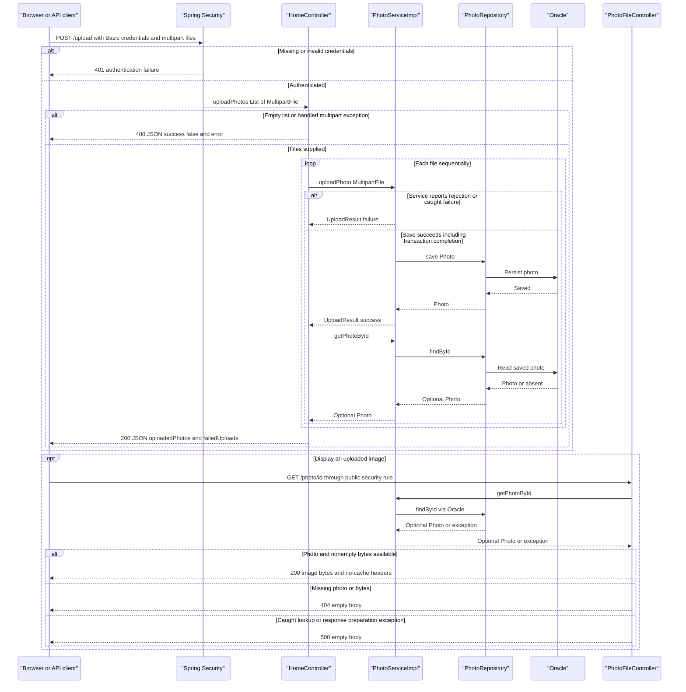

# API & Service Communication Contracts

Five explicit application endpoints provide gallery HTML, multipart uploads, photo detail HTML, deletion, and image bytes. Communication is synchronous HTTP at the boundary and direct service/repository calls internally; there are no asynchronous messaging contracts.

## Service Catalog

| Service | Port | Category | Purpose |
| --- | --- | --- | --- |
| `photoalbum-java-app` / Maven `com.photoalbum:photo-album` | HTTP 8080, published as 8080 | API Layer / Business | Single source-built application serving gallery pages, upload responses, image content, and deletion. Dependencies include Spring Boot Web, Thymeleaf, Data JPA, Validation, Security, JSON, and the Oracle JDBC driver. |
| `oracle-db` | 1521 and 5500, both published | Infrastructure | Third-party Oracle Express container, not a source module; JDBC persistence dependency. Port 5500 is an Oracle management interface, not an application API. |

The Maven build has one JAR module and no submodules. Compose defines only the two services above; no Kubernetes, Helm, gateway, discovery, or observability deployment definitions were found.

Evidence: `pom.xml:8-18,30-101`; `docker-compose.yml:1-45`; `Dockerfile:24-31`; `src/main/resources/application.properties:1-2`.

## API Endpoints Inventory

Paths below are unversioned and relative to the application root. There is no configured URL/header/query API versioning. Statuses distinguish explicit controller behavior from framework/security handling.

| Service / controller | Method | Path | Request Type | Response Type |
| --- | --- | --- | --- | --- |
| Photo Album / `HomeController.index` | GET | `/` | No body or declared query parameters | **200** HTML `index` view, using `List<Photo>` and a timestamp in the model. Retrieval exceptions are logged and replaced with an empty gallery, still normally **200**, not an error status. |
| Photo Album / `HomeController.uploadPhotos` | POST | `/upload` | Authenticated `multipart/form-data`, required repeated `files` parts bound to `List<MultipartFile>` | **200** JSON `Map<String,Object>` containing `success`, `uploadedPhotos`, and `failedUploads`, including partial or total per-file failure. Explicit null/empty list or controller-handled `MultipartException`: **400**, JSON `success=false` and `error="No files provided"`. Missing required parameter: framework **400**. Missing/invalid Basic credentials: **401**. Unhandled service/transaction/read-back failures can become framework **500**. |
| Photo Album / `DetailController.detail` | GET | `/detail/{id}` | `String` path ID; no body | **200** HTML `detail` view with `Photo` and previous/next IDs. Blank ID reaching the handler, absent photo, or caught lookup/navigation exception: **302** redirect to `/`, rather than **404**. |
| Photo Album / `DetailController.deletePhoto` | POST | `/detail/{id}/delete` | Authenticated `String` path ID; no declared body contract; browser submits a form | **302** redirect to `/` for successful deletion, missing photo, and caught exceptions. Flash attributes distinguish success, not-found, and failure messages; these outcomes do not produce **204**, **404**, or controller **500**. Missing/invalid Basic credentials: **401**. |
| Photo Album / `PhotoFileController.servePhoto` | GET | `/photo/{id}` | `String` path ID; optional browser `_t` cache-busting query is not bound or used by the controller | **200** `ResponseEntity<Resource>` backed by `ByteArrayResource`, with stored MIME type. Blank ID reaching the handler, absent photo, or null/empty bytes: empty **404**. Caught lookup/content-type/resource preparation exception: empty **500**. |

**Upload contract details:** files are processed sequentially, with a separate transactional service invocation per file; the request is not an all-or-nothing batch. `success` is true only when at least one saved photo was successfully read back and added to `uploadedPhotos`. A successful service result whose read-back is empty is omitted from both lists. A thrown read-back exception interrupts processing rather than returning the accumulated result. Service-reported rejections remain entries in `failedUploads` with HTTP **200**; there is no controller-level `@Valid` request DTO producing a uniform validation **400**. Multipart parser limits are 10 MB per file and 50 MB per request; the controller's `MultipartException` handler maps exceptions reaching it to the generic **400** response, not an explicit **413** contract. Container/filter-level rejection behavior is not customized. The configured file-count setting is not consumed by the upload controller or service, so it is not an enforced count contract. See `business-workflows.md` for individual validation rules.

**Image response headers:** `Cache-Control: no-cache, no-store, must-revalidate, private`, `Pragma: no-cache`, `Expires: 0`, plus `X-Photo-ID`, `X-Photo-Name`, and `X-Photo-Size`. The controller adds no download `Content-Disposition`. These headers are added on the successful response, not on its empty error responses.

**Framework surface:** static resources include `/css/site.css` and `/js/upload.js`; they are not additional annotated business endpoints. Boot's default `/error` handling is framework-provided, not a custom controller contract. GET mappings also receive normal Spring MVC HEAD support, and OPTIONS/method mismatch handling is framework-managed; no explicit PUT, PATCH, DELETE, or custom OPTIONS routes exist. A missing path segment does not invoke a controller's blank-ID branch.

Evidence: `src/main/java/com/photoalbum/controller/HomeController.java:38-107`; `src/main/java/com/photoalbum/controller/DetailController.java:18-79`; `src/main/java/com/photoalbum/controller/PhotoFileController.java:23-87`; `src/main/java/com/photoalbum/service/impl/PhotoServiceImpl.java:27-29,80-184`; `src/main/resources/application.properties:23-30`; `src/main/resources/static/js/upload.js:97-131,176-179`; `src/main/resources/templates/detail.html:50-59`.

## Management & Observability Endpoints

| Service | Endpoint | Custom Metrics (if any) |
| --- | --- | --- |
| Photo Album | No Actuator, dedicated health/readiness/liveness, metrics, Prometheus, Swagger UI, or API-docs endpoint configured | None found: no `@Timed`, custom meter registrations, or metrics exporter configuration in application source/build. Logging is not a metrics endpoint. |
| Oracle | Published container port 5500; exact management URL is not defined by this repository | No application metrics contract. Compose checks database connectivity without exposing an application health route. |

Do not treat `/`, `/error`, or a Compose database health check as an application health API. Evidence: `pom.xml:30-101`; application source under `src/main/java/com/photoalbum`; `src/main/resources/application.properties`; `src/main/resources/application-docker.properties`; `docker-compose.yml:11-24`.

## DTOs & Contracts

| Class / contract | API role | Mutability / representation |
| --- | --- | --- |
| `Photo` | Service-owned entity used in gallery/detail view models and as the source of upload response metadata; not accepted as a JSON request body | Mutable Java POJO with setters. Controllers do not serialize the complete entity as their JSON response. See `data-architecture.md` for entity fields and persistence details. |
| `UploadResult` | Internal result from `PhotoService.uploadPhoto` to `HomeController`; converted to response maps, not returned directly | Mutable Java POJO with setters; not a record or immutable DTO. |
| `List<MultipartFile>` | Upload request parts named `files` | Framework multipart abstraction, not a JSON/domain DTO. |
| `Map<String,Object>` and nested lists of maps | Upload HTTP response envelope, successful upload metadata, and per-file failures | Ad hoc mutable JSON contract without a dedicated response class or schema. |
| `Resource` / `ByteArrayResource` | Successful image response body | Raw binary HTTP entity, not base64 JSON. |
| MVC `Model` / `RedirectAttributes` | HTML rendering and post-delete flash messages | Internal presentation contracts rather than JSON payloads. |

There are no gateway aggregation DTOs. JSON serialization is supplied by Spring Boot's Jackson integration through Web/JSON starters; no custom `ObjectMapper`, Jackson annotations, or serialization properties were found. Upload metadata includes a `LocalDateTime` value serialized using Boot's default Java-time handling; no explicit wire-format/time-zone contract is declared. View rendering uses Thymeleaf rather than serializing the model to JSON. No OpenAPI/Swagger specification or generation dependency, protobuf schema, GraphQL schema, or explicit compatibility/versioning policy was found.

Evidence: `src/main/java/com/photoalbum/model/Photo.java:19-156`; `src/main/java/com/photoalbum/model/UploadResult.java:6-47`; `src/main/java/com/photoalbum/service/PhotoService.java:13-54`; `src/main/java/com/photoalbum/controller/HomeController.java:58-97`; `pom.xml:30-79`.

## Communication Patterns

- **Synchronous boundary and internal calls:** the browser fetches gallery/detail HTML and image bytes, uploads through same-origin `fetch('/upload')`, and deletes with a normal POST form. Controllers call `PhotoServiceImpl` directly; it calls `PhotoRepository` and Oracle through JDBC/JPA. These are not separately deployed REST services. The detail page assembles the current photo and previous/next IDs from local service calls, not gateway composition.
- **External browser resources:** templates load Bootstrap CSS and JavaScript from `cdn.jsdelivr.net` over HTTPS. This is browser-to-CDN traffic, not backend service discovery or a backend REST dependency; no application-defined CDN fallback is present.
- **No asynchronous service contract:** browser `async`/`await` still uses request/response HTTP. No broker, queue, event publication, gRPC, backend HTTP client, scheduled messaging, or pub/sub implementation was found.
- **Resilience and timeouts:** no explicit retries, circuit breaker, bulkhead, fallback library, or application HTTP/JDBC/query timeout value is configured. Do not infer a timeout of zero or infinite from this absence; runtime/library defaults apply. Browser upload uses one fetch attempt, without a timeout/abort or retry policy. Compose's process restart policy is not a request retry. Application fallbacks are the empty gallery, redirect-on-detail/delete failure, upload failure entries where caught, and photo-byte **404/500** responses described above. Transaction completion errors can escape the upload service's internal catches.
- **Discovery, gateway, and balancing:** no Eureka/Consul, logical-service registry, API gateway, gateway response merging, or client-side load balancer. The database uses a configured JDBC address, resolving `oracle-db` in Compose and defaulting to localhost outside Compose; this is container name resolution rather than application service registration.
- **Availability dependency:** Compose starts the application after the database is healthy; database connectivity and externally supplied database/admin credentials are startup dependencies. There is no separate application readiness route. Full startup/probe and environment configuration belongs in `configuration-inventory.md`.
- **Authentication and authorization:** Spring Security enables HTTP Basic and stateless security session management. Only POST `/upload` and POST `/detail/*/delete` require an authenticated principal; other requests are explicitly permitted by the filter chain, subject to route matching. The sole configured in-memory user has role `ADMIN` and a BCrypt-encoded password from external configuration, but the endpoint rule is `authenticated()`, not `hasRole("ADMIN")`; there is no per-photo ownership check, method-security annotation, JWT, or OAuth2 integration. Missing/invalid credentials for protected requests normally produce **401** with a Basic challenge; the JSON upload error envelope is not a security error format. Default Spring Basic handling can suppress the challenge header for requests marked `X-Requested-With: XMLHttpRequest`; the supplied fetch does not set that header. Supplying invalid Basic credentials can also cause authentication failure on an otherwise public route.
- **Browser/authentication interaction:** upload JavaScript does not explicitly construct an Authorization header or provide a sign-in flow; a client must supply valid Basic credentials or rely on browser-managed credentials. Delete flash messages may use MVC flash/session infrastructure; stateless Spring Security does not establish that the entire MVC application is session-free.
- **CSRF, CORS, and transport:** CSRF is explicitly disabled, so protected POSTs do not require a CSRF token. No custom CORS policy is configured. Application HTTPS/TLS, HTTPS enforcement, reverse-proxy TLS termination, and database TLS are not configured in the inspected source/deployment files; the application exposes HTTP on 8080. HTTPS CDN URLs do not secure the application's Basic-auth traffic. Spring Security's default headers are not a configured TLS listener.

Evidence: `src/main/java/com/photoalbum/config/SecurityConfig.java:28-59`; `src/main/java/com/photoalbum/controller/DetailController.java:38-58,64-79`; `src/main/java/com/photoalbum/service/impl/PhotoServiceImpl.java:27-29,52-74,165-209,215-229`; `src/main/java/com/photoalbum/repository/PhotoRepository.java:15-62`; `src/main/resources/static/js/upload.js:90-132`; `src/main/resources/templates/index.html:7,124-125`; `src/main/resources/templates/detail.html:50-59`; `docker-compose.yml:26-46`; both application properties files; `pom.xml:30-101`.

## Service Technology Matrix

| Service | Web | Data Access | Discovery | Gateway | Actuator / Health | Cache | Metrics |
| --- | --- | --- | --- | --- | --- | --- | --- |
| Photo Album | Spring MVC + Thymeleaf; Jackson JSON; Spring Security Basic | Spring Data JPA / Hibernate; Oracle JDBC | None; configured JDBC host | None | No Actuator or custom health endpoint | No application cache layer found; image responses disable HTTP caching | No exporter or custom meters found |
| Oracle container | Vendor management interface; no source-built web API | Oracle database server | Compose hostname only | None | Compose database connectivity check | Not an application cache service | No repository-defined exporter |

No cache provider, TTL, or cache configuration is documented here; persistence/cache implementation details belong in `data-architecture.md`. Evidence: `pom.xml`; `docker-compose.yml`; `src/main/java/com/photoalbum/config/SecurityConfig.java`; `src/main/java/com/photoalbum/controller/PhotoFileController.java:74-83`; application source and properties.

## Service Communication Sequence

Primary write flow: authenticated multipart upload, with per-file results and subsequent public image retrieval. Solid arrows are synchronous calls; dashed arrows are responses, not broker messages. No gateway, retry, or circuit breaker exists to depict.

The **200** upload response assumes no uncaught service/transaction/read-back exception; such failures instead escape to framework error handling, potentially **500**. An empty read-back is omitted rather than converted into a per-file failure. The diagram summarizes controller-caught multipart failures; a missing required `files` parameter is rejected by framework binding before method invocation.

Evidence: `src/main/java/com/photoalbum/config/SecurityConfig.java:45-59`; `src/main/java/com/photoalbum/controller/HomeController.java:56-107`; `src/main/java/com/photoalbum/service/impl/PhotoServiceImpl.java:80-184`; `src/main/java/com/photoalbum/controller/PhotoFileController.java:37-87`.
