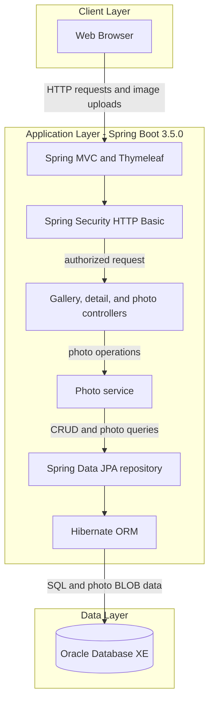
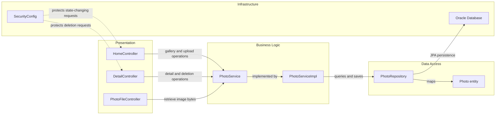

# Architecture Diagram

The application serves a browser-based photo gallery, accepts image uploads, and stores photo records and binary content in a relational database.

## Application Architecture

### Technology Stack Summary

| Layer | Technology | Version | Purpose |
|---|---|---:|---|
| Presentation | Spring MVC and Thymeleaf | Spring Boot 3.5.0 | Renders the gallery and photo detail pages and receives upload/delete requests |
| Security | Spring Security | Managed by Spring Boot 3.5.0 | Protects state-changing requests with stateless HTTP Basic authentication |
| Business logic | Spring service components | Spring Boot 3.5.0 | Validates image uploads, persists photos, and supports gallery navigation |
| Persistence | Spring Data JPA and Hibernate | Hibernate 6.6.15.Final | Repository access and ORM mapping |
| Database | Oracle Database XE | 21.3.0-xe in Compose | Stores photo metadata and binary content |

### Data Storage & External Services

Oracle Database XE is the only application data store. The `Photo` entity keeps image bytes in a database LOB; no cache, message broker, or external application API was identified.

### Key Architectural Decisions

- Uses Spring MVC controllers, a service layer, and a Spring Data JPA repository.
- Stores uploaded images in the database rather than on the application filesystem.
- Uses server-rendered Thymeleaf pages alongside a JSON response for uploads.

## Component Relationships

### Component Inventory

| Component | Layer | Type | Responsibility |
|---|---|---|---|
| `HomeController` | Presentation | Spring MVC controller | Displays the gallery and handles multi-file uploads |
| `DetailController` | Presentation | Spring MVC controller | Displays a photo and handles deletion |
| `PhotoFileController` | Presentation | Spring MVC controller | Serves stored photo bytes |
| `PhotoService` | Business Logic | Service interface | Defines photo retrieval, upload, deletion, and navigation operations |
| `PhotoServiceImpl` | Business Logic | Service | Applies upload checks and coordinates persistence |
| `PhotoRepository` | Data Access | Spring Data JPA repository | Retrieves and persists `Photo` records |
| `Photo` | Data Access | JPA entity | Represents photo metadata and stored binary content |
| `SecurityConfig` | Infrastructure | Security configuration | Configures HTTP Basic authentication and access rules |
