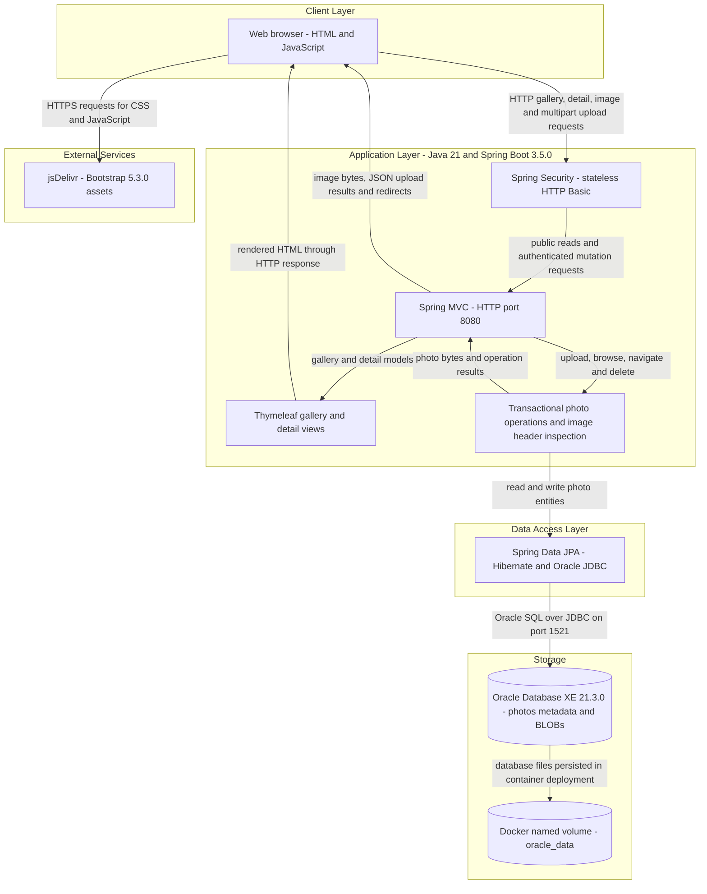
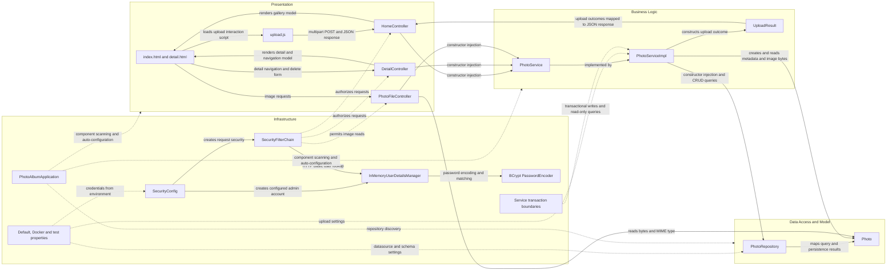

# Architecture Diagram

Photo Album is a single-module Java web application that provides a public photo gallery and authenticated upload and deletion operations. This factual assessment is based on the Maven build, Java sources, templates, browser script, application profiles, Dockerfile, and Docker Compose configuration; it describes declared architecture, not a verified running deployment.

## Application Architecture

### Technology Stack Summary

Versions below are verified declarations in repository files, not measurements of installed or deployed software. Where a library has no explicit version in `pom.xml`, its exact resolved version is not asserted.

| Layer | Technology | Version | Purpose |
|---|---|---|---|
| Application | Photo Album Maven artifact `com.photoalbum:photo-album` | 1.0.0 | Single executable JAR application. |
| Runtime | Java / Eclipse Temurin | Java 21; runtime image `eclipse-temurin:21-jre` | Compiler source and target level and container runtime; patch version is not pinned. |
| Build | Maven / Eclipse Temurin build image | `maven:3.9.9-eclipse-temurin-21` | First stage of the Docker build packages the application, skipping tests. |
| Application framework | Spring Boot | 3.5.0 | Parent dependency management, auto-configuration, startup, and executable JAR packaging. |
| Presentation | Spring Boot Web and Thymeleaf starters | 3.5.0 through the Boot parent | MVC routing and server-side HTML; underlying Spring MVC, servlet container, and Thymeleaf versions are not explicitly pinned. |
| Browser UI | Bootstrap | 5.3.0 | Responsive CSS and bundled JavaScript loaded from jsDelivr in templates. |
| Browser UI | Plain JavaScript and Fetch API | No version declared | Drag-and-drop/file-picker uploads, client-side checks, and gallery DOM updates. |
| Security | Spring Boot Security starter | 3.5.0 through the Boot parent | HTTP Basic authentication and request authorization; underlying Spring Security version is not explicitly pinned. |
| Persistence | Spring Boot Data JPA starter | 3.5.0 through the Boot parent | Repository abstraction, Hibernate entity mapping, and transactional persistence; underlying Hibernate version is not explicitly pinned. |
| Database connectivity | Oracle JDBC `ojdbc8` | Boot-managed; no explicit driver version | Runtime Oracle connection using `oracle.jdbc.OracleDriver`. The artifact name is not the application Java version. |
| Storage | Oracle Database Express Edition | Compose image tag `21.3.0-xe` | Application database, using the `XE` JDBC SID in configuration. |
| Validation | Spring Boot Validation starter | 3.5.0 through the Boot parent | Jakarta Bean Validation annotations on photo metadata. |
| JSON | Spring Boot JSON starter | 3.5.0 through the Boot parent | Serialization of upload result response maps. |
| Image metadata | Java ImageIO | JDK 21 API | Header-based image dimension inspection without a full image decode. |
| Utility dependency | Apache Commons IO | 2.14.0 | Declared dependency; no direct usage identified in the inspected application Java sources. |
| Test persistence | H2 | Boot-managed; no explicit engine version | In-memory database for the `test` profile, not the normal application database. |
| Deployment | Docker multi-stage build and Docker Compose | Tool versions not declared | Separate application and Oracle containers connected by a bridge network. |

Evidence: `pom.xml`, `Dockerfile`, `docker-compose.yml`, `src/main/resources/templates/{index,detail,layout}.html`, and `src/test/resources/application-test.properties`.

### Data Storage & External Services

Oracle is the application's primary data store. `Photo` maps to the `photos` table with a UUID string key, original filename, byte count, MIME type, upload timestamp, optional image dimensions, and a `photo_data` binary large object (`@Lob byte[]`). An index covers `uploaded_at`. Uploaded content is stored in the database and served through `/photo/{id}`; the bundled file in `static/uploads` is not the upload persistence mechanism. `PhotoRepository` combines inherited JPA CRUD with native Oracle queries using `NVL`, `ROWNUM`, `SYSDATE`, and `DUAL`.

The default profile targets `localhost:1521:XE`; the Docker profile targets `oracle-db:1521:XE`, with environment-variable overrides for connection details and credentials. Compose persists Oracle files in `oracle_data`, mounts `oracle-init` startup scripts, and waits for database health before starting the application. Both normal profiles specify `spring.jpa.hibernate.ddl-auto=create`: database file persistence does **not** imply preservation of application table contents across application starts because Hibernate recreates its schema. The test profile instead uses H2 `jdbc:h2:mem:testdb` with `create-drop`.

The only identified external web service is jsDelivr, contacted by the browser for Bootstrap assets, not by the backend. No application cache, message broker, object-storage service, email service, or external backend API client was identified in the inspected source and configuration.

### Key Architectural Decisions

- **Layered monolith with constructor injection:** MVC controllers depend on the `PhotoService` interface; one transactional implementation depends on one Spring Data repository. The same application renders HTML, returns upload JSON, and streams database-backed image responses. There is no separately deployed API or frontend service.
- **Database-backed binary content with Oracle coupling:** metadata and image bytes share one entity/table. Native Oracle SQL makes the repository database-specific despite JPA abstractions. Gallery queries select binary content as well as metadata; image responses use no-cache headers rather than an application cache. Upload checks cover declared MIME type, nonempty content, a 10 MiB per-file limit, and a 40-million-pixel limit when ImageIO can identify dimensions; requests are limited to 50 MB by multipart configuration. `max-files-per-upload=10` is configured but is not consumed by the inspected controller/service.
- **Public reads, authenticated mutations:** `SecurityConfig` requires authentication for `POST /upload` and `POST /detail/*/delete`, permits other requests, disables CSRF, and uses stateless HTTP Basic. An environment-configured administrator is held in memory with a BCrypt-encoded password; no identity-provider integration or persistent user store is present. The configuration grants an ADMIN role but the endpoint rules check authentication, not that role. Application configuration declares HTTP on port 8080; no application TLS configuration was identified.

## Component Relationships

The diagram shows application components and cross-cutting wiring, not separate processes. Controllers receive the service interface through constructors; Spring injects its sole implementation, which receives the repository and upload settings through its constructor. Communication within the application is synchronous Java invocation; no event/listener or queue-based processing was identified.

### Component Inventory

| Component | Layer | Type | Responsibility |
|---|---|---|---|
| `PhotoAlbumApplication` | Infrastructure | Spring Boot entry point | Starts the application and enables auto-configuration and component discovery beneath `com.photoalbum`. |
| `HomeController` | Presentation | MVC controller with JSON endpoint | `GET /` loads newest-first gallery data; `POST /upload` processes multiple multipart files and assembles per-file success/failure JSON; handles multipart exceptions locally. |
| `DetailController` | Presentation | MVC controller | `GET /detail/{id}` loads the photo and adjacent-photo navigation; `POST /detail/{id}/delete` deletes and redirects with flash feedback. |
| `PhotoFileController` | Presentation | Binary HTTP controller | `GET /photo/{id}` returns a `ByteArrayResource` using stored bytes and MIME type, with no-cache headers; missing content returns 404. |
| `index.html`, `detail.html` | Presentation | Thymeleaf views | Gallery/upload UI and photo detail, navigation, and deletion UI; request images through `/photo/{id}`. |
| `layout.html` | Presentation | Thymeleaf layout template | Declares shared navigation, view/script placeholders, and Bootstrap asset links; the inspected index/detail pages also declare their own full documents. |
| `static/js/upload.js` | Presentation | Browser script | Checks file type/size, sends multipart uploads with Fetch, reports results, and inserts gallery cards without a page reload. |
| `static/css/site.css` | Presentation | Stylesheet asset | Application-specific styling referenced by templates. |
| `PhotoService` | Business logic | Service interface | Contract for photo listing, lookup, upload, deletion, and adjacent-photo retrieval. |
| `PhotoServiceImpl` | Business logic | Transactional Spring service | Validates uploads, inspects image dimensions through ImageIO, creates database-backed entities, delegates persistence, and resolves navigation results. |
| `UploadResult` | Business logic | Result DTO | Carries upload success, original filename, error message, and persisted photo ID back to the controller. |
| `PhotoRepository` | Data access | Spring Data JPA repository | CRUD for `Photo` keyed by string UUID and native Oracle queries for listing and timestamp navigation. |
| `Photo` | Data/model | JPA entity | Maps metadata and binary image content to `photos`; initializes UUID and upload timestamp; declares validation constraints and upload-time index. |
| `SecurityConfig` / `SecurityFilterChain` | Infrastructure | Security configuration and servlet filter chain | Configures stateless HTTP Basic, mutation endpoint authentication, public reads, and disabled CSRF. |
| `InMemoryUserDetailsManager` / `PasswordEncoder` | Infrastructure | Security beans | Holds the configured administrator and encodes/verifies its password using BCrypt. |
| Service transaction boundaries | Infrastructure | Spring transaction annotations | Class-level write transactions and explicit read-only transactions on service read operations. |
| `application.properties`, `application-docker.properties` | Infrastructure | Runtime configuration | Port, datasource, Oracle dialect, schema creation, multipart/upload validation settings, encoding, and logging levels. |
| `Dockerfile`, `docker-compose.yml`, `oracle-init` | Infrastructure | Packaging and deployment configuration | Builds/runs the JAR, defines the Oracle container/network/volume/health dependency, and provisions the application database user. |
| `PhotoAlbumApplicationTests`, `application-test.properties` | Test support | Spring Boot context test and profile | Runs a context-load test with H2 and test credentials; does not establish full Oracle-backed workflow coverage. |

Evidence: `src/main/java/com/photoalbum/{PhotoAlbumApplication.java,config/SecurityConfig.java,controller,service,repository,model}`, `src/main/resources/{templates,static,application.properties,application-docker.properties}`, `src/test`, `Dockerfile`, `docker-compose.yml`, and `oracle-init`.
