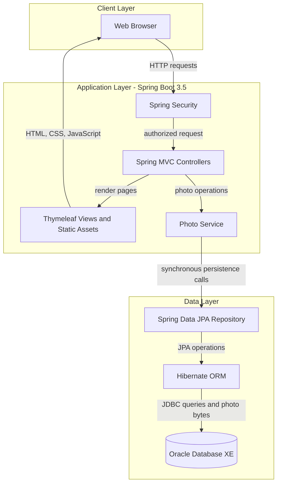
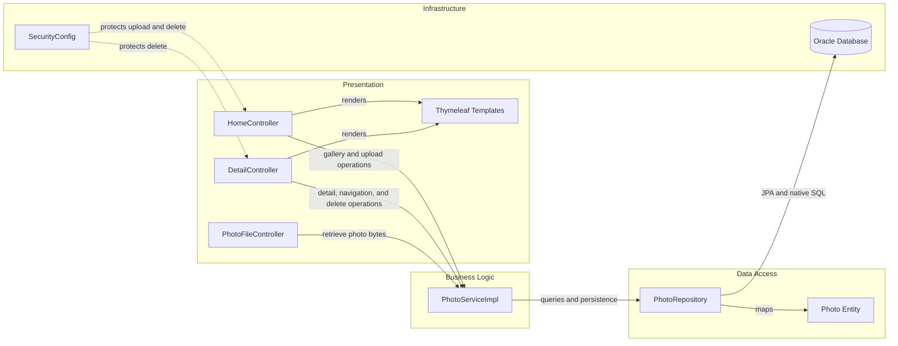

# Architecture Diagram

Photo Album is a single deployable web application with server-rendered gallery pages and synchronous requests to a relational database. Uploaded photo bytes and their metadata are stored together in Oracle.

## Application Architecture

### Technology Stack Summary

| Layer | Technology | Version | Purpose |
|---|---|---|---|
| Presentation | Spring MVC and Thymeleaf | Spring Boot 3.5.0; Thymeleaf 3.1.3.RELEASE | Server-rendered gallery and detail pages |
| Application | Java | 21 | Application runtime and business services |
| Security | Spring Security | 6.5.0 | HTTP Basic authentication for upload and delete operations |
| Persistence | Spring Data JPA and Hibernate | 3.5.0; Hibernate 6.6.15.Final | Repository abstraction and ORM |
| Database access | Oracle JDBC | 23.7.0.25.01 | Connectivity to Oracle |
| Database | Oracle Database XE | 21.3.0-xe in Compose | Photo metadata and binary storage |
| Build | Maven with Spring Boot parent | Maven wrapper metadata present; parent 3.5.0 | Dependency management and executable JAR packaging |

### Data Storage & External Services

Oracle is the only external application dependency. The application stores each photo's binary bytes and metadata in a relational table and serves image bytes from the database. No cache, message broker, remote API, or separate application service was identified.

### Key Architectural Decisions

- The application uses controller, service, and repository layers with constructor-injected dependencies.
- Photo uploads are persisted in the database rather than on a shared filesystem.
- Gallery reads are public; HTTP Basic authentication is required for state-changing upload and delete requests.

## Component Relationships

### Component Inventory

| Component | Layer | Type | Responsibility |
|---|---|---|---|
| HomeController | Presentation | MVC Controller | Displays the gallery and accepts multipart uploads |
| DetailController | Presentation | MVC Controller | Displays photo details, navigation, and deletion results |
| PhotoFileController | Presentation | MVC Controller | Serves stored photo bytes |
| PhotoServiceImpl | Business Logic | Spring Service | Validates uploads and coordinates photo retrieval, persistence, and deletion |
| PhotoRepository | Data Access | Spring Data JPA Repository | Reads and writes Photo records |
| Photo | Data Access | JPA Entity | Represents photo metadata and database-stored image bytes |
| SecurityConfig | Infrastructure | Spring Security Configuration | Configures stateless HTTP Basic authentication and endpoint authorization |
