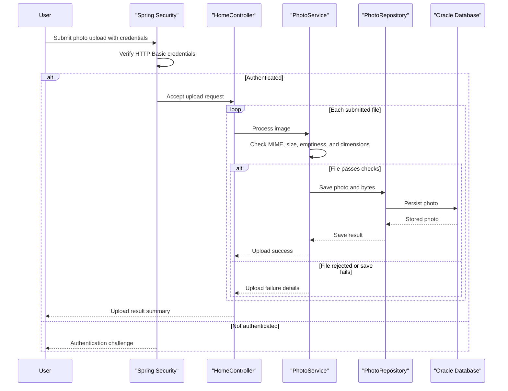

# Core Business Workflows

Photo Album lets users browse a gallery, upload image files, view full-size photos, navigate between neighboring photos, and delete stored photos.

## Domain Entities

| Entity | Service / Bounded Context | Description | Key Relationships |
|---|---|---|---|
| `Photo` | Photo Album / Photo Catalog | A user-uploaded image together with its display metadata and stored content | No other domain entity relationships identified |

## Service-to-Domain Mapping

| Service | Domain Context | Owned Entities | External Dependencies |
|---|---|---|---|
| Photo Album application | Photo Catalog | `Photo` | Oracle database |

## Primary Workflows

### Workflow 1: Upload photos

1. An authenticated user submits one or more files through the gallery upload form.
2. `HomeController` iterates through submitted files and invokes `PhotoServiceImpl`.
3. The service checks the MIME type, file size, and whether the file is empty. It reads the content, extracts image header dimensions when possible, and rejects images exceeding the 40-million-pixel limit.
4. The service creates a `Photo` and saves it through `PhotoRepository`; the controller returns JSON with successful uploads and failures.

Business rules include an allowed MIME list of JPEG, PNG, GIF, and WebP, a 10 MiB file limit, and the maximum image pixel count. A `max-files-per-upload=10` setting is declared but is not enforced by the controller.

### Workflow 2: Browse and view photos

1. A visitor opens the gallery. The application retrieves photos ordered by upload time and renders the page.
2. A visitor opens a detail page for a photo. The application retrieves that photo and requests older/newer records for navigation.
3. The photo content route retrieves the stored bytes and returns them using the recorded MIME type; missing photos or empty content produce a not-found response.

### Workflow 3: Delete a photo

1. An authenticated user submits a delete request for a photo identifier.
2. The service looks up the photo, returns not-found behavior if absent, or deletes it from the database.
3. The browser is redirected to the gallery with a success or error message.

## Cross-Service Data Flows

There are no independently deployed application services to aggregate. The application service uses its repository to read and write Oracle-backed photo records; image bytes are stored in the `Photo` record rather than a separate object-storage service.

## Business Workflow Sequence

## Business Rules & Decision Logic

- Uploads must use an allowed image MIME type, have non-empty content, and not exceed the configured per-file size. When dimensions can be extracted, uploads above 40 million pixels are rejected.
- Individual file processing failures are returned in the upload result; successful files are persisted independently.
- The configured per-request file count is 10, but the code does not currently enforce that setting.
- Gallery ordering is newest-first; detail navigation finds older and newer photos by upload timestamp.
- Upload and delete operations require authentication. Gallery viewing and photo retrieval are public.
- `PhotoServiceImpl` is transactionally scoped, with read-only annotations on retrieval operations. No cross-service saga or audit trail was identified.
