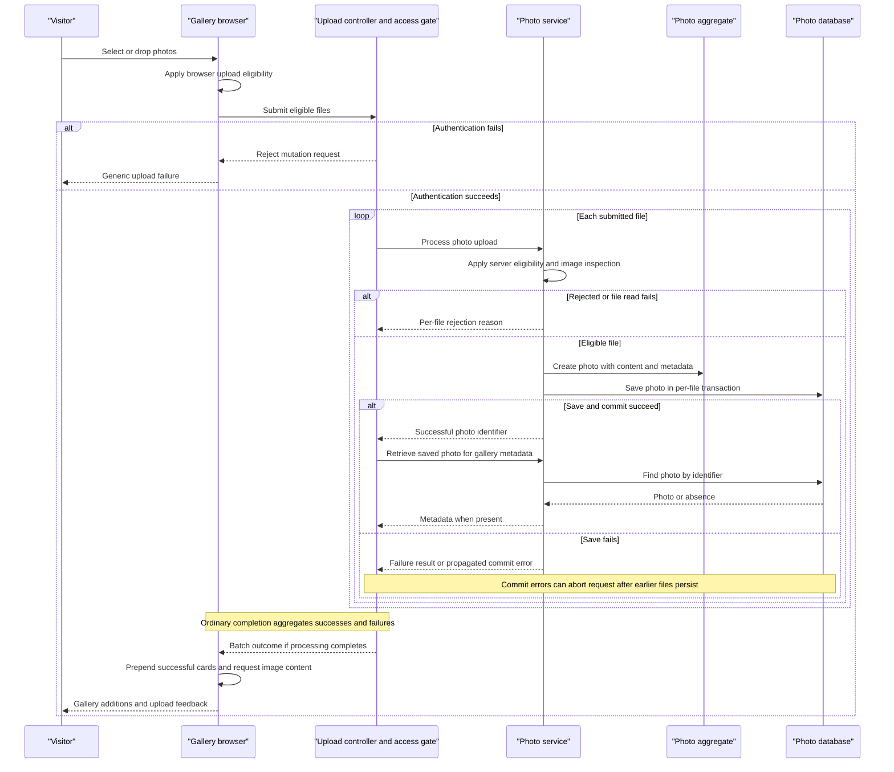

# Core Business Workflows

Photo Album lets visitors browse uploaded photos, inspect their metadata, and navigate between images. Authenticated users can add photos in batches and permanently delete individual photos.

## Domain Entities

| Entity | Service / Bounded Context | Description | Key Relationships |
| --- | --- | --- | --- |
| Photo | PhotoService / Photo Management | An individually uploaded image, its original content, and information used for gallery and detail presentation. The only persisted business entity and natural aggregate boundary. | Appears in the shared gallery; older and newer photos are located by upload time rather than explicit relationships. No owner or album entity exists. |
| UploadResult | PhotoService / Upload Processing | Transient per-file outcome identifying an accepted photo or explaining rejection. Not a persisted entity or independent aggregate. | A successful result references a Photo; the controller combines results into batch feedback. |

Evidence: `src/main/java/com/photoalbum/model/Photo.java:19-91`, `model/UploadResult.java:6-14`, and `service/PhotoService.java:13-54` (Java paths below are relative to `src/main/java/com/photoalbum/` unless otherwise stated).

## Service-to-Domain Mapping

This is one application, not a set of independently deployed domain services. The rows below describe internal responsibilities, not microservices.

| Service | Domain Context | Owned Entities | External Dependencies |
| --- | --- | --- | --- |
| PhotoService / PhotoServiceImpl | Photo Management and Upload Processing | Photo aggregate; creates UploadResult outcomes | PhotoRepository and the configured database; image-header inspection |
| HomeController | Gallery and Batch Upload presentation | No separate ownership; composes Photo metadata and UploadResult outcomes | PhotoService; gallery template and upload JavaScript |
| DetailController | Individual Photo presentation and deletion | No separate ownership; uses Photo | PhotoService; detail template |
| PhotoFileController | Image delivery | No separate ownership; reads Photo content | PhotoService; browser image requests |

PhotoRepository provides the shared persistence boundary; it is not another business service. The database is the source of truth for both image bytes and metadata. All controller-to-service exchanges are local calls; there are no domain events, remote domain services, gateway aggregation, or cross-context foreign keys in the inspected application.

Evidence: `controller/HomeController.java:25-107`, `controller/DetailController.java:19-79`, `controller/PhotoFileController.java:23-88`, `service/impl/PhotoServiceImpl.java:27-230`, `repository/PhotoRepository.java:16-62`.

## Primary Workflows

### Workflow 1: Upload a Batch and Update the Visible Gallery

1. On the gallery page, a visitor selects multiple files or drops them into the upload area. Selection immediately invokes the upload JavaScript; there is no separate upload button or authentication form.
2. JavaScript applies **Browser upload eligibility**, collects eligible files into one multipart request, and displays an uploading indicator. Ineligible files are not submitted.
3. The request enters through `POST /upload`. **Mutation authorization** must pass before controller processing. The controller applies **Batch presence** and processes files sequentially through PhotoService.
4. Each service invocation applies **Server upload eligibility** and **Image inspection**, reads the bytes, constructs a Photo, and saves bytes and metadata together. A new Photo receives an identifier and upload time under **Photo identity and lifecycle**.
5. The service returns a per-file UploadResult. For each reported success, the controller performs a separate lookup and constructs display metadata. Rejections become filename/error entries. There is no transaction spanning the whole batch.
6. An ordinarily processed batch returns HTTP 200 with successful metadata and failures; its success flag is true only when the successful metadata list is nonempty. Missing batch input takes the controller's HTTP 400 branch. Successful files remain saved even when other files fail.
7. JavaScript prepends returned photo cards without reloading, removing the empty-gallery message or creating a gallery container if needed. Each card causes a separate image-content request. Cards are inserted one at a time at the beginning, reversing response order visually; a later gallery reload applies database ordering.
8. Success feedback automatically hides after five seconds. Server per-file failures can be displayed alongside successes. Non-2xx responses and network/JSON errors produce generic messages, not the server's detailed error body.

**Actual presentation caveat:** client rejections call `showErrors`, but that function does not reveal the initially hidden feedback container. If the same selection contains eligible files, starting their upload hides the rejection list. Thus the intended client feedback is not reliably visible. JavaScript also does not explicitly supply credentials or offer login; authentication must be satisfied by the request/browser context.

**Reporting gap:** if the post-save lookup returns empty, the saved photo is omitted from both lists. If that lookup or a transaction commit throws, it can terminate the request rather than produce a per-file failure, while earlier committed uploads remain stored.

Evidence: `controller/HomeController.java:54-106`, `service/impl/PhotoServiceImpl.java:81-185`, `model/Photo.java:78-91`, `src/main/resources/static/js/upload.js:48-159,205-220`, `src/main/resources/templates/index.html:48-77`.

### Workflow 2: Browse the Shared Gallery and Display Image Content

1. `GET /` calls PhotoService to retrieve the gallery using **Gallery ordering**. The template renders filenames, upload times, sizes, and available dimensions, with links to details.
2. If retrieval fails, the controller logs the error and substitutes an empty list. The same “No photos yet” prompt is shown for both genuine emptiness and a database failure; no outage warning distinguishes them.
3. Gallery image elements independently request `GET /photo/{id}`. PhotoFileController looks up the Photo and applies **Image availability**.
4. Available bytes are served directly from the database with the stored MIME type. There is no thumbnail-generation workflow: gallery cards and detail pages request the same original content.
5. Missing data returns 404; unexpected lookup or response-construction errors return 500. There is no implemented placeholder-image fallback.
6. Images are served with no-cache/no-store response headers. Dynamically added cards also append a timestamp to image URLs; ordinary server-rendered gallery images do not use the timestamp model attribute.

Evidence: `controller/HomeController.java:38-50`, `controller/PhotoFileController.java:37-86`, `repository/PhotoRepository.java:23-29`, `src/main/resources/templates/index.html:81-113`, `src/main/resources/static/js/upload.js:161-202`.

### Workflow 3: Inspect a Photo and Navigate to Adjacent Uploads

1. `GET /detail/{id}` checks **Detail availability** and looks up the selected Photo.
2. For an existing Photo, the controller independently requests older and newer candidates using **Temporal navigation**. It adds the first candidate's identifier in each direction to the view.
3. The detail template presents the original image, filename, upload time, formatted size, MIME type, and dimensions when present. It shows navigation buttons only when candidate identifiers exist.
4. The image itself is retrieved through the independent content-delivery workflow, so rendered metadata does not guarantee the subsequent image request succeeds.
5. Invalid/missing photos or exceptions, including navigation-query failures, redirect to the gallery. Although the template contains a “Photo not found” branch, this controller does not render it for a missing record.

Evidence: `controller/DetailController.java:32-58`, `service/impl/PhotoServiceImpl.java:213-230`, `repository/PhotoRepository.java:37-62`, `src/main/resources/templates/detail.html:32-38,62-132`.

### Workflow 4: Delete a Photo and Return to the Gallery

1. The detail template offers a delete form. Browser confirmation cancels submission if declined; this is a UI safeguard, not a server-side approval rule.
2. Confirmed submission enters `POST /detail/{id}/delete`, subject to **Mutation authorization**.
3. PhotoService looks up the Photo. Absence returns false; presence triggers deletion of the single database entity, including its stored image content.
4. The controller redirects to the gallery in every handled outcome. It supplies a success flash message for deletion, “Photo not found” for absence, or a generic failure flash message after an exception; the gallery template renders these messages.
5. Deletion is permanent at the application level. There is no recycle bin, soft-delete state, filesystem cleanup, or compensating operation.

Evidence: `src/main/resources/templates/detail.html:50-59`, `controller/DetailController.java:64-78`, `service/impl/PhotoServiceImpl.java:190-209`, `src/main/resources/templates/index.html:37-46`.

### Workflow 5: Update Capability and Startup State

**No photo-update workflow is implemented.** There is no controller entry point, service operation, edit form, or JavaScript action for renaming, replacing image bytes, or editing metadata. Entity setters and the generic repository's persistence capabilities do not constitute an exposed business workflow. The visible “update” after uploading is a gallery DOM change, not mutation of an existing Photo.

Startup launches the application without a custom business initializer, seed process, scheduler, batch command, or event listener in the inspected source. However, both checked-in application profiles set `spring.jpa.hibernate.ddl-auto=create`; schema recreation on startup can discard existing photo state. Persistent storage should not be interpreted as an application guarantee that photos survive restarts under this configuration.

Evidence: `service/PhotoService.java:13-54`, the three controllers cited above, `src/main/resources/templates/index.html`, `src/main/resources/templates/detail.html`, `src/main/resources/static/js/upload.js`, `PhotoAlbumApplication.java:9-14`, `src/main/resources/application.properties:17-30`, `src/main/resources/application-docker.properties:13-27`.

## Cross-Service Data Flows

There are no cross-service business calls or circuit breakers to trace. Within the application:

- **Upload response composition:** browser files → HomeController → one PhotoService transaction per file → shared database; successful identifiers → separate PhotoService lookups → metadata response → new browser cards. Binary content is not included in this response.
- **Detail composition:** selected identifier → Photo lookup → separate older/newer queries using its upload time → template with photo information and navigation identifiers. These reads are not enclosed in a single controller-level transaction/snapshot.
- **Content composition:** a card/detail page supplies the photo identifier in an image URL; an independent browser request retrieves the bytes from the same database. There is no join with an external image store.
- **Degradation:** gallery lookup failure looks like an empty gallery; detail or navigation failure redirects home; content absence produces 404 and content exceptions produce 500. Upload and deletion failures use the outcomes described above, not a fallback service or queue.

**Filesystem/database consistency:** application code stores original image bytes and metadata in the same Photo record. There is no application-managed upload directory, filename-to-path mapping, file move, or separate durable filesystem write/delete to coordinate with database transactions. Request buffering and image-library temporary caching, if used by the runtime, are not business photo storage. Database-content consistency still has limits: nullable image content and permissive inspection mean a listed Photo need not have renderable bytes; post-upload reads and independent image requests can observe later deletion.

**Actual versus intended documentation:** `README.md:27-36` describes the original database-backed photo store and a future PostgreSQL/managed-identity/Azure deployment. The inspected implementation still uses database BLOB photo storage and database-specific navigation queries; those workshop migration goals are not implemented business flows. Read access is public and mutation access uses application HTTP Basic authentication, not per-photo ownership or a passwordless end-user flow.

## Business Workflow Sequence

The save-failure alternative distinguishes a caught save exception from a transaction-boundary exception; the latter does not guarantee the illustrated batch response.

## Business Rules & Decision Logic

### Validation and Eligibility

| Named rule | Actual decision and consequence | Evidence |
| --- | --- | --- |
| Browser upload eligibility | Accepts reported file types `image/jpeg`, `image/png`, `image/gif`, `image/webp`; rejects sizes greater than 10 × 1024 × 1024 bytes. Exactly the limit is allowed. Zero-byte files are not explicitly rejected here. File-picker `accept` is only a selection hint. | `src/main/resources/static/js/upload.js:60-88`; `templates/index.html:63` under resources |
| Batch presence | Controller returns HTTP 400 for a null/empty list; its MultipartException handler also returns HTTP 400 with “No files provided,” even when the multipart error has a different cause. Required-parameter binding may reject missing input before the explicit branch. | `controller/HomeController.java:58-67,100-106` |
| Server upload eligibility | Lowercases reported content type for membership in the configured allowed list; rejects a size above 10,485,760 bytes or a nonpositive size. A null content type causes the outer generic-error branch, not a specific MIME rejection. Submitted MIME is retained for storage; filename extension is not checked. | `service/impl/PhotoServiceImpl.java:85-118,154-160,178-182`; `src/main/resources/application.properties:23-30` |
| Image inspection | Reads image dimensions from the first available image reader's header; rejects a width × height product greater than 40,000,000. It does not fully decode, transcode, or verify declared MIME against detected content. No reader means acceptance without dimensions. IOException means rejection; other inspection exceptions are logged and processing continues without guaranteed dimensions. Thus allowed MIME alone does not prove a valid/renderable image, and WebP dimensions depend on available readers. | `service/impl/PhotoServiceImpl.java:33-34,111-152` |
| Entity constraints | Declares nonblank original filename (maximum 255 characters), nonnull positive file size, nonblank MIME (maximum 50 characters), and nonnull upload time. Image bytes are nullable; dimensions have no positivity annotations. These are entity/persistence constraints, not an explicit controller `@Valid` request-validation step, so persistence/provider enforcement and commit timing determine their failure path. | `model/Photo.java:28-75`; `controller/HomeController.java:58`; `service/impl/PhotoServiceImpl.java:164-182` |
| Batch capacity | Multipart configuration caps each file at 10MB and the request at 50MB. The configured `app.file-upload.max-files-per-upload=10` is not read/enforced by the service or browser; there is no implemented ten-photo count check. | `src/main/resources/application.properties:23-30`; `src/main/resources/application-docker.properties:19-27`; `service/impl/PhotoServiceImpl.java:36-47`; `controller/HomeController.java:69-91` |

### Availability, Ordering, and Lifecycle

- **Photo identity and lifecycle:** construction generates a UUID and local upload timestamp. A photo progresses from submitted bytes to a persisted Photo or a rejection, then can be read or permanently deleted. There is no explicit status field, moderation/approval state, or update transition. No filename uniqueness or content deduplication rule exists; repeated uploads create distinct photos. (`model/Photo.java:78-91`; `service/impl/PhotoServiceImpl.java:154-170,190-205`.)
- **Gallery ordering:** all photos are retrieved newest-first, without pagination or a secondary tie-breaker; the gallery query substitutes a generic MIME value for null stored MIME. That query substitution is not an upload validation rule or a guaranteed fallback on direct identifier lookup. (`repository/PhotoRepository.java:23-29`.)
- **Temporal navigation:** previous chooses the first older photo from a descending-time query capped at ten returned candidates. Next chooses the first newer photo in ascending order, additionally excluding uploads after database `SYSDATE`. Comparisons are strict, so photos with equal timestamps are not linked by these queries; there is no wraparound. Application-local timestamps and database time may differ. (`repository/PhotoRepository.java:37-62`; `service/impl/PhotoServiceImpl.java:217-230`.)
- **Detail availability:** blank identifiers, absent records, or lookup/navigation exceptions redirect to the gallery. **Image availability:** blank identifiers, missing records, or null/empty bytes return 404; unexpected exceptions, including invalid stored media type parsing, return 500. A metadata record can therefore be visible while its image fails. (`controller/DetailController.java:32-58`; `controller/PhotoFileController.java:37-86`.)
- **Computed display values:** dimensions are optional header-derived values; displayed dates and human-readable sizes are presentation calculations. Gallery sizes are rounded KB; detail sizes switch between bytes, KB, and MB. No pricing, quotas per user, relationship-maintenance rules, or business totals are implemented. (`src/main/resources/templates/index.html:101-107`; `src/main/resources/templates/detail.html:108-130`; `src/main/resources/static/js/upload.js:162-197`.)

### Transactions, Consistency, and Failures

- PhotoServiceImpl has class-level transactions; retrieval and navigation methods declare read-only transactions. Each controller-invoked upload/delete is its own service boundary. Batch processing, subsequent metadata lookups, and detail composition are not one atomic operation. (`service/impl/PhotoServiceImpl.java:27-29,52-74,190-229`; `controller/HomeController.java:69-91`.)
- Image content and its metadata are saved/deleted together as one database entity, with no dual-write filesystem consistency problem. There is no explicit flush before forming an upload success result, and an exception during transaction completion can escape the method's catch blocks. Catching save errors does not guarantee transaction recovery; the transaction may already require rollback. Deletion errors are wrapped as runtime exceptions and handled by the controller. (`service/impl/PhotoServiceImpl.java:154-184,190-209`.)
- There is no implemented retry, outbox, saga, compensating delete for upload-reporting failures, or reconciliation job. Concurrent reads/deletes can make a page or successful upload response stale. Schema recreation at startup is a separate durability risk, not a photo lifecycle rule. (`src/main/resources/application.properties:19`; `src/main/resources/application-docker.properties:15`.)

### Authorization and Audit

- **Mutation authorization:** the security filter requires authentication for upload and deletion POSTs using stateless HTTP Basic. It creates one configured in-memory administrator with ADMIN role, but these request matchers require only authentication, not an explicit role test. Other requests are permitted. There is no photo ownership field or per-resource authorization check; an authenticated caller can delete any photo. CSRF protection is disabled. Templates expose upload and delete controls without role-aware hiding. (`config/SecurityConfig.java:33-59`; gallery/detail templates.)
- Successful uploads/deletions, rejections, and exceptions are logged, but there is no persisted audit trail, recorded acting user, edit history, or domain-event history. Content delivery also logs filenames, sizes, and a short byte prefix for debugging; that is not an access-audit model. (`service/impl/PhotoServiceImpl.java:90-100,171-180,195-208`; `controller/PhotoFileController.java:45-72`.)

This document describes source-observed behavior; README workshop goals, comments, configured-but-unused settings, and template-only branches are not treated as implemented guarantees. No application execution or tests were performed for this source-based assessment.
