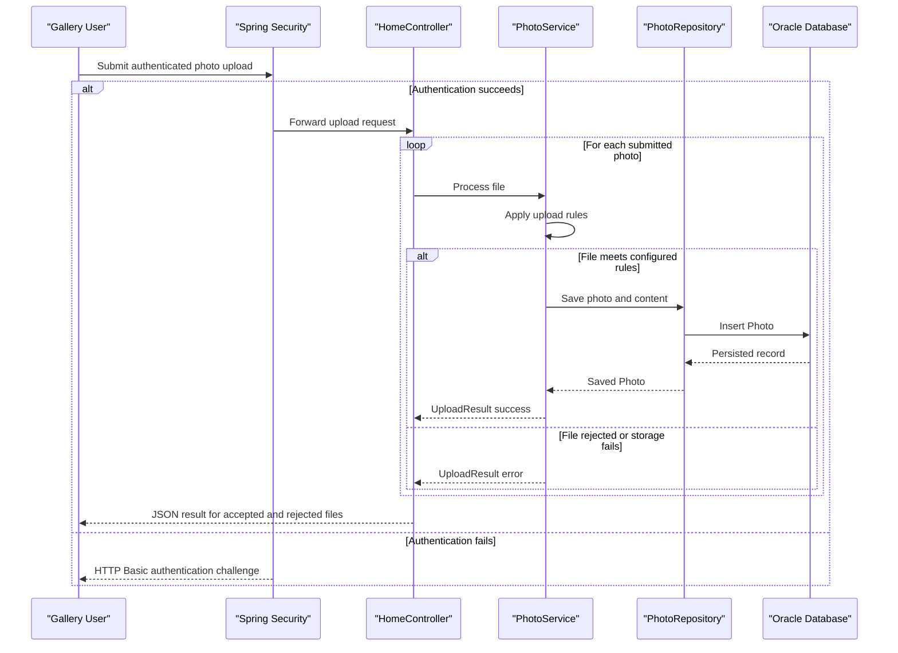

# Core Business Workflows

Photo Album lets users browse a gallery, upload image files, view individual photos, navigate by upload time, and delete photos. Photo records and image content are managed as one application-owned data set.

## Domain Entities

| Entity | Service / Bounded Context | Description | Key Relationships |
|---|---|---|---|
| Photo | photoalbum-java-app / Photo Gallery | An uploaded image with display metadata and stored image content | No other domain entities; previous/next navigation is based on upload time |
| UploadResult | photoalbum-java-app / Photo Gallery | Transient result of processing one upload | Refers to a saved Photo by identifier when successful; not persisted |

## Service-to-Domain Mapping

| Service | Domain Context | Owned Entities | External Dependencies |
|---|---|---|---|
| photoalbum-java-app | Photo Gallery | Photo | Oracle database |

The application is a single service and owns all photo data. There are no cross-service data flows, shared entities, or aggregation boundaries between services.

## Primary Workflows

### Workflow 1: Upload Photos

1. An authenticated user submits one or more multipart files through the gallery.
2. The controller handles each file independently and invokes the photo service.
3. The service applies its supported-image type, per-file size, non-empty file, and image-pixel checks.
4. The service stores accepted image bytes and metadata as a Photo record in Oracle and returns an UploadResult.
5. The controller retrieves successful records and returns lists of successful and failed uploads as JSON; one failed file does not prevent processing later files.

The configured per-request file count is 10, but the controller does not enforce that limit.

### Workflow 2: Browse and View Photos

1. A visitor opens the gallery; the service loads photos newest-first.
2. The browser requests a detail page for a selected photo.
3. The application loads the photo and finds older and newer records for navigation.
4. Image bytes are served from the Photo record when the browser requests the photo resource.

### Workflow 3: Delete a Photo

1. An authenticated user submits a delete action for a photo identifier.
2. The service looks up the record and deletes it from Oracle when present.
3. The controller redirects to the gallery with a success or not-found message.

## Cross-Service Data Flows

No inter-service composition exists. Controllers request photo data from the application service, which reads or writes the single Oracle-owned data set. Browser image retrieval is a separate synchronous request to the same application; no fallback to another storage provider is configured.

## Business Workflow Sequence

## Business Rules & Decision Logic

- Only configured image media types are accepted; the configured list contains JPEG, PNG, GIF, and WebP.
- An uploaded file must be non-empty and no larger than 10 MB.
- Image metadata extraction rejects images whose reported dimensions exceed 40 million pixels.
- A request body is limited to 50 MB. Although a maximum of 10 files is configured, that count is not enforced by the upload controller.
- Gallery results are ordered newest-first. Navigation looks up photos before and after the current upload time.
- Upload and delete require authentication; read-only gallery, detail, and photo-file requests are permitted.
- Service operations are transactional. Upload validation and persistence errors are returned as per-file results; deletion of a missing photo produces a not-found message.
- Successful uploads and deletions are logged. Authentication success and failure events are not explicitly audited by application listeners.
