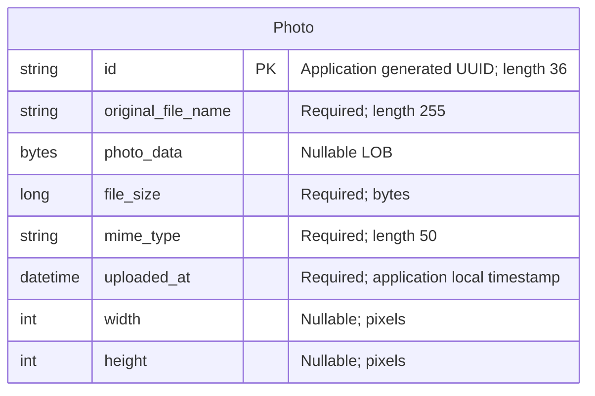

# Data Architecture & Persistence Layer

The data layer contains one Jakarta Persistence entity, `Photo`, accessed through Spring Data JPA/Hibernate. Oracle stores photo metadata and binary content together; the test profile substitutes an in-memory H2 database.

## Database Configuration

| Service/Module | DB Type | Profile | Driver | Connection | Migration Tool |
|---|---|---|---|---|---|
| Photo Album (`photo-album`) | Oracle; Compose specifies Oracle XE 21.3 | Default (no explicit profile) | `com.oracle.database.jdbc:ojdbc8`, runtime; `oracle.jdbc.OracleDriver` | Environment-overridable Oracle Thin JDBC connection, defaulting to local Oracle on port 1521 with SID XE; credentials externalized | No versioned migration tool declared; Hibernate recreates the mapped schema at startup |
| Photo Album (`photo-album`) | Oracle XE | `docker` | Same Oracle runtime driver | Environment-overridable Oracle Thin JDBC connection to the database host on port 1521 with SID XE; credentials injected externally | Same destructive Hibernate schema creation; startup scripts provision/check the schema account, not application table migrations |
| Photo Album tests | H2, in memory | `test` | `com.h2database:h2`, test scope; `org.h2.Driver` | Named in-memory JDBC database; no file-backed database configured | Hibernate creates the schema and drops it on persistence-context shutdown |

Evidence: `pom.xml:43-54,88-93`; `src/main/resources/application.properties:9-21`; `src/main/resources/application-docker.properties:1-17`; `src/test/resources/application-test.properties:1-10`; `docker-compose.yml:4,33-36`.

- **Schema lifecycle:** Default and Docker configurations request schema recreation, not incremental updates. Existing mapped photo data can therefore be lost when the application starts, even though Oracle database files have persistent storage configured (`docker-compose.yml:14-16`). No Flyway/Liquibase dependency, versioned migration, application `schema.sql`, `data.sql`, or `import.sql` was found in the inspected source/build configuration.
- **Initialization and seeds:** `oracle-init/01-create-user.sh:19-47` and `oracle-init/create-user.sh:21-42` provision the schema account and privileges. `oracle-init/02-verify-user.sql:1-14` checks the account/privileges, and `oracle-init/healthcheck.sql:1-3` checks connectivity. These are not photo seed scripts. The application entry point has no seeding runner (`src/main/java/com/photoalbum/PhotoAlbumApplication.java:9-14`).
- **Pooling:** Spring Data JPA's starter normally supplies Boot's default HikariCP pool. No explicit pool implementation override, sizing, timeout, or tuning is present in the three inspected profile configurations; actual runtime pool values were not measured.
- **Test fidelity:** The sole test activates `test` and loads the application context; it does not execute repository queries or verify Oracle/H2 behavioral equivalence (`src/test/java/com/photoalbum/PhotoAlbumApplicationTests.java:7-14`). H2 configuration has no explicit Oracle compatibility mode, while repository SQL uses Oracle-specific constructs.

For the complete property inventory, consult `configuration-inventory.md`; connection credential values are intentionally omitted here.

## Data Ownership per Service

| Service | Tables Owned | ORM Framework | Caching | Notes |
|---|---|---|---|---|
| Photo Album / `PhotoServiceImpl` | `photos` (`Photo`) | Jakarta Persistence / Hibernate through Spring Data JPA | No application entity/result cache configured | One table stores both image bytes and metadata; no outbox, audit table, join table, or persistent user entity found |

Evidence: `src/main/java/com/photoalbum/model/Photo.java:15-76`; `src/main/java/com/photoalbum/repository/PhotoRepository.java:15-16`; `src/main/java/com/photoalbum/service/impl/PhotoServiceImpl.java:27-46`. Authentication users are held in memory, not in a JPA table (`src/main/java/com/photoalbum/config/SecurityConfig.java:33-43`).

## Entity Model

`Photo` is defined in `src/main/java/com/photoalbum/model/Photo.java:15-76`. The diagram uses physical column names; there are no foreign keys or relationship cardinalities to draw.

| Java field | Java type | Persistence mapping |
|---|---|---|
| `id` | `String` | Primary key, length 36; constructor generates a UUID, rather than a database identity or sequence |
| `originalFileName` | `String` | Non-null `original_file_name`, length 255 |
| `photoData` | `byte[]` | Nullable `photo_data`, `@Lob`; binary data resides in the database |
| `fileSize` | `Long` | Non-null `file_size` |
| `mimeType` | `String` | Non-null `mime_type`, length 50 |
| `uploadedAt` | `LocalDateTime` | Non-null `uploaded_at`; initialized from the application clock, with no stored time-zone/offset |
| `width`, `height` | `Integer` | Nullable `width` and `height` |

The entity declares a nonunique index on `uploaded_at` (`Photo.java:16-18`), but no optimistic-lock `@Version`, entity relationships, cascade/orphan-removal rules, or explicit lazy loading for the LOB. UUID and timestamp initialization occurs in the constructor (`Photo.java:78-91`). `UploadResult` is a transient result object, not an entity (`src/main/java/com/photoalbum/model/UploadResult.java:6-10`).

**Binary/metadata consistency:** The upload service puts bytes and their metadata into the same entity/save operation, avoiding a separate database-to-filesystem commit boundary (`src/main/java/com/photoalbum/service/impl/PhotoServiceImpl.java:111-176`). Filename, file size, and MIME type come from the multipart object; size is not recomputed from the stored byte array and MIME type is not derived from the image reader. Dimensions come from image headers when a reader is available; unsupported/unreadable dimension extraction can leave them null. The stored bytes are not re-encoded or stripped of embedded metadata. No checksum, database rule tying `file_size` to LOB length, or automatic reconciliation is present in the inspected mapping/service. Because the LOB column is nullable, metadata-only rows are permitted by the mapping; binary serving explicitly treats null/empty data as unavailable (`src/main/java/com/photoalbum/controller/PhotoFileController.java:53-62`).

The test configuration retains an upload-directory setting, but the current service does not inject/use it. A tracked image exists under `src/main/resources/static/uploads/`; no inspected persistence code links it to `photos` or imports it as seed data. It should not be interpreted as a second active photo store.

**Transactions:** `PhotoServiceImpl` has class-level Spring `@Transactional`; its four read operations override this with read-only transactions (`PhotoServiceImpl.java:27-28,52-75,215-230`). Upload and deletion use the default write transaction. Deletion loads and removes the entity within that service transaction; failures are rethrown as runtime exceptions (`PhotoServiceImpl.java:190-209`). No distributed transaction, explicit isolation/locking, or custom propagation is configured.

Upload catches save failures and returns a failed result rather than propagating them (`PhotoServiceImpl.java:164-184`). This does not guarantee clean recovery: a repository failure may already mark the transaction rollback-only, and flush/commit failures can occur after the method body returns through the transaction interceptor. Success is set after `save`, not after an explicit flush. Multiple uploads are separate externally invoked service transactions, not one atomic batch; the controller loop itself has no transaction annotation (`src/main/java/com/photoalbum/controller/HomeController.java:58-91`).

## Key Repository Methods

| Service | Repository | Notable Methods | Purpose |
|---|---|---|---|
| Photo Album | `PhotoRepository extends JpaRepository<Photo, String>` | `List<Photo> findAllOrderByUploadedAtDesc()` | Native SQL returns all rows, newest first, including LOB bytes; uses Oracle `NVL` to substitute a MIME value in the query result |
| Photo Album | `PhotoRepository` | `List<Photo> findPhotosUploadedBefore(LocalDateTime uploadedAt)` | Bound timestamp parameter; strictly older rows ordered descending, limited to 10 by Oracle `ROWNUM` in an outer query |
| Photo Album | `PhotoRepository` | `List<Photo> findPhotosUploadedAfter(LocalDateTime uploadedAt)` | Bound timestamp parameter; strictly newer rows through Oracle server `SYSDATE`, ascending; uses `DUAL`, with no row limit |

Source: `src/main/java/com/photoalbum/repository/PhotoRepository.java:15-62`. All three custom methods use native `@Query` SQL rather than derived queries. Standard CRUD is inherited from `JpaRepository` and is not repeated in the table; the service uses inherited persistence operations for lookup, saving, and deletion. No custom bulk aggregation query, stored-procedure call, named query, or separate JDBC mapper was found.

Persistence implications:

- These are entity queries containing `photo_data`, not metadata-only projections. The gallery query is unbounded, and the newer-photo query can load many LOBs even though the service takes only the first returned entity (`PhotoServiceImpl.java:217-229`).
- Timestamp comparisons are strict and ordering has no ID tie-breaker. Equal-timestamp photos are not reachable through these before/after queries; deterministic ordering among timestamp ties is not specified.
- Newer-photo selection compares application-generated local timestamps with the database server clock. Future-dated records are excluded until database time catches up.
- `NVL` supplies a read-time fallback; it does not repair the stored MIME value or change the mapping's non-null requirement.

## Caching Strategy

| Layer | Observed strategy | Provider / TTL / eviction |
|---|---|---|
| Application and repository results | No Spring cache annotations/configuration or explicit cache-aside/read-through/write-through pattern found | No Redis, Ehcache, Caffeine, or JCache dependency/binding declared; no cache names, TTLs, or eviction policy configured |
| Hibernate | Ordinary persistence-context identity tracking; no explicit second-level or query-result cache configuration found | No configured external provider/regions; first-level tracking is not a shared cross-request cache |
| Photo responses | Explicit no-cache/no-store behavior; gallery adds a timestamp for cache busting | No response-cache TTL; this is cache prevention rather than a persistence cache |
| Authentication/session state | In-memory identity manager; stateless request authentication | No shared session cache configured |

Evidence: `pom.xml:30-101`; the three application property files; `src/main/java/com/photoalbum/controller/PhotoFileController.java:74-79`; `src/main/java/com/photoalbum/controller/HomeController.java:39-48`; `src/main/java/com/photoalbum/config/SecurityConfig.java:33-58`. The response-serving source explicitly intends to avoid caching; no broader performance rationale for omitting a data cache is documented. Database engine/internal buffer caches are outside what this source inspection establishes.

## Data Ownership Boundaries

The inspected project has one persistence-owning application module and one application database connection per active configuration. It is not a database-per-microservice topology: metadata and image content share the `photos` table and transaction boundary. H2 is an alternative test store, not a replica, read model, or additional production persistence tier.

Controllers obtain data through `PhotoService`, whose implementation accesses `PhotoRepository`; no cross-service REST data retrieval, shared-database access by another service, federation, or gateway aggregation is present in the inspected source. The same entity/repository serves reads and writes, with no CQRS split or event-driven synchronization. No owner/user/tenant foreign key or row-level ownership partition is modeled.

### Data Classification & Sensitivity

| Entity | Sensitive Fields | Classification (PII/PHI/PCI/None) | Controls in Place |
|---|---|---|---|
| `Photo` / `photos` | `originalFileName` can contain personal identifiers; `photoData` can contain identifiable people, private scenes, or embedded EXIF location/camera metadata | Potential PII, content-dependent; no dedicated PHI or PCI fields found, but uploaded content is unconstrained by those categories | Authentication gates configured upload/deletion operations; photo reads are public. No per-photo owner/tenant or field-level access control, masking, field encryption, or metadata stripping is implemented in the inspected code |
| `Photo` metadata | `id`, `fileSize`, `mimeType`, `uploadedAt`, `width`, `height` | No intrinsic PII/PHI/PCI identified in these fields alone; identifiers/timestamps can become sensitive when correlated with content | No separate field-level controls or masking |

No encryption-at-rest setting or application-level encrypted LOB mapping was found; Oracle infrastructure encryption cannot be confirmed from these files. Password hashing in the in-memory identity manager protects authentication passwords, not photo contents (`SecurityConfig.java:28-43`). No persistent credential/user entity is present.

Logging includes original filenames and photo IDs during upload and serving, and binary serving logs up to the first ten stored bytes without redaction (`PhotoServiceImpl.java:171-179`; `PhotoFileController.java:53-72`). Those logs can carry content-derived information beyond the database boundary. These are source-observed controls and exposure characteristics, not a runtime security assessment.
