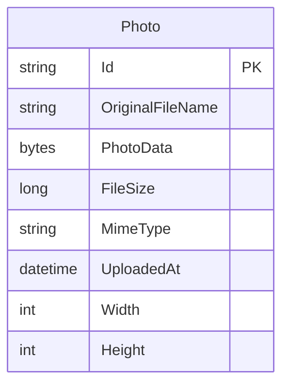

# Data Architecture & Persistence Layer

The application has one persisted domain entity, `Photo`, mapped with JPA/Hibernate to Oracle in development and Docker deployments. Tests use an H2 in-memory database.

## Database Configuration

| Service/Module | DB Type | Profile | Driver | Connection | Migration Tool |
|---|---|---|---|---|---|
| Photo Album | Oracle XE | Default | Oracle JDBC `ojdbc8` | Oracle XE at local port 1521; connection can be overridden by environment variables | None detected; Hibernate creates the schema |
| Photo Album | Oracle XE | `docker` | Oracle JDBC `ojdbc8` | Compose service `oracle-db` on port 1521 | None detected; Hibernate creates the schema |
| Photo Album tests | H2 | `test` | H2 | In-memory `testdb` | None detected; Hibernate creates and drops the schema |

## Data Ownership per Service

| Service | Tables Owned | ORM Framework | Caching | Notes |
|---|---|---|---|---|
| Photo Album application | `photos` | Hibernate via Spring Data JPA | None detected | `Photo` is the only JPA entity |

## Entity Model

Source: `src/main/java/com/photoalbum/model/Photo.java`. No entity relationships were identified.

The entity stores the original name, image bytes, size, MIME type, upload timestamp, and optional dimensions. It has validation annotations for required values, positive file size, and bounded name/MIME length. `PhotoServiceImpl` is transactionally scoped; retrieval methods are read-only.

## Key Repository Methods

| Service | Repository | Notable Methods | Purpose |
|---|---|---|---|
| Photo Album | `PhotoRepository` (`src/main/java/com/photoalbum/repository/PhotoRepository.java`) | `findAllOrderByUploadedAtDesc()` | Lists photos newest first using native Oracle SQL and `NVL` |
| Photo Album | `PhotoRepository` | `findPhotosUploadedBefore(LocalDateTime)` | Retrieves older photos for navigation using Oracle `ROWNUM` |
| Photo Album | `PhotoRepository` | `findPhotosUploadedAfter(LocalDateTime)` | Retrieves newer photos using Oracle `SYSDATE` and `DUAL` |

Standard CRUD operations are inherited from `JpaRepository<Photo, String>`.

## Caching Strategy

No application cache, cache annotations, cache provider, or Hibernate second-level cache configuration was detected.

## Data Ownership Boundaries

The single application service owns its data in one shared Oracle schema. All read and write operations pass through `PhotoServiceImpl` and `PhotoRepository`; there are no cross-service database access patterns, event flows, or CQRS boundaries. The native SQL uses Oracle-specific constructs, including `NVL`, `ROWNUM`, `SYSDATE`, and `DUAL`.

### Data Classification & Sensitivity

| Entity | Sensitive Fields | Classification (PII/PHI/PCI/None) | Controls in Place |
|---|---|---|---|
| `Photo` | Uploaded image content may include identifiable people; filename may contain user-provided information | Potential PII in image/file metadata; no PHI or PCI fields are modeled | No field-level encryption or masking is configured in the application; database platform encryption controls are outside this source assessment |

