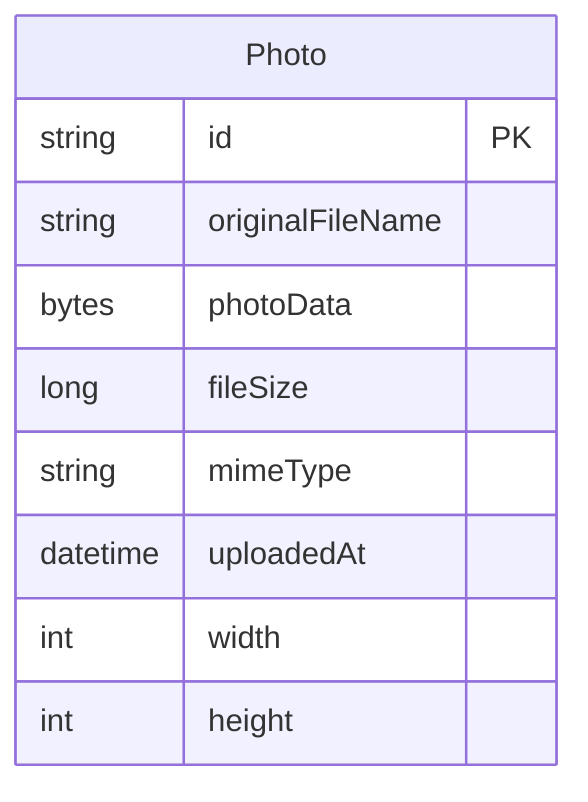

# Data Architecture & Persistence Layer

The data model contains one JPA entity and uses Hibernate through Spring Data JPA. Oracle is configured for the default and Docker runtime profiles, while tests use an in-memory H2 database.

## Database Configuration

| Service/Module | DB Type | Profile | Driver | Connection | Migration Tool |
|---|---|---|---|---|---|
| photoalbum-java-app | Oracle XE | Default | Oracle JDBC 23.7.0.25.01 | Environment-overridable Oracle JDBC URL; default local XE | None detected; Hibernate creates the schema |
| photoalbum-java-app | Oracle XE | docker | Oracle JDBC 23.7.0.25.01 | Environment-overridable URL to Compose Oracle service | None detected; Hibernate creates the schema |
| photoalbum-java-app | H2 in-memory | test | H2 2.3.232 | `jdbc:h2:mem:testdb` | None; Hibernate creates and drops the test schema |

The Oracle profiles use the Oracle dialect and `create` schema behavior. No Flyway, Liquibase, checked-in schema migration, or seed-data script was found. HikariCP is supplied transitively, with no explicit pool-size override identified. See `configuration-inventory.md` for the property inventory.

## Data Ownership per Service

| Service | Tables Owned | ORM Framework | Caching | Notes |
|---|---|---|---|---|
| photoalbum-java-app | `photos` | Hibernate / Spring Data JPA | None detected | Owns all application photo data in Oracle |

## Entity Model

`Photo` is declared in `src/main/java/com/photoalbum/model/Photo.java`. It has no entity relationships or foreign keys. `UploadResult` is an application result object, not a persisted entity. Service operations are transaction-managed with `@Transactional`; read operations are marked read-only.

## Key Repository Methods

| Service | Repository | Notable Methods | Purpose |
|---|---|---|---|
| photoalbum-java-app | `PhotoRepository` (`src/main/java/com/photoalbum/repository/PhotoRepository.java`) | `findAllOrderByUploadedAtDesc()` | Returns photos newest-first using Oracle SQL |
| photoalbum-java-app | `PhotoRepository` | `findPhotosUploadedBefore(LocalDateTime)` | Retrieves older photos for navigation |
| photoalbum-java-app | `PhotoRepository` | `findPhotosUploadedAfter(LocalDateTime)` | Retrieves newer photos for navigation |

The repository also inherits standard CRUD operations from `JpaRepository<Photo, String>`. Custom SQL is static and date parameters are bound through named parameters.

## Caching Strategy

No application cache, second-level Hibernate cache, or cache annotations were detected. Repository reads query the database directly.

## Data Ownership Boundaries

The application is a single service with one Oracle database; there is no cross-service data access, service-to-service aggregation, or CQRS split. The application service is the source of truth for photo metadata and image bytes. Reads and writes use the same relational model.

### Data Classification & Sensitivity

| Entity | Sensitive Fields | Classification (PII/PHI/PCI/None) | Controls in Place |
|---|---|---|---|
| Photo | `photoData`, `originalFileName` | Potential PII: user images can depict identifiable people and filenames may contain user-provided information | No application-level field encryption or masking is configured. Database-level encryption at rest is not established by the repository configuration. |

No health-record or payment-card fields were identified.
