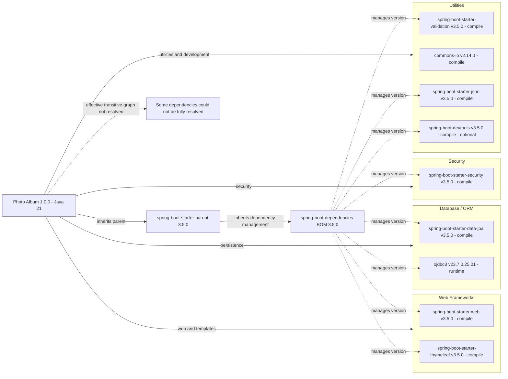

# Dependency Map

Photo Album (`com.photoalbum:photo-album:1.0.0`) is a Java 21 Maven application with **11 declared external dependencies: 9 non-test dependencies and 2 test dependencies** in `pom.xml`. This build-file-only map distinguishes explicitly declared versions, inherited managed versions, and unresolved effective transitive versions; parents and build plugins are not counted as application dependencies.

## Dependencies

### Dependency Summary

| Category | Count | Key Libraries | Notes |
|----------|-------|---------------|-------|
| Web Frameworks | 2 | `org.springframework.boot:spring-boot-starter-web:3.5.0`; `org.springframework.boot:spring-boot-starter-thymeleaf:3.5.0` | Both use default `compile` scope; versions inherited from Spring Boot dependency management. |
| Database / ORM | 2 | `org.springframework.boot:spring-boot-starter-data-jpa:3.5.0`; `com.oracle.database.jdbc:ojdbc8:23.7.0.25.01` | JPA uses default `compile` scope; Oracle explicitly uses `runtime`. Both versions are inherited managed versions, not local version declarations. |
| Security | 1 | `org.springframework.boot:spring-boot-starter-security:3.5.0` | Default `compile` scope; inherited managed version. |
| Utilities | 4 | `org.springframework.boot:spring-boot-starter-validation:3.5.0`; `commons-io:commons-io:2.14.0`; `org.springframework.boot:spring-boot-starter-json:3.5.0`; `org.springframework.boot:spring-boot-devtools:3.5.0` | All use default `compile` scope. Commons IO is explicitly pinned; the others inherit managed versions. Devtools has `optional=true`, not `runtime` scope. |
| **Total non-test** | **9** | **8 default compile; 1 explicit runtime** | Includes optional devtools; excludes both test dependencies. |

**Version provenance and boundaries:** The project declares `org.springframework.boot:spring-boot-starter-parent:3.5.0` with an empty `relativePath`; that published parent inherits `org.springframework.boot:spring-boot-dependencies:3.5.0`. There are no local BOM imports or dependency-management overrides. The published BOM manages the Spring Boot artifacts at `3.5.0`, Oracle through `oracle-database.version=23.7.0.25.01`, and H2 through `h2.version=2.3.232`. Only Commons IO has a version explicitly written on its local dependency declaration.

Sources are the local [`pom.xml`](../../../../../../pom.xml) (link relative to the final report location, `reports/report-20261021130521/facts`) and the published Maven [parent POM](https://repo.maven.apache.org/maven2/org/springframework/boot/spring-boot-starter-parent/3.5.0/spring-boot-starter-parent-3.5.0.pom), [dependency BOM](https://repo.maven.apache.org/maven2/org/springframework/boot/spring-boot-dependencies/3.5.0/spring-boot-dependencies-3.5.0.pom), and [test starter POM](https://repo.maven.apache.org/maven2/org/springframework/boot/spring-boot-starter-test/3.5.0/spring-boot-starter-test-3.5.0.pom). Managed versions are build-metadata evidence, not proof of a resolved dependency tree: this build-file-only map did not use a lockfile or resolved tree and did not run Maven resolution, builds, or tests. This limitation applies only to this map, not to the separate CVE scan, which is currently attempting `dependency:tree`; that scan's resolution outcome is not asserted here. BOM entries alone do not establish that a transitive library is present; effective transitive versions and conflict mediation remain unverified in this map.

### Version & Compatibility Risks

Spring Boot `3.5.0` is the initial 3.5 release rather than a later maintenance patch; review supported patch levels before modernization. Commons IO `2.14.0` is independently pinned and needs its own maintenance review. Preserve Java 21 and the Spring Boot 3 Jakarta-era compatibility baseline when changing framework components; validate the Oracle driver against the target JDK and database rather than inferring compatibility from the `ojdbc8` artifact name. Build metadata alone does not establish current end-of-life status or known vulnerability exposure.

### Notable Observations

- Scope totals across all 11 declarations are **8 default `compile`, 1 explicit `runtime`, and 2 explicit `test`**; none use `provided`. Optional devtools remains a direct compile dependency but is not propagated automatically to downstream consumers; optionality does not itself mean exclusion from every packaged artifact.
- The JSON starter is a JSON-support dependency, not an image-processing library, despite the local POM comment. Its possible overlap with the web starter cannot be treated as a resolved transitive relationship from the local declaration alone.
- No messaging, caching, logging, or observability dependencies are directly declared. This does not establish their absence from starter transitives; those libraries are excluded from the declared-dependency counts and main diagram.
- `org.springframework.boot:spring-boot-maven-plugin` is a declared build plugin with an inherited version, not a twelfth application dependency. The parent/BOM and test-support libraries listed below are likewise excluded from the nine-node application dependency count.

## Test Dependencies

| Framework | Version | Notes |
|-----------|---------|-------|
| `org.springframework.boot:spring-boot-starter-test` | `3.5.0` — inherited managed | Direct declaration with explicit `test` scope; aggregates Spring Boot and general-purpose test support. |
| `com.h2database:h2` | `2.3.232` — inherited managed | Direct declaration with explicit `test` scope; database support, not a test framework. |
| Spring Boot Test and Test Autoconfigure | `3.5.0` — published starter metadata | Indirect support via the test starter; not additional direct declarations. Effective resolved versions are unverified. |
| JUnit Jupiter; Mockito Core and Mockito JUnit Jupiter | `5.12.2`; `5.17.0` — published starter/BOM metadata | Indirect framework and mocking support, not directly declared dependencies. Effective resolved versions are unverified. |
| AssertJ; Awaitility; Hamcrest | `3.27.3`; `4.3.0`; `3.0` — published starter/BOM metadata | Indirect assertion and asynchronous-test support. Effective resolved versions are unverified. |
| Spring Test; JSONPath; JSONassert; XMLUnit Core | `6.2.7`; `2.9.0`; `1.5.3`; `2.10.1` — published starter/BOM metadata | Indirect Spring and structured-data test support. Effective resolved versions are unverified. |
| JSON Smart; Jakarta XML Bind API; Spring Core | `2.5.2`; `4.0.2`; `6.2.7` — published starter/BOM metadata | Other dependencies visible in the published test starter POM; supporting libraries rather than additional test frameworks. Effective resolved versions are unverified. |

Total test-scope dependencies: 2

The indirect support rows describe published starter metadata, not a complete resolved test graph, and do not increase the direct test dependency count. No Testcontainers, Oracle-specific integration-test dependency, or contract-testing dependency is directly declared; H2 does not by itself demonstrate Oracle behavior parity, and build-file inspection does not establish actual test coverage.
