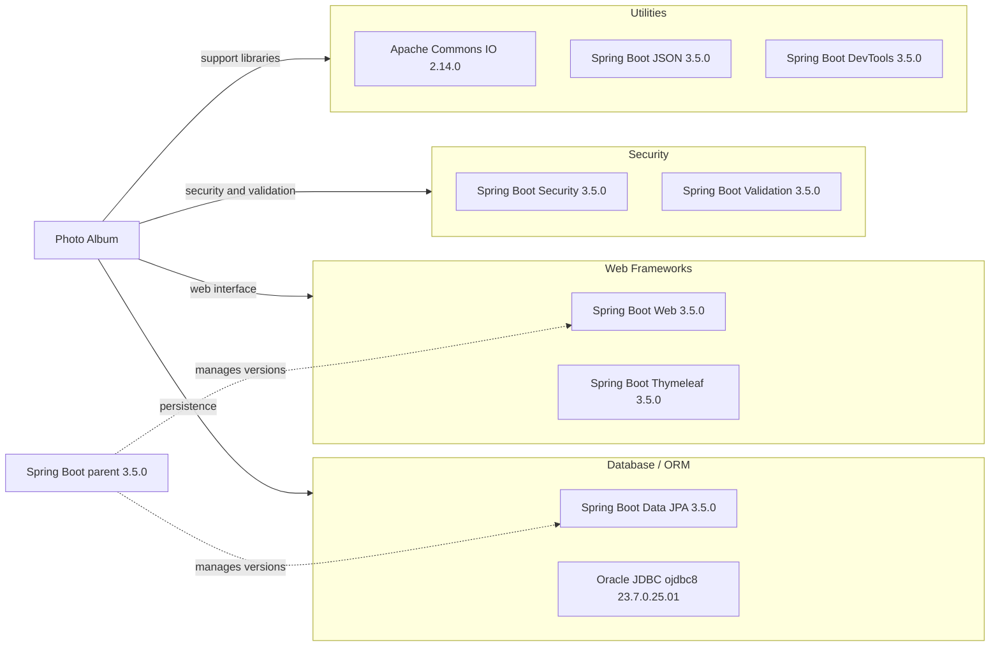

# Dependency Map

Photo Album declares 11 direct Maven dependencies; the Spring Boot parent manages versions for most Spring and test libraries.

## Dependencies

### Dependency Summary

| Category | Count | Key Libraries | Notes |
|---|---:|---|---|
| Web Frameworks | 2 | Spring Boot Web, Thymeleaf | Server-rendered UI and MVC handlers |
| Database / ORM | 2 | Spring Data JPA, Oracle JDBC | Oracle-specific SQL and persistence |
| Security | 2 | Spring Security, Validation | HTTP Basic authentication and input validation |
| Utilities | 3 | Commons IO, Spring Boot JSON, DevTools | DevTools is optional; JSON starter is also included through web dependencies |

### Version & Compatibility Risks

Spring Boot 3.5.0 and Java 21 are explicit project targets. Apache Commons IO 2.14.0 is independently versioned and should be tracked separately from the Spring Boot-managed dependencies. The Oracle JDBC driver is runtime-scoped and its resolved version is 23.7.0.25.01.

### Notable Observations

- The Spring Boot parent POM manages versions for most Spring, Hibernate, and test dependencies.
- `spring-boot-starter-json` overlaps with JSON support already brought in by the web starter.
- The application uses Oracle-specific SQL, so database-driver replacement alone would not establish portability.

## Test Dependencies

| Framework | Version | Notes |
|---|---:|---|
| Spring Boot Starter Test | 3.5.0 | Provides Spring test support, JUnit Jupiter, Mockito, AssertJ, and related libraries |
| H2 Database | Spring Boot managed | In-memory relational database used by the test profile |

Total test-scope dependencies: 2 declared dependencies.

The declared test setup contains a single Spring context-load test. The test profile uses H2; no dedicated database integration, contract-testing, or containerized test framework was identified.
