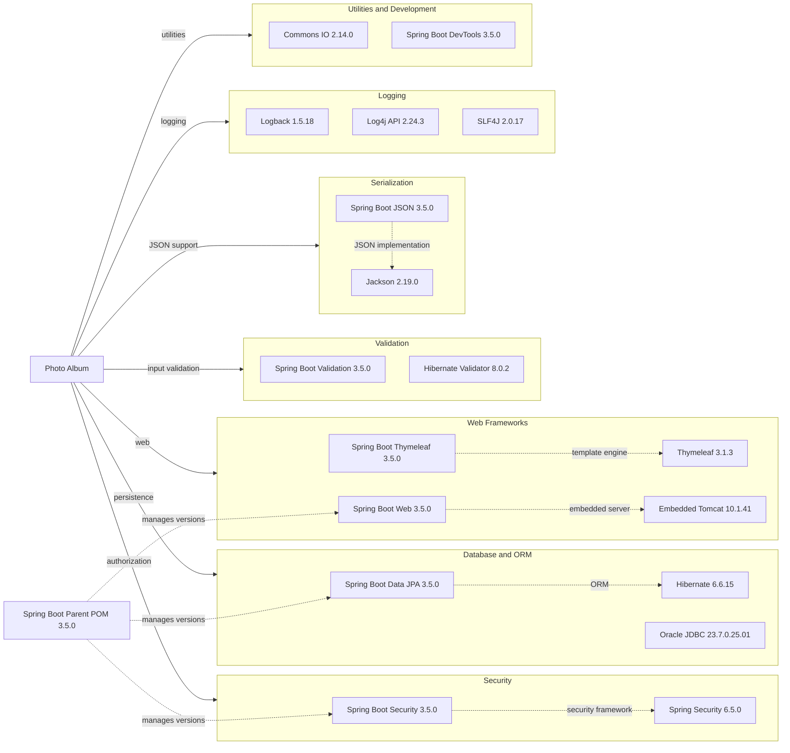

# Dependency Map

Photo Album declares 9 production dependencies and resolves 77 compile/runtime dependencies including transitives. The test scope adds 2 direct dependencies and 27 resolved test dependencies.

## Dependencies

### Dependency Summary

Counts below are declared production dependencies grouped by function; versions managed by the parent POM are resolved from the Maven dependency tree.

| Category | Count | Key Libraries | Notes |
|---|---:|---|---|
| Web Frameworks | 2 | Spring Boot Web, Spring Boot Thymeleaf | Spring MVC with embedded Tomcat and server-side templates |
| Database / ORM | 2 | Spring Data JPA, Oracle JDBC | Hibernate is transitive through the JPA starter |
| Security | 1 | Spring Boot Security | Spring Security protects write operations |
| Validation | 1 | Spring Boot Validation | Jakarta Bean Validation and Hibernate Validator |
| Serialization | 1 | Spring Boot JSON | Jackson is transitively managed |
| Utilities | 2 | Commons IO, Spring Boot DevTools | DevTools is optional; Commons IO is explicitly versioned |

### Version & Compatibility Risks

The GitHub advisory scan found 76 applicable medium-or-higher CVE advisories across resolved production dependencies. Affected resolved versions include Embedded Tomcat 10.1.41, Spring Framework 6.2.7, Spring Data Commons 3.5.0, Spring Security 6.5.0, Jackson 2.19.0, Thymeleaf 3.1.3.RELEASE, and Logback 1.5.18. See `security-assessment.md` for advisory details and patched-version references.

### Notable Observations

- The Spring Boot 3.5.0 parent POM manages most transitive Spring and framework versions.
- Oracle-specific JDBC and native SQL bind the application persistence layer to Oracle.
- Photo content is stored as a database LOB; no object-storage dependency is declared.
- The test scope resolves to 27 dependencies, including JUnit 5, Mockito, Spring Boot Test, and H2.

## Test Dependencies

| Framework | Version | Notes |
|---|---|---|
| Spring Boot Test | 3.5.0 | Test starter with Spring test support |
| JUnit Jupiter | 5.12.2 | Unit and application-context tests |
| Mockito | 5.17.0 | Mocking support |
| AssertJ | 3.27.3 | Assertion library |
| H2 | 2.3.232 | In-memory relational database for the test profile |
| JSONPath, Awaitility, Hamcrest, JSONAssert, XMLUnit | Resolved transitively | Test assertions and utilities |

Total test-scope dependencies: 27 resolved artifacts, including 2 direct declarations. The project includes a Spring application-context test and an H2 test profile; no separate contract-testing or container-based test framework was detected.
