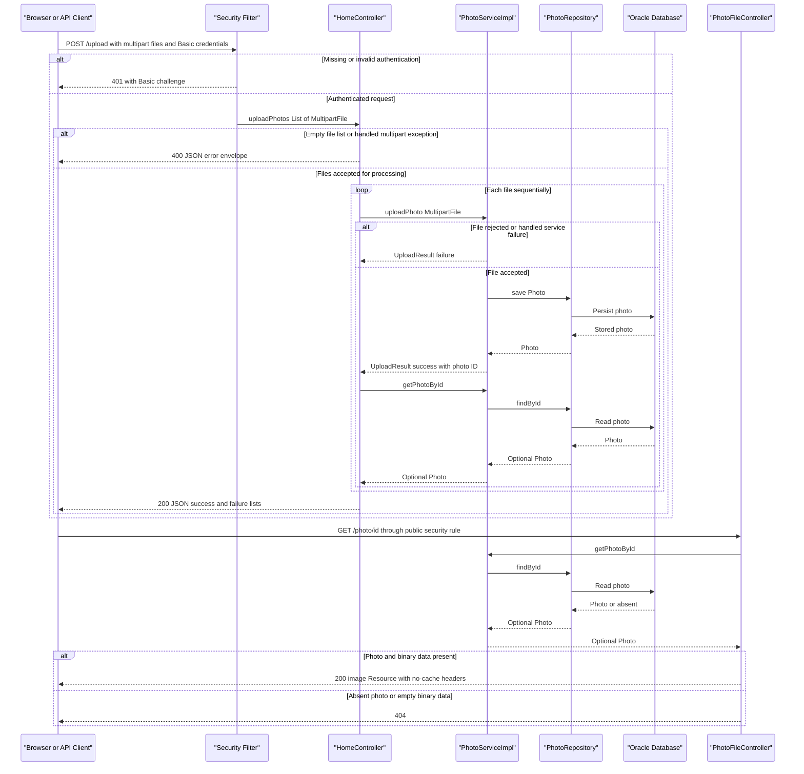

# API & Service Communication Contracts

Five explicit HTTP endpoint mappings expose gallery browsing, multipart uploads, image retrieval, and deletion. Browser requests and persistence calls are synchronous; uploads return JSON while gallery/detail requests render HTML.

## Service Catalog

| Service | Port | Category | Purpose |
|---|---|---|---|
| `photoalbum-java-app` / Maven `com.photoalbum:photo-album` | HTTP 8080, host/container | Business, with embedded API layer | Single source-built application serving the gallery, upload interface, and photo resources. |
| `oracle-db` | 1521 database listener; 5500 database management, host/container | Infrastructure | Third-party Oracle Database Express 21.3 container providing photo storage; not an application HTTP API. |

There is one Maven module and one independently deployable source-built application. Key dependencies are Spring Boot 3.5.0 Web/MVC, Thymeleaf, Data JPA, Validation, Security, Jackson through the JSON starter, and the Oracle JDBC driver. Oracle is a prebuilt image, not a source module. No gateway, discovery server, observability service, Kubernetes deployment, or Helm chart was found in the tracked deployment artifacts.

Evidence: `pom.xml:8-18,30-79`; `docker-compose.yml:1-45`; `Dockerfile:21-31`.

## API Endpoints Inventory

Paths are unversioned: no URL, header, or query-based version scheme was found. All mappings belong to `photoalbum-java-app`; there are no explicit PUT, PATCH, or DELETE mappings. Deletion uses POST.

| Service / Controller | Method | Path | Request Type | Response Type |
|---|---|---|---|---|
| App / `HomeController.index` | GET | `/` | No declared parameters or body | 200 HTML `index` view with `List<Photo>` model; loading errors produce an empty gallery rather than an error status. |
| App / `HomeController.uploadPhotos` | POST | `/upload` | `multipart/form-data`, repeated required `files` parts bound to `List<MultipartFile>`; HTTP Basic authentication | 200 JSON `Map<String,Object>` containing `success`, `uploadedPhotos`, and `failedUploads`, including partial or complete per-file failure; 400 JSON for an empty list or handled multipart exception; 401 without valid authentication. |
| App / `DetailController.detail` | GET | `/detail/{id}` | String path parameter identifying a photo | 200 HTML `detail` view with a `Photo` and previous/next navigation IDs; 302 redirect to `/` for blank/missing photo or caught exception. |
| App / `DetailController.deletePhoto` | POST | `/detail/{id}/delete` | String path parameter; no body DTO required; HTTP Basic authentication | 302 redirect to `/` with success/error flash message, including not-found and caught deletion failures; 401 without valid authentication. |
| App / `PhotoFileController.servePhoto` | GET | `/photo/{id}` | String path parameter; browser cache-busting query parameters are not bound by the controller | 200 `ResponseEntity<Resource>` backed by `ByteArrayResource`, content type from stored photo MIME type; 404 for blank ID, absent photo, or empty binary data; 500 for caught exceptions. |

Upload response handling distinguishes transport failure from item failure: clients must inspect the JSON result even after HTTP 200. A successful service upload is followed by a metadata lookup; only a present photo is added to the success list. Exceptions escaping service transaction completion or this lookup are not covered by a general upload-controller exception handler, so the normal JSON envelope is not guaranteed for every server error.

Image responses explicitly send `Cache-Control: no-cache, no-store, must-revalidate, private`, `Pragma: no-cache`, `Expires: 0`, and `X-Photo-ID`, `X-Photo-Name`, `X-Photo-Size`. No download-disposition header is set.

Framework-provided static resource handling serves assets such as `/css/site.css` and `/js/upload.js`; these are not additional business-controller mappings. Spring Boot's conventional `/error` handling is framework infrastructure, not a custom API contract.

Evidence: `src/main/java/com/photoalbum/controller/HomeController.java:38-107`; `src/main/java/com/photoalbum/controller/DetailController.java:18-78`; `src/main/java/com/photoalbum/controller/PhotoFileController.java:23-86`; `src/main/resources/static/js/upload.js:97-131,176-179`.

## Management & Observability Endpoints

| Service | Endpoint | Custom Metrics (if any) |
|---|---|---|
| `photoalbum-java-app` | No explicit health, Actuator, Prometheus, Swagger UI, or API-documentation endpoint found | No custom metric registrations or timing annotations found; application logging only. |
| `oracle-db` | Container publishes database management port 5500; no HTTP management path is declared in this repository | No application metric contract defined. |

Actuator and metrics-export dependencies are absent from `pom.xml`. Compose database readiness is not an application HTTP health endpoint.

Evidence: `pom.xml:30-101`; `docker-compose.yml:11-24`; controllers listed above.

## DTOs & Contracts

| Class / Type | API contract role | Mutability |
|---|---|---|
| `Photo` | Service-owned domain entity used in HTML view models and as the source of upload response metadata; not accepted as a JSON request body and not returned wholesale as JSON. | Mutable POJO with setters; not a record. |
| `UploadResult` | Internal service-to-controller outcome for each uploaded file; translated into the external map-based response rather than exposed directly. | Mutable POJO with setters. |
| `MultipartFile` / `List<MultipartFile>` | Framework multipart request contract for upload file parts. | Framework abstraction, not an application immutable DTO. |
| `Map<String,Object>` and nested lists/maps | Ad hoc external upload response and multipart-error envelope; no dedicated response class or formal schema. | Mutable collections. |
| `Resource` / `ByteArrayResource` | Binary image response body, not JSON. | Framework resource abstraction. |

There are no gateway-level aggregation DTOs or separate backend-service contracts. Entity field and persistence documentation belongs in `data-architecture.md`; validation details belong in `business-workflows.md`.

Jackson supplied by Spring Boot serializes the upload maps, including metadata timestamps. No custom serializer, Jackson configuration, OpenAPI/Swagger specification or annotations, protobuf schema, or GraphQL schema was found in the application artifacts. HTML rendering uses Thymeleaf. A successful upload response is a metadata projection, not an image payload; clients fetch the binary separately.

Evidence: `src/main/java/com/photoalbum/model/Photo.java:19-155`; `src/main/java/com/photoalbum/model/UploadResult.java:6-47`; `src/main/java/com/photoalbum/controller/HomeController.java:58-97`; `pom.xml:31-47,75-79`.

## Communication Patterns

- **Browser to application:** Same-origin HTTP requests, form submissions, and image loads. `upload.js` uses browser `fetch` with `FormData`. Its JavaScript `async`/`await` is not asynchronous service messaging: the HTTP response waits for upload processing.
- **Inside the application:** Controllers call `PhotoService` directly; `PhotoServiceImpl` calls `PhotoRepository` synchronously. Uploads process files sequentially, persist each photo, then retrieve its metadata. Detail rendering composes a photo and adjacent-photo navigation through local service calls, not gateway aggregation.
- **External dependency:** JPA/JDBC communicates with Oracle over its database protocol. Compose resolves the database by service hostname; standalone configuration targets a local database by default. There is no REST client, gRPC client, message broker, event bus, pub/sub, application service registry, or client-side load balancer.
- **Browser-only external assets:** Templates reference Bootstrap assets on jsDelivr over HTTPS. This is a browser CDN dependency, not a backend service call.
- **Resilience:** No application retry, circuit breaker, bulkhead, or explicit outbound request/query timeout policy was found. Framework/driver defaults are not an explicit service-level guarantee. Container restart-on-failure is a process policy, not a request retry. Gallery read errors fall back to an empty HTML gallery; detail errors redirect; deletion errors redirect with a flash message; image-serving errors return 500. Per-file upload failures generally become failure entries in a 200 response; there is no distributed compensation or fallback backend.
- **Availability:** In Compose, the application depends on database readiness. Database unavailability affects operations; full startup configuration belongs in `configuration-inventory.md`.
- **Authentication and authorization:** Stateless HTTP Basic authentication protects POST `/upload` and POST `/detail/*/delete`. An in-memory user has an ADMIN role, but route rules require only authentication, not a role check. Remaining requests are permitted by the security rules. Missing/invalid credentials on protected operations result in 401, with an HTTP Basic challenge. No JWT, OAuth2, form-login endpoint, or method-level authorization is implemented. CSRF protection is explicitly disabled.
- **Transport:** No application HTTPS/TLS listener, TLS enforcement, or TLS-terminating reverse proxy is configured in the inspected deployment files. HTTP Basic therefore requires deployment-level TLS for secure credential transport. Database transport encryption is not explicitly configured. Credentials are externally supplied; no credential values are reproduced here.
- **Client behavior:** The upload script does not construct an Authorization header or provide its own login flow; protected operations need an authenticated browser HTTP Basic context or an API client supplying credentials.

Evidence: `src/main/java/com/photoalbum/service/impl/PhotoServiceImpl.java:27-29,54-74,81-184,191-229`; `src/main/java/com/photoalbum/repository/PhotoRepository.java:15-62`; `src/main/java/com/photoalbum/config/SecurityConfig.java:28-59`; `src/main/resources/static/js/upload.js:90-131`; `src/main/resources/templates/layout.html`; `docker-compose.yml:26-46`.

## Service Technology Matrix

| Service | Web | Data Access | Discovery | Gateway | Actuator / Health | Cache | Metrics |
|---|---|---|---|---|---|---|---|
| `photoalbum-java-app` | Spring MVC, Thymeleaf, JSON and binary responses | Spring Data JPA / Hibernate, Oracle JDBC | No registry; Compose hostname for database | None | No application health endpoint | No application cache abstraction found; image responses disable HTTP caching | No exporter/custom metrics found |
| `oracle-db` | No application web framework | Oracle database server | Compose service DNS | None | Container database readiness check | Not an application cache service | No configured exporter |

## Service Communication Sequence

The upload flow illustrates authentication, sequential synchronous processing, item-level rejection, and subsequent public image retrieval. Dashed arrows denote replies, not broker messaging.

Uncaught upload exceptions and image-serving exceptions follow the error behavior described above; there is no circuit-breaker or retry branch to depict.
