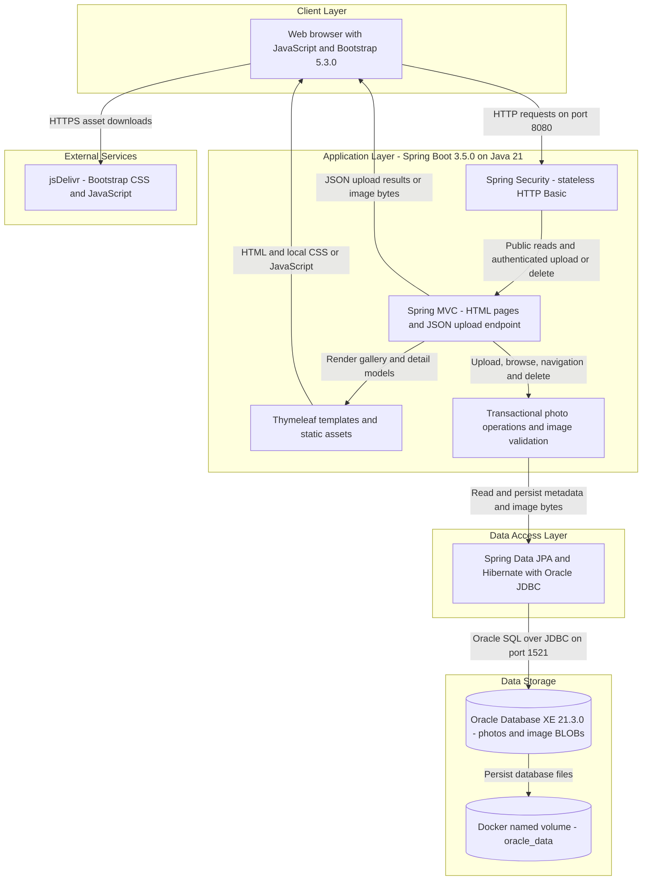
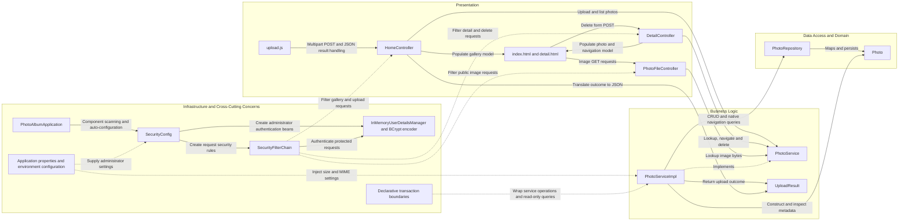

# Architecture Diagram

Photo Album is a single-module Java 21 Spring Boot application for browsing, uploading, viewing, and deleting photos. This source-based assessment describes the current implementation and Docker Compose topology; it does not imply a verified live deployment.

## Application Architecture

### Technology Stack Summary

| Layer | Technology | Version | Purpose |
|---|---|---|---|
| Runtime | Java / Eclipse Temurin | 21 | Application language and container JRE |
| Application | Spring Boot | 3.5.0 | Auto-configuration, executable JAR, and embedded servlet runtime |
| Presentation | Spring MVC and Thymeleaf | Managed by Spring Boot 3.5.0 | Server-rendered gallery/detail pages, multipart uploads, JSON responses, and binary image delivery |
| Browser | JavaScript Fetch API, Bootstrap | JavaScript version unspecified; Bootstrap 5.3.0 | Upload interaction and responsive UI; Bootstrap fetched from jsDelivr |
| Security | Spring Security and BCrypt | Managed by Spring Boot 3.5.0 | Stateless HTTP Basic and in-memory administrator authentication |
| Business logic | Spring transactions and Java ImageIO | Spring Boot-managed; Java 21 | Photo operations, MIME/size validation, image-header dimension extraction, and pixel-count limit |
| Data access | Spring Data JPA, Hibernate, Oracle JDBC `ojdbc8` | Managed by Spring Boot 3.5.0 | Entity persistence and Oracle-specific native queries |
| Storage | Oracle Database Express Edition | Compose image tag `21.3.0-xe` | Metadata and image BLOB storage in the `photos` table |
| Build and deployment | Maven, Docker, Docker Compose | Build image Maven 3.9.9; Docker/Compose versions unspecified | Multi-stage JAR build and application/database containers |

### Data Storage & External Services

Oracle is the sole application datastore. The `Photo` entity maps UUID identifiers, original filenames, MIME types, file sizes, timestamps, dimensions, and binary image data to `photos`; `photo_data` is a JPA large-object field. Uploads are stored in the database and served through `/photo/{id}`, not written to the bundled `static/uploads` directory. Compose persists Oracle files in `oracle_data`, mounts initialization scripts, and waits for database health before starting the application on the shared bridge network. Both default and Docker profiles configure Hibernate `ddl-auto=create`, so application startup recreates the mapped schema despite volume persistence. Database and administrator credentials are externally supplied; credential values are intentionally omitted.

The browser retrieves Bootstrap assets from jsDelivr. No server-side external API, object-storage service, cache, message broker, or external identity provider is evident in the inspected implementation. H2 is declared only as a test-scoped dependency, not the configured runtime datastore.

### Key Architectural Decisions

- A layered monolith uses constructor injection from MVC controllers through the `PhotoService` interface to its transactional implementation and a Spring Data repository. There is no separate networked business service.
- Images and metadata share Oracle persistence. Gallery ordering and adjacent-photo navigation use native Oracle SQL, including `NVL`, `ROWNUM`, and `SYSDATE`, tying repository behavior to Oracle.
- Read endpoints are public; upload and delete POST endpoints require authentication. `SecurityConfig` builds an in-memory administrator with BCrypt, enables stateless HTTP Basic, and disables CSRF. The inspected server configuration exposes HTTP; no TLS termination is defined here.

## Component Relationships

### Component Inventory

| Component | Layer | Type | Responsibility |
|---|---|---|---|
| `PhotoAlbumApplication` | Infrastructure | Spring Boot entry point | Starts the application and enables component scanning and auto-configuration |
| `HomeController` | Presentation | MVC controller | Handles `GET /`, multipart `POST /upload`, JSON upload responses, and multipart exceptions |
| `DetailController` | Presentation | MVC controller | Handles `GET /detail/{id}`, previous/next navigation, and `POST /detail/{id}/delete` with redirect messages |
| `PhotoFileController` | Presentation | MVC binary-resource controller | Handles `GET /photo/{id}` by returning database image bytes with MIME type and no-cache headers |
| `index.html`, `detail.html` | Presentation | Thymeleaf views | Render gallery cards, image detail, navigation, and deletion form |
| `layout.html` | Presentation | Thymeleaf layout template | Defines a shared page shell and view/script replacement slots; inspected page templates also include their own document shells |
| `upload.js`, `site.css` | Presentation | Browser assets | Implement upload UI and Fetch requests, update gallery cards, and provide local styling |
| `PhotoService` | Business logic | Service interface | Defines listing, lookup, upload, deletion, and adjacent-photo operations |
| `PhotoServiceImpl` | Business logic | Transactional Spring service | Injects repository and upload settings; validates files, extracts image dimensions with a 40-million-pixel limit, and orchestrates persistence |
| `UploadResult` | Business logic | Result DTO | Carries upload success, original filename, error message, and persisted photo identifier |
| `PhotoRepository` | Data access | Spring Data `JpaRepository<Photo, String>` | Provides CRUD and native SQL for gallery ordering and time-based navigation |
| `Photo` | Domain/data access | JPA entity | Models the `photos` table, including image bytes and metadata, with Jakarta validation annotations |
| `SecurityConfig` | Infrastructure | Spring configuration | Creates authentication beans and HTTP access policy |
| `SecurityFilterChain` | Infrastructure | Servlet security filter chain | Applies stateless HTTP Basic, public reads, authenticated upload/delete POST requests, and disabled CSRF |
| `InMemoryUserDetailsManager`, BCrypt encoder | Infrastructure | Authentication beans | Hold the externally configured administrator in memory and encode its password |
| Application properties and environment configuration | Infrastructure | Externalized settings | Supply Oracle connectivity, schema-generation policy, multipart limits, MIME allowlist, logging, and authentication settings |
| Declarative transaction boundaries | Infrastructure | Spring transaction interception | Apply service-level transactions and read-only overrides to photo read/navigation operations |

Evidence: `pom.xml`, `Dockerfile`, `docker-compose.yml`, `src/main/resources/application.properties`, `src/main/resources/application-docker.properties`, the application classes under `src/main/java/com/photoalbum`, and the templates/static JavaScript under `src/main/resources`. Framework versions not explicitly pinned are reported as Spring Boot-managed rather than independently inferred.
