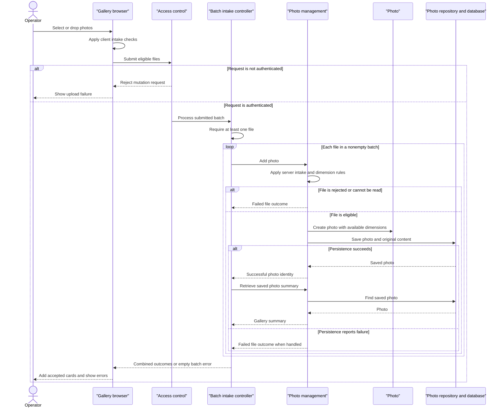

# Core Business Workflows

Photo Album lets visitors browse a shared photo collection and navigate individual images. Authenticated operators can add photos in batches and permanently remove photos.

## Domain Entities

| Entity | Service / Bounded Context | Description | Key Relationships |
| --- | --- | --- | --- |
| Photo | Photo management | A stored image with descriptive information used for gallery display and chronological navigation. The only persisted business entity. | Combines image content and metadata; related to neighboring photos through upload chronology, not explicit associations. |
| UploadResult | Photo intake | Transient outcome of an individual upload, not a persisted entity or aggregate. | Identifies a successfully created Photo or associates an error with the submitted filename. |

There is no persisted Album, User, ownership relationship, tagging system, or explicit DDD aggregate model. The gallery is a view over the shared Photo collection.

Evidence: `src/main/java/com/photoalbum/model/Photo.java:19-91`; `src/main/java/com/photoalbum/model/UploadResult.java:6-10`.

## Service-to-Domain Mapping

This is one application, not a set of independently deployed business services. The following rows describe internal responsibilities.

| Service | Domain Context | Owned Entities | External Dependencies |
| --- | --- | --- | --- |
| PhotoService / PhotoServiceImpl | Photo intake, browsing, and removal | Photo lifecycle; UploadResult outcomes | PhotoRepository and the configured database; image-header inspection |
| HomeController | Gallery presentation and batch intake orchestration | None; composes Photo summaries and upload outcomes | PhotoService |
| DetailController | Individual photo browsing and removal | None; composes current photo and navigation references | PhotoService |
| PhotoFileController | Image delivery | None; serves Photo content | PhotoService |
| SecurityConfig | Operator access control | No persisted business entities; configured in-memory operator account | Externally supplied credentials, intentionally not reproduced |

PhotoService is the application-level authority for photo changes; the database stores both original image bytes and metadata. Controllers share that authority rather than maintaining separate domain copies.

Evidence: `src/main/java/com/photoalbum/service/impl/PhotoServiceImpl.java:27-46`; controller constructors; `src/main/java/com/photoalbum/config/SecurityConfig.java:33-59`.

## Primary Workflows

### Workflow 1: Upload a batch and update the gallery

1. The visitor selects or drops files. The browser applies **Client intake checks**, submits eligible files to `POST /upload`, and displays progress.
2. The security boundary requires **Mutation authorization** before the controller processes the batch.
3. HomeController applies **Batch presence** and then calls PhotoService once per submitted file, in sequence.
4. PhotoService applies **Server intake checks**, reads the image bytes, and attempts **Image dimension inspection**.
5. An accepted file becomes a Photo with an identity and upload time, then is saved with its content. A rejected file produces an unsuccessful UploadResult without intentionally creating a Photo.
6. For a successful result, HomeController reads the saved Photo back to compose its gallery summary. Rejections become filename/error entries.
7. The controller returns combined successful and failed outcomes under **Batch outcome semantics**. The browser prepends successful photo cards and displays returned failures; each card subsequently fetches its image separately.

This is partial-success batch orchestration, not an all-or-nothing batch transaction. Earlier successful uploads are not compensated if a later file fails. A readback exception can abort the response after photos have already been committed.

Evidence: `src/main/resources/static/js/upload.js:48-158`; `src/main/java/com/photoalbum/controller/HomeController.java:56-107`; `src/main/java/com/photoalbum/service/impl/PhotoServiceImpl.java:80-184`.

### Workflow 2: Browse the collection and navigate a photo

1. A visitor opens `GET /`. HomeController requests all photos through PhotoService and renders the gallery using **Gallery ordering**.
2. If retrieval fails, the controller logs the failure and renders an empty collection. The same empty-gallery prompt appears for a genuinely empty collection; no stale collection is supplied.
3. Opening `GET /detail/{id}` loads the selected Photo, then queries older and newer photos through **Chronological navigation**. The view combines photo information with available neighbor links.
4. Invalid, missing, or failed detail retrieval redirects to the gallery; a failure in either neighbor lookup also takes this path.
5. The browser separately requests `GET /photo/{id}`. PhotoFileController applies **Content availability**, retrieves stored bytes, and serves the original content. It does not generate a thumbnail or transformed image.

Evidence: `src/main/java/com/photoalbum/controller/HomeController.java:38-50`; `src/main/java/com/photoalbum/controller/DetailController.java:32-58`; `src/main/java/com/photoalbum/controller/PhotoFileController.java:37-87`; `src/main/resources/templates/detail.html:62-94`.

### Workflow 3: Permanently remove a photo

1. The detail-page deletion form asks for browser confirmation before submitting `POST /detail/{id}/delete`.
2. After **Mutation authorization**, DetailController calls PhotoService.
3. PhotoService looks up the Photo. If absent, it returns false; otherwise, it removes the stored Photo, including its content.
4. The controller sets a success, not-found, or failure flash message and redirects to the gallery.

There is no soft-delete, recycle bin, approval step, or restore workflow. Browser confirmation is a presentation safeguard, not a server-side approval requirement.

Evidence: `src/main/resources/templates/detail.html:50-59`; `src/main/java/com/photoalbum/controller/DetailController.java:64-78`; `src/main/java/com/photoalbum/service/impl/PhotoServiceImpl.java:190-209`.

No scheduled business jobs, event listeners, message consumers, CLI business commands, or business-data initialization routines were found in the inspected application sources. The application entry point only starts the application (`src/main/java/com/photoalbum/PhotoAlbumApplication.java:9-14`).

## Cross-Service Data Flows

There are no inter-service business calls, gateway aggregation endpoints, domain events, or circuit breakers. All composition occurs inside the application:

- **Upload composition:** browser files → HomeController → PhotoService → PhotoRepository/database; accepted photo IDs are read back into summaries and combined with per-file failures. The browser joins image URLs and detail links to summaries using the Photo identity.
- **Detail composition:** DetailController combines the current Photo with older/newer lookup results from the same repository. Only navigation identities are added to the view; no other domain owns this information.
- **Content delivery:** gallery/detail markup references image identities; subsequent browser requests obtain bytes from that same persisted Photo. There is no external object-storage handoff.
- **Degradation:** gallery read failure yields an empty gallery, detail failure redirects home, missing/empty image content yields not-found, and unexpected image-delivery errors yield a server error. Upload failures are normally reported per file; there is no alternate storage or queued retry. Browser request failures show a generic retry message.

Evidence: `HomeController.java:69-97`, `DetailController.java:39-57`, `PhotoFileController.java:46-86` under `src/main/java/com/photoalbum/controller/`; `src/main/resources/static/js/upload.js:102-132,176-179`.

## Business Workflow Sequence

The diagram shows normal handled outcomes. Transaction-commit failures and summary-readback exceptions can escape per-file handling; the browser then receives a request-level failure rather than a complete batch report.

## Business Rules & Decision Logic

### Intake and validation

- **Client intake checks:** browser MIME allowlist accepts JPEG, PNG, GIF, and WebP; each selected file must be no larger than 10 MiB. Rejected files are excluded from submission. These checks do not replace server validation.
- **Batch presence:** null or empty file lists yield a bad-request response with a no-files error. The controller maps MultipartException to the same generic error.
- **Server intake checks:** the declared MIME type, lowercased, must match the configured allowlist; content must be nonempty and no larger than the configured maximum, currently 10,485,760 bytes. Missing MIME metadata triggers generic failure handling rather than a dedicated validation message. There is no explicit content-signature agreement check.
- **Image dimension inspection:** a recognized image reader inspects the first image's dimensions without fully decoding it. More than 40,000,000 pixels is rejected. No available reader or a non-I/O inspection exception permits continuation without dimensions; an IOException rejects the file. Consequently, upload acceptance does not guarantee that the content is a decodable image.
- **Photo validity:** entity annotations require a nonblank original filename of at most 255 characters, positive nonnull file size, nonblank MIME type of at most 50 characters, and nonnull upload time. Dimensions are optional. These are declared entity constraints, not a separate controller validator.
- **Transport versus business limits:** multipart configuration limits each file to 10 MB and a request to 50 MB. A configured maximum of ten files per upload is not read or enforced by the inspected controller, service, or browser code; it must not be treated as an implemented count rule.
- **Batch outcome semantics:** the response success flag is true only when at least one saved Photo was read back and added to the successful summaries. Mixed success is permitted; a processed batch with only failures still returns an ordinary successful HTTP response carrying failure outcomes. A successful save with no readback result contributes to neither outcome list. There is no duplicate-filename or content-deduplication rule.

Evidence: `src/main/resources/static/js/upload.js:60-88`; `src/main/java/com/photoalbum/controller/HomeController.java:63-106`; `src/main/java/com/photoalbum/service/impl/PhotoServiceImpl.java:33-46,85-182`; `src/main/java/com/photoalbum/model/Photo.java:31-82`; upload and multipart properties in `src/main/resources/application.properties` and `application-docker.properties`.

### Browsing, computed values, and lifecycle

- **Gallery ordering:** photos are listed newest first by upload time. No pagination or search workflow is implemented.
- **Chronological navigation:** previous means the nearest strictly older timestamp; next means the nearest strictly newer timestamp, additionally bounded by database current time. Equal-timestamp photos are not neighbors through these comparisons. Missing neighbors hide the corresponding navigation control.
- **Content availability:** blank identities, missing photos, or absent/empty stored bytes return not-found. Unexpected retrieval or response-construction failures return a server error. Image responses discourage caching so browsers request current stored content.
- **Lifecycle:** a submitted file is either rejected or becomes a stored Photo that is immediately available to the shared gallery; stored photos can be permanently removed. These are behavioral stages, not persisted status values.
- **Derived presentation:** upload time and identity are assigned at construction; dimensions come from image inspection when available. Views format upload dates and byte sizes, conditionally display dimensions, and derive navigation links. No pricing, quotas per operator, or aggregate financial calculations exist.

Evidence: `src/main/java/com/photoalbum/repository/PhotoRepository.java:23-62`; `src/main/java/com/photoalbum/service/impl/PhotoServiceImpl.java:213-229`; `src/main/java/com/photoalbum/controller/PhotoFileController.java:37-86`; `src/main/java/com/photoalbum/model/Photo.java:78-90`; `src/main/resources/templates/detail.html:103-131`.

### Cross-cutting behavior

- **Mutation authorization:** reads are public; upload and deletion POST requests require authentication. The configured account is assigned ADMIN, but the route rule checks authentication rather than that role. There is no photo ownership or per-photo permission check. Authentication uses stateless HTTP Basic; CSRF protection is disabled. No credential values are included here.
- **Transactions and integrity:** PhotoServiceImpl is transactional, with read-only annotations on retrieval/navigation methods. Each upload service invocation has its own transaction; HomeController does not wrap the batch in a shared transaction. A Photo stores its metadata and bytes together, with no bidirectional domain associations to maintain. Save exceptions are caught inside the service, but deferred commit errors may propagate after method return; a caught error is not proof of a committed success.
- **Error handling:** uploads use UploadResult for expected validation and handled storage errors. General retrieval/deletion failures are wrapped as runtime exceptions, then mapped by controllers to empty-gallery rendering, redirects/messages, or image-delivery errors. There are no compensating actions, dead-letter queues, or automatic business retries.
- **Audit/logging:** upload acceptance/rejection, database errors, deletion, and image retrieval are logged, including photo identifiers and filenames; image-serving debug logs also include a small byte prefix. This is operational logging, not a dedicated durable business audit trail.

Evidence: `src/main/java/com/photoalbum/config/SecurityConfig.java:33-59`; `src/main/java/com/photoalbum/service/impl/PhotoServiceImpl.java:27-28,53-74,164-208`; controller failure branches cited above.
