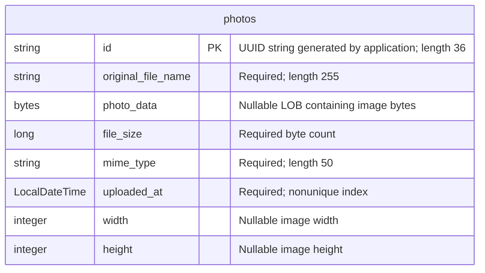

# Data Architecture & Persistence Layer

The data layer contains one JPA entity, `Photo`, persisted with Hibernate through Spring Data JPA. Oracle stores both photo metadata and binary image content; the test profile substitutes an in-memory H2 database.

## Database Configuration

| Service/Module | DB Type | Profile | Driver | Connection | Migration Tool |
|---|---|---|---|---|---|
| Photo Album | Oracle | Default | `com.oracle.database.jdbc:ojdbc8`; `oracle.jdbc.OracleDriver` | Local Oracle listener on port 1521, SID XE; connection can be overridden through the environment. Credentials: [REDACTED]. | None detected; Hibernate recreates the mapped schema at startup. |
| Photo Album | Oracle | `docker` | Same Oracle driver | Oracle host `oracle-db`, port 1521, SID XE; environment-overridable connection. Credentials: [REDACTED]. | None detected; Hibernate recreates the mapped schema at startup. |
| Photo Album tests | H2, in-memory | `test` | Test-scoped `com.h2database:h2`; `org.h2.Driver` | Named in-memory database `testdb`. Credentials: [REDACTED]. | None detected; Hibernate creates the schema and drops it when the persistence context closes. |

Sources: `pom.xml:43-54,88-93`, `src/main/resources/application.properties:9-21`, `src/main/resources/application-docker.properties:1-17`, and `src/test/resources/application-test.properties:1-10`.

- **Schema lifecycle:** Default and Docker startup schema recreation is destructive to existing mapped data; there is no versioned migration history. Oracle initialization scripts provision and verify the database user and grants, not application tables or photo seed records (`oracle-init/01-create-user.sh`, `oracle-init/create-user.sh`, `oracle-init/02-verify-user.sql`).
- **Pooling:** No explicit connection-pool tuning was found. HikariCP is the conventional auto-configured pool supplied transitively by the JPA starter; effective limits are framework defaults rather than repository-defined settings.
- **Seed data:** No SQL photo seed scripts or programmatic database seeding were found. A bundled image under `src/main/resources/static/uploads/` is a static resource, not a database seed.
- **Portability:** Repository native queries use Oracle functions and pseudo-tables; the H2 profile does not configure Oracle compatibility mode. The existing context-load test does not exercise those queries (`src/test/java/com/photoalbum/PhotoAlbumApplicationTests.java`).

For raw configuration properties and the full environment inventory, see the companion `configuration-inventory.md` assessment.

## Data Ownership per Service

| Service | Tables Owned | ORM Framework | Caching | Notes |
|---|---|---|---|---|
| Photo Album (`com.photoalbum`) | `photos` | Jakarta Persistence / Hibernate; Spring Data JPA | Transaction-scoped persistence context; no explicit application cache | `PhotoServiceImpl` accesses the single table through `PhotoRepository`; image bytes are stored in the same row as metadata. |

## Entity Model

Source: `src/main/java/com/photoalbum/model/Photo.java:15-81`.

| Java field | Java type | Persistence mapping |
|---|---|---|
| `id` | `String` | Primary key; UUID initialized in the constructor rather than database-generated. |
| `originalFileName` | `String` | Non-null filename column, maximum mapped length 255. |
| `photoData` | `byte[]` | Nullable large-object column; binary content is database-resident rather than a filesystem reference. |
| `fileSize` | `Long` | Non-null file-size column. |
| `mimeType` | `String` | Non-null column, maximum mapped length 50. |
| `uploadedAt` | `LocalDateTime` | Non-null timestamp initialized with the application clock; indexed by `idx_photos_uploaded_at`. |
| `width`, `height` | `Integer` | Optional dimension columns. |

There are no foreign keys, relationship mappings, bidirectional links, or cascade rules. The LOB has no explicit lazy-fetch annotation; custom repository queries include its bytes even when retrieving lists. `UploadResult` is a transient result object, not a persisted entity (`src/main/java/com/photoalbum/model/UploadResult.java`).

Transactions are defined at `PhotoServiceImpl` class level; read methods override this with read-only transactions (`src/main/java/com/photoalbum/service/impl/PhotoServiceImpl.java:27-28,53,67,216,226`). Writes use the same repository and transaction infrastructure; no distributed transaction configuration was found.

## Key Repository Methods

All methods below belong to `PhotoRepository extends JpaRepository<Photo, String>`, in `src/main/java/com/photoalbum/repository/PhotoRepository.java:15-62`. Standard inherited CRUD methods are omitted from the table; the service uses inherited lookup, save, and delete operations.

| Service | Repository | Notable Methods | Purpose |
|---|---|---|---|
| Photo Album | `PhotoRepository` | `List<Photo> findAllOrderByUploadedAtDesc()` | Native SQL returns every photo, including binary data, newest first; Oracle `NVL` supplies a fallback MIME type. No pagination is declared. |
| Photo Album | `PhotoRepository` | `List<Photo> findPhotosUploadedBefore(LocalDateTime uploadedAt)` | Native SQL filters older timestamps, orders descending, and limits output to ten rows with Oracle `ROWNUM`; supports adjacent-record lookup. |
| Photo Album | `PhotoRepository` | `List<Photo> findPhotosUploadedAfter(LocalDateTime uploadedAt)` | Native SQL filters newer timestamps up to the Oracle server's current date/time using `SYSDATE` and `DUAL`, ordered ascending; no row limit is declared. |

Timestamp inputs use named query parameters. No cross-service bulk lookup methods, stored procedure calls, or separate query repository were found.

## Caching Strategy

| Layer | Observed behavior | Provider / TTL / eviction |
|---|---|---|
| Application/entity results | No cache annotations or explicit cache provider found in source or dependencies. | No Redis, Caffeine, Ehcache, JCache binding, or configured result TTL. |
| Hibernate persistence context | Standard transaction-scoped entity identity tracking; not a shared application cache. | Hibernate first-level context; no explicit second-level or query-cache configuration found. |
| HTTP image responses | Image responses explicitly prohibit storage and require revalidation. | No browser/proxy cache TTL; no-store behavior in `src/main/java/com/photoalbum/controller/PhotoFileController.java:74-79`. |
| Authentication/session | Administrator identity is held in an in-memory user manager; security is stateless, not session-cached. | No distributed session store configured (`src/main/java/com/photoalbum/config/SecurityConfig.java:33-43,51-58`). |

No cache-aside, read-through, write-through, or write-behind implementation was found. The repository does not document a caching rationale; repeated photo retrievals rely on database access rather than a configured shared cache.

## Data Ownership Boundaries

One application module owns one logical photo datastore. All photo readers and writers share `PhotoRepository`; there is no database-per-service split, cross-service database access, external aggregation layer, or CQRS read-model separation. H2 is a separate test database, not an additional production data owner.

Metadata and image payloads share the `photos` table and transactional boundary. No external object store or active filesystem-backed persistence implementation was found in the service. The entity has no uploader identifier, owner relationship, or tenant column, so row ownership and tenant isolation are not represented in the data model.

### Data Classification & Sensitivity

| Entity | Sensitive Fields | Classification (PII/PHI/PCI/None) | Controls in Place |
|---|---|---|---|
| `Photo` | `photoData`, `originalFileName` | Potential PII: images may identify people and filenames may contain personal information. No explicit PHI or PCI fields; arbitrary uploaded content cannot be classified from code alone. | Writes require authentication; reads are public. No per-photo ownership checks, field masking, application-level encryption, or configured database encryption-at-rest was found. Image responses prohibit caching. |
| `Photo` | `id`, `fileSize`, `mimeType`, `uploadedAt`, `width`, `height` | None inherently; metadata can become identifying when linked to photo content. | Common application access policy; no field-level access controls or masking detected. |

Security evidence: `src/main/java/com/photoalbum/config/SecurityConfig.java:33-58`. Administrator credentials are environment-supplied and BCrypt-encoded for the in-memory identity manager; no persisted user entity exists. Database credentials and any credential values are intentionally redacted in this report.

Filename and photo identifiers are logged by the service; the binary-serving code also logs the first ten payload bytes (`src/main/java/com/photoalbum/service/impl/PhotoServiceImpl.java:171-172`, `src/main/java/com/photoalbum/controller/PhotoFileController.java:53-66`). No log-data masking was found. Database-side encryption or access policies outside this repository remain unverified.
