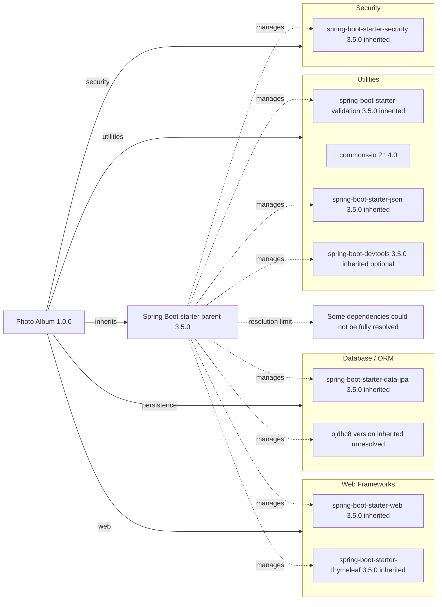

# Dependency Map

Photo Album (`com.photoalbum:photo-album:1.0.0`) declares 11 external dependencies in `pom.xml`: 9 non-test dependencies and 2 test dependencies. This map covers declared packages only; the parent POM and build plugin are listed separately and are not included in that count.

## Dependencies

### Dependency Summary

| Category | Count | Key Libraries | Notes |
|----------|-------|---------------|-------|
| Web Frameworks | 2 | `org.springframework.boot:spring-boot-starter-web`, `org.springframework.boot:spring-boot-starter-thymeleaf` — inherited 3.5.0 | Both use default `compile` scope. |
| Database / ORM | 2 | `org.springframework.boot:spring-boot-starter-data-jpa` — inherited 3.5.0; `com.oracle.database.jdbc:ojdbc8` — parent-managed, exact version unresolved | JPA uses default `compile` scope; Oracle driver uses `runtime` scope. |
| Security | 1 | `org.springframework.boot:spring-boot-starter-security` — inherited 3.5.0 | Default `compile` scope. |
| Utilities | 4 | `org.springframework.boot:spring-boot-starter-validation` — inherited 3.5.0; `commons-io:commons-io` — explicit 2.14.0; `org.springframework.boot:spring-boot-starter-json` — inherited 3.5.0; `org.springframework.boot:spring-boot-devtools` — inherited 3.5.0 | All use default `compile` scope; DevTools is optional. |
| **Total non-test** | **9** | | Test dependencies excluded. |

Version and scope evidence: `pom.xml:8–13,30–101`. Dependencies without a `<version>` rely on the parent-managed dependency set; Spring Boot artifacts are shown at the parent release version. No local BOM contents or lockfiles were found to establish the exact Oracle and H2 versions or enumerate transitive dependencies. No separate BOM import is declared.

Build tooling: `org.springframework.boot:spring-boot-maven-plugin` is declared without an explicit version (`pom.xml:103–109`); its version is inherited from the Spring Boot 3.5.0 parent. It is not an application dependency or diagram node.

### Version & Compatibility Risks

The project targets Java 21 and Spring Boot 3.5.0. The initial 3.5.0 release and the explicitly pinned Commons IO 2.14.0 warrant review against current supported maintenance releases; this build-file-only assessment does not establish lifecycle status or confirm vulnerabilities. Future major Spring Boot upgrades require checking Java baselines and framework/API compatibility. The Oracle JDBC artifact name alone does not establish Java 21 compatibility: verify the exact inherited driver version and supported Oracle database versions before modernization.

### Notable Observations

- The Spring Boot parent centralizes most versions; Commons IO is explicitly pinned outside that inherited-version pattern.
- `spring-boot-starter-json` is explicitly declared alongside the web starter. It may duplicate a dependency supplied by the web starter; no transitive metadata was resolved. Despite its POM comment, it is a JSON starter, not an image-processing library.
- DevTools is optional but has default `compile` scope, not `runtime` scope. Optionality affects downstream consumers and is not itself proof of exclusion from a deployment artifact.
- H2 is test-only while Oracle JDBC is runtime-only; an H2 test dependency does not establish Oracle dialect or production database compatibility.

## Test Dependencies

| Framework | Version | Notes |
|-----------|---------|-------|
| `org.springframework.boot:spring-boot-starter-test` | Inherited 3.5.0 | Explicit `test` scope; aggregate test starter. Individual framework and supporting-library versions are not declared locally. |
| `com.h2database:h2` | Parent-managed; exact version unresolved | Explicit `test` scope; in-memory database support. |

Total test-scope dependencies: 2

No dedicated integration-test or contract-testing dependency is explicitly declared. The starter's transitive test libraries were not enumerated; dependency declarations alone do not establish which tests exist or run.
