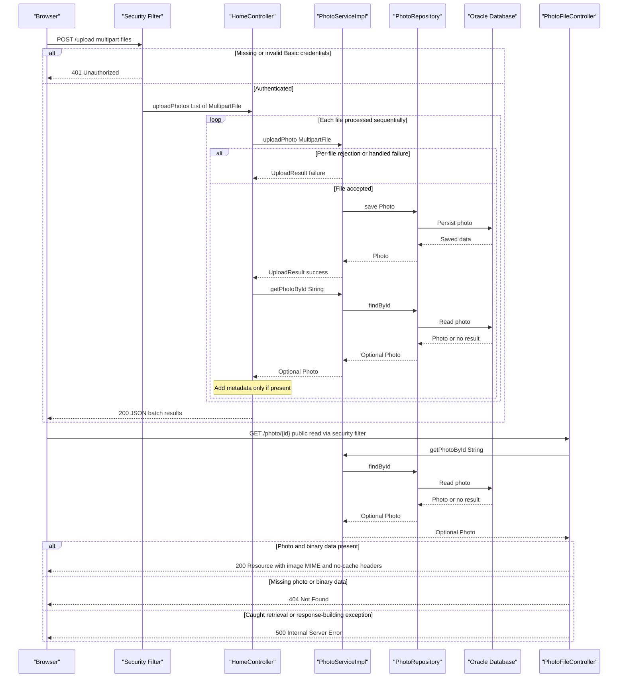

# API & Service Communication Contracts

Five explicitly mapped HTTP endpoints provide gallery/detail HTML, multipart upload with a JSON result, deletion by redirect, and binary photo retrieval. Browser requests, controller/service calls, and database access are synchronous request/response operations; no messaging or inter-service HTTP API is implemented.

## Service Catalog

| Service | Port | Category | Purpose |
|---|---|---|---|
| `photoalbum-java-app` / Maven `com.photoalbum:photo-album` | 8080 | API Layer; also contains business logic | Source-built application exposing the gallery and photo operations. |
| `oracle-db` / no Maven module | 1521 database listener; 5500 database management port, both published | Infrastructure | Third-party Oracle Express container used by the application for photo storage; not an application HTTP API. |

Evidence: `pom.xml:15-21` defines one JAR project, with no child modules; `docker-compose.yml:1-45` defines the two services, their build/image origin and port mappings; `Dockerfile:21-31` runs the application JAR. No additional deployment, Helm, or IaC service definitions were found in the supplied project files.

Application framework dependencies are Spring Boot Web, Thymeleaf, Data JPA, Validation, Security and JSON, with the Oracle JDBC runtime driver (`pom.xml:30-79`). The database container uses Oracle Express 21.3.0 XE (`docker-compose.yml:3-4`); it is not source-built and has no application framework dependencies.

## API Endpoints Inventory

Paths are relative to the application root. No URL, header, or query-based API versioning is declared in the controllers.

| Service | Method | Path | Request Type | Response Type |
|---|---|---|---|---|
| `photoalbum-java-app` / `HomeController` | GET | `/` | No explicit parameters | 200 HTML `index` view with `List<Photo>` model; database-read exceptions produce an empty gallery rather than an error response. |
| `photoalbum-java-app` / `HomeController` | POST | `/upload` | Authenticated request; multipart form field `files`, bound to `List<MultipartFile>` | 200 JSON `Map<String,Object>` with batch results, including partial or total per-file failure; 400 JSON for an empty list or handled `MultipartException`; 401 for missing/invalid Basic credentials. |
| `photoalbum-java-app` / `DetailController` | GET | `/detail/{id}` | Path `id: String` | 200 HTML `detail` view containing `Photo` and navigation IDs; ordinarily 302 redirect to `/` if absent, blank, or lookup/navigation throws. |
| `photoalbum-java-app` / `DetailController` | POST | `/detail/{id}/delete` | Authenticated request; path `id: String`; no body DTO required | Ordinarily 302 redirect to `/` with success/error flash attribute, including missing photo and caught deletion failures; 401 for missing/invalid Basic credentials. |
| `photoalbum-java-app` / `PhotoFileController` | GET | `/photo/{id}` | Path `id: String`; browser may append `_t` cache-busting query parameter, which the handler does not bind | 200 `ResponseEntity<Resource>` containing image bytes with stored MIME type; 404 for absent photo or empty binary data; 500 for caught exceptions. |

Evidence: `src/main/java/com/photoalbum/controller/HomeController.java:38-107`, `src/main/java/com/photoalbum/controller/DetailController.java:18-78`, `src/main/java/com/photoalbum/controller/PhotoFileController.java:23-86`, `src/main/java/com/photoalbum/config/SecurityConfig.java:45-59`; cache-busting client usage: `src/main/resources/static/js/upload.js:176-179`. Redirect status descriptions reflect normal MVC redirect behavior, not an explicitly set controller status.

**Wire-contract details**

- Upload responses are maps, not a serialized `UploadResult` or full `Photo`. The batch envelope contains `success`, `uploadedPhotos`, and `failedUploads`; each failure item contains `fileName` and `error`. The explicit 400 response instead contains `success: false` and `error`, without the batch arrays. `success` is true only if at least one uploaded photo is added to the response. A successful upload triggers a separate ID lookup; an empty lookup contributes neither a success entry nor a failure entry (`HomeController.java:58-106`).
- Per-file validation/storage errors normally become entries in a **200** batch response, not 400/422. Multipart parsing failures handled by the controller become 400 with `"No files provided"`. Missing required parameter binding and uncaught exceptions may use framework error handling rather than that JSON envelope; the successful-upload follow-up lookup is not caught by the upload controller (`HomeController.java:58-106`; `src/main/java/com/photoalbum/service/impl/PhotoServiceImpl.java:81-184`). See `business-workflows.md` for individual validation rules.
- Binary responses explicitly disable caching using `Cache-Control: no-cache, no-store, must-revalidate, private`, `Pragma: no-cache`, and `Expires: 0`, and add `X-Photo-ID`, `X-Photo-Name`, and `X-Photo-Size`. They do not set `Content-Disposition` (`PhotoFileController.java:74-83`).
- The browser creates `FormData` with repeated `files` fields, calls `/upload` once, and parses successful HTTP responses as JSON. Non-2xx responses produce a generic upload failure message (`src/main/resources/static/js/upload.js:90-132`). Deletion uses a POST HTML form (`src/main/resources/templates/detail.html:50-59`).
- Static CSS, JavaScript, and the bundled file under `src/main/resources/static/uploads/` are resource assets, not additional controller mappings. Default framework static-resource/error handling is not counted among the five explicit endpoints.

## Management & Observability Endpoints

| Service | Endpoint | Custom Metrics (if any) |
|---|---|---|
| `photoalbum-java-app` | No explicit management, health, Actuator, Swagger UI, or metrics route found | No custom metric registrations or metrics exporter found. |
| `oracle-db` | Published port 5500 is database management infrastructure, not a source-defined application endpoint | No application metrics contract defined. |

Evidence: the complete dependency list in `pom.xml:30-101` contains no Actuator, Springdoc, or metrics exporter; the five mappings above exhaust the controller sources. `docker-compose.yml:11-13` publishes the database ports. The database container health check is operational configuration, not an HTTP health API; see `configuration-inventory.md`. Application diagnostics use SLF4J logging, for example `HomeController.java:27,45-46` and `PhotoFileController.java:26,84-86`.

## DTOs & Contracts

| Class / type | API contract role | Mutability |
|---|---|---|
| `MultipartFile` / `List<MultipartFile>` | Framework-bound multipart upload input; no custom request-body DTO | Framework interface; not an immutable domain DTO. |
| `UploadResult` | Internal per-file result returned by `PhotoService.uploadPhoto`; transformed into response maps by the controller, not directly exposed as JSON | Mutable POJO with setters. |
| `Photo` | Service-owned domain entity supplied to HTML view models and used to construct upload response metadata and binary image responses; not directly returned as a JSON entity endpoint | Mutable POJO with setters. |
| `Map<String,Object>` and nested maps/lists | Actual upload JSON envelope and batch item contracts; no named upload-response class | Mutable collections. |
| `Resource` / `ByteArrayResource` | Binary photo HTTP response body; not a JSON DTO | Framework resource abstraction. |

Evidence: `src/main/java/com/photoalbum/model/UploadResult.java:6-47`, `src/main/java/com/photoalbum/model/Photo.java:19,78-156`, `src/main/java/com/photoalbum/service/PhotoService.java:19-54`, `HomeController.java:58-97`, `PhotoFileController.java:37-83`.

There are no gateway-level composition DTOs or independently owned service-to-service schemas. Entity field inventories and persistence details belong in `data-architecture.md`; they are intentionally not duplicated here.

JSON support is declared through Spring Boot JSON/Web dependencies (`pom.xml:31-35,75-79`), so upload maps use Spring MVC's configured JSON message conversion (normally Jackson). No application-specific Jackson serializer, serialization override, record DTO, OpenAPI/Swagger specification, protobuf, or GraphQL schema was found in the inspected application/build sources. `Photo` metadata timestamps are copied into the upload map without explicit formatting in the controller (`HomeController.java:76-83`); a custom date wire format is not defined there. HTML responses use view names rather than JSON serialization (`HomeController.java:50`; `DetailController.java:54`).

## Communication Patterns

- **Synchronous HTTP and local calls:** The browser invokes the same application's endpoints. Controllers call the injected `PhotoService`, implemented by `PhotoServiceImpl`, which calls `PhotoRepository` directly. Database communication uses JPA/JDBC, not a downstream REST API (`HomeController.java:29-41,69-74`; `src/main/java/com/photoalbum/service/impl/PhotoServiceImpl.java:27-29,36-46,53-74,164-169`; `src/main/java/com/photoalbum/repository/PhotoRepository.java:15-29`; `pom.xml:43-54`). Browser `async`/`await` does not imply a server-side queue or event contract.
- **No asynchronous service transport:** No broker, producer/consumer, event-bus, gRPC client, REST client, or background upload worker was found in the application sources or dependencies. Upload files are processed sequentially in the HTTP request (`HomeController.java:69-91`).
- **No gateway, aggregation, discovery, or client-side balancing:** There is no gateway component or cross-service response composition/fallback. Detail-view photo/navigation assembly and upload metadata assembly are local service calls, not gateway aggregation (`DetailController.java:39-52`; `HomeController.java:69-95`). Compose supplies the database hostname through its service network, rather than an application discovery registry; the default non-container connection targets localhost (`docker-compose.yml:32-45`; `src/main/resources/application.properties:9-15`).
- **Resilience and timeout contract:** No application retry, circuit breaker, bulkhead, fallback client, or explicit API/JDBC request timeout was found; there are no policy-specific timeout values to report. Container restart behavior is not an HTTP retry policy (`docker-compose.yml:46`). The client fetch has no explicit timeout, abort controller, or retry (`src/main/resources/static/js/upload.js:102-132`).
- **Error fallbacks:** Gallery lookup errors render an empty gallery; detail lookup/navigation errors redirect home; deletion errors redirect with an error flash message. Photo-byte failures return 404/500 instead of placeholder images. Upload handles many per-file errors as `UploadResult` failures, but no controller-level catch guarantees the batch envelope for all exceptions or transaction-completion failures (`HomeController.java:38-107`; `DetailController.java:32-78`; `PhotoFileController.java:37-86`; `PhotoServiceImpl.java:27-28,81-184`).
- **Availability/startup:** Compose makes application startup depend on a healthy database. Security bean creation also requires an externally supplied admin password property. Neither requirement is an API readiness guarantee; full startup/configuration details belong in `configuration-inventory.md` (`docker-compose.yml:41-43`; `src/main/java/com/photoalbum/config/SecurityConfig.java:33-42`).
- **Authentication/authorization:** Spring Security uses stateless HTTP Basic. POST `/upload` and POST `/detail/*/delete` require authentication; other requests are permitted. The configured in-memory account has role `ADMIN`, but the route rules require only `authenticated()`, not an explicit role check. No JWT/OAuth2 or method-level authorization is declared. CSRF protection is disabled (`SecurityConfig.java:28-59`). Credentials and credential values are intentionally omitted.
- **Transport security:** No server TLS configuration or HTTPS-enforcement rule was found in the inspected application configuration, security chain, or Compose deployment; the application exposes port 8080. External TLS termination is not established by these sources. Browser Bootstrap dependencies are fetched over HTTPS from a CDN, which does not secure the application's own API transport (`src/main/resources/application.properties:1-7`; `src/main/resources/application-docker.properties:24-27`; `SecurityConfig.java:45-59`; `docker-compose.yml:39-40`; `src/main/resources/templates/detail.html:7,147`).

## Service Technology Matrix

| Service | Web | Data Access | Discovery | Gateway | Actuator | Cache | Metrics |
|---|---|---|---|---|---|---|---|
| `photoalbum-java-app` | Spring MVC; Thymeleaf HTML, JSON and binary responses | Spring Data JPA / Oracle JDBC | None; Compose database hostname | None | Not declared | No application cache found; image HTTP caching explicitly disabled | No exporter/custom metrics found |
| `oracle-db` | No application web layer; management port published | Database server | None; Compose service identity | None | Not applicable | Not assessed internally | No repository-defined exporter |

Evidence: `pom.xml:30-101`, `docker-compose.yml:1-46`, controller and service sources cited above. HTTP cache headers are evidenced by `PhotoFileController.java:74-83`; persistence/cache implementation details belong in `data-architecture.md`.

## Service Communication Sequence

Primary flow: an authenticated multipart upload followed by binary retrieval. Solid arrows show synchronous requests/local calls; dashed arrows show responses, not queued events. No gateway or broker exists to insert into this flow.

Evidence: `HomeController.java:56-107`, `PhotoServiceImpl.java:68-74,81-184`, `PhotoFileController.java:37-86`, `SecurityConfig.java:45-59`. Multipart exceptions may short-circuit the upload with 400 before the depicted loop; unhandled errors can bypass its normal 200 response. These are local error paths, not circuit-breaker or retry behavior.
