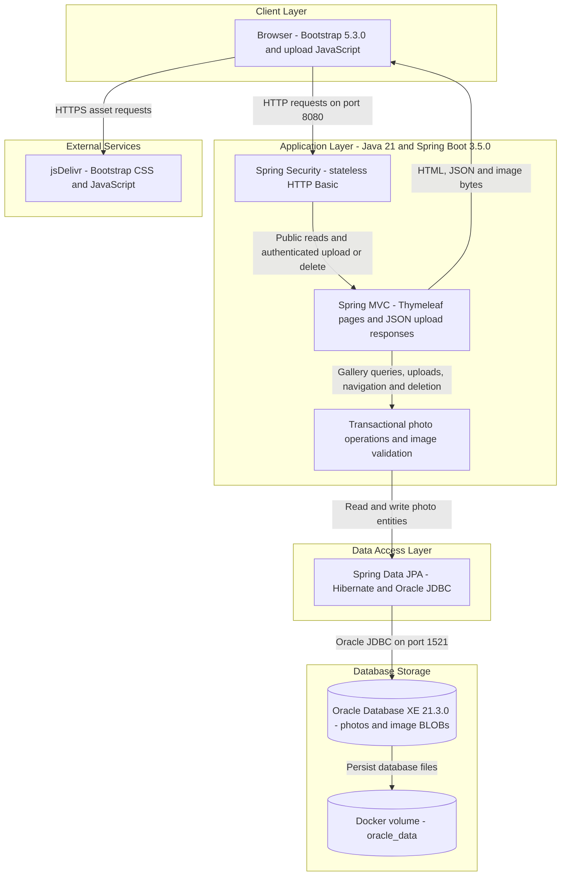
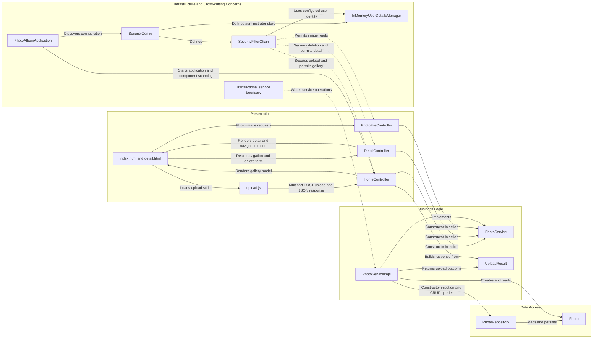

# Architecture Diagram

Photo Album is a single-module Java web application with server-rendered gallery pages, multipart uploads, and database-backed image delivery. The diagrams describe the checked-in implementation and Docker Compose configuration, not a verified running deployment; all evidence paths are relative to the repository root.

## Application Architecture

Diagram evidence: web dependencies and platform (`pom.xml:8-26`, `pom.xml:30-66`); HTTP entry points (`src/main/java/com/photoalbum/controller/HomeController.java:38-58`, `src/main/java/com/photoalbum/controller/DetailController.java:32-67`, `src/main/java/com/photoalbum/controller/PhotoFileController.java:37-83`); security (`src/main/java/com/photoalbum/config/SecurityConfig.java:45-59`); transactions and persistence (`src/main/java/com/photoalbum/service/impl/PhotoServiceImpl.java:27-46`, `src/main/java/com/photoalbum/service/impl/PhotoServiceImpl.java:154-176`); database and volume topology (`docker-compose.yml:3-18`, `docker-compose.yml:27-45`); browser CDN usage (`src/main/resources/templates/index.html:7`, `src/main/resources/templates/index.html:124-125`).

### Technology Stack Summary

| Layer | Technology | Version | Purpose |
|---|---|---|---|
| Runtime and packaging | Java, Maven, executable Spring Boot JAR | Java 21; Maven builder 3.9.9; application 1.0.0 | Single deployable application; multi-stage container build (`pom.xml:15-26`, `Dockerfile:1-22`). |
| Web framework | Spring Boot and Spring MVC | Boot 3.5.0; MVC managed by Boot | HTTP routing, multipart input, JSON responses and web runtime (`pom.xml:8-13`, `pom.xml:30-35`, `src/main/java/com/photoalbum/controller/HomeController.java:38-58`). |
| Presentation | Thymeleaf, Bootstrap, browser JavaScript | Thymeleaf managed by Boot; Bootstrap 5.3.0; JavaScript version unspecified | Server-rendered gallery and detail pages, styling and asynchronous upload (`pom.xml:37-41`, `src/main/resources/templates/index.html:92-95`, `src/main/resources/templates/index.html:124-125`, `src/main/resources/static/js/upload.js:97-105`). |
| Security | Spring Security | Managed by Boot | In-memory administrator identity and stateless HTTP Basic; authentication for upload and deletion (`pom.xml:62-66`, `src/main/java/com/photoalbum/config/SecurityConfig.java:33-59`). |
| Business logic | Spring services and transactions; Java ImageIO | Spring managed by Boot; ImageIO from Java 21 | Photo validation, image dimension extraction, navigation and transactional persistence (`src/main/java/com/photoalbum/service/impl/PhotoServiceImpl.java:27-46`, `src/main/java/com/photoalbum/service/impl/PhotoServiceImpl.java:80-166`, `src/main/java/com/photoalbum/service/impl/PhotoServiceImpl.java:212-229`). |
| Data access | Spring Data JPA, Hibernate, Oracle JDBC ojdbc8 | Managed by Boot; exact resolved versions not inspected | Entity mapping, CRUD and Oracle-specific native queries (`pom.xml:43-54`, `src/main/java/com/photoalbum/repository/PhotoRepository.java:15-62`, `src/main/resources/application.properties:15-19`). |
| Database | Oracle Database Express Edition | Compose image tag 21.3.0-xe | Photo metadata and binary image storage (`docker-compose.yml:3-16`, `src/main/java/com/photoalbum/model/Photo.java:15-76`). |
| Deployment | Docker and Docker Compose | Tool versions unspecified; Temurin runtime image 21-jre | App on port 8080, database health dependency, bridge network and persistent database volume (`Dockerfile:17-31`, `docker-compose.yml:39-53`). |

### Data Storage & External Services

Oracle stores both metadata and image bytes in the `photos` entity table; `photo_data` is a JPA large-object byte array, so the implemented upload and delivery paths do not use a separate image filesystem or object-storage service (`src/main/java/com/photoalbum/model/Photo.java:15-76`, `src/main/java/com/photoalbum/service/impl/PhotoServiceImpl.java:117-166`, `src/main/java/com/photoalbum/controller/PhotoFileController.java:57-83`). Compose persists Oracle files in `oracle_data` and starts the application after the database health check succeeds (`docker-compose.yml:14-24`, `docker-compose.yml:41-49`). Both application profiles configure Hibernate schema creation with `ddl-auto=create`; a persistent database volume therefore does not imply preservation of application tables across restarts (`src/main/resources/application.properties:17-21`, `src/main/resources/application-docker.properties:13-17`). The browser retrieves Bootstrap assets from jsDelivr over HTTPS (`src/main/resources/templates/index.html:7`, `src/main/resources/templates/index.html:124`). No application cache, message broker, or outbound business API client was identified in the inspected build and main source files.

### Key Architectural Decisions

- **Layered monolith with constructor injection:** three MVC controllers share the `PhotoService` abstraction; its transactional implementation delegates to one JPA repository (`src/main/java/com/photoalbum/PhotoAlbumApplication.java:9-14`, `src/main/java/com/photoalbum/controller/HomeController.java:24-33`, `src/main/java/com/photoalbum/controller/DetailController.java:17-27`, `src/main/java/com/photoalbum/controller/PhotoFileController.java:22-32`, `src/main/java/com/photoalbum/service/impl/PhotoServiceImpl.java:27-46`).
- **Database-centric media storage with Oracle coupling:** images are entity BLOBs; navigation/listing queries use Oracle-specific `NVL`, `ROWNUM`, `SYSDATE` and `DUAL` rather than database-neutral queries (`src/main/java/com/photoalbum/model/Photo.java:36-41`, `src/main/java/com/photoalbum/repository/PhotoRepository.java:23-62`).
- **Public reads with authenticated mutations:** the security filter chain requires authentication for upload and deletion, permits other requests, disables CSRF and uses stateless HTTP Basic; the configured administrator is held in memory (`src/main/java/com/photoalbum/config/SecurityConfig.java:33-59`). Credential values are intentionally omitted.

## Component Relationships

Diagram evidence: controller injection and delegation (`src/main/java/com/photoalbum/controller/HomeController.java:29-50`, `src/main/java/com/photoalbum/controller/HomeController.java:56-97`, `src/main/java/com/photoalbum/controller/DetailController.java:23-67`, `src/main/java/com/photoalbum/controller/PhotoFileController.java:28-46`); service implementation and transaction annotations (`src/main/java/com/photoalbum/service/impl/PhotoServiceImpl.java:27-70`, `src/main/java/com/photoalbum/service/impl/PhotoServiceImpl.java:154-184`); repository/entity relationship (`src/main/java/com/photoalbum/repository/PhotoRepository.java:15-29`); security beans (`src/main/java/com/photoalbum/config/SecurityConfig.java:33-59`); startup (`src/main/java/com/photoalbum/PhotoAlbumApplication.java:9-14`); template and JavaScript interactions (`src/main/resources/templates/index.html:92-95`, `src/main/resources/templates/index.html:124-125`, `src/main/resources/templates/detail.html:50`, `src/main/resources/templates/detail.html:67`, `src/main/resources/static/js/upload.js:97-105`). The startup arrow illustrates component discovery, not a direct controller call.

### Component Inventory

| Component | Layer | Type | Responsibility |
|---|---|---|---|
| `index.html`, `detail.html` | Presentation | Thymeleaf views | Display gallery, metadata and photo navigation; link image requests and submit deletion (`src/main/resources/templates/index.html:92-113`, `src/main/resources/templates/detail.html:50-95`). |
| `upload.js` | Presentation | Browser script | Assemble multipart files and POST to `/upload` (`src/main/resources/static/js/upload.js:97-105`). |
| `HomeController` | Presentation | MVC controller | Serve `/`, orchestrate multi-file uploads and produce JSON outcomes; handle multipart errors (`src/main/java/com/photoalbum/controller/HomeController.java:38-106`). |
| `DetailController` | Presentation | MVC controller | Serve `/detail/{id}`, obtain neighboring photos and process deletion redirects (`src/main/java/com/photoalbum/controller/DetailController.java:32-78`). |
| `PhotoFileController` | Presentation | Binary HTTP controller | Retrieve database image bytes and return a typed resource with no-cache headers (`src/main/java/com/photoalbum/controller/PhotoFileController.java:37-86`). |
| `PhotoService` | Business Logic | Service interface | Shared photo-operation abstraction consumed by all three controllers and implemented by the service (`src/main/java/com/photoalbum/controller/HomeController.java:29-33`, `src/main/java/com/photoalbum/controller/DetailController.java:23-27`, `src/main/java/com/photoalbum/controller/PhotoFileController.java:28-32`, `src/main/java/com/photoalbum/service/impl/PhotoServiceImpl.java:27-29`). |
| `PhotoServiceImpl` | Business Logic | Transactional Spring service | Validate MIME/size and image dimensions, save image bytes, query gallery/navigation and delete photos (`src/main/java/com/photoalbum/service/impl/PhotoServiceImpl.java:80-176`, `src/main/java/com/photoalbum/service/impl/PhotoServiceImpl.java:190-229`). |
| `UploadResult` | Business Logic | Outcome DTO | Carry success, filename, error message and photo identifier from service to controller (`src/main/java/com/photoalbum/model/UploadResult.java:3-10`, `src/main/java/com/photoalbum/controller/HomeController.java:69-89`). |
| `PhotoRepository` | Data Access | Spring Data JPA repository | Provide CRUD and native Oracle listing/navigation queries (`src/main/java/com/photoalbum/repository/PhotoRepository.java:15-62`). |
| `Photo` | Data Access | JPA entity | Map UUID identifier, filename, image bytes, size, MIME type, timestamp and dimensions to `photos` (`src/main/java/com/photoalbum/model/Photo.java:15-90`). |
| `PhotoAlbumApplication` | Infrastructure | Spring Boot entry point | Launch auto-configuration and application component discovery (`src/main/java/com/photoalbum/PhotoAlbumApplication.java:9-14`). |
| `SecurityConfig` | Infrastructure | Spring configuration | Define administrator identity and HTTP security policy (`src/main/java/com/photoalbum/config/SecurityConfig.java:25-59`). |
| `SecurityFilterChain` | Infrastructure | Security filter-chain bean | Apply stateless Basic authentication to mutations while allowing public reads (`src/main/java/com/photoalbum/config/SecurityConfig.java:45-59`). |
| `InMemoryUserDetailsManager` | Infrastructure | Identity-store bean | Hold the configured administrator with the ADMIN role; values omitted (`src/main/java/com/photoalbum/config/SecurityConfig.java:33-43`). |
| Transactional service boundary | Infrastructure | Spring transaction interception | Wrap service operations, with explicit read-only retrieval/navigation boundaries (`src/main/java/com/photoalbum/service/impl/PhotoServiceImpl.java:27-29`, `src/main/java/com/photoalbum/service/impl/PhotoServiceImpl.java:52-70`, `src/main/java/com/photoalbum/service/impl/PhotoServiceImpl.java:215-229`). |
