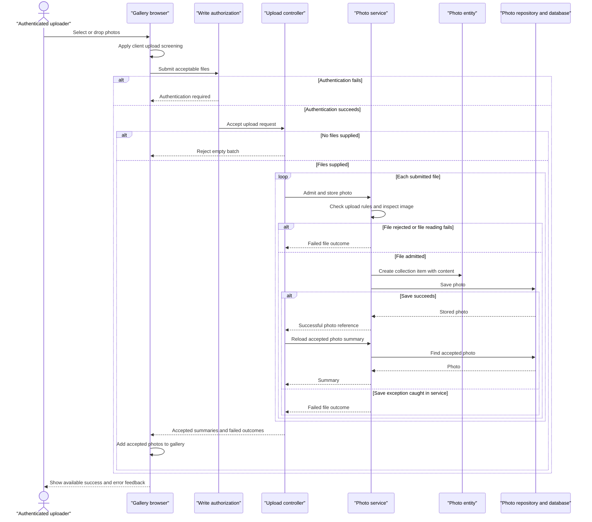

# Core Business Workflows

Photo Album lets visitors browse a shared photo collection, view individual images, and navigate by upload time. Authenticated users can add photos in batches and remove photos from the collection.

Evidence references below use repository-relative paths and source line numbers. This document describes observed implementation, not intended features; no secret values are reproduced.

## Domain Entities

| Entity | Service / Bounded Context | Description | Key Relationships |
|---|---|---|---|
| Photo | PhotoService / Photo collection management | An uploaded image and its descriptive information, managed as one collection item. The only persisted business entity; no explicit multi-entity aggregate is defined. | Image content and metadata belong to the same photo. Older/newer photos are computed navigation neighbors, not stored relationships. No album, owner, or user relationship exists in the model. |
| UploadResult | PhotoService / Upload processing | A transient per-file outcome, not a persisted entity: either a saved photo reference or an explanation of failure. | Successful outcomes refer to a Photo; the controller combines outcomes into batch feedback. |

Evidence: `src/main/java/com/photoalbum/model/Photo.java:19-91`; `src/main/java/com/photoalbum/model/UploadResult.java:6-10`; `src/main/java/com/photoalbum/service/impl/PhotoServiceImpl.java:190-230`.

## Service-to-Domain Mapping

This is one application, not a set of independently deployed business services. The following are in-process responsibilities within one bounded context.

| Service | Domain Context | Owned Entities | External Dependencies |
|---|---|---|---|
| PhotoService / PhotoServiceImpl | Photo collection management: upload, listing, lookup, navigation, deletion | Photo; transient UploadResult | PhotoRepository and the photo database; local image-header inspection |
| HomeController | Gallery and batch-upload orchestration | No independent entities; composes Photo summaries and upload outcomes | In-process PhotoService |
| DetailController | Individual-photo viewing and collection maintenance | No independent entities; uses Photo and computed neighbor references | In-process PhotoService |
| PhotoFileController | Delivery of stored photo content | No independent entities; reads Photo content | In-process PhotoService |

PhotoService is the common business access layer; PhotoRepository and its database are the persisted source of truth. Controllers neither own separate copies nor exchange business events. Authentication accounts are access-control infrastructure, not photo owners.

Evidence: `src/main/java/com/photoalbum/service/impl/PhotoServiceImpl.java:27-47,154-176`; `src/main/java/com/photoalbum/controller/HomeController.java:29-33,69-95`; `src/main/java/com/photoalbum/controller/DetailController.java:23-27`; `src/main/java/com/photoalbum/controller/PhotoFileController.java:28-32`; `src/main/java/com/photoalbum/config/SecurityConfig.java:33-42`.

## Primary Workflows

### Workflow 1: Upload a batch and publish accepted photos

1. A user selects files or drops them onto the gallery. The browser applies **Client upload screening**, then submits acceptable files to `POST /upload`. State-changing requests must pass **Write authorization** before reaching the controller.
2. HomeController applies **Batch presence**, then processes each file sequentially through PhotoService. There is no controller-wide transaction or all-or-nothing batch requirement.
3. PhotoService applies **Server upload admission** and **Image inspection**. A rejected file produces a failed UploadResult; ordinary per-file failures allow processing of subsequent files.
4. For an admitted file, the service constructs a Photo, assigns available dimensions, and persists its content and metadata together.
5. For each successful result, the controller reloads the photo by its returned identifier and collects a display summary. Failed results are collected separately.
6. The response follows **Batch outcome aggregation**. The browser displays successes and failures, prepends accepted photos to the gallery, and retrieves their images separately.

An unexpected exception in the controller's successful-photo reload is not caught by the batch loop; the partial-success behavior applies to failures returned as UploadResult, not every possible exception.

Evidence: `src/main/resources/static/js/upload.js:48-131,135-158,176-179`; `src/main/java/com/photoalbum/controller/HomeController.java:56-107`; `src/main/java/com/photoalbum/service/impl/PhotoServiceImpl.java:80-184`; `src/main/java/com/photoalbum/config/SecurityConfig.java:46-59`.

### Workflow 2: Browse the collection and navigate individual photos

1. A visitor opens `GET /`. HomeController loads the collection through PhotoService and PhotoRepository using **Gallery ordering**.
2. On a retrieval exception, HomeController logs the error and renders an empty collection rather than a dedicated failure page. Users therefore cannot distinguish an empty collection from this loading failure solely from the supplied photo list.
3. Opening `GET /detail/{id}` loads the selected photo, then separately loads older and newer candidates under **Chronological navigation**. The response combines the photo with optional neighbor identifiers.
4. The detail page displays the image and navigation controls only where a neighbor exists. A blank identifier, missing photo, or detail-loading exception redirects to the gallery.
5. Gallery/detail images are fetched through `GET /photo/{id}`. PhotoFileController loads the same Photo and returns its stored bytes. **Photo availability** determines missing-content and error responses.

Evidence: `src/main/java/com/photoalbum/controller/HomeController.java:38-50`; `src/main/java/com/photoalbum/service/impl/PhotoServiceImpl.java:52-75,215-230`; `src/main/java/com/photoalbum/repository/PhotoRepository.java:23-62`; `src/main/java/com/photoalbum/controller/DetailController.java:32-58`; `src/main/resources/templates/detail.html:62-94`; `src/main/java/com/photoalbum/controller/PhotoFileController.java:37-86`.

### Workflow 3: Remove a photo from the shared collection

1. The detail-page delete form asks for browser confirmation; cancellation prevents that form submission, but is not a server-side approval rule.
2. An authenticated request to `POST /detail/{id}/delete` enters DetailController.
3. PhotoService first looks up the photo. If absent, it returns false; if present, it deletes the Photo, including its stored content.
4. DetailController sets a success, not-found, or failure flash message and redirects to the gallery. There is no soft-delete state, restore operation, or ownership check in this path.

Evidence: `src/main/resources/templates/detail.html:50-59`; `src/main/java/com/photoalbum/config/SecurityConfig.java:53-58`; `src/main/java/com/photoalbum/service/impl/PhotoServiceImpl.java:190-209`; `src/main/java/com/photoalbum/controller/DetailController.java:64-78`.

No scheduled business jobs, event consumers, batch business commands, or business-data seeding routines are present in the inspected application sources. The application entry point only starts the application (`src/main/java/com/photoalbum/PhotoAlbumApplication.java:9-14`).

## Cross-Service Data Flows

There are no remote business-service calls, gateway aggregations, message-based workflows, sagas, or circuit breakers in the inspected application. All business orchestration is synchronous and in-process.

- **Upload composition:** HomeController calls the shared service once per file, reloads successful Photos by identifier, and separates successful display summaries from failed-file outcomes. The browser joins each summary to its content by photo identifier using a subsequent image request.
- **Detail composition:** DetailController loads one Photo and two independently queried neighbor candidates, then supplies the current photo and optional neighbor identifiers to the view. All data comes from the same collection, not separate domain owners.
- **Unavailable-data behavior:** A gallery retrieval failure becomes an empty list; a detail retrieval/navigation failure redirects to the gallery; an image lookup failure returns a server error, while missing photos or bytes return not found. Upload failures returned by the service become per-file feedback; deletion failures become a flash error and redirect. These are local error-handling branches, not circuit-breaker fallbacks.
- **Freshness:** Image responses discourage caching and gallery-generated URLs use cache-busting timestamps, favoring fresh reads over reuse. No business cache fallback is implemented.

Evidence: `src/main/java/com/photoalbum/controller/HomeController.java:38-50,69-97`; `src/main/java/com/photoalbum/controller/DetailController.java:38-58,64-78`; `src/main/java/com/photoalbum/controller/PhotoFileController.java:44-86`; `src/main/resources/static/js/upload.js:113-120,176-179`.

## Business Workflow Sequence

Primary workflow: a user uploads a batch, receives per-file outcomes, and sees accepted photos. Failure branches below are local validation/persistence outcomes, not remote-service circuit breakers.

Evidence: `src/main/java/com/photoalbum/controller/HomeController.java:56-98`; `src/main/java/com/photoalbum/service/impl/PhotoServiceImpl.java:80-184`; `src/main/resources/static/js/upload.js:60-131`; `src/main/java/com/photoalbum/config/SecurityConfig.java:53-58`.

## Business Rules & Decision Logic

### Admission and validation

- **Write authorization:** Upload and delete POST requests require authentication. Reads are public. The configured account has an administrative role, but the endpoint rule checks authentication, not a role or photo ownership. Accounts are not linked to Photos. Authentication is stateless HTTP Basic; CSRF protection is disabled. Evidence: `src/main/java/com/photoalbum/config/SecurityConfig.java:33-59`.
- **Client upload screening:** The browser accepts declared JPEG, PNG, GIF, or WebP types and files no larger than 10 MiB. Invalid files are excluded before upload; valid files from the same selection can proceed. Evidence: `src/main/resources/static/js/upload.js:60-87`.
- **Batch presence:** A null/empty file list returns a bad-request outcome. Multipart exceptions handled by HomeController are also reported as a bad request with “No files provided,” irrespective of their underlying cause. Evidence: `src/main/java/com/photoalbum/controller/HomeController.java:63-67,100-106`.
- **Server upload admission:** The lowercased supplied content type must be on the configured allowlist; file size must not exceed the configured maximum and must be positive. Current application defaults are JPEG/PNG/GIF/WebP and 10 MiB per file; multipart limits are 10 MB per file and 50 MB per request. A missing content type reaches the outer generic failure handler rather than the unsupported-type result. Evidence: `src/main/java/com/photoalbum/service/impl/PhotoServiceImpl.java:40-46,85-109,178-181`; `src/main/resources/application.properties:24-29`.
- **Image inspection:** When an image reader recognizes the content, header dimensions exceeding 40,000,000 pixels are rejected. An IOException while reading bytes or dimensions rejects the file. No recognized reader leaves dimensions absent, and other inspection exceptions log a warning and allow processing to continue without requiring dimensions. The code does not enforce a successful image decode or a match between the supplied MIME type and inspected content. Evidence: `src/main/java/com/photoalbum/service/impl/PhotoServiceImpl.java:33-34,111-162`.
- **Photo validation declarations:** Original filename must be nonblank and at most 255 characters; MIME type must be nonblank and at most 50 characters; file size must be nonnull and positive; upload time must be nonnull. These are model validation annotations, not an explicit controller validation step. Evidence: `src/main/java/com/photoalbum/model/Photo.java:28-64`.
- **File-count distinction:** Configuration declares a maximum of ten files per upload, but neither the inspected upload controller/service nor the browser consumes that property or enforces a count limit. Do not treat ten files as an implemented business constraint. Evidence: `src/main/resources/application.properties:30`; `src/main/java/com/photoalbum/controller/HomeController.java:58-91`; `src/main/resources/static/js/upload.js:60-100`.

### Decisions, lifecycle, and derived values

- **Batch outcome aggregation:** A nonempty processed batch returns HTTP 200, even if all returned per-file results fail. Top-level success is true only when at least one reloaded Photo summary is collected. A service-reported success whose reload returns empty is omitted from both outcome lists. Evidence: `src/main/java/com/photoalbum/controller/HomeController.java:69-97`.
- **Gallery ordering:** Stored photos are listed newest first. The gallery query substitutes a generic content type for null stored MIME values; this is retrieval normalization, not upload admission. Evidence: `src/main/java/com/photoalbum/repository/PhotoRepository.java:23-29`.
- **Chronological navigation:** Previous means an older upload, choosing the first result ordered newest-to-oldest, from at most ten candidates. Next means a newer upload, choosing the first oldest-to-newest candidate not later than database current time. Strict time comparisons exclude equal-timestamp photos; no tie-breaker is defined. Missing neighbors produce no navigation link. Evidence: `src/main/java/com/photoalbum/repository/PhotoRepository.java:37-62`; `src/main/java/com/photoalbum/service/impl/PhotoServiceImpl.java:215-230`; `src/main/resources/templates/detail.html:75-94`.
- **Photo availability:** Blank identifiers, absent Photos, or absent/empty stored bytes return not found on content delivery; other delivery exceptions return a server error. Evidence: `src/main/java/com/photoalbum/controller/PhotoFileController.java:37-86`.
- **Lifecycle and identity:** Each constructed Photo receives a generated identity and current application-local upload time. An admitted upload becomes a stored collection item; deletion physically removes it. Rejected uploads yield transient failure outcomes. There is no approval, draft, archive, deduplication, or filename uniqueness rule in the inspected model and upload/deletion paths. Evidence: `src/main/java/com/photoalbum/model/Photo.java:15-18,79-91`; `src/main/java/com/photoalbum/service/impl/PhotoServiceImpl.java:154-176,190-205`.
- **Derived presentation:** Image dimensions are extracted where possible, not mandatory. Human-readable dates and file sizes are formatted for display; there are no pricing calculations or aggregate business totals. Evidence: `src/main/resources/static/js/upload.js:161-197`; `src/main/resources/templates/detail.html:108-125`.

### Cross-cutting behavior

- **Transactions:** PhotoServiceImpl has a class-level transaction boundary; listing, lookup, and neighbor queries override it as read-only. Each controller-to-service upload call is separate; there is no batch transaction, compensating deletion, or distributed transaction. Exceptions thrown during transaction completion can escape the service's internal catch blocks, so returned per-file failure handling is not a guarantee for commit-time failures. Evidence: `src/main/java/com/photoalbum/service/impl/PhotoServiceImpl.java:27-29,52-75,165-184,190-229`; `src/main/java/com/photoalbum/controller/HomeController.java:69-91`.
- **Error handling:** Uploads use UploadResult rather than typed business exceptions. Lookup/list/delete service errors are wrapped in generic runtime exceptions; their controllers apply the outcomes described above. There is no retry queue or dead-letter path in these flows. Evidence: `src/main/java/com/photoalbum/service/impl/PhotoServiceImpl.java:55-74,173-181,206-208`.
- **Audit/logging:** Upload rejection/success, deletion outcomes, and retrieval failures are logged. File serving also logs photo metadata and a content-byte preview. These are operational logs, not a dedicated business audit ledger or actor-attributed change history; no actual logged content or credentials are reproduced here. Evidence: `src/main/java/com/photoalbum/service/impl/PhotoServiceImpl.java:90-100,171-181,193-208`; `src/main/java/com/photoalbum/controller/PhotoFileController.java:45-72`.
