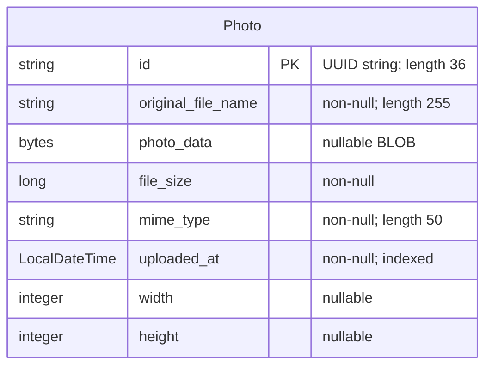

# Data Architecture & Persistence Layer

The data layer contains one persistent entity, `Photo`, managed through Spring Data JPA/Hibernate. Oracle stores both metadata and image BLOBs in normal operation; the test profile substitutes an in-memory H2 database (`pom.xml:43-54,88-93`; `src/main/java/com/photoalbum/model/Photo.java:15-76`).

## Database Configuration

| Service/Module | DB Type | Profile | Driver | Connection | Migration Tool |
|---|---|---|---|---|---|
| Photo Album | Oracle | Default | `com.oracle.database.jdbc:ojdbc8`; `oracle.jdbc.OracleDriver` | Environment-overridable Oracle Thin connection; defaults to local host, port 1521, XE identifier. Credentials are externalized and omitted here. Hibernate recreates the schema at startup, risking loss of existing rows. | No Flyway/Liquibase dependency or versioned migration found; Hibernate-generated DDL. |
| Photo Album | Oracle | `docker` | Same Oracle driver | Environment-overridable Oracle Thin connection; default host is the database service, port 1521, XE identifier. Credentials omitted. Hibernate also recreates the schema at startup. | Same Hibernate schema generation. |
| Photo Album tests | H2 | `test` | `com.h2database:h2` (test scope); `org.h2.Driver` | Named in-memory database; Hibernate creates schema at startup and drops it at shutdown. Credentials omitted. | Hibernate create/drop; no separate migration tool. |

Evidence: `src/main/resources/application.properties:9-21`; `src/main/resources/application-docker.properties:1-17`; `src/test/resources/application-test.properties:1-10`; `pom.xml:30-101`. The context test explicitly activates `test` (`src/test/java/com/photoalbum/PhotoAlbumApplicationTests.java:7-9`).

No explicit connection-pool sizing, timeout tuning, or provider override appears in these configurations; the JPA starter supplies the normal Boot-managed datasource/pooling infrastructure, rather than an application-defined pool. No application schema SQL or photo seed data was found under `src` or `oracle-init`. Initialization scripts provision an Oracle schema user and grants, not photo rows; verification scripts only inspect database state (`oracle-init/01-create-user.sh:19-47`; `oracle-init/create-user.sh:21-42`; `oracle-init/02-verify-user.sql:1-12`; `oracle-init/healthcheck.sql`). Full configuration properties belong in `configuration-inventory.md`; no raw configuration key/value inventory is reproduced here.

## Data Ownership per Service

| Service | Tables Owned | ORM Framework | Caching | Notes |
|---|---|---|---|---|
| Photo Album (`com.photoalbum`) | `photos` / `Photo` | Jakarta Persistence mappings with Hibernate through Spring Data JPA | No explicit application/entity/query cache configured | `PhotoServiceImpl` owns persistence operations through `PhotoRepository`; image bytes and metadata occupy the same row. No outbox or auxiliary domain table found. |

Evidence: `src/main/java/com/photoalbum/model/Photo.java:15-76`; `src/main/java/com/photoalbum/repository/PhotoRepository.java:15-16`; `src/main/java/com/photoalbum/service/impl/PhotoServiceImpl.java:27-46,154-166,190-204`; `pom.xml:43-47`.

## Entity Model

`Photo` maps to `photos`. Java field names are camelCase equivalents of the diagram's mapped column names; types are `String`, `byte[]`, `Long`, `LocalDateTime`, and nullable `Integer`. The nonunique `idx_photos_uploaded_at` index supports timestamp ordering. IDs are initialized with Java-generated UUIDs, and upload timestamps with local application time, in the constructor rather than a database sequence/default (`src/main/java/com/photoalbum/model/Photo.java:15-81`).

There are no foreign keys, associations, join tables, cascade mappings, or bidirectional links in the sole entity. `photoData` has `@Lob` but no lazy-fetch override, and all custom repository queries select it alongside metadata; listing therefore does not use a metadata-only projection (`src/main/java/com/photoalbum/model/Photo.java:39-41`; `src/main/java/com/photoalbum/repository/PhotoRepository.java:23-62`). `UploadResult` is an operation-result object, not another entity (`src/main/java/com/photoalbum/model/UploadResult.java:3-10`).

Transactions are declared on `PhotoServiceImpl` at class level. Photo lookup/listing and older/newer lookups override this with read-only transactions; uploads and deletes inherit the class-level transaction (`src/main/java/com/photoalbum/service/impl/PhotoServiceImpl.java:27-29,52-70,80-81,190-202,215-228`).

## Key Repository Methods

All entries belong to `PhotoRepository extends JpaRepository<Photo, String>` in `src/main/java/com/photoalbum/repository/PhotoRepository.java:15-62`. Standard inherited CRUD operations are omitted from the table.

| Service | Repository | Notable Methods | Purpose |
|---|---|---|---|
| Photo Album | `PhotoRepository` | `List<Photo> findAllOrderByUploadedAtDesc()` | Native SQL selects complete photo rows, newest first; Oracle `NVL` supplies a fallback MIME type. Source: lines 18-29. |
| Photo Album | `PhotoRepository` | `List<Photo> findPhotosUploadedBefore(LocalDateTime uploadedAt)` | Bound timestamp parameter selects older rows ordered descending, capped at 10 by outer `ROWNUM`; returns full entities including BLOBs. Source: lines 31-46. |
| Photo Album | `PhotoRepository` | `List<Photo> findPhotosUploadedAfter(LocalDateTime uploadedAt)` | Bound timestamp parameter selects newer rows no later than Oracle `SYSDATE`, ordered ascending; uses `DUAL` and has no result cap. Source: lines 48-62. |

These are Oracle-specific native queries, not derived finders or portable JPQL. H2 context startup alone does not establish that their Oracle-specific execution is compatible with the test database: the existing test only loads the context (`src/test/java/com/photoalbum/PhotoAlbumApplicationTests.java:7-14`). No cross-service bulk finder, stored-procedure repository call, or separate JDBC mapper was found.

## Caching Strategy

| Layer | Observed strategy | Evidence |
|---|---|---|
| Application / distributed cache | No Spring Cache annotations, Redis, Caffeine, Ehcache, or JCache dependency/provider configuration found in application sources and build declarations; no configured TTL, eviction policy, named regions, or cache-aside/write-through implementation. | `pom.xml:30-101`; `src/main/resources/application.properties`; `src/main/resources/application-docker.properties`; `src/main/java/com/photoalbum/service/impl/PhotoServiceImpl.java:52-74,215-229` |
| Hibernate | Ordinary persistence-context identity management is implicit in JPA transactions; no explicit second-level or query-result cache configuration found. This is not a shared application cache. | `src/main/java/com/photoalbum/service/impl/PhotoServiceImpl.java:27-29,52-70`; configuration files above |
| Photo response caching | Successful binary responses explicitly prohibit browser/proxy storage and require revalidation. There is no positive response-cache TTL or invalidation mechanism to document. The source expresses a no-cache intent but does not explain a broader performance rationale. | `src/main/java/com/photoalbum/controller/PhotoFileController.java:74-83` |
| Session storage | Stateless authentication; no persistent/distributed session cache configured. The administrator identity is held by an in-memory user manager, not a database entity. | `src/main/java/com/photoalbum/config/SecurityConfig.java:33-43,46-58` |

## Data Ownership Boundaries

One application owns one domain table in a single configured datasource per active environment. Oracle is the normal store; H2 is a test substitute, not a simultaneously maintained read replica or separate service store. Schema-user provisioning supports a distinct application schema, but the repository does not demonstrate database-per-service isolation across multiple services (`src/main/resources/application.properties:9-19`; `src/test/resources/application-test.properties:1-9`; `oracle-init/01-create-user.sh:27-43`).

`PhotoServiceImpl` directly uses the same JPA repository for reads and writes. There is no separate command/read model, CQRS store, cross-service database access, remote data-owner lookup, or aggregation-specific bulk repository method in the inspected application data layer. Photo content is persisted as database bytes rather than a filesystem/object-store reference (`src/main/java/com/photoalbum/service/impl/PhotoServiceImpl.java:36-46,54-70,117-118,154-166,190-202`; `src/main/java/com/photoalbum/repository/PhotoRepository.java:15-62`).

### Data Classification & Sensitivity

| Entity | Sensitive Fields | Classification (PII/PHI/PCI/None) | Controls in Place |
|---|---|---|---|
| `Photo` | `photoData` | Potential PII: images may identify people, and original uploaded bytes may include embedded metadata. Actual image contents are not established by source inspection. No structured PHI/PCI fields detected. | No field encryption, masking, metadata stripping, or owner/tenant access-control field found. Binary reads are publicly permitted; designated writes require authentication. Database encryption-at-rest is not established by repository configuration. |
| `Photo` | `originalFileName` | Potential PII if user-provided names identify individuals; no dedicated person/name/email entity fields. | No masking or field-level access control found. Original filenames are logged; the serving code also logs the first ten image bytes. |
| `Photo` | `id`, `fileSize`, `mimeType`, `uploadedAt`, `width`, `height` | None intrinsically; metadata may become identifying when linked to image content. | No per-record ownership or tenant boundary; UUID is a key, not an authorization control. |

Evidence: stored fields and constructor in `src/main/java/com/photoalbum/model/Photo.java:24-90`; unmodified file-byte capture and persistence in `src/main/java/com/photoalbum/service/impl/PhotoServiceImpl.java:117-118,154-172`; logging in `src/main/java/com/photoalbum/controller/PhotoFileController.java:53-66`; public reads/authenticated designated writes and in-memory BCrypt administrator identity in `src/main/java/com/photoalbum/config/SecurityConfig.java:28-58`. Schema credentials are externalized, and initialization scripts grant schema-creation privileges rather than DBA (`oracle-init/01-create-user.sh:4-15,31-43`); these controls do not establish encryption or per-photo confidentiality. Credential values are deliberately excluded from this assessment.
