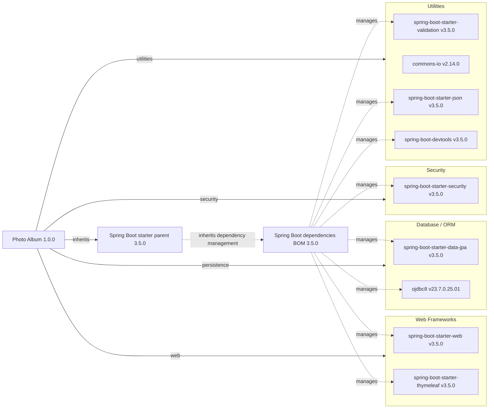

# Dependency Map

Photo Album (`com.photoalbum:photo-album:1.0.0`) declares **11 external library dependencies: 9 non-test and 2 test-scoped** in its single Maven build. Counts exclude the parent POM and build plugin; analysis is limited to build/package metadata, not application source ([project identity](../../../../../pom.xml#L15-L21), [dependency declarations](../../../../../pom.xml#L30-L101)).

## Dependencies

### Dependency Summary

| Category | Count | Key Libraries | Notes |
|----------|-------|---------------|-------|
| Web Frameworks | 2 | Spring Boot Web 3.5.0; Thymeleaf starter 3.5.0 | Both compile-scoped; [pom.xml:31–41](../../../../../pom.xml#L31-L41). |
| Database / ORM | 2 | Spring Boot Data JPA 3.5.0; Oracle ojdbc8 23.7.0.25.01 | JPA compile-scoped; JDBC driver runtime-scoped; [pom.xml:43–54](../../../../../pom.xml#L43-L54). |
| Security | 1 | Spring Boot Security 3.5.0 | Compile-scoped; [pom.xml:62–66](../../../../../pom.xml#L62-L66). |
| Utilities | 4 | Validation starter 3.5.0; Commons IO 2.14.0; JSON starter 3.5.0; DevTools 3.5.0 | All compile-scoped; DevTools is optional, not test-scoped; [pom.xml:56–60](../../../../../pom.xml#L56-L60), [68–79](../../../../../pom.xml#L68-L79), [95–100](../../../../../pom.xml#L95-L100). |
| **Total non-test** | **9** | | Test libraries excluded. |

Full declared coordinates and version provenance:

| Group and artifact | Declared version | Managed version | Scope |
|--------------------|------------------|-----------------|-------|
| `org.springframework.boot:spring-boot-starter-web` | Omitted; inherited management | 3.5.0 | compile (default) |
| `org.springframework.boot:spring-boot-starter-thymeleaf` | Omitted; inherited management | 3.5.0 | compile (default) |
| `org.springframework.boot:spring-boot-starter-data-jpa` | Omitted; inherited management | 3.5.0 | compile (default) |
| `com.oracle.database.jdbc:ojdbc8` | Omitted; inherited management | 23.7.0.25.01 | runtime |
| `org.springframework.boot:spring-boot-starter-validation` | Omitted; inherited management | 3.5.0 | compile (default) |
| `org.springframework.boot:spring-boot-starter-security` | Omitted; inherited management | 3.5.0 | compile (default) |
| `commons-io:commons-io` | 2.14.0 | Not used; explicit version | compile (default) |
| `org.springframework.boot:spring-boot-starter-json` | Omitted; inherited management | 3.5.0 | compile (default) |
| `org.springframework.boot:spring-boot-devtools` | Omitted; inherited management | 3.5.0 | compile (default), optional |

**Version evidence:** The build declares [`spring-boot-starter-parent:3.5.0`](../../../../../pom.xml#L8-L13). Its inherited version management is published in the [Spring Boot dependencies 3.5.0 POM](https://repo.maven.apache.org/maven2/org/springframework/boot/spring-boot-dependencies/3.5.0/spring-boot-dependencies-3.5.0.pom): Boot artifacts use 3.5.0, `oracle-database.version` is 23.7.0.25.01, and `h2.version` is 2.3.232. These are metadata-derived versions, not an executed Maven dependency resolution.

### Version & Compatibility Risks

The build targets Java 21 ([pom.xml:23–28](../../../../../pom.xml#L23-L28)) and Spring Boot 3.5.0. Boot upgrades should retain alignment with its managed dependency set and Jakarta-based ecosystem. Commons IO 2.14.0 is an explicitly pinned older release outside inherited version selection and should receive an independent update/advisory review. Verify the managed Oracle JDBC driver against the actual database and Java 21 support matrix; the `ojdbc8` artifact name alone does not establish incompatibility. No vulnerability scan or current support-lifecycle verification was performed.

### Notable Observations

- The parent centralizes versions for 10 of the 11 library declarations, including both test dependencies. No BOM import is declared directly in this project's dependency management; the BOM relationship is inherited ([parent](../../../../../pom.xml#L8-L13), [dependencies](../../../../../pom.xml#L30-L101)).
- The JSON starter is declared separately alongside the web starter. This warrants a potential redundancy review, but no resolved transitive graph or lockfile was available to prove overlap. BOM-managed libraries are not automatically application dependencies and are not added to the counts.
- DevTools is an optional **compile** dependency, not a test dependency. The Spring Boot Maven plugin is separately declared without a version; it is build tooling, not a library node ([pom.xml:95–110](../../../../../pom.xml#L95-L110)).
- No logging, messaging, caching, or observability libraries are directly declared. This does not establish their absence transitively; starter internals and actual application usage were not inspected.

## Test Dependencies

| Framework | Version | Notes |
|-----------|---------|-------|
| `org.springframework.boot:spring-boot-starter-test` | 3.5.0, inherited; no version declared locally | Test support starter; explicit `test` scope; [pom.xml:81–86](../../../../../pom.xml#L81-L86). Individual framework versions are not separately declared. |
| `com.h2database:h2` | 2.3.232, inherited; no version declared locally | Test database; explicit `test` scope; [pom.xml:88–93](../../../../../pom.xml#L88-L93). |

Total test-scope dependencies: 2

No dedicated integration/contract-testing library is directly declared. H2 is test-only while Oracle JDBC is runtime-scoped, so database-specific behavior may require additional verification; declarations alone do not establish test coverage or execution.
