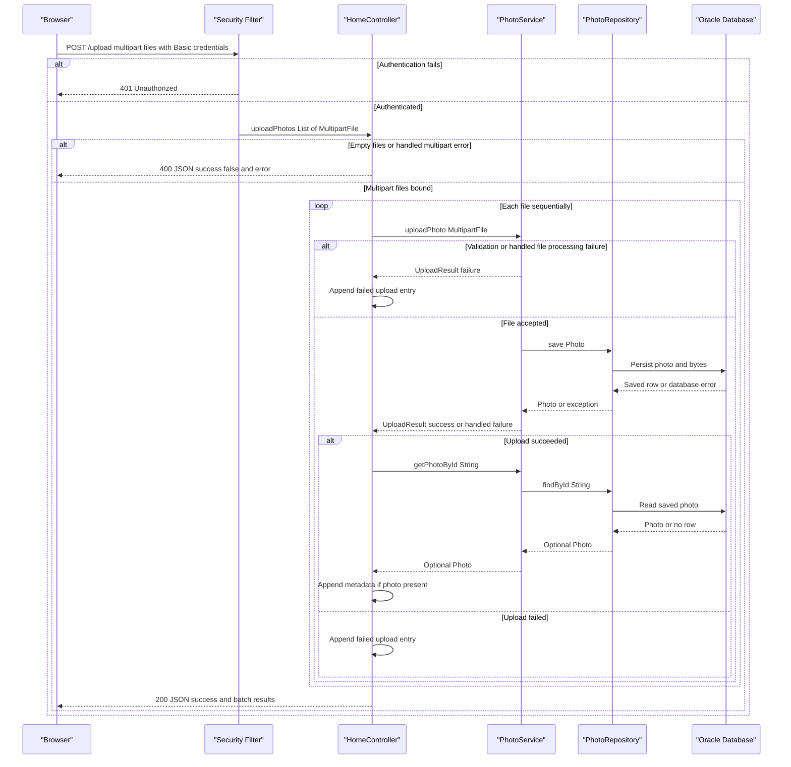

# API & Service Communication Contracts

The application exposes five explicit controller endpoints: three read-only HTML/image routes and two authenticated mutation routes. Browser requests and internal service calls are synchronous; uploads return JSON, while gallery and detail pages are server-rendered.

## Service Catalog

| Service | Port | Category | Purpose |
| --- | --- | --- | --- |
| `photoalbum-java-app` — Maven `com.photoalbum:photo-album` | HTTP 8080 | Business | Source-built gallery, photo upload, image delivery, and deletion application. |
| `oracle-db` — third-party Oracle Express container | 1521 database listener; 5500 management port published | Infrastructure | External persistence dependency used by the application; not an application HTTP API. |

There is one Maven module and one source-built deployable service. Its key dependencies are Spring Boot Web, Thymeleaf, Data JPA, Validation, Security, JSON/Jackson, and Oracle JDBC. Docker Compose defines both services; no Kubernetes, Helm, additional source modules, or separate gateway were found.

Evidence: `pom.xml`, `docker-compose.yml`, `Dockerfile`.

## API Endpoints Inventory

All routes belong to `photoalbum-java-app`. No URL, header, or query-based API versioning is implemented.

| Service | Method | Path | Request Type | Response Type |
| --- | --- | --- | --- | --- |
| `photoalbum-java-app` / `HomeController.index` | GET | `/` | No application parameters | 200 HTML `index` view with `List<Photo>` model and cache-busting timestamp. Retrieval failures are logged and rendered as an empty gallery, still 200. |
| `photoalbum-java-app` / `HomeController.uploadPhotos` | POST | `/upload` | Authenticated multipart form; repeated `files` parts bind to `List<MultipartFile>` | 200 JSON `Map<String,Object>` batch result, including partial or complete per-file failure; 400 JSON for empty files or handled `MultipartException`; missing required parameter can produce framework 400. Authentication failure: 401. Unhandled errors can produce 500. |
| `photoalbum-java-app` / `DetailController.detail` | GET | `/detail/{id}` | String path parameter `id` | 200 HTML `detail` view with `Photo` and optional previous/next IDs; 302 redirect to `/` for blank/unavailable ID or caught retrieval/navigation errors. |
| `photoalbum-java-app` / `DetailController.deletePhoto` | POST | `/detail/{id}/delete` | Authenticated request with String path parameter `id`; no body DTO | 302 redirect to `/`, with success/error flash message for deleted, missing, or failed deletion; authentication failure: 401. |
| `photoalbum-java-app` / `PhotoFileController.servePhoto` | GET | `/photo/{id}` | String path parameter `id` | 200 `ResponseEntity<Resource>` backed by `ByteArrayResource`, using the stored MIME type; 404 for blank/missing ID or missing bytes; 500 for caught exceptions. |

Image responses include `Cache-Control: no-cache, no-store, must-revalidate, private`, `Pragma: no-cache`, `Expires: 0`, and `X-Photo-ID`, `X-Photo-Name`, `X-Photo-Size` headers. They return bytes rather than JSON.

Static resource delivery and framework error dispatch are framework behavior, not additional explicit business-controller routes. Evidence: `src/main/java/com/photoalbum/controller/{HomeController,DetailController,PhotoFileController}.java`.

## Management & Observability Endpoints

| Service | Endpoint | Custom Metrics (if any) |
| --- | --- | --- |
| `photoalbum-java-app` | No explicit management, health, Swagger, or Actuator endpoint configured | None found; no Actuator dependency, metrics exporter, `@Timed`, or custom meter registration. |
| `oracle-db` | Container publishes management port 5500; no application-defined HTTP management path | None defined by this repository. |

The application uses SLF4J logging, not a separate observability service. Evidence: `pom.xml`, controller/service sources, `docker-compose.yml`.

## DTOs & Contracts

| Class/type | API contract role | Mutability |
| --- | --- | --- |
| `Photo` | Service-owned domain entity used in HTML view models and projected into upload metadata; not directly returned as a JSON entity | Mutable POJO. |
| `UploadResult` | Internal per-file service result, translated by `HomeController` into the public upload response; not itself serialized as the endpoint response | Mutable POJO. |
| `MultipartFile` / `List<MultipartFile>` | Framework request contract for multipart upload parts named `files` | Framework abstraction, not an immutable application DTO. |
| `Map<String,Object>` | Public upload JSON envelope and nested success/failure entries | Mutable maps/lists; no dedicated response DTO. |
| `Resource` / `ByteArrayResource` | Raw image response body | Binary resource abstraction, not a domain DTO. |

The upload envelope contains `success`, `uploadedPhotos`, and `failedUploads`. Success entries expose selected photo metadata, not image bytes; failure entries contain `fileName` and `error`. The handled bad-request envelope instead contains `success: false` and `error`. A batch can return 200 with `success: false` when every file fails; the flag is true only if at least one uploaded photo is included in the response. A successful upload whose follow-up lookup is empty is omitted from both result lists.

Jackson through Spring MVC's JSON message converter serializes the maps and their Java values; no custom serializer or explicit date-format configuration was found. Thymeleaf renders HTML model values. No gateway-level aggregation DTO, immutable application record, OpenAPI/Swagger specification, protobuf schema, or GraphQL schema was found.

Entity structure and persistence details belong in `data-architecture.md`; individual upload validation rules belong in `business-workflows.md`. Contract-level distinction: per-file validation failures usually remain 200 batch results, whereas handled multipart parsing failures return 400.

Evidence: `src/main/java/com/photoalbum/model/{Photo,UploadResult}.java`, `HomeController.java`, `pom.xml`.

## Communication Patterns

- **Browser communication:** HTML navigation, image GETs, multipart POST upload through `fetch('/upload')`, and form POST deletion. Upload files use repeated `files` multipart parts. No separate HTTP API client service exists.
- **In-process calls:** Controllers directly invoke `PhotoService`/`PhotoServiceImpl`, which invokes `PhotoRepository`. These calls are synchronous. Detail rendering combines a photo lookup with previous/next navigation lookups inside the same application, not a gateway composition flow.
- **External communication:** Spring Data JPA/Hibernate uses Oracle JDBC for synchronous database operations. The Compose hostname `oracle-db` is resolved through container networking; outside Compose the configured default database host is localhost. There is no Eureka/Consul registration, HTTP service discovery client, client-side load balancing, or separate gateway.
- **Asynchronous communication:** No message broker, queue, pub/sub, event-driven service communication, or background upload processing was found. A browser JavaScript `await fetch` is not asynchronous messaging between backend services.
- **Resilience and timeouts:** No explicit circuit breaker, request-level retry, bulkhead, application HTTP/JDBC timeout value, or browser fetch timeout is configured in the inspected source/configuration. There are no downstream HTTP clients. Framework/driver defaults are not an explicit application timeout policy. Compose's restart-on-failure is process recovery, not an API request retry.
- **Fallback/error behavior:** Gallery retrieval exceptions produce an empty HTML gallery; detail errors redirect home; deletion errors produce a redirect with a flash message. Image failures return 404 or 500. Upload processing collects per-file failures and continues; some exceptions outside the handled paths, including a failing post-upload lookup, can terminate the request with a server error. No circuit-breaker fallback or automatic retry exists.
- **Availability:** Compose starts the application after the database is healthy; database initialization and required admin credentials affect startup and therefore API availability. See `configuration-inventory.md` for startup dependencies and configuration details.
- **Security posture:** Spring Security uses stateless HTTP Basic authentication for POST `/upload` and `/detail/*/delete`; read routes and other requests are permitted without authentication. An in-memory user has an ADMIN role, but these endpoint matchers require only authentication, not an ADMIN-role check. Passwords are BCrypt-encoded; CSRF protection is disabled. No JWT/OAuth2, method-level authorization, application TLS listener, or TLS-terminating proxy is configured in the inspected deployment. The configured API listener is HTTP, so HTTPS would require deployment changes outside this repository.

Evidence: `SecurityConfig.java`, `PhotoServiceImpl.java`, `PhotoRepository.java`, `src/main/resources/static/js/upload.js`, `src/main/resources/templates/detail.html`, `docker-compose.yml`, `src/main/resources/application*.properties`.

## Service Technology Matrix

| Service | Web | Data Access | Discovery | Gateway | Actuator | Cache | Metrics |
| --- | --- | --- | --- | --- | --- | --- | --- |
| `photoalbum-java-app` | Spring MVC, Thymeleaf, Jackson | Spring Data JPA/Hibernate, Oracle JDBC | No registry; container DNS for database host | None | None | No application caching layer; image responses prohibit caching | Logging only; no exporter |
| `oracle-db` | Not an application web service | Oracle database server | Container DNS hostname | None | Not applicable | Not assessed for third-party database internals | No exporter configured |

## Service Communication Sequence

The upload flow is synchronous and sequential per file. Solid arrows are calls; dashed arrows are responses, not broker messages.

Unhandled transaction or follow-up lookup exceptions can escape the illustrated batch-result path and result in a server error; the flow has no retry or circuit breaker.
