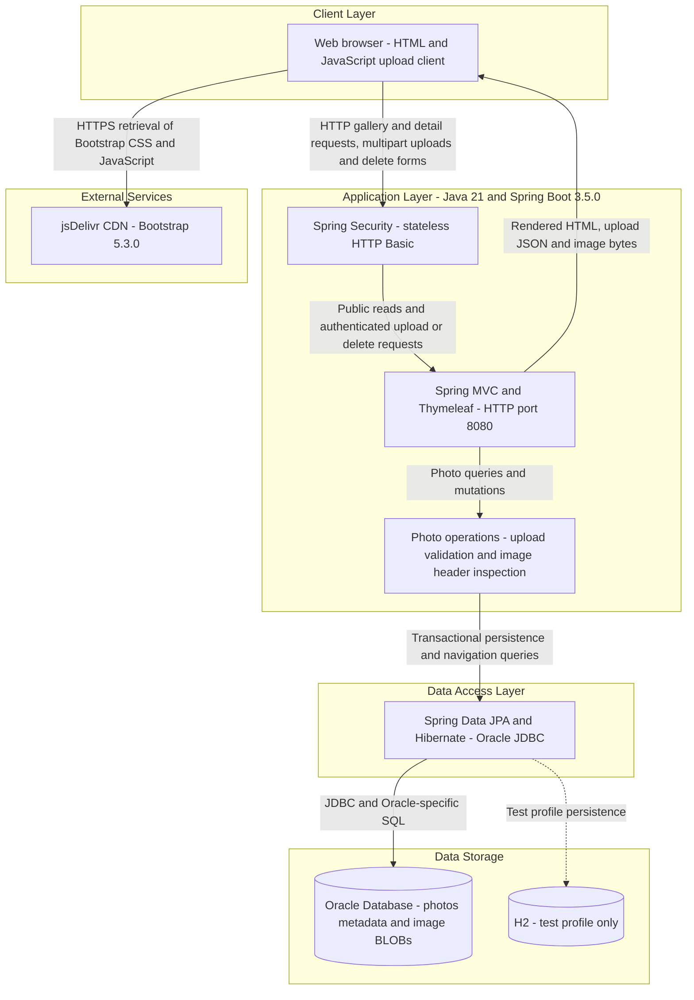
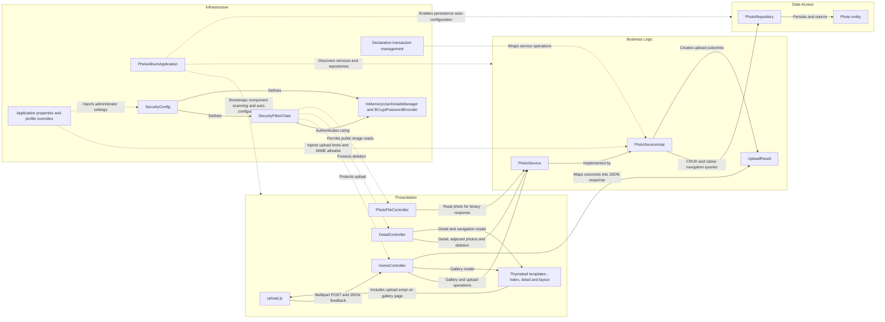

# Architecture Diagram

Photo Album is a single-module Java 21 and Spring Boot 3.5.0 web application for browsing, uploading, viewing, and deleting photos. It renders a server-side gallery and stores both photo metadata and image bytes in Oracle Database.

## Application Architecture

### Technology Stack Summary

| Layer | Technology | Version | Purpose |
|---|---|---|---|
| Runtime and packaging | Java, Maven, Spring Boot executable JAR | Java 21; Spring Boot 3.5.0; Docker builder Maven 3.9.9 | Single application process; optional multi-stage container with Eclipse Temurin 21 JRE |
| Presentation | Spring MVC, Thymeleaf | Managed by Spring Boot 3.5.0 | Gallery and detail HTML, multipart upload JSON responses, image delivery |
| Browser UI | Bootstrap, JavaScript Fetch API | Bootstrap 5.3.0; browser-provided Fetch | Responsive gallery, asynchronous uploads and feedback |
| Security | Spring Security, BCrypt, in-memory user store | Managed by Spring Boot 3.5.0 | HTTP Basic authentication for upload and delete; public read access |
| Business logic | Spring services, transaction management, Java ImageIO | Spring Boot-managed Spring libraries; Java 21 ImageIO | Validate uploads, inspect dimensions, manage photo lifecycle and navigation |
| Data access | Spring Data JPA, Hibernate, Oracle JDBC ojdbc8 | Managed by Spring Boot 3.5.0 | Entity persistence and native Oracle queries |
| Production storage | Oracle Database | Server version not established by inspected application files | Store image BLOBs and metadata in the `photos` table |
| Test storage | H2 | Managed by Spring Boot 3.5.0; test scope | In-memory persistence under the test profile |

### Data Storage & External Services

Oracle is the application's persistent store: the `photos` table contains UUID identifiers, original filenames, MIME types, file sizes, timestamps, optional image dimensions, and image bytes mapped as a JPA large object. Photo delivery reads these bytes from the database rather than an upload filesystem or object store. Native repository queries use Oracle features such as `NVL`, `ROWNUM`, and `DUAL`. H2 is configured separately for tests. The browser retrieves Bootstrap assets from jsDelivr; no backend external API, message broker, or cache integration was identified. Default and Docker configurations use Hibernate schema creation (`ddl-auto=create`), rather than preserving the schema through migrations.

### Key Architectural Decisions

- A layered monolith uses constructor injection from controllers through a service interface to a Spring Data repository; transaction boundaries reside in the service implementation.
- Images and their metadata share database persistence, while ImageIO inspects image headers during upload and the web layer serves the stored bytes.
- Security is cross-cutting: gallery reads are public, upload and deletion require stateless HTTP Basic authentication, and the configured in-memory administrator uses BCrypt. CSRF protection is disabled in the current configuration; credential values are intentionally omitted.

## Component Relationships

### Component Inventory

| Component | Layer | Type | Responsibility |
|---|---|---|---|
| `HomeController` | Presentation | Spring MVC controller | Render `/`; handle multipart `/upload` requests and upload errors; produce JSON feedback |
| `DetailController` | Presentation | Spring MVC controller | Render `/detail/{id}`, resolve older and newer photos, and handle deletion with redirects |
| `PhotoFileController` | Presentation | Spring MVC controller | Serve `/photo/{id}` as a byte-array resource using the stored MIME type and no-cache headers |
| `index.html`, `detail.html`, `layout.html` | Presentation | Thymeleaf templates | Gallery, photo detail, navigation, delete form, and shared layout template |
| `upload.js` | Presentation | Browser script | Submit multipart uploads with Fetch and update gallery feedback |
| `PhotoService` | Business Logic | Service interface | Define photo listing, lookup, upload, deletion, and navigation operations |
| `PhotoServiceImpl` | Business Logic | Transactional Spring service | Validate file size and MIME type, inspect image dimensions, coordinate repository access and upload outcomes |
| `UploadResult` | Business Logic | Result DTO | Carry upload success, photo identifier, filename, and error information |
| `PhotoRepository` | Data Access | Spring Data JPA repository | Standard CRUD plus native Oracle listing and timestamp-based navigation queries |
| `Photo` | Data Access | JPA entity with validation constraints | Map the `photos` table, metadata, UUID identifier, and binary photo data |
| `PhotoAlbumApplication` | Infrastructure | Spring Boot entry point | Start the executable application and enable component scanning and auto-configuration |
| `SecurityConfig` | Infrastructure | Spring configuration | Define the security chain, in-memory administrator, and password encoder |
| `SecurityFilterChain` | Infrastructure | HTTP security filter chain | Apply stateless HTTP Basic authentication to upload and delete endpoints; allow other requests |
| `InMemoryUserDetailsManager`, `BCryptPasswordEncoder` | Infrastructure | Authentication beans | Hold the configured administrator in memory and verify its BCrypt-encoded password |
| Application properties and profile overrides | Infrastructure | Externalized configuration | Supply datasource, JPA, HTTP, multipart, logging, and upload settings; provide a separate test database profile |
| Declarative transaction management | Infrastructure | Spring transaction interception | Apply service transactions and read-only semantics to photo retrieval operations |
