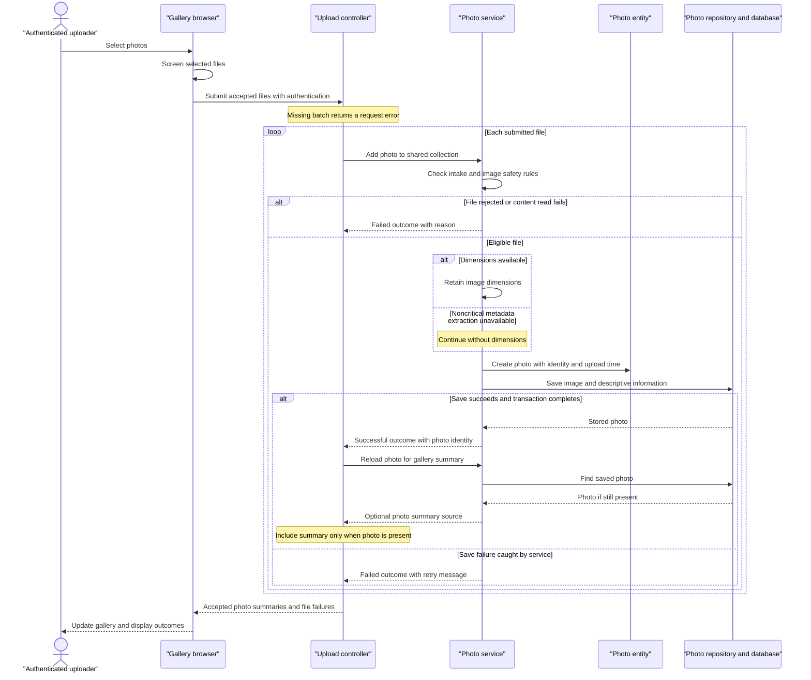

# Core Business Workflows

Photo Album lets visitors browse a shared photo collection, inspect individual images, and navigate by upload time. Authenticated users can add photos in batches and permanently remove photos.

## Domain Entities

| Entity | Service / Bounded Context | Description | Key Relationships |
| --- | --- | --- | --- |
| Photo | PhotoService / Photo Collection Management | An uploaded image and its descriptive information, managed as one independently stored item. | Belongs to the shared collection; earlier and later photos are derived by upload time, not explicit relationships. |
| UploadResult (operation outcome, not a persisted entity) | PhotoService / Photo Intake | Reports whether one selected file became a stored photo or why it was rejected. | References the created Photo on success; grouped into batch success and failure results. |

There are no modeled albums, photo owners, tags, or user-to-photo relationships. The configured administrator is an authentication principal, not a business-domain entity. No explicit multi-entity aggregate or DDD bounded-context implementation is present.

Evidence: `src/main/java/com/photoalbum/model/Photo.java`, `src/main/java/com/photoalbum/model/UploadResult.java`, `src/main/java/com/photoalbum/config/SecurityConfig.java`.

## Service-to-Domain Mapping

This is one application, not independently deployed microservices. The following are internal responsibilities within the same photo-management context.

| Service | Domain Context | Owned Entities | External Dependencies |
| --- | --- | --- | --- |
| PhotoService / PhotoServiceImpl | Photo intake, collection browsing, chronological navigation, and removal | Photo; produces UploadResult | PhotoRepository and the configured database; local image-header readers |
| HomeController | Gallery presentation and batch intake orchestration | None; composes Photo summaries and upload outcomes | Internal PhotoService calls |
| DetailController | Individual photo viewing, adjacent-photo selection, and deletion feedback | None | Internal PhotoService calls |
| PhotoFileController | Delivery of stored image content | None | Internal PhotoService calls |

PhotoRepository is the persistence boundary and the database is the source of truth for both images and descriptive information. Controllers exchange objects with PhotoService in-process; there are no cross-context identifiers, remote business APIs, or events.

Evidence: `src/main/java/com/photoalbum/service/impl/PhotoServiceImpl.java`, `src/main/java/com/photoalbum/repository/PhotoRepository.java`, `src/main/java/com/photoalbum/controller/`.

## Primary Workflows

### Workflow 1: Upload a batch and publish accepted photos

1. A user selects or drops files in the gallery. The browser applies **Client intake screening** and submits accepted files to `POST /upload`; authentication is required before controller execution.
2. HomeController applies **Batch presence** and processes each submitted file sequentially through PhotoService. There is no all-or-nothing batch transaction.
3. PhotoService applies **Server intake eligibility** and reads the file bytes. It attempts header-based dimension extraction and applies **Image dimension safety** when a reader recognizes the content.
4. **Metadata extraction fallback** permits some files to continue without dimensions. A file-read I/O failure instead produces a failed UploadResult.
5. An accepted file becomes a Photo, receives its identity and upload time, and is saved together with its image content. Validation rejection creates no Photo.
6. For each successful UploadResult, HomeController reloads the Photo by its returned identity and adds a descriptive summary to the successful batch results. Failed results carry the filename and reason separately.
7. The response follows **Batch outcome reporting**. The browser prepends accepted photos to the gallery without a full-page refresh and displays any server-reported file failures. Requests that fail at the HTTP or network level receive generic retry feedback.

This is controller-led orchestration within one application. There is no event publication, remote image store, or compensation that removes earlier successful uploads when a later file fails.

Evidence: `src/main/resources/static/js/upload.js:60-158`, `src/main/java/com/photoalbum/controller/HomeController.java:56-106`, `src/main/java/com/photoalbum/service/impl/PhotoServiceImpl.java:80-184`.

### Workflow 2: Browse the collection and inspect adjacent photos

1. A visitor opens `GET /`. HomeController requests all Photos through PhotoService and PhotoRepository; **Chronological browsing** determines gallery ordering.
2. If collection retrieval fails, the controller logs the error and renders an empty collection rather than an explicit gallery error.
3. Selecting a gallery item opens `GET /detail/{id}`. DetailController loads the Photo and independently requests its previous and next candidates.
4. The controller composes the selected Photo and optional neighboring identities into the detail page. Navigation controls appear only for available neighbors.
5. The browser separately requests `GET /photo/{id}` for image content. PhotoFileController loads the same Photo and applies **Image delivery availability** before returning its bytes.
6. A blank, missing, or failed detail lookup redirects to the gallery; an image request instead returns a not-found or server-error response. If a neighbor query fails, the whole detail request redirects rather than rendering a photo without navigation.

Image responses prohibit caching, and gallery URLs use timestamps to encourage fresh image retrieval. No thumbnail-generation workflow is present: gallery and detail views use stored image content.

Evidence: `src/main/java/com/photoalbum/controller/HomeController.java:38-50`, `src/main/java/com/photoalbum/controller/DetailController.java:32-58`, `src/main/java/com/photoalbum/controller/PhotoFileController.java:37-86`, `src/main/java/com/photoalbum/repository/PhotoRepository.java:23-62`.

### Workflow 3: Confirm and permanently remove a photo

1. The detail page asks the user to confirm deletion. Canceling prevents the browser submission; this is a browser convenience, not a server-side approval step.
2. An authenticated submission to `POST /detail/{id}/delete` invokes PhotoService.
3. The service looks up the Photo. If absent, it returns false; otherwise, it deletes the stored item, including its image content.
4. DetailController redirects to the gallery and sets success, not-found, or retry-oriented failure flash feedback.

There is no soft-delete state, restore process, retention window, owner check, or downstream deletion notification.

Evidence: `src/main/resources/templates/detail.html:50-59`, `src/main/java/com/photoalbum/controller/DetailController.java:64-78`, `src/main/java/com/photoalbum/service/impl/PhotoServiceImpl.java:190-209`.

No scheduled business jobs, event-driven workflows, custom command-line jobs, or business-state seeding routines were found under `src/main`. The application entry point only starts the application. Both supplied main configuration profiles request schema recreation at startup, so collection retention across restarts must not be assumed.

## Cross-Service Data Flows

There are no cross-service calls, API gateway, message broker, circuit breakers, or distributed aggregation. Business data composition occurs locally:

- **Upload composition:** HomeController joins each successful UploadResult to a persisted Photo using the returned photo identity, then combines Photo summaries with separate per-file failure outcomes. If the reload returns no Photo, that success is omitted from both result lists; if the reload throws, the controller has no local recovery branch.
- **Detail composition:** DetailController combines one Photo with older and newer candidates using upload-time comparisons, then passes neighboring identities to the view. Image bytes are fetched in a separate browser request using the Photo identity; no remote service supplies part of the detail record.
- **Failure degradation:** Optional dimension extraction can degrade to an image without dimensions; gallery retrieval can degrade to an empty collection. Detail failures redirect home, and image delivery reports unavailable content. There is no cached or remote fallback when the database cannot supply photos.
- **Consistency:** Each service call has its own transaction boundary. Upload save and subsequent summary reload are separate calls; detail lookup, neighbor queries, and browser image retrieval do not form one consistent snapshot. A photo can disappear between these steps.

Evidence: `HomeController.java:69-95`, `DetailController.java:38-57`, `PhotoFileController.java:44-86` under `src/main/java/com/photoalbum/controller/`; `src/main/java/com/photoalbum/service/impl/PhotoServiceImpl.java`.

## Business Workflow Sequence

The normal completed-batch path is shown. Exceptions raised while completing a transaction or reloading a successful photo can escape this flow; there is no controller-level batch compensation or circuit-breaker fallback.

## Business Rules & Decision Logic

### Validation and eligibility

| Rule | Implemented decision |
| --- | --- |
| Client intake screening | Browser accepts declared JPEG, PNG, GIF, or WebP MIME types and files no larger than 10 MiB. Unsupported or oversized files are excluded from submission; empty files are not rejected by this client check. |
| Batch presence | A null or empty bound file list returns a bad request with “No files provided.” Multipart exceptions handled by HomeController receive the same response; earlier rejection by the request parser can prevent per-file processing. |
| Server intake eligibility | Declared MIME type, lowercased, must belong to the configured allowlist; file size must be positive and no greater than the configured limit. Shipped defaults allow JPEG, PNG, GIF, and WebP up to 10,485,760 bytes. A missing content type reaches the generic upload-error path. |
| Image dimension safety | When an image reader recognizes the content, header dimensions must not exceed 40,000,000 pixels in total. The service reads dimensions without fully decoding the image. |
| Metadata extraction fallback | No matching image reader does not reject a file. Non-I/O extraction exceptions are logged and processing continues with unavailable dimensions; I/O errors produce a failed upload. Consequently, an allowed declared MIME type is not proof that image content was fully validated or decodable. |
| Photo metadata constraints | Model declarations require a nonblank filename of at most 255 characters, positive non-null file size, nonblank MIME type of at most 50 characters, and an upload timestamp. These are entity constraints, not a separate controller validator. Dimensions and image content lack equivalent mandatory model constraints. |
| Request and file-count limits | Both main profiles declare a 10 MB multipart file limit and 50 MB request limit. A maximum-files setting of 10 exists but is not read or enforced by the upload service/controller or browser loop. |

### Outcomes, ordering, and lifecycle

- **Batch outcome reporting:** For a normally completed nonempty batch, HTTP status is OK even when all files fail. The response's `success` flag is true only if at least one Photo summary was actually added. Successful and failed files may coexist; the browser reports both server outcome lists.
- **Chronological browsing:** Gallery order is newest upload first. Previous means the nearest strictly older upload. Next means the nearest strictly newer upload that is no later than database current time. Equal timestamps are excluded from neighbor searches; no tie-breaking identity is used.
- **Image delivery availability:** Blank or unknown identities and missing/empty stored image bytes produce not-found responses. Other delivery exceptions produce a server error.
- **Lifecycle:** Selected file → rejected outcome, or stored Photo → permanently deleted. There is no persisted pending, approval, publication, or deleted status. A UUID and application-local upload time are assigned on construction. Reusing a filename is not prohibited.
- **Computed presentation:** Dimensions come from recognized image headers; image size and upload date are formatted for display. Adjacent identities are computed on demand rather than maintained as relationships.

### Cross-cutting business behavior

- **Transactions:** PhotoServiceImpl has class-level transactional behavior; retrieval and navigation operations are read-only. Upload and deletion execute as service transactions, not as a batch transaction. Caught repository exceptions become failure results during upload, but transaction-completion failures may still escape; no saga, retries, or explicit compensation is implemented.
- **Error handling:** UploadResult represents expected per-file rejections and caught read/save failures. Retrieval and deletion failures are wrapped in generic runtime exceptions. Controllers translate errors into empty gallery content, redirects/flash feedback, or image error statuses as described above; there are no domain-specific exception types or dead-letter handling.
- **Authorization:** Gallery, detail, and image viewing are public. Upload and deletion require authentication through stateless HTTP Basic. The configured principal has an ADMIN role, but these routes check authentication rather than that role. There are no resource-ownership restrictions, so any accepted authenticated principal can modify the shared collection. CSRF protection is disabled.
- **Audit/logging:** Upload success/rejection, deletion, and retrieval errors are logged with photo identities and/or filenames; image serving also logs image size and a small byte preview. There is no durable business audit entity or change history.
- **Startup retention:** Both main profiles use schema creation on startup, which can recreate photo storage and discard prior collection state. No business recovery or import step accompanies initialization.

Evidence: `src/main/java/com/photoalbum/service/impl/PhotoServiceImpl.java:27-229`, `src/main/java/com/photoalbum/model/Photo.java:31-90`, `src/main/java/com/photoalbum/repository/PhotoRepository.java:23-62`, `src/main/java/com/photoalbum/config/SecurityConfig.java:33-59`, `src/main/resources/static/js/upload.js:60-132`, `src/main/resources/application.properties:19-30`, `src/main/resources/application-docker.properties`.
