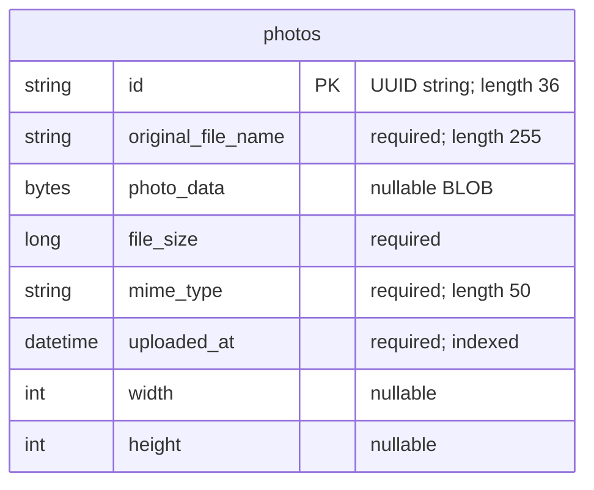

# Data Architecture & Persistence Layer

The data layer contains one JPA entity, `Photo`, persisted through Hibernate and Spring Data JPA. Oracle stores photo metadata and binary image content in normal runtime profiles; tests use an in-memory H2 database.

## Database Configuration

| Service/Module | DB Type | Profile | Driver | Connection | Migration Tool |
|---|---|---|---|---|---|
| Photo Album (`photo-album`) | Oracle | Default (no explicit profile) | `com.oracle.database.jdbc:ojdbc8`; `oracle.jdbc.OracleDriver` | JDBC thin connection to local Oracle XE by default; environment-overridable connection and schema credentials. Spring Boot's JPA starter supplies HikariCP; no explicit pool sizing is configured. | None; Hibernate recreates the mapped schema at startup, potentially destroying existing photo data. |
| Photo Album (`photo-album`) | Oracle | `docker` | Same Oracle driver | JDBC thin connection to the Oracle database host by default; environment-overridable connection and schema credentials. Same default pooling behavior. | None; Hibernate recreates the mapped schema at startup. |
| Photo Album tests | H2 | `test` | `com.h2database:h2` (test scope); `org.h2.Driver` | Named, in-memory test database; no explicit pool tuning. | None; Hibernate creates the schema at startup and drops it at shutdown. |

Sources: `pom.xml:43-54,88-93`, `src/main/resources/application.properties:9-21`, `src/main/resources/application-docker.properties:1-17`, and `src/test/resources/application-test.properties:1-10`. See `configuration-inventory.md` for the full property inventory rather than raw configuration keys and values here.

No Flyway/Liquibase dependencies, versioned schema migrations, application schema SQL, or database seed data were found. The scripts in `oracle-init/` provision/check the application schema user and database availability; they do not create the `photos` table or seed photos. The default schema user receives schema-creation privileges, not DBA privileges (`oracle-init/01-create-user.sh:27-43`, `oracle-init/create-user.sh:29-35`). The checked-in static image is not referenced as a database seed by the persistence code.

## Data Ownership per Service

| Service | Tables Owned | ORM Framework | Caching | Notes |
|---|---|---|---|---|
| Photo Album / `PhotoServiceImpl` | `photos` (`Photo`) | Jakarta Persistence / Hibernate via Spring Data JPA | No configured application, second-level, or query cache | Owns both image bytes and metadata. `UploadResult` is a nonpersistent result object, not another table. |

Sources: `src/main/java/com/photoalbum/model/Photo.java:15-76`, `src/main/java/com/photoalbum/model/UploadResult.java:3-10`, `src/main/java/com/photoalbum/repository/PhotoRepository.java:15-16`, and `src/main/java/com/photoalbum/service/impl/PhotoServiceImpl.java:27-36`.

## Entity Model

`Photo` is defined in `src/main/java/com/photoalbum/model/Photo.java:15-81`. Java fields map respectively to `String id`, `String originalFileName`, `byte[] photoData`, `Long fileSize`, `String mimeType`, `LocalDateTime uploadedAt`, `Integer width`, and `Integer height`. The constructor assigns the UUID identifier and local upload timestamp; there is no database-generated identifier or optimistic-lock version field. The upload timestamp has a nonunique index, `idx_photos_uploaded_at`.

This is a single-table model without foreign keys, entity associations, relationship cardinalities, cascade rules, or bidirectional links. The binary field uses `@Lob` without a lazy-fetch override; custom native queries explicitly select the bytes as well as metadata, so gallery/navigation queries are not metadata-only projections.

`PhotoServiceImpl` has class-level `@Transactional`; its retrieval and navigation methods override this with read-only transactions (`src/main/java/com/photoalbum/service/impl/PhotoServiceImpl.java:27-28,52-70,215-229`). Upload and delete use the default write transaction. No explicit isolation level or propagation override is declared.

## Key Repository Methods

| Service | Repository | Notable Methods | Purpose |
|---|---|---|---|
| Photo Album | `PhotoRepository` (`Photo`, identifier `String`), `src/main/java/com/photoalbum/repository/PhotoRepository.java:15-29` | `List<Photo> findAllOrderByUploadedAtDesc()` | Native SQL retrieves all photo rows, including BLOBs, newest first. Oracle `NVL` substitutes a MIME type when the stored value is null. No pagination is applied. |
| Photo Album | `PhotoRepository`, same source, lines 37-46 | `List<Photo> findPhotosUploadedBefore(LocalDateTime uploadedAt)` | Native SQL selects strictly older rows, ordered newest first, with an outer Oracle `ROWNUM` limit of ten. Includes BLOBs. |
| Photo Album | `PhotoRepository`, same source, lines 54-62 | `List<Photo> findPhotosUploadedAfter(LocalDateTime uploadedAt)` | Native SQL selects strictly newer rows up to Oracle's current database time, ordered oldest first. Uses `SYSDATE`, `DUAL`, and `NVL`; includes BLOBs and has no explicit row limit. |

The interface extends `JpaRepository<Photo, String>` for standard CRUD, paging, and sorting; inherited CRUD methods are omitted from the table. There are no derived custom finders, named queries, stored-procedure calls, or cross-service bulk aggregation methods. All three custom methods are native SQL rather than JPQL and depend on Oracle constructs. The H2 test only loads the application context and does not exercise these queries (`src/test/java/com/photoalbum/PhotoAlbumApplicationTests.java:7-14`).

## Caching Strategy

| Layer | Provider / Pattern | TTL / Eviction | Evidence |
|---|---|---|---|
| Application data | No Spring Cache annotations, cache manager, Redis, Ehcache, Caffeine, or JCache provider configured | Not applicable | `pom.xml`; `src/main/java`; application properties |
| Hibernate | Normal persistence-context identity tracking; no configured second-level or query-result cache | Persistence-context lifecycle; no application TTL configured | JPA dependencies and transaction annotations; no explicit cache settings or entity cache annotations |
| Photo responses | Explicitly prevent browser/intermediary caching rather than cache-aside or read-through storage | No storage requested; responses require revalidation and immediate expiry | `src/main/java/com/photoalbum/controller/PhotoFileController.java:74-79` |
| Authentication sessions | Stateless security configuration; no session cache configured | Not applicable | `src/main/java/com/photoalbum/config/SecurityConfig.java:46-58` |

Photo reads therefore depend on the database rather than a configured reusable data cache. The code explicitly chooses noncached photo responses; no broader data-cache rationale or performance policy is documented.

## Data Ownership Boundaries

There is one application-owned relational store per selected environment, not a database-per-service topology or a shared database accessed by multiple identified services. Metadata and image bytes reside together in `photos`; the upload implementation writes bytes to the entity rather than an external object store or filesystem (`src/main/java/com/photoalbum/service/impl/PhotoServiceImpl.java:154-166`).

All identified application persistence access is through `PhotoServiceImpl` and `PhotoRepository`. No cross-service database access, remote data-service integration, outbox, replication, or gateway-level aggregation is implemented. Reads and writes use the same entity, repository, and database; read-only transaction hints do not represent CQRS or a separate read store. Profile-specific H2 storage is isolated test storage, not a runtime replica.

### Data Classification & Sensitivity

| Entity | Sensitive Fields | Classification (PII/PHI/PCI/None) | Controls in Place |
|---|---|---|---|
| `Photo` | `originalFileName`; potentially `photoData` containing identifiable people, documents, or embedded metadata | Potential PII, depending on uploaded content; no explicit PHI or PCI fields | Writes require authentication; reads are public. No per-owner or field-level authorization, masking, content redaction, application-level field encryption, or configured database encryption-at-rest is evidenced in the inspected files. Photo responses request no caching. |
| `Photo` | `id`, `fileSize`, `mimeType`, `uploadedAt`, `width`, `height` | None explicitly; identifiers/timestamps may become identifying when linked with other data | Same public-read/authenticated-write policy; no additional field-specific controls. |

No user, patient, payment-card, or account entity is defined. Admin identity is held in an in-memory user manager with a BCrypt-encoded password, not in the relational entity model (`src/main/java/com/photoalbum/config/SecurityConfig.java:28-42`). Database credentials are externally supplied in runtime configuration. The absence of checked-in encryption-at-rest configuration does not establish whether an externally managed database has encryption enabled. Original filenames and a small prefix of image bytes are also logged without masking (`src/main/java/com/photoalbum/controller/PhotoFileController.java:54-66`).
