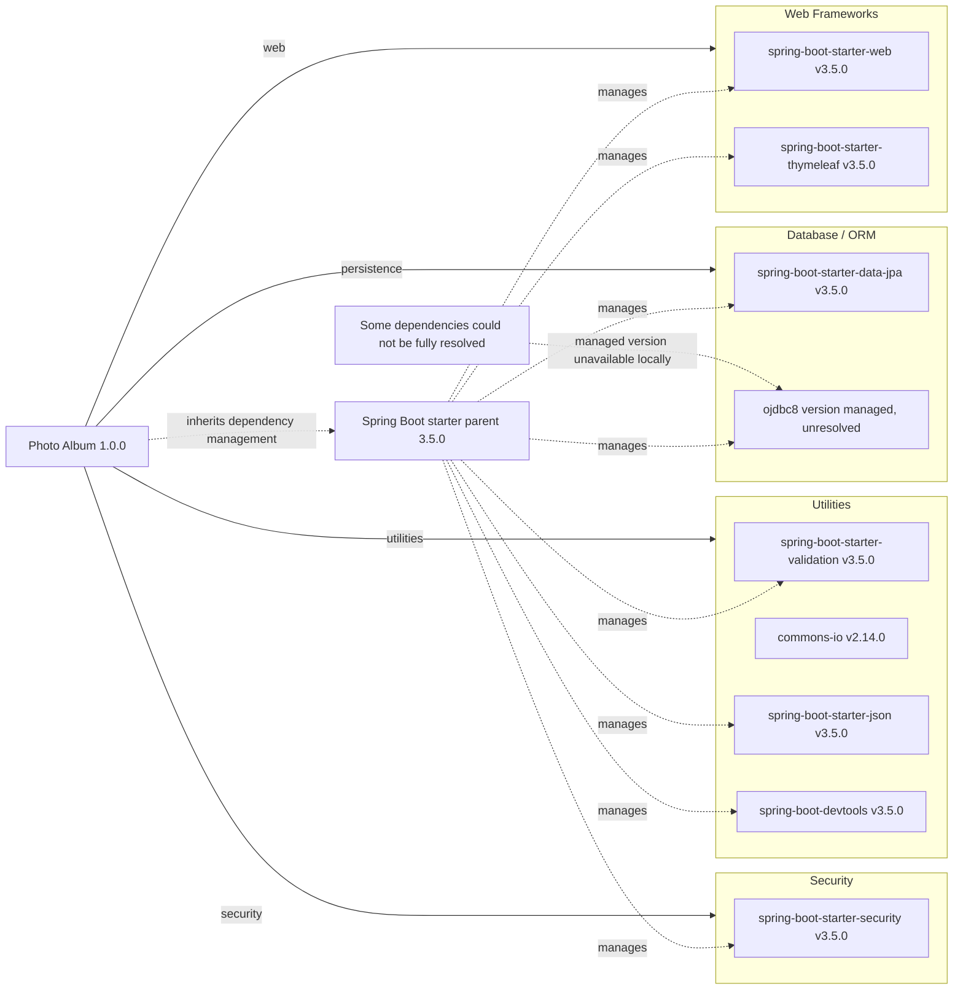

# Dependency Map

Photo Album (`com.photoalbum:photo-album:1.0.0`) declares 11 external dependencies in `pom.xml`: 9 non-test dependencies and 2 test dependencies. The project targets Java 21 and inherits dependency management from Spring Boot parent 3.5.0; the parent and build plugin are not included in dependency counts.

## Dependencies

### Dependency Summary

| Category | Count | Key Libraries | Notes |
|----------|-------|---------------|-------|
| Web Frameworks | 2 | `org.springframework.boot:spring-boot-starter-web:3.5.0`; `org.springframework.boot:spring-boot-starter-thymeleaf:3.5.0` | Default compile scope; versions inherited from parent management. |
| Database / ORM | 2 | `org.springframework.boot:spring-boot-starter-data-jpa:3.5.0`; `com.oracle.database.jdbc:ojdbc8` (managed version unresolved) | JPA has default compile scope; Oracle driver has runtime scope. |
| Security | 1 | `org.springframework.boot:spring-boot-starter-security:3.5.0` | Default compile scope; parent-managed version. |
| Utilities | 4 | `org.springframework.boot:spring-boot-starter-validation:3.5.0`; `commons-io:commons-io:2.14.0`; `org.springframework.boot:spring-boot-starter-json:3.5.0`; `org.springframework.boot:spring-boot-devtools:3.5.0` | All default compile scope; Commons IO is explicitly versioned; DevTools is optional. |
| **Total non-test** | **9** | | Test dependencies are excluded. |

### Version & Compatibility Risks

Spring Boot 3.5.0 is an initial minor-line release; review newer maintenance releases and applicable support policy before deployment. Commons IO 2.14.0 is an older, explicitly pinned release and will not follow parent-managed upgrades. Java 21 and the Spring Boot 3 Jakarta-based ecosystem constrain compatibility with older Java EE integrations. The Oracle driver version cannot be determined from the local POM alone, so driver/JDK/database compatibility requires verification. This build-file inventory does not establish current vulnerability status or end-of-life status.

### Notable Observations

- Only `pom.xml` was found among recognized build/package manifests. No local lockfile or BOM contents expose the resolved transitive dependency tree; Oracle and H2 versions remain unresolved. Spring Boot artifact versions shown as 3.5.0 derive from the parent release rather than explicit dependency versions.
- The parent is `org.springframework.boot:spring-boot-starter-parent:3.5.0`; no BOM import is explicitly declared. The build also declares `org.springframework.boot:spring-boot-maven-plugin` without an explicit version; it is build tooling, not a counted application dependency.
- `spring-boot-starter-json` supplies JSON support, not image processing despite its POM comment. It is typically also brought in by the web starter; that transitive overlap is not resolved from local files.
- DevTools is a compile-scoped optional dependency, not test-scoped. Optional status affects propagation to consumers and does not itself exclude the dependency from this application's development classpath.

## Test Dependencies

| Framework | Version | Notes |
|-----------|---------|-------|
| `org.springframework.boot:spring-boot-starter-test` | 3.5.0 (parent-managed) | Test scope; aggregates testing support, typically including JUnit Jupiter, Mockito, and AssertJ. Individual transitive library versions are not visible in the local manifest and are not counted separately. |
| `com.h2database:h2` | Parent-managed; unresolved locally | Test scope; in-memory database support. |

Total test-scope dependencies: 2

No dedicated Testcontainers or contract-testing dependency is declared. H2 provides test database support but does not alone verify Oracle-specific behavior; build files alone do not establish actual test coverage.
