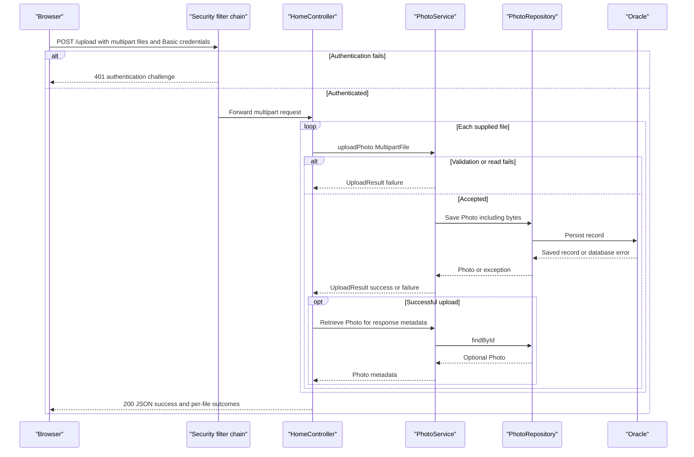

# API & Service Communication Contracts

Five controller-defined routes expose gallery browsing, detail navigation, image retrieval, multipart uploads and deletion. Communication is synchronous HTTP at the boundary and direct calls internally; there is no versioned API or service gateway.

Evidence paths in this document are relative to `/home/runner/work/PhotoAlbum-Java-Lite/PhotoAlbum-Java-Lite/`.

## Service Catalog

| Service | Port | Category | Purpose |
|---|---|---|---|
| photoalbum-java-app / com.photoalbum:photo-album | 8080 | Business, including API/presentation layer | Only source-built deployable; web, Thymeleaf, JPA and Security starters |
| oracle-db | 1521; 5500 also published | Infrastructure | Third-party Oracle database container, not an independently implemented API |

Evidence: `pom.xml:15-21,30-66`; `docker-compose.yml:3-43`. There are no Maven submodules, gateway, discovery, or observability services in these declarations.

## API Endpoints Inventory

| Service / Controller | Method | Path | Request Type | Response Type |
|---|---|---|---|---|
| Photo Album / HomeController | GET | `/` | None | 200 HTML `index` view; photo-loading exception yields an empty gallery |
| Photo Album / HomeController | POST | `/upload` | Multipart `files`: List of MultipartFile | 200 JSON Map with `success`, `uploadedPhotos`, `failedUploads`; 400 JSON for no files or handled multipart exception; unauthenticated request challenged with 401 |
| Photo Album / DetailController | GET | `/detail/{id}` | String path ID | 200 HTML `detail` with Photo and adjacent IDs; missing/invalid ID or lookup exception redirects to `/` (normally 302) |
| Photo Album / DetailController | POST | `/detail/{id}/delete` | String path ID | Redirect to `/` with success/error flash message, including not-found/error cases; 401 when unauthenticated |
| Photo Album / PhotoFileController | GET | `/photo/{id}` | String path ID | 200 Resource backed by ByteArrayResource with stored media type; 404 if record/bytes absent; 500 on caught exception |

Evidence: `src/main/java/com/photoalbum/controller/HomeController.java:38-106`; `src/main/java/com/photoalbum/controller/DetailController.java:18-78`; `src/main/java/com/photoalbum/controller/PhotoFileController.java:23-86`. Framework-generated errors can occur before handler invocation; the table distinguishes explicit controller behavior from framework defaults. Static assets and framework error handling are not additional business controller routes.

## Management & Observability Endpoints

| Service | Endpoint | Custom Metrics (if any) |
|---|---|---|
| Photo Album | No explicit management/health/Swagger endpoint found | No custom metric registration found |
| Oracle container | No application HTTP management contract defined | SQL-based container health check, not an application API |

No Actuator or metrics-export dependency is declared (`pom.xml:30-101`). Application logging is present, but is not a metrics API.

## DTOs & Contracts

- `MultipartFile` is the framework request contract. No dedicated upload request DTO exists.
- Mutable `UploadResult` is an internal per-file service outcome, transformed by HomeController into JSON maps rather than returned directly.
- Mutable domain entity `Photo` is supplied to HTML views and used to compose successful upload metadata; it is not returned as the entire entity in the JSON upload response. See [data-architecture.md](data-architecture.md) for its fields and persistence.
- The upload JSON envelope contains a Boolean success indicator plus successful metadata entries and file-name/error entries. A nonempty batch can return HTTP 200 with `success=false` if every file fails; mixed outcomes are supported.
- There are no gateway aggregation DTOs, immutable records, custom serialization configuration, OpenAPI, protobuf, or GraphQL contracts in the inspected application files. JSON uses the Boot web/JSON stack; no custom date representation is specified locally.

Evidence: `src/main/java/com/photoalbum/model/UploadResult.java:6-47`; `src/main/java/com/photoalbum/model/Photo.java:19-155`; `src/main/java/com/photoalbum/controller/HomeController.java:58-97`; `pom.xml:32-40,75-79`.

## Communication Patterns

Browser requests synchronously invoke controllers, PhotoService and the repository. The browser's asynchronous JavaScript `fetch` does not establish broker-based asynchronous service communication. No outbound backend HTTP/gRPC client, message broker, event choreography, discovery registry, gateway aggregation, client-side balancing, retry policy, circuit breaker, bulkhead or application timeout is defined in the inspected source. Consequently there are no configured retry counts, service timeout values or circuit-breaker fallbacks to report.

The gallery deliberately degrades to an empty view after a read failure; detail failures redirect, image failures return 500, and upload errors are represented per file. These are local error paths, not resilience-library fallback policies. Compose starts the app after the database health condition; see [configuration-inventory.md](configuration-inventory.md) for startup details.

Security is **present**: the two write routes require authentication through stateless HTTP Basic and an in-memory BCrypt-encoded admin identity. Reads are public; the ADMIN role is assigned but no role-specific or per-photo ownership check is applied. CSRF is explicitly disabled. No JWT/OAuth, application TLS or HTTPS connector is configured; Compose publishes HTTP, so external transport protection cannot be assumed. Evidence: `src/main/java/com/photoalbum/config/SecurityConfig.java:28-59`; `docker-compose.yml:32-43`.

## Service Technology Matrix

| Service | Web | Data Access | Discovery | Gateway | Actuator | Cache | Metrics |
|---|---|---|---|---|---|---|---|
| Photo Album | MVC / Thymeleaf / JSON | JPA and native Oracle SQL | None | None | Not declared | No configured application cache | No exporter declared |
| oracle-db | Not an application web service | Oracle database | None | None | N/A | N/A | No separate exporter declared |

## Service Communication Sequence

The no-files/handled-multipart-error branch returns 400 before the loop; no retry is applied. Transaction-completion failures or the post-save metadata lookup can escape the local result-construction path, so the per-file failure envelope is not guaranteed for every infrastructure exception.
