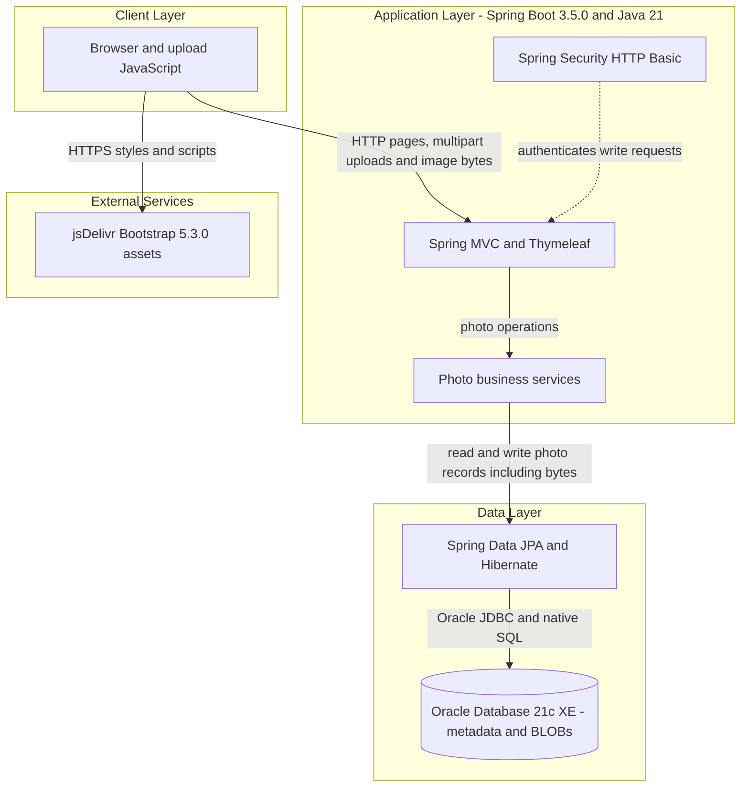
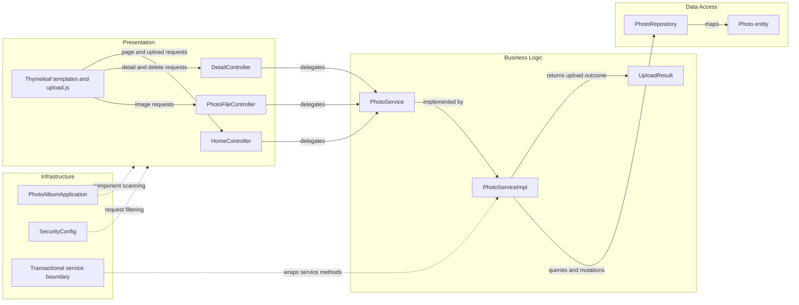

# Architecture Diagram

Photo Album is a single deployable application with server-rendered gallery pages and a JSON upload response. Diagrams describe the inspected implementation, not the Azure migration proposed by the workshop README.

## Application Architecture

### Technology Stack Summary

| Layer | Technology | Version | Purpose |
|---|---|---|---|
| Runtime | Java | 21 | Compile target and container runtime |
| Application | Spring Boot | 3.5.0 | Auto-configuration and executable JAR |
| Presentation | Spring MVC, Thymeleaf, Jackson | Boot-managed; component versions not declared | HTML pages, multipart handling, JSON response |
| Browser | Bootstrap | 5.3.0 | CDN-delivered presentation assets |
| Security | Spring Security | Boot-managed | Stateless Basic authentication for writes |
| Persistence | Spring Data JPA, Hibernate, Oracle JDBC ojdbc8 | Boot-managed | Entity persistence and Oracle-native queries |
| Database | Oracle Express Edition | Container tag 21.3.0-xe | Runtime photo metadata and binary storage |
| Test persistence | H2 | Boot-managed, test scope | Test profile only, not a runtime alternative packaged by default |

### Data Storage & External Services

Uploads store bytes in the database alongside metadata; the image-serving controller constructs an in-memory resource from those bytes. The Compose `oracle_data` volume persists Oracle database files, not a directory of uploaded images. A checked-in static upload image and a test upload-path property are legacy artifacts, not evidence of the current upload destination. No cache, broker, or backend cloud API integration is present in the inspected source. The browser separately requests Bootstrap assets from jsDelivr.

Evidence: `/home/runner/work/PhotoAlbum-Java-Lite/PhotoAlbum-Java-Lite/src/main/java/com/photoalbum/model/Photo.java:36-41`; `src/main/java/com/photoalbum/service/impl/PhotoServiceImpl.java:116-166`; `src/main/java/com/photoalbum/controller/PhotoFileController.java:57-83`; `docker-compose.yml:3-16`; `src/main/resources/templates/index.html:7,124`. Here and below, relative evidence paths resolve against `/home/runner/work/PhotoAlbum-Java-Lite/PhotoAlbum-Java-Lite/`.

### Key Architectural Decisions

- Constructor injection connects controllers to a service interface and its implementation to a repository.
- Database-backed binary storage is authoritative; there is no filesystem write or file-resource serving path in the photo service/controller.
- The application uses transaction-scoped services and Oracle-specific repository SQL rather than inter-service calls.

## Component Relationships

### Component Inventory

| Component | Layer | Type | Responsibility |
|---|---|---|---|
| HomeController | Presentation | MVC controller | Gallery and batch upload response composition |
| DetailController | Presentation | MVC controller | Detail navigation, deletion and redirect feedback |
| PhotoFileController | Presentation | MVC controller | Return database bytes as an image resource |
| index, detail, layout templates; upload.js | Presentation | Templates/browser script | Display gallery, initiate uploads and navigation |
| PhotoService / PhotoServiceImpl | Business logic | Interface / transactional service | Validation, persistence orchestration and navigation |
| UploadResult | Business logic | Mutable result POJO | Per-file outcome, not a persisted entity |
| PhotoRepository | Data access | JpaRepository | CRUD plus three native Oracle queries |
| Photo | Data access | JPA entity | Metadata and binary content |
| SecurityConfig | Infrastructure | Configuration/filter-chain beans | In-memory admin identity, BCrypt and Basic authentication |
| PhotoAlbumApplication | Infrastructure | Boot entry point | Application startup and auto-configuration |

Evidence: `src/main/java/com/photoalbum/controller/HomeController.java:24-33,38-106`; `src/main/java/com/photoalbum/controller/DetailController.java:17-27,32-78`; `src/main/java/com/photoalbum/controller/PhotoFileController.java:22-38`; `src/main/java/com/photoalbum/service/impl/PhotoServiceImpl.java:27-47,190-229`; `src/main/java/com/photoalbum/repository/PhotoRepository.java:15-62`; `src/main/java/com/photoalbum/config/SecurityConfig.java:25-59`; `src/main/java/com/photoalbum/PhotoAlbumApplication.java:9-13`.
