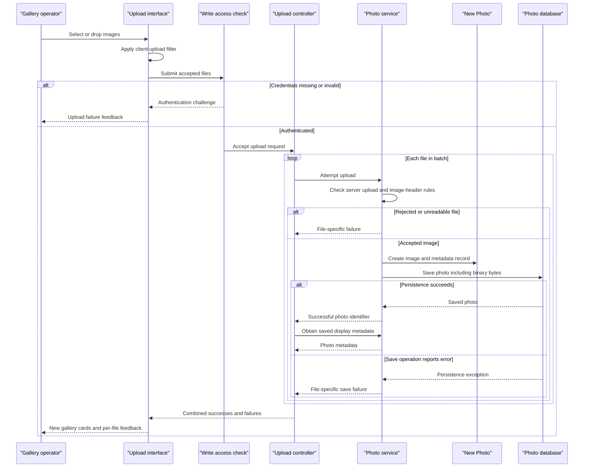

# Core Business Workflows

Users browse a shared photo gallery, inspect photos and navigate chronologically. Authenticated operators upload one or more images and remove photos, receiving per-file or page-level feedback.

Evidence paths resolve against `/home/runner/work/PhotoAlbum-Java-Lite/PhotoAlbum-Java-Lite/`.

## Domain Entities

| Entity | Service / Bounded Context | Description | Key Relationships |
|---|---|---|---|
| Photo | Photo Album / shared gallery | An uploaded image with display metadata and optional dimensions | Independent gallery item; navigation derived from upload chronology, not an explicit association |
| UploadResult | Photo Album / upload operation | Nonpersisted outcome of one upload | Correlates a file with a saved photo or an error; not a domain aggregate |

No user-owned album, account entity or formal DDD aggregate structure is implemented. Persistence details are in [data-architecture.md](data-architecture.md).

## Service-to-Domain Mapping

| Service | Domain Context | Owned Entities | External Dependencies |
|---|---|---|---|
| Photo Album deployable / PhotoServiceImpl | Gallery management, upload and removal | Photo; transient UploadResult | Database repository; local image-header inspection |

There are no independent domain microservices. All three controllers use the same photo service; the shared application is the source of truth rather than a gateway combining remote owners.

## Primary Workflows

### Workflow 1: Upload a batch of photos

1. User selects/drops files; browser applies the **client upload filter**, submits the accepted subset and displays progress.
2. The write request must pass **authenticated-write access**. HomeController applies **batch presence validation**, then calls the service separately for each file.
3. Service applies **server upload validation**, reads bytes, applies **image-header safety validation** when a reader exists, and creates the photo.
4. The photo including binary content is saved to the database. No durable filesystem upload step occurs.
5. For successful service outcomes, the controller looks up the saved photo and composes response metadata. It combines successes and failures, permitting partial success, then the browser prepends successful cards and displays errors.

Evidence: `src/main/resources/static/js/upload.js:60-132,135-159`; `src/main/java/com/photoalbum/controller/HomeController.java:56-97`; `src/main/java/com/photoalbum/service/impl/PhotoServiceImpl.java:80-184`; `src/main/java/com/photoalbum/config/SecurityConfig.java:51-58`.

### Workflow 2: Browse, inspect and navigate

1. Gallery requests all photos newest first; a read error produces an empty gallery rather than an error page.
2. Selecting a photo loads its record and computes older/newer neighbors by timestamp. Missing IDs, absent records or read errors redirect to the gallery.
3. The browser separately retrieves image bytes from the database-backed image controller. A missing record or missing binary content yields not found; other serving failures yield an internal error.
4. Available adjacent IDs become navigation links. There is no wraparound when no older/newer photo is found.

Evidence: `src/main/java/com/photoalbum/controller/HomeController.java:38-50`; `src/main/java/com/photoalbum/controller/DetailController.java:32-58`; `src/main/java/com/photoalbum/controller/PhotoFileController.java:38-86`; `src/main/java/com/photoalbum/service/impl/PhotoServiceImpl.java:215-229`.

### Workflow 3: Remove a photo

1. Browser displays a confirmation prompt before submitting the deletion.
2. After write authentication, the service looks up the photo; missing records produce a not-found outcome.
3. Existing photo rows, including their stored image bytes, are deleted. The controller redirects to the gallery with success/not-found/error feedback.

There is no soft-delete state, restore workflow, remote cleanup or filesystem unlink operation. Evidence: `src/main/resources/templates/detail.html:50-51`; `src/main/java/com/photoalbum/controller/DetailController.java:64-78`; `src/main/java/com/photoalbum/service/impl/PhotoServiceImpl.java:190-208`.

## Cross-Service Data Flows

No cross-service orchestration, gateway aggregation, message exchange or asynchronous business processing exists in the inspected implementation. HomeController's upload metadata lookup and DetailController's adjacent-photo composition are in-process combinations over one service/repository. There is no downstream service outage fallback or circuit breaker; the empty-gallery, redirect, per-file error and image-error behaviors are local handling paths.

The database container is infrastructure, not a second domain service. Browser CDN requests supply styling/scripts rather than business data.

## Business Workflow Sequence

The save-error branch describes the local catch path, not a guarantee that every transaction-completion error is converted into an upload result. No automated retry or compensating rollback across the entire batch is implemented.

## Business Rules & Decision Logic

| Rule | Actual implementation and limits | Evidence |
|---|---|---|
| Client upload filter | Allows JPEG, PNG, GIF and WebP MIME labels; rejects files over 10 MiB. This is UI guidance, not authoritative server validation. | upload.js:65-79 |
| Batch presence validation | Empty/null file list and handled multipart failures return a bad request; nonempty batches are processed file by file. | HomeController.java:63-70,100-106 |
| Server upload validation | Lowercased declared content type must be allowed; byte size must be positive and not exceed configured maximum. Missing MIME may enter the generic failure path. | PhotoServiceImpl.java:85-109,178-181 |
| Image-header safety validation | Reader-provided width × height must not exceed 40,000,000 pixels. Reads header dimensions rather than fully decoding. IOException rejects upload; other extraction exceptions permit continuing without dimensions. No matching reader also permits continuing, so this is not full image-content validation. | PhotoServiceImpl.java:33-34,116-152 |
| Metadata constraints | Filename is nonblank and at most 255 characters; size nonnull and positive; MIME nonblank and at most 50 characters; upload time nonnull. No request-level Valid annotation is used; entity constraints are declared for persistence validation. | Photo.java:31-64; HomeController.java:58 |
| Declared batch-count setting | Configuration says 10 files per upload, but controller loops all supplied files and service does not consume/enforce this value. Multipart request-size limit is separate. | application.properties:24-30; HomeController.java:69-91; PhotoServiceImpl.java:40-46 |
| Partial success | Response success means at least one saved photo was successfully reread and added to response metadata. All-file failures still produce a normal JSON response for a nonempty processed batch. No batch-wide atomicity is defined. | HomeController.java:69-97 |
| Chronological neighbors | Strictly earlier/later timestamps; previous candidates descending, next ascending and not later than database current time; service selects first candidate. Equal-time photos are not neighbors through these predicates. | PhotoRepository.java:37-62; PhotoServiceImpl.java:215-229 |
| Photo identity/lifecycle | Construction assigns UUID and current local timestamp; lifecycle is create, read and hard delete, with no workflow status or state machine. | Photo.java:79-90; PhotoServiceImpl.java:190-205 |
| Authenticated-write access | Upload/delete require authentication; reads are public. Assigned ADMIN role is not checked explicitly; no per-photo owner access rule. HTTP Basic is stateless, CSRF disabled, no local TLS configuration. | SecurityConfig.java:33-58 |

In this table, Java short filenames refer to `src/main/java/com/photoalbum/` under their corresponding controller/model/repository/service/config packages; `upload.js` is under `src/main/resources/static/js/` and `application.properties` under `src/main/resources/`.

**Transactions and integrity:** service class is transactional; reads are marked read-only. Each controller-issued service upload is a separate operation; binary content and metadata share the entity write. No bidirectional associations or cross-service saga/compensation are needed by the current model. Caught persistence exceptions may still mark a transaction rollback-only or surface at commit.

**Errors and audit:** service reads/deletes wrap failures in runtime exceptions; upload generally produces UploadResult errors, and controllers apply their local feedback policies. There are SLF4J upload/delete/error logs, but no dedicated immutable audit trail, entity change history or dead-letter queue. Image serving logs filenames and initial bytes. Evidence: `src/main/java/com/photoalbum/service/impl/PhotoServiceImpl.java:27-29,52-74,164-208`; `src/main/java/com/photoalbum/controller/PhotoFileController.java:53-72`.
