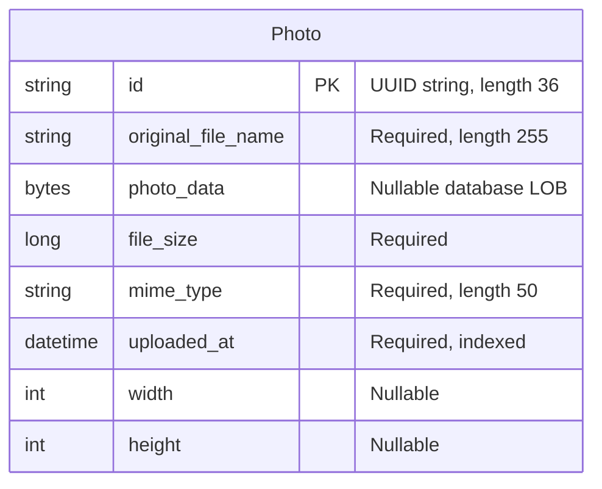

# Data Architecture & Persistence Layer

One JPA entity stores photo metadata and binary content in Oracle; the test profile substitutes an in-memory H2 database. There are no entity-to-entity relationships.

Evidence paths below resolve against `/home/runner/work/PhotoAlbum-Java-Lite/PhotoAlbum-Java-Lite/`.

## Database Configuration

| Service/Module | DB Type | Profile | Driver | Connection | Migration Tool |
|---|---|---|---|---|---|
| photo-album | Oracle | Default | oracle.jdbc.OracleDriver / ojdbc8 | Localhost:1521, XE SID by default; URL/user/password externalizable | No Flyway/Liquibase; Hibernate recreates schema at startup |
| photo-album | Oracle | docker | oracle.jdbc.OracleDriver / ojdbc8 | oracle-db:1521, XE SID default; Compose overrides connection settings | Same Hibernate schema recreation |
| photo-album tests | H2 in-memory | test | org.h2.Driver / test-scoped H2 | Named in-memory test database; test-only credentials omitted | Hibernate creates and drops test schema |

Connection-pool settings are not explicitly supplied; JPA starter defaults apply rather than a locally specified pool size. Oracle startup scripts create/grant the schema user, not domain seed records. No versioned schema migrations or domain SQL seed files are present in the inspected resources. See [configuration-inventory.md](configuration-inventory.md) for property keys/values and deployment details.

Evidence: `src/main/resources/application.properties:9-21`; `src/main/resources/application-docker.properties:1-17`; `src/test/resources/application-test.properties:1-10`; `oracle-init/01-create-user.sh:19-43`; `oracle-init/create-user.sh:22-35`; `pom.xml:43-54,88-93`.

## Data Ownership per Service

| Service | Tables Owned | ORM Framework | Caching | Notes |
|---|---|---|---|---|
| photo-album | photos (Photo) | JPA / Hibernate | No explicit application or second-level cache configuration | UploadResult is a transient result POJO, not an entity |

## Entity Model

`Photo` maps to `photos`; `idx_photos_uploaded_at` is a nonunique index. Java types are String, byte array, Long, String, LocalDateTime and nullable Integer dimensions. The constructor generates a UUID and local timestamp. The binary column is explicitly nullable even though normal accepted uploads supply bytes. There are no foreign keys, cascade rules, bidirectional associations, or explicit lazy BLOB mapping. Full entity queries select `photo_data`, including the unpaginated gallery query; metadata-only projection is not implemented.

`PhotoServiceImpl` has a class-level transaction boundary, with read-only annotations for gallery, lookup and navigation operations. Upload and delete use write transactions. Catching a repository failure while constructing an upload result does not guarantee the transaction can subsequently commit.

Evidence: `src/main/java/com/photoalbum/model/Photo.java:15-90`; `src/main/java/com/photoalbum/repository/PhotoRepository.java:23-62`; `src/main/java/com/photoalbum/service/impl/PhotoServiceImpl.java:27-29,52-75,154-184,190-229`.

### Binary storage fact verification

The supplied fact is **accurate for the current implementation**:

> Photo uploads persist binary content in Photo.photoData (@Lob); PhotoFileController serves database bytes through ByteArrayResource, not filesystem files.

All three supplied citations were verified:

| Supplied citation | Observed evidence |
|---|---|
| `src/main/java/com/photoalbum/model/Photo.java:36-41` | `@Lob`, `photo_data` column and `byte[] photoData` |
| `src/main/java/com/photoalbum/service/impl/PhotoServiceImpl.java:154-166` | Constructor receives `photoData`; repository saves the Photo |
| `src/main/java/com/photoalbum/controller/PhotoFileController.java:57-69` | Reads `getPhotoData`, rejects absent bytes and wraps bytes in ByteArrayResource |

Additional provenance: service lines 116-118 obtain multipart bytes before the save. `src/test/resources/application-test.properties:13` contains an unconsumed legacy upload-directory setting, and `src/main/resources/static/uploads/5c62a4c2-d4eb-446f-9cd2-7ab8898cf371.jpg` is an existing static artifact. Neither is the current upload destination. Framework multipart staging, if used, is not durable photo storage. No memory vote was performed.

## Key Repository Methods

| Service | Repository | Notable Methods | Purpose |
|---|---|---|---|
| photo-album | PhotoRepository, Photo / String ID | `List<Photo> findAllOrderByUploadedAtDesc()` | Full records newest first; native SQL applies Oracle NVL to MIME type |
| photo-album | PhotoRepository | `List<Photo> findPhotosUploadedBefore(LocalDateTime uploadedAt)` | Strictly earlier uploads, descending, outer ROWNUM limit 10 |
| photo-album | PhotoRepository | `List<Photo> findPhotosUploadedAfter(LocalDateTime uploadedAt)` | Strictly later uploads, ascending, bounded above by Oracle SYSDATE from DUAL; no row limit |

Repository evidence: `src/main/java/com/photoalbum/repository/PhotoRepository.java:15-62`. CRUD is inherited from JpaRepository; there are no cross-service bulk queries or stored-procedure calls. The service picks the first result for each adjacent-photo lookup, and equal timestamps are excluded by the strict comparisons (`src/main/java/com/photoalbum/service/impl/PhotoServiceImpl.java:215-229`). Oracle-specific NVL, ROWNUM, SYSDATE and DUAL make these queries database-specific; H2 configuration alone does not demonstrate parity.

## Caching Strategy

No Spring Cache annotations, cache provider dependency, explicit TTL/eviction policy, JCache binding, Redis service, query cache or Hibernate second-level cache configuration was found in the inspected application and configuration. JPA's normal persistence context is not evidence of a shared application cache.

Image responses explicitly prohibit browser/proxy caching; the upload script additionally appends a timestamp to image URLs. Evidence: `src/main/java/com/photoalbum/controller/PhotoFileController.java:74-83`; `src/main/resources/static/js/upload.js:176-179`; `pom.xml:30-101`.

## Data Ownership Boundaries

The single application owns one database schema for reads and writes. Controllers share the same in-process service/repository rather than separate service-owned stores. There is no cross-service database access, event replication, gateway aggregation, outbox or CQRS read model. Test H2 is a separate testing context, not a second production data owner.

### Data Classification & Sensitivity

| Entity | Sensitive Fields | Classification (PII/PHI/PCI/None) | Controls in Place |
|---|---|---|---|
| Photo | Uploaded image bytes and user-supplied filenames can contain identifying content; timestamps can reveal activity | Potential PII, content-dependent; no dedicated PHI/PCI fields | Writes authenticated; reads public; no resource ownership checks, field masking or application-level encryption configured |

No application-configured encryption-at-rest or database TDE setting is shown; actual infrastructure encryption cannot be determined from source. Binary content is arbitrary user data, so absence of explicitly modeled medical/payment fields does not prove the uploads contain none. Image-serving logs include the filename and first ten bytes, not a dedicated immutable audit trail (`src/main/java/com/photoalbum/controller/PhotoFileController.java:53-72`). Access controls are evidenced in `src/main/java/com/photoalbum/config/SecurityConfig.java:33-58`.
