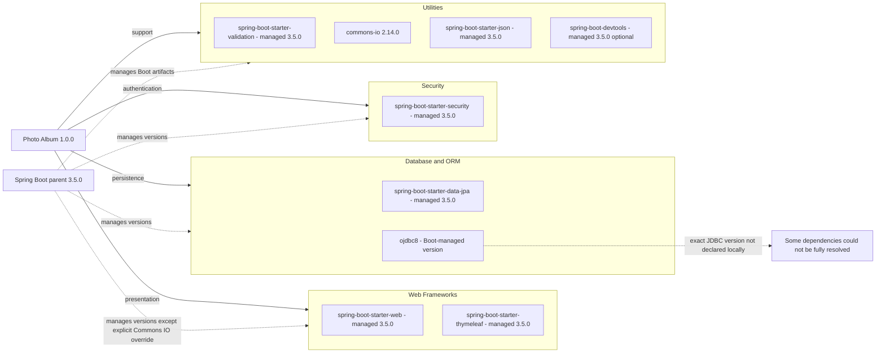

# Dependency Map

Photo Album declares 11 direct Maven dependencies: nine non-test dependencies and two test dependencies. This map uses build declarations only; it does not infer dependency use from source or resolve the transitive graph.

## Dependencies

### Dependency Summary

| Category | Count | Key Libraries | Notes |
|---|---|---|---|
| Web Frameworks | 2 | org.springframework.boot:spring-boot-starter-web; spring-boot-starter-thymeleaf | Compile scope (default), parent-managed |
| Database / ORM | 2 | org.springframework.boot:spring-boot-starter-data-jpa; com.oracle.database.jdbc:ojdbc8 | JPA compile; JDBC runtime |
| Security | 1 | org.springframework.boot:spring-boot-starter-security | Compile, parent-managed |
| Utilities | 4 | org.springframework.boot:spring-boot-starter-validation; commons-io:commons-io:2.14.0; org.springframework.boot:spring-boot-starter-json; org.springframework.boot:spring-boot-devtools | All default compile scope; DevTools optional |
| **Non-test total** | **9** | | No declared messaging, cache or observability-specific dependency |

### Version & Compatibility Risks

Java 21 is the explicit compile target and Spring Boot 3.5.0 is the explicit parent version. Commons IO 2.14.0 is pinned independently of parent dependency management; its age and override merit separate advisory/lifecycle review, but this document does not assert a verified CVE or end-of-life status. Exact Oracle JDBC, H2, Hibernate, Jackson and testing-library versions are not declared locally; changing database technology would require reviewing driver and dialect compatibility. No dependency resolution, vulnerability scan, build or test was run.

### Notable Observations

- Evidence is `/home/runner/work/PhotoAlbum-Java-Lite/PhotoAlbum-Java-Lite/pom.xml:8-28,30-101`; the single module packages a JAR, with no Maven profiles or explicit BOM import.
- The Boot parent provides inherited dependency management. Boot-owned artifact versions follow 3.5.0; third-party component versions are not locally pinned and must not be guessed.
- The JSON starter is explicitly declared alongside the web starter; its precise transitive overlap is not established without a dependency graph.
- `spring-boot-maven-plugin` is declared without an explicit version (`pom.xml:103-109`); build plugins and the parent are not counted as direct dependencies. No lockfile-backed transitive inventory was supplied.

## Test Dependencies

| Framework | Version | Notes |
|---|---|---|
| org.springframework.boot:spring-boot-starter-test | Parent-managed 3.5.0 | Test-scope aggregate; underlying JUnit/Mockito/AssertJ versions not locally specified |
| com.h2database:h2 | Boot-managed; exact version not declared | Test-scope embedded database |

Total test-scope dependencies: 2

No explicit Testcontainers, contract-testing, or other integration-test-specific dependency is declared. These statements concern build declarations, not test coverage or execution results.
