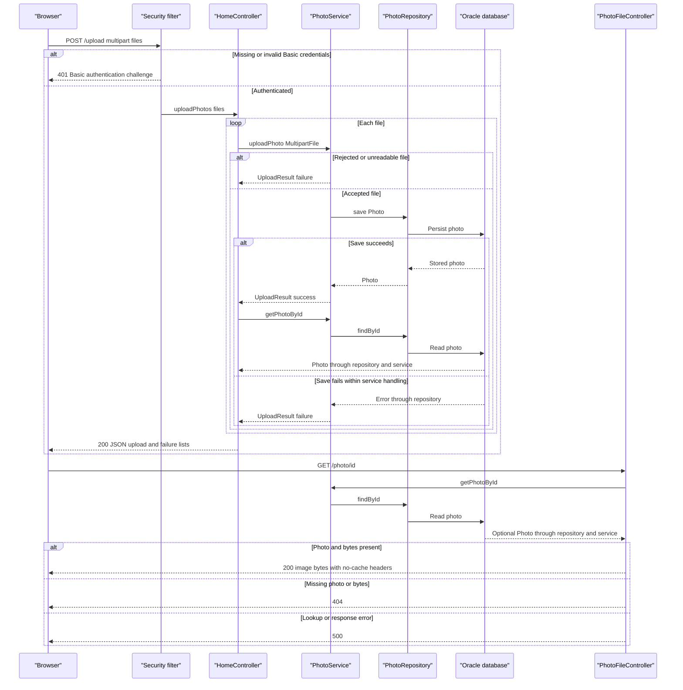

# API & Service Communication Contracts

Five application-defined HTTP endpoints serve gallery/detail HTML, accept multipart uploads, delete photos, and return image bytes. Browser requests, in-process service calls, and database operations follow synchronous request/response flows; no backend messaging or remote business-service API was found.

## Service Catalog

| Service | Port | Category | Purpose |
|---|---|---|---|
| `photoalbum-java-app` — Maven `com.photoalbum:photo-album`, single executable JAR | HTTP 8080, published as 8080 | API Layer / Business | Source-built gallery, upload, deletion, and image-serving application. Key dependencies: Spring MVC, Thymeleaf, Spring Security, Spring Data JPA, Validation, Jackson, Oracle JDBC, Commons IO. |
| `oracle-db` — third-party Oracle Database Express 21.3 container; no Maven module | 1521 database listener; 5500 database management, both published | Infrastructure | Stores photo content and metadata; not an application HTTP API. Uses the Oracle database image rather than project source. |

Evidence: `pom.xml:8-101`, `docker-compose.yml`, `Dockerfile`. The build has no Maven submodules; the checked-in deployment definition is Docker Compose. No separate gateway, discovery, or observability service was found.

## API Endpoints Inventory

All paths are unversioned and belong to `photoalbum-java-app`. Status codes below distinguish explicit controller behavior from conventional framework behavior.

| Service / controller | Method | Path | Request Type | Response Type |
|---|---|---|---|---|
| Application / `HomeController` | GET | `/` | No body or declared query parameters | 200 HTML `index` view, with `List<Photo>` and cache-busting timestamp in the template model. Retrieval exceptions produce the same view with an empty list, not an explicit error status. |
| Application / `HomeController` | POST | `/upload` | `multipart/form-data`; repeated required `files` parts bound to `List<MultipartFile>`; HTTP Basic authentication required | 200 JSON `Map<String,Object>` with `success`, `uploadedPhotos`, `failedUploads`, including partial or total per-file failure. Explicit 400 JSON for an empty list or controller-handled `MultipartException`; missing required parts are framework binding errors. Unauthenticated requests receive a Basic-auth 401 challenge. Unhandled service/transaction errors can produce framework 5xx responses. |
| Application / `DetailController` | GET | `/detail/{id}` | String path ID | 200 HTML `detail` view with `Photo` and adjacent photo IDs; missing/blank ID or caught lookup/navigation error redirects to `/` (normally 302), rather than returning 404. |
| Application / `DetailController` | POST | `/detail/{id}/delete` | String path ID; no declared request body; HTTP Basic authentication required | Redirect to `/` (normally 302) with success/error flash attributes. Missing photo and caught deletion failures also redirect; no JSON deletion result or explicit 404. Unauthenticated requests receive 401. |
| Application / `PhotoFileController` | GET | `/photo/{id}` | String path ID; browser may append an undeclared `_t` cache-busting query parameter | 200 `ResponseEntity<Resource>` backed by `ByteArrayResource`, using the stored MIME type; 404 for a missing photo or missing/empty image bytes; 500 for caught exceptions. |

Image responses set `Cache-Control: no-cache, no-store, must-revalidate, private`, `Pragma: no-cache`, `Expires: 0`, and `X-Photo-ID`, `X-Photo-Name`, `X-Photo-Size`. They do not set a download attachment disposition.

The configured multipart envelope is 10 MB per file and 50 MB per request. Service-level file rejection is represented in the 200 response's failed-upload entries, not generally as HTTP 400. Multipart parsing failures can be mapped to 400 by the local handler; rejection before controller handling may have framework/container-dependent behavior. Detailed validation belongs in `business-workflows.md`.

Evidence: `src/main/java/com/photoalbum/controller/HomeController.java:38-106`, `DetailController.java:32-78`, `PhotoFileController.java:23-86`; `src/main/resources/static/js/upload.js:97-131,178-179`; application properties.

## Management & Observability Endpoints

| Service | Endpoint | Custom Metrics (if any) |
|---|---|---|
| Application | No explicit health, Actuator, metrics, Prometheus, Swagger UI, or OpenAPI endpoint found | None found; application uses logging rather than custom metric annotations/exporters. |
| Application | Framework error handling, conventionally `/error`; not a declared business endpoint | No custom error controller or uniform error DTO found; default Spring Boot behavior is not runtime-verified. |
| Oracle container | Port 5500 is published for database management; no application-defined HTTP path is documented | No application metric export found. |

Static resources are framework-served rather than business controller contracts. Evidence: `pom.xml:30-101`, controller sources, `src/main/resources/static`, `docker-compose.yml`.

## DTOs & Contracts

| Type | API role | Mutability / boundary |
|---|---|---|
| `MultipartFile` / `List<MultipartFile>` | Framework upload request representation | Multipart request parts, not a JSON DTO. |
| `Photo` | Service-owned domain entity used in HTML template models and as the source for upload metadata and binary image responses | Mutable POJO with setters; not returned wholesale as a JSON entity by these controllers. See `data-architecture.md` for entity fields and persistence details. |
| `UploadResult` | Internal result of `PhotoService.uploadPhoto`, translated by `HomeController` into success/failure response entries | Mutable POJO; not directly serialized as the endpoint response. |
| `Map<String,Object>` with lists of maps | Actual upload JSON response envelope and per-file projections | Mutable, ad hoc maps; no dedicated public request/response DTO or compile-time response schema. |
| `Resource` / `ByteArrayResource` | Binary photo response body | Spring resource abstraction, not a JSON DTO. |
| `Model` / `RedirectAttributes` | HTML rendering and deletion feedback | Server-side view/flash models, not independent REST payload classes. |

There are no gateway-level aggregation DTOs or immutable record/value DTOs. Spring's Jackson HTTP message conversion serializes the upload maps; no custom serializer or Jackson configuration was found. Upload metadata includes a temporal value sourced from `Photo`; its exact wire formatting is framework-managed and was not observed at runtime. No checked-in OpenAPI/Swagger, protobuf, or GraphQL schema was found in the application.

Evidence: `src/main/java/com/photoalbum/model/Photo.java`, `model/UploadResult.java`, `controller/HomeController.java:58-106`, `pom.xml:76-79`.

## Communication Patterns

- **Browser to application:** HTML navigation and form submission use HTTP; JavaScript uses asynchronous `fetch('/upload')` with multipart data and awaits a JSON response. This is asynchronous browser programming, not queue-based backend communication. Images are fetched separately by ID.
- **Within the application:** Controllers invoke `PhotoService` directly; `PhotoServiceImpl` invokes `PhotoRepository` synchronously through Spring Data JPA/JDBC. Uploads are processed sequentially, each successful upload followed by an ID lookup to construct response metadata. Detail rendering looks up the selected photo and its older/newer neighbors. These are in-process composition operations, not gateway aggregation.
- **External dependencies:** Database calls target the configured Oracle listener; Compose uses the `oracle-db` hostname via container DNS, not service registration. Templates also direct browsers to fetch Bootstrap CSS/JavaScript over HTTPS from jsDelivr; this is a browser-side asset dependency, not a server-to-server API.
- **Asynchronous backend communication:** No message broker, event bus, pub/sub, gRPC, Feign, REST client, or remote business-service call was found.
- **Resilience and timeouts:** No application retry, circuit breaker, bulkhead, downstream fallback client, client-side load balancer, or explicit application/database-call timeout was found. No numeric request timeout is therefore asserted. Compose container restart behavior is not an HTTP retry policy. Deployment health-check timing is outside this contract; see `configuration-inventory.md`.
- **Failure behavior:** Gallery load failures become an empty gallery. Detail failures redirect to the gallery; deletion failures redirect with flash feedback. Image-serving exceptions return 500. Upload service validation/read/save failures usually become `UploadResult` failures and are included in a 200 batch response; a transaction-boundary exception or post-save lookup failure can still escape the controller. A successful save followed by an empty lookup is omitted from both result lists. There is no documented atomic batch or idempotency-key contract.
- **Availability:** API availability depends on database access and required credentials at startup; Compose starts the application after database health. No startup ordering among application services exists. Refer to `configuration-inventory.md` for full dependency/readiness details.
- **Authentication and authorization:** Spring Security enforces stateless HTTP Basic authentication for POST `/upload` and `/detail/*/delete`; other requests are permitted without authentication. The configured in-memory user has an admin role, but endpoint rules check authentication, not a role. No JWT/OAuth, method-level authorization, ownership checks, or custom login endpoint was found. CSRF protection is disabled. Credentials are externally supplied; their values are intentionally omitted.
- **Transport security:** Application configuration and Compose expose HTTP, with no application TLS termination or HTTPS enforcement found. Basic credentials therefore require an external HTTPS boundary for secure transport; no such boundary is established by the checked-in deployment. No explicit JDBC TLS configuration was found. Browser CDN traffic uses HTTPS independently.

Evidence: `src/main/java/com/photoalbum/config/SecurityConfig.java:28-59`, `service/impl/PhotoServiceImpl.java:52-229`, controller sources, `src/main/resources/templates/{index,detail,layout}.html`, `docker-compose.yml`.

## Service Technology Matrix

| Service | Web | Data Access | Discovery | Gateway | Actuator | Cache | Metrics |
|---|---|---|---|---|---|---|---|
| `photoalbum-java-app` | Spring MVC / Thymeleaf; JSON and binary responses | Spring Data JPA / Oracle JDBC | Compose hostname DNS only | None | Not included | No application cache found; images explicitly prohibit caching | Logging; no exporter/custom metrics found |
| `oracle-db` | Published database-management port; no project web API | Database server | Compose hostname DNS | None | Not applicable | Not assessed internally | No project-defined export |

## Service Communication Sequence

The upload flow below includes the authentication boundary, per-file outcomes, and a subsequent binary image request. Dashed arrows represent responses, not backend message queues.

Assessment is based on static source/configuration inspection only; no tests, live endpoint requests, or Mermaid renderer were run. Framework defaults, actual deployment overrides, authentication UX, and exact JSON temporal/error serialization remain unverified. References to sibling assessment documents identify their scope, not confirmation that those documents already exist.
