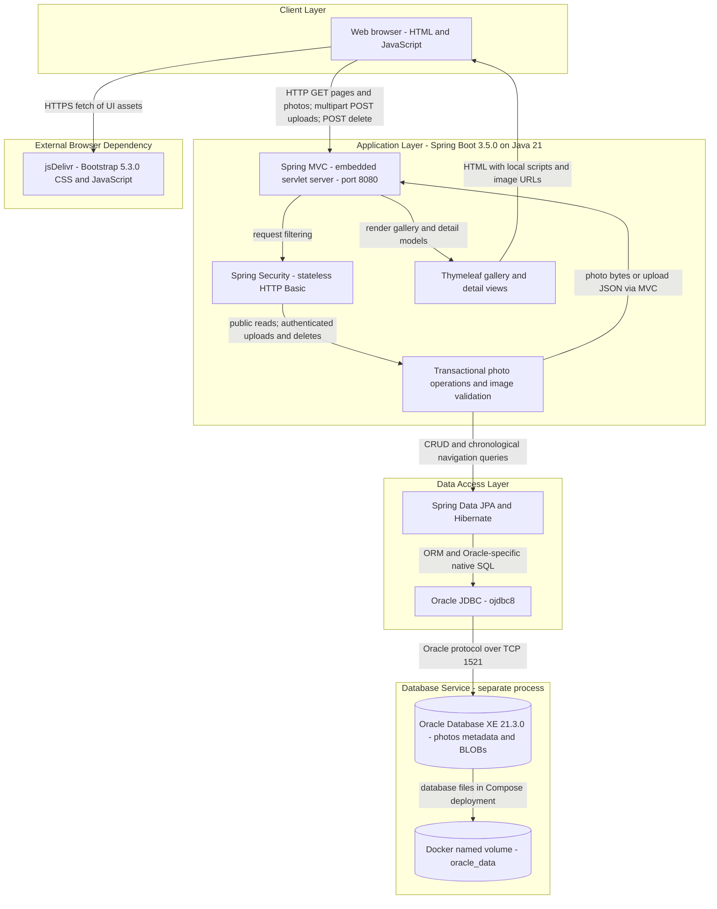
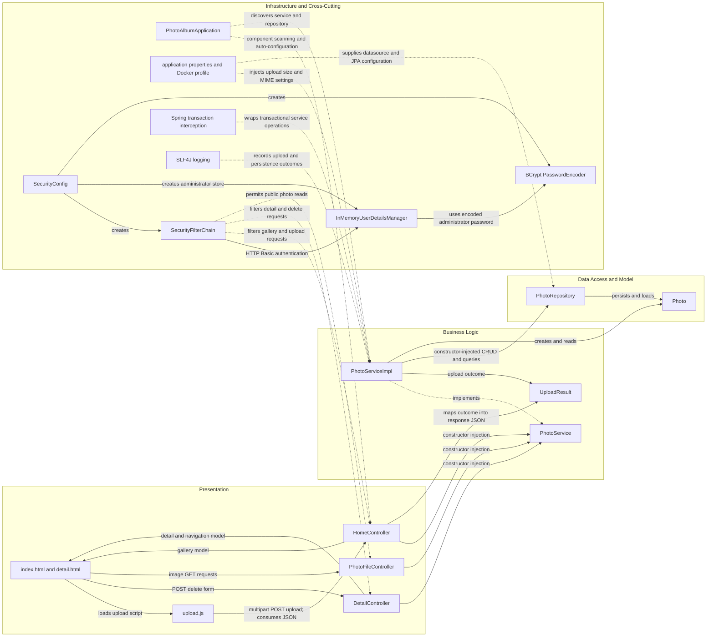

# Architecture Diagram

Photo Album is a single-module Java web application providing a public gallery, photo detail navigation, and authenticated upload and deletion. This static assessment covers `/home/runner/work/PhotoAlbum-Java-Lite/PhotoAlbum-Java-Lite`; diagrams describe checked-in implementation and container configuration, not a verified running deployment. Credential values are omitted.

## Application Architecture

### Technology Stack Summary

| Layer | Technology | Version | Purpose |
|---|---|---|---|
| Runtime | Java / Eclipse Temurin | 21 | Application runtime; Docker final image uses a JRE |
| Application | Spring Boot | 3.5.0 | Auto-configuration, executable JAR, dependency management |
| Presentation | Spring MVC / embedded servlet server | Boot-managed; exact resolved versions not verified | HTML, multipart upload JSON, photo byte responses on port 8080 |
| Presentation | Thymeleaf | Boot-managed; exact version not verified | Server-rendered gallery and detail pages |
| Browser | JavaScript Fetch API, Bootstrap via jsDelivr | Browser-provided API; Bootstrap 5.3.0 | Drag-and-drop upload, gallery updates, responsive styling |
| Security | Spring Security / BCrypt | Boot-managed; exact version not verified | In-memory administrator, stateless HTTP Basic, password encoding |
| Business | Spring transactions, Java ImageIO | Boot-managed transactions; JDK 21 ImageIO | CRUD orchestration, configured MIME/size checks, image dimensions and pixel limit |
| Persistence | Spring Data JPA / Hibernate | Boot-managed; exact versions not verified | Entity persistence and repository queries |
| Database connectivity | Oracle JDBC `ojdbc8` | Boot-managed; exact version not verified | Runtime Oracle connection |
| Database | Oracle Database Express Edition | 21.3.0-xe in Compose | Photo metadata and binary data in the `photos` table |
| Build and packaging | Maven, Spring Boot Maven plugin | Docker builder Maven 3.9.9; plugin Boot-managed | Single executable JAR, multi-stage container build |
| Deployment | Docker Compose, Eclipse Temurin | Compose version unspecified; runtime image `21-jre` | App and Oracle services on a shared bridge network |
| Test-only persistence | H2 | Boot-managed; exact version not verified | In-memory datasource in the test profile; not production storage |

### Data Storage & External Services

Oracle is the only identified application datastore. The `Photo` entity maps to `photos`, storing UUID identifiers, original filenames, MIME types, upload timestamps, dimensions, file sizes, and image bytes through a JPA LOB field. Uploads are saved to the database and `/photo/{id}` returns those bytes; the bundled file under `static/uploads` is not evidence of an active filesystem upload pipeline. Repository native queries use Oracle constructs including `NVL`, `ROWNUM`, `SYSDATE`, and `DUAL`.

Compose deploys the app and Oracle on `photoalbum-network`, persists Oracle files in `oracle_data`, and mounts initialization scripts into the database container. App startup depends on the database health check. Database and administrator passwords are supplied through external configuration; no credential values are reproduced here. Bootstrap assets are requested directly by browsers from jsDelivr over HTTPS. No application cache, message broker, object storage, or server-side third-party API integration was identified.

**Significant caveats:** Both default and Docker profiles set `spring.jpa.hibernate.ddl-auto=create`, so application startup can recreate the schema even when the Oracle volume persists. The configured application endpoint is HTTP; no TLS termination component is present in the examined deployment files. Upload and delete POSTs require authentication, while reads are public; CSRF protection is explicitly disabled. These are configuration observations, not runtime or security-test results. The browser upload script has no explicit login or Authorization-header flow, so authenticated browser upload behavior was not established. The `max-files-per-upload` setting exists, but no corresponding server-side count enforcement was found in the upload controller/service. No builds, tests, dependency resolution, database connections, or Mermaid renderer were run.

### Key Architectural Decisions

- A layered monolith uses constructor-injected MVC controllers, a `PhotoService` interface and transactional implementation, and a Spring Data repository; communication within the process is synchronous.
- Photo content and metadata share Oracle persistence rather than a separate file or object store. Native SQL makes chronological navigation and gallery queries Oracle-specific.
- Public browsing is separated from authenticated mutation through a configured security filter chain and an externally configured, BCrypt-encoded in-memory administrator; browser presentation combines server-rendered pages and asynchronous upload JSON.

## Component Relationships

### Component Inventory

| Component | Layer | Type | Responsibility |
|---|---|---|---|
| `PhotoAlbumApplication` | Infrastructure | Boot entry point | Starts Spring Boot and enables component scanning/auto-configuration |
| `HomeController` | Presentation | MVC controller | `GET /` gallery; `POST /upload` multipart batches and JSON outcomes; local multipart exception handling |
| `DetailController` | Presentation | MVC controller | `GET /detail/{id}` detail/navigation; `POST /detail/{id}/delete` deletion and redirect feedback |
| `PhotoFileController` | Presentation | MVC controller | `GET /photo/{id}` database image bytes, content type, and no-cache response headers |
| `index.html`, `detail.html` | Presentation | Thymeleaf views | Gallery, upload UI, photo detail, previous/next links, deletion form |
| `layout.html` | Presentation | Additional template | Shared-layout markup exists; direct reuse by the standalone gallery/detail templates was not established |
| `upload.js`, `site.css` | Presentation | Static browser assets | Drag/drop selection, client MIME/size checks, Fetch upload, DOM gallery updates and styling |
| `PhotoService` | Business Logic | Service interface | Defines browsing, upload, retrieval, deletion, and adjacent-photo operations |
| `PhotoServiceImpl` | Business Logic | Constructor-injected transactional service | Validates upload size/MIME, extracts dimensions with ImageIO, applies pixel bound, persists and navigates photos |
| `UploadResult` | Business Logic | Result DTO | Carries success, filename, error message and generated photo ID to the upload controller |
| `PhotoRepository` | Data Access | Spring Data `JpaRepository<Photo, String>` | CRUD plus Oracle-native ordered gallery and timestamp navigation queries |
| `Photo` | Data Access / Model | JPA entity | UUID-based photo metadata and LOB bytes; upload-time index and validation annotations |
| `SecurityConfig` | Infrastructure | Spring configuration | Builds security chain, administrator store, and password encoder from external configuration |
| `SecurityFilterChain` | Infrastructure | Request filter chain bean | Stateless Basic authentication for upload/delete POSTs; otherwise permits access; disables CSRF |
| `InMemoryUserDetailsManager`, `PasswordEncoder` | Infrastructure | Security beans | Holds one configured administrator and BCrypt-encodes the supplied password; not a database user table |
| Spring transaction interception | Infrastructure | Framework interceptor | Applies service transaction boundaries, including read-only retrieval/navigation methods |
| SLF4J logging | Infrastructure | Cross-cutting logging API | Controllers and service log operations, failures, and photo-serving diagnostics |
| `application.properties`, `application-docker.properties` | Infrastructure | Externalized configuration | Datasource, Oracle dialect, schema creation, upload settings, logging and HTTP port |
| `Dockerfile`, `docker-compose.yml` | Infrastructure | Build/deployment definitions | Multi-stage JAR build; app/Oracle service topology, network, persistent database volume and startup ordering |

**Evidence:** `pom.xml`; `Dockerfile`; `docker-compose.yml`; `src/main/resources/application.properties`; `src/main/resources/application-docker.properties`; `src/main/java/com/photoalbum/PhotoAlbumApplication.java`; `src/main/java/com/photoalbum/config/SecurityConfig.java`; all three files in `src/main/java/com/photoalbum/controller/`; `src/main/java/com/photoalbum/service/PhotoService.java`; `src/main/java/com/photoalbum/service/impl/PhotoServiceImpl.java`; `src/main/java/com/photoalbum/repository/PhotoRepository.java`; `src/main/java/com/photoalbum/model/Photo.java`; `src/main/java/com/photoalbum/model/UploadResult.java`; `src/main/resources/templates/`; `src/main/resources/static/js/upload.js`; `src/test/resources/application-test.properties`.
