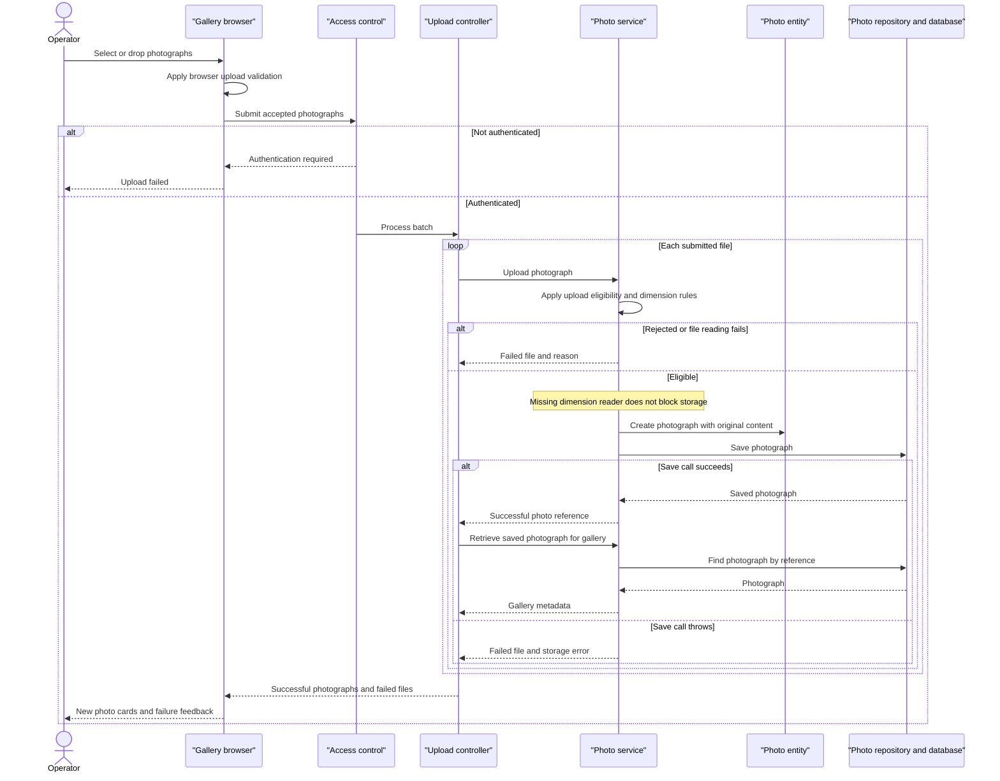

# Core Business Workflows

Photo Album provides a shared gallery where visitors browse uploaded photographs and navigate between images. Authenticated operators can upload batches of photographs and permanently remove individual photographs.

Assessment workspace: `/home/runner/work/PhotoAlbum-Java-Lite/PhotoAlbum-Java-Lite`. Findings describe source behavior, not runtime verification; no tests were run. Credential values are intentionally omitted.

## Domain Entities

| Entity | Service / Bounded Context | Description | Key Relationships |
|---|---|---|---|
| Photo | PhotoService / Photo Management | An uploaded photograph, its original content, and information used to display and navigate it. The only persisted business entity found. | Independent photograph in a shared gallery; older and newer neighbors are derived by upload time, not explicit relationships. |
| UploadResult (operation result, not a persisted entity) | PhotoService / Upload Processing | Reports whether an individual upload succeeded, its resulting photo reference, or a failure reason. | One result per submitted file; successful results refer to a Photo. |

There is no Album, customer, owner, or persisted user entity in the examined application model. The gallery is a view over Photos, not a separate aggregate. The configured operator identity belongs to access control, not photo ownership.

Evidence: `src/main/java/com/photoalbum/model/Photo.java:19-91`; `src/main/java/com/photoalbum/controller/HomeController.java:58-97`.

## Service-to-Domain Mapping

This is one application with an internal service layer, not independently deployed domain services.

| Service | Domain Context | Owned Entities | External Dependencies |
|---|---|---|---|
| Photo Album application — PhotoServiceImpl | Photo Management: upload, discovery, navigation, removal | Photo; produces UploadResult | PhotoRepository and the configured relational database, including stored image content |
| HomeController, DetailController, PhotoFileController (entry-point components, not separate services) | Gallery presentation and operator actions | No independent domain ownership; use PhotoService | Browser; shared in-process PhotoService |

PhotoService is the business operation boundary; PhotoRepository accesses the source-of-truth Photo records. Controllers compose presentation responses, while browser code combines upload results with image requests. No inter-domain events, backend service calls, or shared ownership between services were found.

Evidence: `src/main/java/com/photoalbum/service/impl/PhotoServiceImpl.java:27-47`; `src/main/java/com/photoalbum/repository/PhotoRepository.java:15-16`.

## Primary Workflows

### Workflow 1: Upload a batch and update the gallery

1. An operator selects or drops files in the gallery. Browser upload validation filters files before submission and displays progress.
2. The browser submits accepted files to `POST /upload`; the authentication rule gates state-changing access.
3. HomeController applies the batch-presence rule and calls PhotoService once per file, sequentially.
4. PhotoService applies upload eligibility and image-dimension rules. It reads the original bytes, attempts dimension extraction, constructs a Photo, and saves content and metadata together.
5. For each successful result, the controller re-reads the Photo to assemble gallery metadata. Failed results become filename-and-error entries.
6. The controller returns both result lists. The browser prepends successful photo cards and displays failed-upload messages; each card retrieves its image separately.

The batch permits partial success; there is no all-or-nothing batch transaction or rollback of earlier successful files. A re-read exception is not caught by the upload controller, so it can abort response assembly after some files have already persisted. A successful save whose re-read returns empty is omitted from both result lists.

Evidence: `src/main/resources/static/js/upload.js:60-159`; `src/main/java/com/photoalbum/controller/HomeController.java:56-107`; `src/main/java/com/photoalbum/service/impl/PhotoServiceImpl.java:81-184`.

### Workflow 2: Browse the gallery and navigate photographs

1. A visitor opens `GET /`. HomeController obtains the gallery through PhotoService and renders newest-first photo cards.
2. If loading fails, the controller still renders the gallery with an empty collection. The template presents its normal “No photos yet” message, so an unavailable gallery is indistinguishable from a genuinely empty one.
3. A visitor opens `GET /detail/{id}`. DetailController checks the identifier, loads the Photo, and separately obtains older and newer neighbors using the navigation rule.
4. The page combines the current Photo with neighboring photo references; navigation controls are shown only when the relevant reference exists.
5. The browser requests `GET /photo/{id}` to receive stored original content. Missing identifiers, missing records, or missing content return not found; serving exceptions return an error response.

An invalid or missing detail record, or any exception during detail or neighbor lookup, redirects to the gallery rather than rendering a partial detail view. Image responses prevent caching so visitors request current content; no resized thumbnail or image transformation workflow was found.

Evidence: `src/main/java/com/photoalbum/controller/HomeController.java:38-50`; `src/main/java/com/photoalbum/controller/DetailController.java:32-58`; `src/main/java/com/photoalbum/controller/PhotoFileController.java:37-86`; `src/main/resources/templates/index.html:81-113`; `src/main/resources/templates/detail.html:62-132`.

### Workflow 3: Delete a photograph

1. The detail page asks the operator for browser confirmation; cancellation submits nothing.
2. Confirmation submits `POST /detail/{id}/delete`, subject to authentication.
3. PhotoService looks up the Photo. If absent it returns false; otherwise it deletes the record, including its stored content.
4. DetailController sets a success, not-found, or failure flash message and redirects to the gallery.

This is permanent removal rather than a soft-delete lifecycle. Browser confirmation is a presentation safeguard, not a server-side business precondition.

Evidence: `src/main/resources/templates/detail.html:50-59`; `src/main/java/com/photoalbum/controller/DetailController.java:64-78`; `src/main/java/com/photoalbum/service/impl/PhotoServiceImpl.java:190-208`.

No application-level scheduled business jobs, event consumers, batch commands, or startup business-state initialization were found in the examined application sources. The startup class only launches the application.

## Cross-Service Data Flows

There are no backend cross-service composition flows, gateways, message brokers, or circuit breakers in the examined implementation.

- **Upload composition:** browser files → HomeController → PhotoService → PhotoRepository → database. HomeController joins each successful upload result to a fresh Photo lookup by photo ID, returning metadata; the browser subsequently retrieves image content by that ID.
- **Detail composition:** DetailController combines the selected Photo with older/newer Photo references from separate calls in the same domain. The browser then retrieves the selected image independently.
- **Source of truth:** the same Photo record supplies gallery metadata and image content; no remote object-storage handoff is implemented in the examined service.
- **Degradation:** gallery lookup failure becomes an empty page; detail lookup/navigation failure redirects home; image content failure becomes not-found or server error. No stale-data fallback exists. Upload validation failures remain per-file results, but controller re-read failures and transaction-completion failures can escape that result handling.

These are internal orchestration and browser-to-application flows, not choreography or distributed transactions.

## Business Workflow Sequence

The normal per-file outcomes are shown above. A transaction-completion or controller re-read exception can interrupt this response path after earlier files have persisted; no compensating batch action is implemented.

## Business Rules & Decision Logic

### Validation and eligibility

- **Batch presence:** no files produces a bad-request response. Multipart exceptions handled by HomeController also produce “No files provided,” even when the underlying multipart failure has another cause.
- **Browser upload validation:** accepts JPEG, PNG, GIF, and WebP MIME types and files no larger than 10 MiB. It is a client convenience, not authoritative enforcement.
- **Server upload eligibility:** lowercases the submitted MIME type and checks the configured allowlist; rejects files above the configured byte limit and files with nonpositive length. Examined configurations allow the same four MIME types and set a 10 MiB file limit; multipart limits additionally bound a whole request to 50 MB as configured.
- **Batch-count caveat:** configuration declares `app.file-upload.max-files-per-upload=10`, but no application enforcement was found in the upload controller, service, or browser code.
- **Image-dimension rule:** when an image reader is available, dimensions from the first image header must not exceed 40,000,000 pixels in total. An I/O exception rejects the file; no suitable reader, or a non-I/O extraction exception, allows continuation without dimensions. The implementation does not require a successful full image decode or establish agreement between declared MIME type and actual content.
- **Photo model constraints:** original filename must be nonblank and at most 255 characters; MIME type must be nonblank and at most 50 characters; size must be present and positive; upload time must be present. These are declared entity validation constraints, not explicit controller request validation. Image content and dimensions are not required by equivalent model validation annotations.
- A missing submitted MIME type reaches the service's generic failure handling rather than a dedicated validation message.

Evidence: `src/main/resources/static/js/upload.js:60-79`; `src/main/java/com/photoalbum/service/impl/PhotoServiceImpl.java:33-34,85-180`; `src/main/java/com/photoalbum/model/Photo.java:31-75`; `src/main/resources/application.properties:24-30`; `src/main/resources/application-docker.properties:20-27`.

### Ordering, lifecycle, and computed information

- **Navigation rule:** the previous image is the most recent strictly older upload; the next is the earliest strictly newer upload, additionally bounded by database current time. Equal upload timestamps are not neighbors under these comparisons. Gallery ordering has no explicit tie-breaker.
- **Photo creation:** construction generates a new photo reference and current application upload time. Re-uploading the same filename or content creates another Photo; no duplicate-content or filename uniqueness rule was found.
- **Lifecycle:** submitted file → rejected with no new Photo, or persisted Photo → permanently deleted Photo. No approval, publication, archival, restoration, or ownership-transfer states were found.
- **Derived presentation:** gallery cards display rounded kilobytes and optional dimensions; detail views format size and upload time. Neighbor references are calculated at request time, not maintained as domain relationships.
- No bidirectional domain relationships need synchronization in the examined model.

Evidence: `src/main/java/com/photoalbum/model/Photo.java:78-90`; `src/main/java/com/photoalbum/repository/PhotoRepository.java:23-62`; `src/main/java/com/photoalbum/service/impl/PhotoServiceImpl.java:190-229`; `src/main/resources/templates/detail.html:104-132`.

### Transactions, errors, audit, and authorization

- **Transactions:** PhotoServiceImpl is transactional; query methods explicitly use read-only transactions. Controller calls are separate transaction boundaries, so a batch and detail composition are not one consistent unit of work. Success returned inside a service method is not proof of transaction completion: deferred persistence or commit failures may escape the method's internal catch blocks.
- **Errors:** upload service failures generally become UploadResult messages. Gallery and detail controllers degrade as described above; delete failures become flash messages; content-serving failures become error responses. No retries, durable compensation, dead-letter handling, or business-specific exception hierarchy was found.
- **Logging:** uploads, rejections, deletion, retrieval failures, and image-serving activity are logged. Image serving also logs filenames and a prefix of image bytes. No durable business audit history or actor-linked change record was found.
- **Authorization:** upload and delete POST requests require authentication using stateless HTTP Basic. Although the configured identity is assigned an ADMIN role, these route checks require authentication, not an explicit role. Reads are public; there are no per-photo ownership rules. CSRF protection is disabled.
- **Operator experience caveat:** public templates expose upload and delete controls without authentication-aware visibility, and the upload JavaScript has no dedicated login flow; unsuccessful HTTP responses receive generic upload feedback.

Evidence: `src/main/java/com/photoalbum/service/impl/PhotoServiceImpl.java:27-29,53-74,164-208,215-229`; `src/main/java/com/photoalbum/config/SecurityConfig.java:33-59`; `src/main/java/com/photoalbum/controller/PhotoFileController.java:45-86`; `src/main/resources/static/js/upload.js:102-131`.
