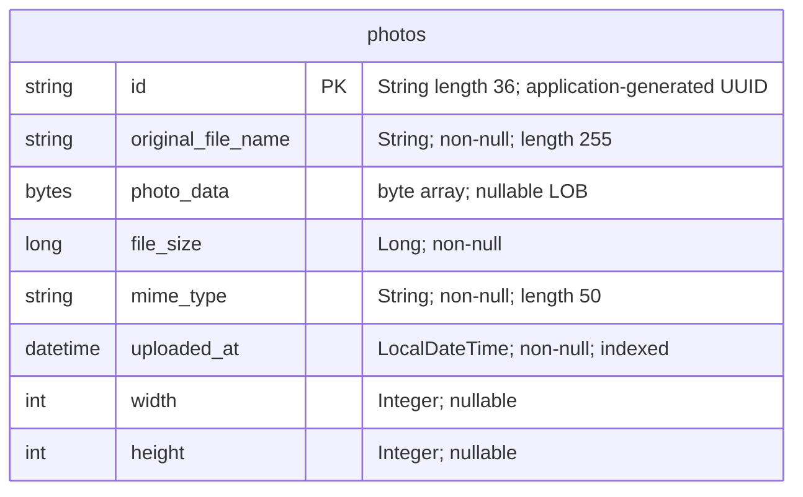

# Data Architecture & Persistence Layer

The data layer contains one JPA entity, `Photo`, persisted through Spring Data JPA/Hibernate to Oracle, with H2 configured for tests. Photo metadata and original image bytes reside together in the `photos` table.

## Database Configuration

| Service/Module | DB Type | Profile | Driver | Connection | Migration Tool |
|---|---|---|---|---|---|
| Photo Album (`photo-album`) | Oracle; container definition specifies Oracle XE 21.3.0 | Default/base | `com.oracle.database.jdbc:ojdbc8`; `oracle.jdbc.OracleDriver` | Environment-overridable Oracle thin connection; fallback targets localhost, port 1521, SID XE. Credential values: [REDACTED]. | None found; Hibernate recreates the mapped schema at application startup. |
| Photo Album (`photo-album`) | Oracle | `docker` | Same Oracle driver | Environment-overridable Oracle thin connection; fallback targets the database host `oracle-db`, port 1521, SID XE. Credential values: [REDACTED]. | None found; Hibernate recreates the mapped schema at application startup. |
| Photo Album tests | H2, in-memory | `test` | `com.h2database:h2`, test scope; `org.h2.Driver` | Process-local named in-memory database `testdb`; credential values: [REDACTED]. | None found; Hibernate creates the schema and drops it at shutdown. |

- Sources: `pom.xml:43-54,81-93`, `src/main/resources/application.properties`, `src/main/resources/application-docker.properties`, `src/test/resources/application-test.properties`, and `docker-compose.yml`.
- No explicit connection-pool implementation, capacity, timeout, or lifetime overrides were found. The JPA starter normally supplies HikariCP through Spring Boot dependency management; the effective pool and defaults were not runtime-verified.
- `oracle-init/01-create-user.sh` and `oracle-init/create-user.sh` provision database accounts/permissions; `oracle-init/02-verify-user.sql` inspects account metadata and `oracle-init/healthcheck.sql` probes connectivity. These are not versioned domain-schema migrations.
- No domain seed data, `schema.sql`, `data.sql`, `import.sql`, Flyway, or Liquibase configuration was found in the inspected application/build/init files. The bundled static JPEG is not evidence of database seeding.
- **Durability caveat:** schema recreation can destroy existing photo records and image BLOBs on startup, including when the Oracle data files themselves persist.
- Property-level configuration belongs in the companion `configuration-inventory.md`; this assessment describes persistence behavior rather than reproducing the property inventory.

## Data Ownership per Service

| Service | Tables Owned | ORM Framework | Caching | Notes |
|---|---|---|---|---|
| Photo Album, `com.photoalbum` | `photos` (`Photo`) | Jakarta Persistence with Hibernate through Spring Data JPA | Transaction-scoped persistence context; no explicit shared application cache | `PhotoServiceImpl` owns persistence operations through `PhotoRepository`. Metadata and binary payload share one row. |

## Entity Model

Source: `src/main/java/com/photoalbum/model/Photo.java:15-82`.

| Java field | Java type | Persistence mapping |
|---|---|---|
| `id` | `String` | Primary key; length 36. Constructor assigns a random UUID string; no database identity/sequence generator is declared. |
| `originalFileName` | `String` | `original_file_name`, non-null, length 255. |
| `photoData` | `byte[]` | `photo_data`, nullable `@Lob`; binary image content. No lazy-fetch override is declared. |
| `fileSize` | `Long` | `file_size`, non-null; size in bytes. |
| `mimeType` | `String` | `mime_type`, non-null, length 50. |
| `uploadedAt` | `LocalDateTime` | `uploaded_at`, non-null; initialized with JVM-local current time. No explicit offset/time-zone mapping. |
| `width` | `Integer` | Nullable pixel width. |
| `height` | `Integer` | Nullable pixel height. |

- Non-unique index `idx_photos_uploaded_at` covers upload time. No foreign keys, associations, cascade mappings, bidirectional links, join tables, or optimistic-lock version field are declared. Consequently the diagram intentionally contains no relationship edges.
- `UploadResult` (`src/main/java/com/photoalbum/model/UploadResult.java:6-10`) is a non-persisted result DTO, not an entity or separate table.
- `PhotoServiceImpl` has class-level `@Transactional`; retrieval/list/navigation methods override it with read-only transactions (`src/main/java/com/photoalbum/service/impl/PhotoServiceImpl.java:27-29,53-54,67-68,216-229`). Upload and deletion use the class-level transaction. Upload catches persistence exceptions; a successful result assembled before transaction completion is not proof of a committed write.
- All custom repository queries select the binary column as well as metadata. The gallery query is unbounded, so metadata listings can materialize image bytes for every returned photo; no metadata-only projection or streaming BLOB API is declared.

## Key Repository Methods

Repository source: `src/main/java/com/photoalbum/repository/PhotoRepository.java:15-62`. `PhotoRepository extends JpaRepository<Photo, String>`; inherited CRUD methods are omitted below.

| Service | Repository | Notable Methods | Purpose |
|---|---|---|---|
| Photo Album | `PhotoRepository` | `List<Photo> findAllOrderByUploadedAtDesc()` | Native SQL returns all photos newest-first; Oracle `NVL` supplies a fallback MIME type. No pagination parameter. |
| Photo Album | `PhotoRepository` | `List<Photo> findPhotosUploadedBefore(LocalDateTime uploadedAt)` | Native SQL selects strictly older records in descending time order and limits the outer result to ten rows using Oracle `ROWNUM`. |
| Photo Album | `PhotoRepository` | `List<Photo> findPhotosUploadedAfter(LocalDateTime uploadedAt)` | Native SQL selects strictly newer records in ascending time order, bounded above by Oracle `SYSDATE` obtained through `DUAL`; no row-count limit. |

No custom batch aggregation finder, stored procedure, cross-service query, or separate JDBC mapper was found. The custom queries depend on Oracle SQL semantics; H2 test configuration does not explicitly enable Oracle compatibility. The existing `PhotoAlbumApplicationTests` only loads the application context, so it does not establish query portability or exercise repository behavior.

Timestamp-only comparisons have no ID tie-breaker and exclude records sharing the reference timestamp. The newer-record query also couples results to the database clock while upload timestamps originate from the JVM.

## Caching Strategy

| Layer | Evidence and behavior |
|---|---|
| Application/distributed cache | No Spring cache annotations, Redis, Caffeine, Ehcache, JCache provider, named cache region, TTL, or eviction policy found in inspected source/configuration/build files. No explicit cache-aside, read-through, or write-through pattern. |
| ORM | Hibernate's normal first-level persistence context is transaction-scoped, not a reusable cross-request cache. No second-level/query-cache enablement or provider binding found. |
| Image responses | `PhotoFileController.java:74-79` explicitly sends private, no-store/no-cache response directives with immediate expiry. No freshness TTL is provided; responses deliberately discourage browser/proxy retention. |
| Authentication/session state | `SecurityConfig.java:32-42,47-58` uses in-memory user details and stateless HTTP Basic authentication; no persistent user/session table or distributed session cache is declared. |

There is no documented data-cache rationale beyond the explicit image-response no-cache intent. Image reads otherwise reach the service/repository rather than a declared content cache.

## Data Ownership Boundaries

One application module owns a single domain table in its configured relational database. There is no evidence of multiple independently owned data services, a database-per-service topology, shared cross-service tables, API-based data aggregation, event/outbox replication, CQRS, or a separate read model. H2 is a test substitute, not an additional production owner.

Reads and writes use the same entity/repository and configured data source. Image bytes are database-owned BLOB content, not references to an object store or runtime filesystem upload store. The existing static JPEG and test upload-path setting do not establish a second active persistence mechanism: the inspected upload service saves image bytes directly to the database.

The entity contains no account, tenant, or owner identifier. Therefore ownership isolation cannot be derived from row-level associations. Application authentication protects state changes, while photo reads are publicly allowed; no per-photo ownership or field-level authorization is implemented in the inspected model/security configuration.

### Data Classification & Sensitivity

| Entity | Sensitive Fields | Classification (PII/PHI/PCI/None) | Controls in Place |
|---|---|---|---|
| `Photo` / `photos` | `photoData` may contain identifiable people, documents, or embedded image metadata; `originalFileName` may contain personal names or other identifiers. | Potential PII in user-supplied content. No explicit PHI/PCI schema fields; arbitrary image content cannot be classified from code alone. | Authenticated state changes; public photo reads; private/no-store response directives. No configured field encryption, masking, tenant/row ownership control, image metadata stripping, or demonstrated database encryption-at-rest in inspected files. |
| `Photo` / `photos` | `id`, `fileSize`, `mimeType`, `uploadedAt`, `width`, `height` | No inherently explicit PII/PHI/PCI fields; timestamps and identifiers can become identifying when correlated. | UUID identifiers and database nullability/index mappings; no field-specific access control or masking found. |

`SecurityConfig` hashes the externally supplied administrator password with BCrypt for its in-memory authentication record; that is not encryption of photo data. Database/admin credential values are intentionally omitted or marked [REDACTED] throughout this document.

`PhotoServiceImpl` logs original filenames, and `PhotoFileController.java:53-66,71-82` logs filenames and a short image-byte prefix and returns filename metadata in response headers. No masking/redaction control for these photo-derived values was found.

**Assessment limitations:** static source/configuration inspection only; no database connection, tests, builds, or live schema inspection performed. Deployed schema, effective pool settings, external encryption/backup/retention controls, actual image sensitivity, and runtime query compatibility remain unverified. No Mermaid renderer was executed; the diagram uses the skill's minimal ER syntax.
