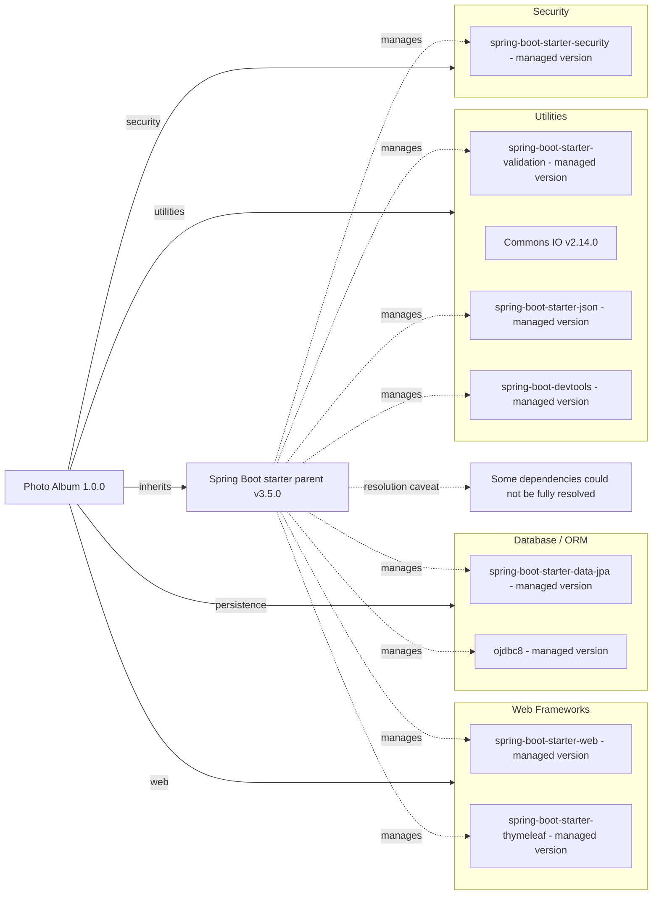

# Dependency Map

Photo Album (`com.photoalbum:photo-album:1.0.0`) declares 11 external dependencies in `pom.xml`: 9 non-test dependencies and 2 test dependencies. This map assesses build/package files only in `/home/runner/work/PhotoAlbum-Java-Lite/PhotoAlbum-Java-Lite`; source code and runtime configuration were not examined.

## Dependencies

“Managed version” means no version is declared on the dependency in the workspace POM; version management is inherited through `org.springframework.boot:spring-boot-starter-parent:3.5.0`. The parent POM and its inherited dependency management are not present locally, so effective artifact versions and transitive dependencies are not asserted. The parent is not included in dependency counts.

### Dependency Summary

| Category | Count | Key Libraries | Notes |
|----------|-------|---------------|-------|
| Web Frameworks | 2 | Spring Boot Web, Thymeleaf starters | Parent-managed versions |
| Database / ORM | 2 | Spring Boot Data JPA starter, Oracle ojdbc8 | Oracle driver has runtime scope |
| Security | 1 | Spring Boot Security starter | Parent-managed version |
| Utilities | 4 | Validation starter, Commons IO 2.14.0, JSON starter, DevTools | DevTools is optional; other versions are parent-managed |
| **Total non-test** | **9** | | Test declarations excluded |

Declared non-test coordinates and scopes (`compile` is Maven's default when omitted):

| Group / package | Artifact | Declared version | Scope | Notes |
|-----------------|----------|------------------|-------|-------|
| org.springframework.boot | spring-boot-starter-web | Not specified; parent-managed | compile | `pom.xml:32-35` |
| org.springframework.boot | spring-boot-starter-thymeleaf | Not specified; parent-managed | compile | `pom.xml:38-41` |
| org.springframework.boot | spring-boot-starter-data-jpa | Not specified; parent-managed | compile | `pom.xml:44-47` |
| com.oracle.database.jdbc | ojdbc8 | Not specified; parent-managed | runtime | `pom.xml:50-54` |
| org.springframework.boot | spring-boot-starter-validation | Not specified; parent-managed | compile | `pom.xml:57-60` |
| org.springframework.boot | spring-boot-starter-security | Not specified; parent-managed | compile | `pom.xml:63-66` |
| commons-io | commons-io | 2.14.0 | compile | Explicit version override; `pom.xml:69-73` |
| org.springframework.boot | spring-boot-starter-json | Not specified; parent-managed | compile | `pom.xml:76-79` |
| org.springframework.boot | spring-boot-devtools | Not specified; parent-managed | compile | Optional; `pom.xml:96-100` |

### Version & Compatibility Risks

Spring Boot parent 3.5.0 is an initial release in its line, and Commons IO 2.14.0 is an older explicitly pinned release; review current patch levels, support status, and security advisories before deployment. No advisory lookup or effective dependency resolution was performed, so this report does not establish vulnerability status or end-of-life dates. Java 21 is required by the build properties (`pom.xml:23-28`); confirm the resolved Oracle driver supports the intended Java runtime and database version rather than inferring compatibility from the `ojdbc8` artifact name.

### Notable Observations

- The single discovered supported build/package manifest is the root `pom.xml`; no lockfiles or local imported BOM declarations were found. Transitive logging, JSON, ORM, servlet-container, and test libraries are not individually counted because their declarations are not visible locally.
- JSON is explicitly declared alongside the Web starter; it may duplicate a transitive starter dependency, but no dependency tree was resolved. The POM's “Image processing” comment does not establish an image-processing dependency.
- DevTools is a compile-scoped optional dependency, not a test dependency. Optional controls propagation to consumers, not Maven scope; packaging behavior was not validated.
- The build also declares `org.springframework.boot:spring-boot-maven-plugin` without an explicit version (`pom.xml:103-110`), inherited through the parent. It is a build plugin and excluded from library counts. No credential values are included in this report.

## Test Dependencies

| Framework | Version | Notes |
|-----------|---------|-------|
| org.springframework.boot:spring-boot-starter-test | Not specified; parent-managed through Spring Boot parent 3.5.0 | test scope; `pom.xml:82-86`. Individual bundled frameworks and versions are not resolved. |
| com.h2database:h2 | Not specified; parent-managed through Spring Boot parent 3.5.0 | test scope; in-memory database support; `pom.xml:89-93` |

Total test-scope dependencies: 2

No standalone integration/container-testing or contract-testing dependency is explicitly declared. Test implementation, coverage, execution, and Oracle/H2 behavioral parity were not assessed; no tests were run.
