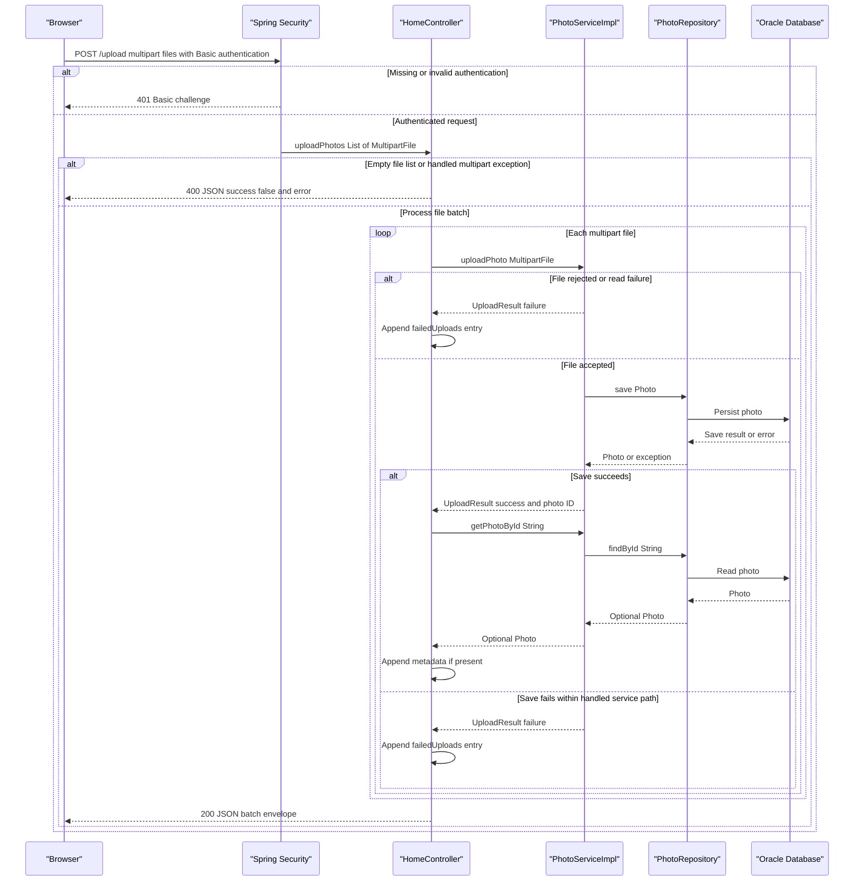

# API & Service Communication Contracts

Five explicit HTTP endpoints provide gallery HTML, multipart upload with JSON results, photo detail HTML, deletion redirects, and binary image delivery. Requests use synchronous controller-to-service calls; browser upload uses asynchronous JavaScript fetch but is not a messaging or background-job contract.

## Service Catalog

| Service | Port | Category | Purpose |
|---|---|---|---|
| `photoalbum-java-app` / Maven `com.photoalbum:photo-album` | HTTP 8080, published 8080 | API Layer / Business | Single source-built application serving the gallery and photo operations. Dependencies include Spring Boot Web, Thymeleaf, Data JPA, Security, Validation, JSON, and Oracle JDBC. |
| `oracle-db` | 1521 and 5500, both published | Infrastructure | Third-party Oracle Express container; application persistence dependency, not an application REST service. Port 1521 is used by application JDBC; 5500 is the database management port. |

Evidence: `pom.xml:8-18,30-79`; `docker-compose.yml:1-45`; `src/main/resources/application.properties:1-2`. No Maven submodules, separate frontend deployment, gateway service, or Kubernetes/Helm deployment definitions were found in the application/deployment files.

## API Endpoints Inventory

Paths are unversioned; no header/query-based versioning is implemented. Controller names below all belong to `photoalbum-java-app`. Status codes describe explicit controller behavior plus the configured authentication boundary; they are not a guarantee of uniform framework error bodies.

| Service / controller | Method | Path | Request Type | Response Type |
|---|---|---|---|---|
| App / `HomeController` | GET | `/` | No body or required parameters | 200 HTML, `index` template with `List<Photo>` and timestamp. Retrieval exceptions render an empty gallery rather than an error status. |
| App / `HomeController` | POST | `/upload` | Authenticated multipart form, repeated `files` parts bound to `List<MultipartFile>` | 200 JSON `Map<String,Object>` batch result, including partial/all per-file failures; 400 JSON for an empty list or handled `MultipartException`; unauthenticated callers receive HTTP Basic challenge / 401. |
| App / `DetailController` | GET | `/detail/{id}` | String path ID | 200 HTML, `detail` template with `Photo` and optional previous/next IDs; redirect to `/` (normally 302) for missing photo, blank ID reaching handler, or caught exception. |
| App / `DetailController` | POST | `/detail/{id}/delete` | Authenticated request with String path ID; no DTO body required | Redirect to `/` (normally 302) with success/error flash attribute for deleted, absent, or failed deletion; unauthenticated callers receive HTTP Basic challenge / 401. |
| App / `PhotoFileController` | GET | `/photo/{id}` | String path ID; browser optionally appends `_t` for cache busting, not a bound controller parameter | 200 `ResponseEntity<Resource>` containing image bytes with stored MIME type; 404 for absent photo/empty bytes or blank ID reaching handler; 500 with empty body for caught exception. |

Evidence: `src/main/java/com/photoalbum/controller/HomeController.java:38-107`; `src/main/java/com/photoalbum/controller/DetailController.java:18-78`; `src/main/java/com/photoalbum/controller/PhotoFileController.java:23-86`; `src/main/java/com/photoalbum/config/SecurityConfig.java:46-59`; `src/main/resources/static/js/upload.js:97-131,176-179`.

**Upload response contract.** The completed batch envelope contains `success`, `uploadedPhotos`, and `failedUploads`. `success` is true only when at least one uploaded photo has been reloaded into the result list. Successful entries are controller-created metadata projections, not serialized `Photo` entities; failed entries contain `fileName` and `error`. Empty-list/handled multipart errors instead return `success:false` with `error:"No files provided"`. Clients must inspect the envelope even on HTTP 200; an all-failed batch still returns 200. A successful upload whose subsequent lookup returns empty is omitted from both lists. Exceptions from that subsequent lookup are not caught by the upload handler, so the batch JSON envelope is not guaranteed on unexpected failures. A missing required `files` parameter is a framework binding error, not explicitly normalized by this handler. Multipart request/file-size limits affect acceptance; see `configuration-inventory.md` for settings and `business-workflows.md` for validation details.

**Binary response contract.** Image responses set `Cache-Control: no-cache, no-store, must-revalidate, private`, `Pragma: no-cache`, `Expires: 0`, and `X-Photo-ID`, `X-Photo-Name`, `X-Photo-Size`. No content-disposition/download contract or JSON image payload is defined (`PhotoFileController.java:74-86`).

## Management & Observability Endpoints

| Service | Endpoint | Custom Metrics (if any) |
|---|---|---|
| `photoalbum-java-app` | No explicit health, metrics, Actuator, Prometheus, Swagger UI, or API documentation endpoint found | No custom metric registration or timing annotations found; controllers/services use SLF4J logging. |
| `oracle-db` | No application management HTTP route; separate database management port 5500 is published | Compose checks database availability through SQL, not an application metrics endpoint. |

The POM has no Actuator or OpenAPI dependency (`pom.xml:30-101`). Source mapping inventory is limited to the five routes above. Framework-provided static resources and default error handling are not additional domain APIs. Deployment readiness details belong in `configuration-inventory.md`.

## DTOs & Contracts

| Type | Contract role | Mutability |
|---|---|---|
| `MultipartFile` / `List<MultipartFile>` | Framework abstraction for multipart upload input; not a custom JSON request DTO | Framework-managed |
| `UploadResult` | Internal service-to-controller upload outcome; not returned directly over HTTP | Mutable POJO with setters |
| `Photo` | Service-owned domain entity used in HTML models and internally to construct upload projections and binary responses | Mutable POJO with setters |
| `Map<String,Object>` / lists of maps | Actual upload JSON envelope and per-file projections/errors; no dedicated response class | Mutable collections |
| `Resource` backed by `ByteArrayResource` | Binary image HTTP response abstraction | Not a domain DTO |

No gateway-level composition DTOs, immutable records, protobuf/GraphQL schemas, or OpenAPI/Swagger specifications were found. Jackson is supplied by the Spring Boot JSON/Web dependencies; no custom mapper, serializer, or explicit wire-date format was found. The upload projection includes a `LocalDateTime`, so clients should not infer a timezone-bearing timestamp guarantee from the controller. HTML views use Thymeleaf rather than JSON entity serialization.

Entity fields and persistence mapping are intentionally deferred to `data-architecture.md`. Evidence: `src/main/java/com/photoalbum/model/UploadResult.java:6-48`; `src/main/java/com/photoalbum/model/Photo.java:19-26,78-155`; `HomeController.java:58-97`; `PhotoFileController.java:68-83`; `pom.xml:30-79`.

## Communication Patterns

- **Synchronous application flow:** Controllers invoke `PhotoService` / `PhotoServiceImpl` directly; the service invokes `PhotoRepository` synchronously through JPA/JDBC. The database is the only identified backend service dependency. Browser JavaScript sends a same-origin multipart POST and uses returned metadata to construct photo/detail links (`src/main/resources/static/js/upload.js:90-131,155-179`).
- **No async backend messaging:** No broker clients, events, queue consumers, pub/sub contracts, or background upload acknowledgment/polling endpoint were found in application source or dependencies.
- **Resilience and failures:** No explicit application retry policy, circuit breaker, bulkhead, fallback backend, REST client timeout, or JDBC query/connect timeout is configured in inspected application files. Do not interpret that as infinite timeouts: driver/framework defaults remain unspecified here. Gallery retrieval failure renders an empty list; detail failure redirects home; deletion failure sets an error flash attribute and redirects; binary retrieval failure returns 500. Upload failures are usually per-file results, not automatic retries (`HomeController.java:40-49,69-107`; `DetailController.java:38-78`; `PhotoFileController.java:44-86`; `PhotoServiceImpl.java:81-184`). Container restart-on-failure is process lifecycle behavior, not an HTTP retry policy (`docker-compose.yml:46`).
- **Discovery and routing:** No Eureka, Consul, service registry, client-side load balancer, or API gateway is present. Compose uses the `oracle-db` hostname for JDBC connectivity; standalone defaults use localhost. There is no multi-backend gateway aggregation; upload batch aggregation combines local per-file outcomes.
- **Availability:** Compose orders the application after database health. Required database/admin credentials must be supplied for configured startup. See `configuration-inventory.md` for the startup/configuration chain; no credential values are reproduced here (`docker-compose.yml:32-43`; `SecurityConfig.java:33-42`).
- **Authentication and authorization:** Spring Security uses stateless HTTP Basic. POST `/upload` and `/detail/*/delete` require authentication; other requests are permitted. An in-memory user is assigned an ADMIN role, but the route rules check only authentication, not role/ownership. No JWT, OAuth2, method-level authorization, or form-login endpoint is configured. CSRF is explicitly disabled (`SecurityConfig.java:28-59`).
- **Transport:** No HTTPS listener, TLS termination proxy, or explicit JDBC TLS configuration was found in the supplied runtime configuration. The application publishes HTTP 8080. External TLS termination cannot be established from this repository; HTTP Basic therefore requires deployment-level transport protection not evidenced here.
- **Browser authentication UX:** Upload JavaScript supplies no explicit Authorization header or login flow and reports non-2xx upload responses generically. Browser-managed previously established Basic credentials may still be used; authenticated mutations remain an API requirement (`src/main/resources/static/js/upload.js:102-131`; `src/main/resources/templates/detail.html:50-51`).

## Service Technology Matrix

| Service | Web | Data Access | Discovery | Gateway | Health / Actuator | Cache | Metrics |
|---|---|---|---|---|---|---|---|
| `photoalbum-java-app` | Spring MVC / Thymeleaf; JSON upload | Spring Data JPA / Oracle JDBC | None; Compose hostname for DB | None | No application health endpoint / Actuator dependency | No application cache found; image responses prohibit HTTP caching | Logging only; no exporter/custom metrics found |
| `oracle-db` | Not an application web service | Oracle SQL/JDBC server | Compose service hostname | None | Compose SQL health check | Outside application contract scope | No exporter configured in Compose |

Evidence: `pom.xml:30-101`; `src/main/java/com/photoalbum/repository/PhotoRepository.java:15-62`; `PhotoFileController.java:74-83`; `docker-compose.yml:1-46`. Cache implementation and persistence details belong in `data-architecture.md`.

## Service Communication Sequence

Primary authenticated upload flow, including per-file failure handling. Solid arrows denote synchronous calls; dashed arrows denote responses, not broker events. No retry or circuit-breaker branch exists in the implementation.

The diagram assumes post-save lookups complete normally. A lookup exception can escape the handler instead of returning the envelope, as noted in the endpoint contract. Evidence: `HomeController.java:56-107`; `PhotoServiceImpl.java:68-74,81-184`.
