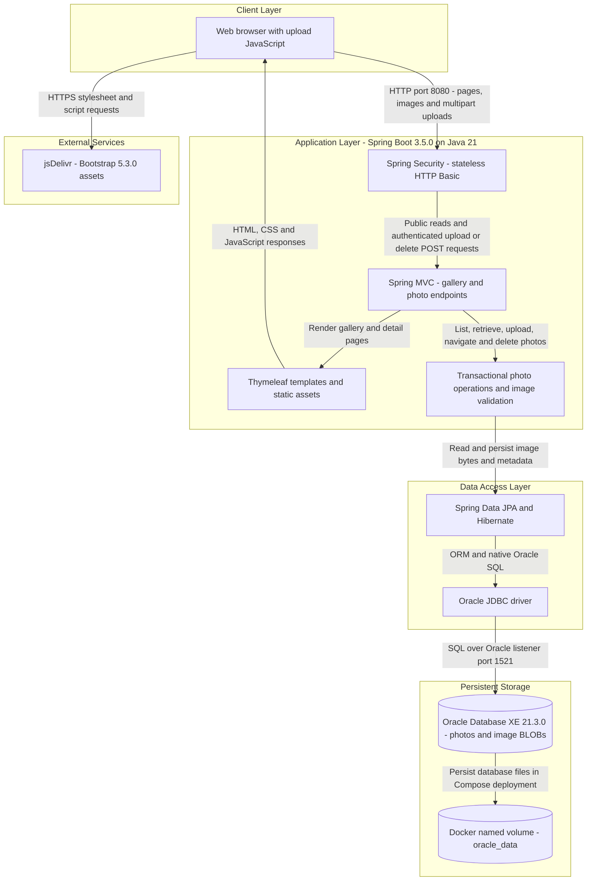
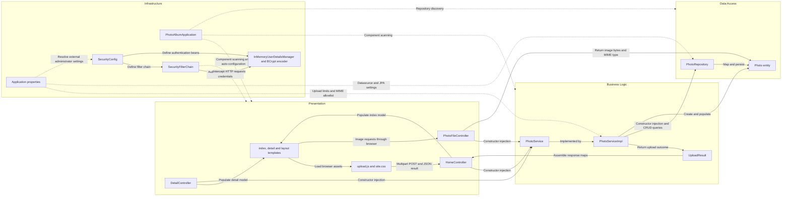

# Architecture Diagram

Photo Album is a single Spring Boot web application providing a public gallery and authenticated photo uploads and deletion. This source-based view describes configured architecture, not a verified running deployment; credential values are omitted.

## Application Architecture

### Technology Stack Summary

| Layer | Technology | Version | Purpose |
|---|---|---|---|
| Runtime and packaging | Java, Maven, executable Spring Boot JAR | Java 21; Maven 3.9.9 in Docker build; application 1.0.0 | Single-process web application; Eclipse Temurin 21 JRE container |
| Web | Spring Boot Web and Spring MVC | Boot 3.5.0; framework versions managed by Boot | HTTP routes, multipart uploads, JSON responses and binary image delivery |
| Presentation | Thymeleaf, browser JavaScript, Bootstrap | Thymeleaf managed by Boot; Bootstrap 5.3.0 | Server-rendered gallery/detail pages and asynchronous upload interface |
| Security | Spring Security, BCrypt | Managed by Boot | In-memory administrator, stateless HTTP Basic and authenticated mutation endpoints |
| Business logic | Spring services, transactions, Java ImageIO | Boot-managed Spring; Java 21 ImageIO | Upload validation, image dimension extraction and photo lifecycle |
| Persistence | Spring Data JPA, Hibernate, Oracle `ojdbc8` | Managed by Boot; driver not explicitly pinned | Entity CRUD and Oracle-specific native queries |
| Database | Oracle Database Express Edition | Compose image tag `21.3.0-xe` | Stores photo metadata and binary content |
| Deployment | Docker multi-stage image and Docker Compose | Engine/Compose versions unspecified | Application and database containers on a bridge network; persistent database volume |

Evidence: [`pom.xml`](../../../../../../pom.xml), [`Dockerfile`](../../../../../../Dockerfile), [`docker-compose.yml`](../../../../../../docker-compose.yml), [`application.properties`](../../../../../../src/main/resources/application.properties), [`application-docker.properties`](../../../../../../src/main/resources/application-docker.properties), and [`templates`](../../../../../../src/main/resources/templates).

### Data Storage & External Services

The `photos` table stores UUID identifiers, original filenames, MIME types, byte sizes, upload timestamps, dimensions and image bytes mapped with JPA `@Lob`. Upload and retrieval paths use the database, not a filesystem upload store. Compose configures Oracle XE and the `oracle_data` volume; the default local datasource targets Oracle on localhost, while the Docker profile targets `oracle-db`. Both profiles configure `spring.jpa.hibernate.ddl-auto=create`, so schema recreation at application startup can remove existing photo data despite persistent database files. Database and administrator secrets are supplied through external configuration; no credential values are reproduced here.

Browser templates load Bootstrap CSS/JavaScript from jsDelivr. No application-level cache, broker, object-storage service or outbound business API integration was identified in the inspected source. H2 is declared only as a test-scoped dependency, not the configured production store.

Evidence: [`Photo.java`](../../../../../../src/main/java/com/photoalbum/model/Photo.java), [`PhotoServiceImpl.java`](../../../../../../src/main/java/com/photoalbum/service/impl/PhotoServiceImpl.java), application property files and Compose cited above.

### Key Architectural Decisions

- **Layered monolith with constructor injection:** MVC controllers depend on the `PhotoService` interface; its transactional implementation depends on a Spring Data repository. Reads use read-only transaction annotations.
- **Database-centric image storage:** binaries and metadata share the same entity/table. Gallery and navigation queries explicitly use Oracle constructs including `NVL`, `ROWNUM`, `SYSDATE` and `DUAL`, coupling persistence to Oracle.
- **Public browsing, protected mutations:** `SecurityConfig` requires authentication for POST `/upload` and `/detail/*/delete`, permits other requests, disables CSRF and uses stateless HTTP Basic with a BCrypt-encoded, externally configured in-memory administrator. No application TLS configuration was identified.

## Component Relationships

### Component Inventory

| Component | Layer | Type | Responsibility |
|---|---|---|---|
| `HomeController` | Presentation | MVC controller | GET `/` lists photos; POST `/upload` processes multipart files and returns JSON maps assembled from upload outcomes; handles multipart exceptions |
| `DetailController` | Presentation | MVC controller | GET `/detail/{id}` renders a photo and navigation links; POST `/detail/{id}/delete` deletes and redirects |
| `PhotoFileController` | Presentation | MVC binary response controller | GET `/photo/{id}` retrieves database image bytes and returns a resource with MIME type and no-cache headers |
| `index.html`, `detail.html`, `layout.html` | Presentation | Thymeleaf templates | Gallery, detail and shared layout markup; photo links, upload/delete controls and Bootstrap asset references |
| `upload.js`, `site.css` | Presentation | Browser assets | Multipart upload fetch requests, dynamic gallery updates and styling |
| `PhotoService` | Business logic | Service interface | Defines photo listing, retrieval, upload, deletion and chronological navigation |
| `PhotoServiceImpl` | Business logic | Transactional Spring service | Implements operations, validates MIME/file size, extracts dimensions with ImageIO, enforces a 40-million-pixel ceiling when dimensions are read, and delegates persistence |
| `UploadResult` | Business logic | Result DTO | Carries per-file success, original filename, error message and stored photo identifier |
| `PhotoRepository` | Data access | Spring Data JPA repository | `JpaRepository<Photo, String>` CRUD plus native Oracle gallery and timestamp navigation queries |
| `Photo` | Data access | JPA entity | Maps the indexed `photos` table, UUID string identifier, metadata and image BLOB |
| `PhotoAlbumApplication` | Infrastructure | Spring Boot entry point | Starts the application and enables convention-based component scanning and auto-configuration |
| `SecurityConfig` | Infrastructure | Configuration | Declares BCrypt encoding, externally configured in-memory administrator and request authorization chain |
| `SecurityFilterChain` | Infrastructure | Security filter chain bean | Stateless HTTP Basic request interception; upload/delete POST authentication and public access otherwise |
| `InMemoryUserDetailsManager`, password encoder | Infrastructure | Authentication beans | Hold the configured administrator and verify credentials against a BCrypt encoding |
| `application.properties`, Docker profile and external properties | Infrastructure | Configuration | HTTP port, multipart limits, upload allowlist, datasource/JPA behavior, logging and externally supplied security settings |

Component evidence: [`controllers`](../../../../../../src/main/java/com/photoalbum/controller), [`PhotoService.java`](../../../../../../src/main/java/com/photoalbum/service/PhotoService.java), [`PhotoServiceImpl.java`](../../../../../../src/main/java/com/photoalbum/service/impl/PhotoServiceImpl.java), [`PhotoRepository.java`](../../../../../../src/main/java/com/photoalbum/repository/PhotoRepository.java), [`models`](../../../../../../src/main/java/com/photoalbum/model), [`SecurityConfig.java`](../../../../../../src/main/java/com/photoalbum/config/SecurityConfig.java), [`PhotoAlbumApplication.java`](../../../../../../src/main/java/com/photoalbum/PhotoAlbumApplication.java) and [`upload.js`](../../../../../../src/main/resources/static/js/upload.js). Relationships describe source dependencies and framework configuration; no runtime validation or tests were performed.
