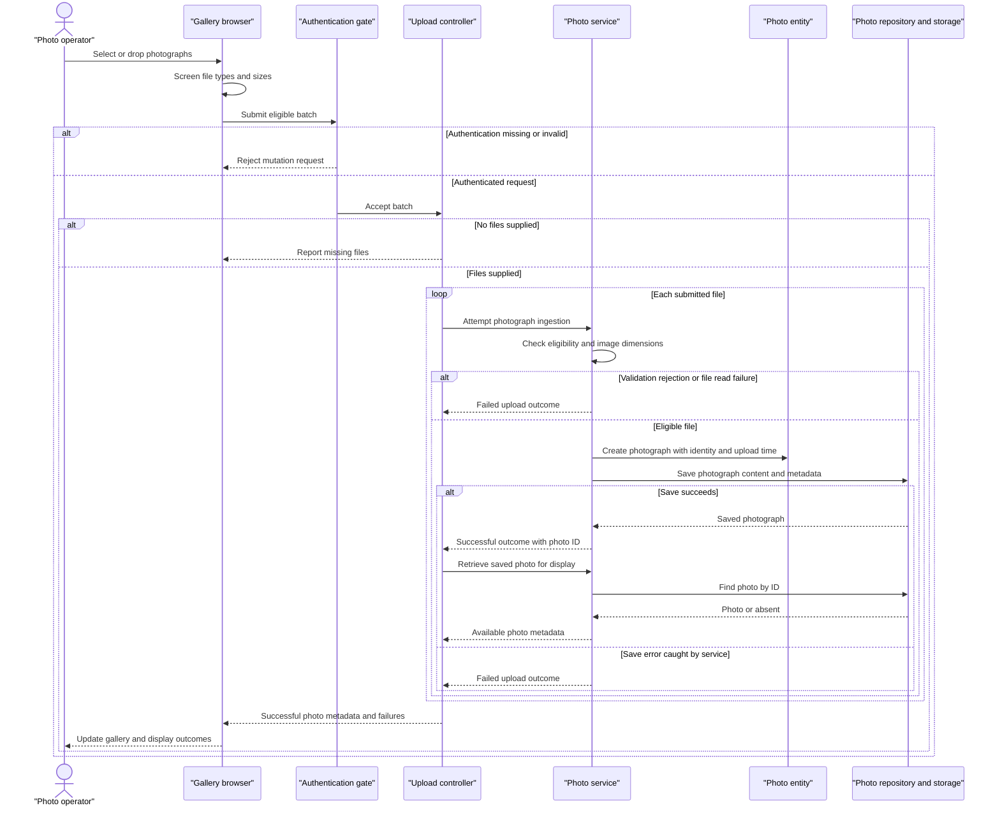

# Core Business Workflows

Photo Album lets visitors browse a shared collection of photographs and view individual images with chronological navigation. Authenticated operators can add photographs in batches and permanently remove them.

Evidence below refers to repository-relative source paths and line numbers. This document describes implemented behavior, not proposed features; no credential values are reproduced.

## Domain Entities

| Entity | Service / Bounded Context | Description | Key Relationships |
|---|---|---|---|
| Photo | PhotoService / Photo collection management | A photograph retained with its original name, image content, upload information, and optional dimensions for presentation. | Independent collection item; previous and next photographs are determined by upload time, not explicit relationships. No album, owner, or user association is modeled. |
| UploadResult (operation outcome, not a persisted entity) | PhotoService / Photo ingestion | Communicates whether one attempted upload succeeded, its resulting photo reference, or a failure explanation. | Links a successful attempt to a Photo; the controller groups outcomes across the submitted batch. |

Evidence: `src/main/java/com/photoalbum/model/Photo.java:12-91`; `src/main/java/com/photoalbum/model/UploadResult.java:3-14`; `src/main/java/com/photoalbum/service/impl/PhotoServiceImpl.java:212-230`.

## Service-to-Domain Mapping

This is one application with one business service, not a microservice topology. Context names below describe responsibilities rather than independently deployed services.

| Service | Domain Context | Owned Entities | External Dependencies |
|---|---|---|---|
| PhotoService, implemented by PhotoServiceImpl | Shared photo collection: ingestion, retrieval, chronological navigation, removal | Photo; produces UploadResult | PhotoRepository and its configured database; image-header readers for optional dimensions |
| HomeController (entry-point adapter) | Gallery presentation and batch upload coordination | None; composes Photo metadata and upload outcomes | PhotoService |
| DetailController (entry-point adapter) | Individual-photo viewing and removal feedback | None | PhotoService |
| PhotoFileController (entry-point adapter) | Delivery of stored image content | None | PhotoService |

PhotoRepository-backed storage is the source of truth for both image content and collection metadata. Controllers share the same service; no separate domain exchanges identifiers over a backend network API. Evidence: `src/main/java/com/photoalbum/service/impl/PhotoServiceImpl.java:27-46,154-169,190-209`; `src/main/java/com/photoalbum/repository/PhotoRepository.java:15-29`; controller constructors at `HomeController.java:29-33`, `DetailController.java:23-27`, and `PhotoFileController.java:28-32` under `src/main/java/com/photoalbum/controller/`.

## Primary Workflows

### Workflow 1: Add a batch of photographs

1. A user selects or drops files into the gallery. The browser applies **Client upload screening**, then submits eligible files to `POST /upload`; authentication is required before the controller is reached.
2. HomeController applies **Batch presence**, then processes the files sequentially through PhotoService. Each file has its own service invocation rather than a single batch-wide business transaction.
3. PhotoService applies **Server upload eligibility** and **Image dimension ceiling**, reads image bytes, and attempts optional dimension extraction. Unavailable image readers or non-I/O dimension-extraction exceptions can leave dimensions absent.
4. For an accepted file, the service creates a Photo, assigns its identity and upload time, and saves the content and metadata together. A rejection or caught read/save error produces a failed UploadResult instead.
5. After a successful service result, HomeController looks the Photo up again to construct the display metadata. It builds separate successful-photo and failed-upload lists and applies **Batch outcome**.
6. The browser reports returned outcomes and prepends successful photographs to the gallery without a full reload. Images are fetched separately from their photo-content entry points.

This supports partial success: one rejected file does not deliberately cancel previously saved files. A successful save whose follow-up lookup returns no record is omitted from both result lists; a follow-up lookup exception is not caught by this upload controller.

Evidence: `src/main/resources/static/js/upload.js:48-131,135-179`; `src/main/java/com/photoalbum/config/SecurityConfig.java:45-59`; `src/main/java/com/photoalbum/controller/HomeController.java:56-107`; `src/main/java/com/photoalbum/service/impl/PhotoServiceImpl.java:80-184`; `src/main/java/com/photoalbum/model/Photo.java:78-91`.

### Workflow 2: Browse the collection and navigate individual photos

1. A visitor opens `GET /`. HomeController loads collection records through PhotoService and renders the gallery under **Collection ordering**.
2. If collection retrieval throws, the controller logs the failure and renders an empty collection. The template's “No photos yet” message therefore also appears when retrieval failed; this is not evidence that the stored collection is empty.
3. Opening `GET /detail/{id}` loads the requested Photo and obtains older and newer navigation candidates using **Chronological navigation**.
4. The detail page combines the current Photo with neighboring identifiers. Missing neighbors suppress the corresponding navigation controls. An invalid, missing, or unsuccessfully loaded detail redirects to the gallery.
5. Gallery and detail images initiate separate `GET /photo/{id}` requests. PhotoFileController retrieves stored bytes and applies **Content availability**. Successful delivery uses the recorded media type and disables browser caching, favoring fresh content.

Evidence: `src/main/java/com/photoalbum/controller/HomeController.java:38-50`; `src/main/java/com/photoalbum/controller/DetailController.java:32-59`; `src/main/java/com/photoalbum/controller/PhotoFileController.java:37-87`; `src/main/java/com/photoalbum/service/impl/PhotoServiceImpl.java:52-74,215-230`; `src/main/resources/templates/index.html:81-113`; `src/main/resources/templates/detail.html:62-94`.

### Workflow 3: Permanently remove a photograph

1. The detail page asks for browser confirmation before submitting `POST /detail/{id}/delete`. Authentication is required; the browser confirmation is not a server-side business safeguard.
2. PhotoService looks up the Photo. If absent, it returns false; otherwise it deletes the stored Photo, including its image content, through PhotoRepository.
3. DetailController redirects to the gallery with success, not-found, or caught-error feedback. No soft-delete state, restoration workflow, or compensating action is implemented.

Evidence: `src/main/resources/templates/detail.html:50-59`; `src/main/java/com/photoalbum/config/SecurityConfig.java:53-58`; `src/main/java/com/photoalbum/service/impl/PhotoServiceImpl.java:190-209`; `src/main/java/com/photoalbum/controller/DetailController.java:64-78`.

No scheduled business jobs, backend event listeners, messaging consumers, or business-data initialization runners were identified in `src/main/java`. The application entry point only starts the application (`src/main/java/com/photoalbum/PhotoAlbumApplication.java:9-14`).

## Cross-Service Data Flows

There are no backend service-to-service aggregation calls, events, sagas, circuit breakers, or remote-service fallbacks in the traced implementation. Composition occurs inside the application:

- **Upload composition:** one UploadResult per file is joined to a saved Photo by photo ID; the controller returns presentation metadata and grouped failures. Image bytes are not part of that upload response.
- **Detail composition:** the current Photo's upload time drives two repository queries; their first results supply older/newer identifiers to the same view.
- **Content delivery:** the browser uses the photo ID from gallery/detail metadata to request the stored image separately. Both metadata and bytes originate from the same Photo storage, not separate services.
- **Degradation:** gallery retrieval errors render an empty gallery; detail failures redirect home; missing image content returns not-found, while caught image-serving errors return a server error. No alternative image store or placeholder fallback is implemented by the content controller.

Evidence: `src/main/java/com/photoalbum/controller/HomeController.java:38-50,69-97`; `src/main/java/com/photoalbum/controller/DetailController.java:38-57`; `src/main/java/com/photoalbum/controller/PhotoFileController.java:44-86`; `src/main/java/com/photoalbum/service/impl/PhotoServiceImpl.java:215-230`; `src/main/resources/static/js/upload.js:172-185`.

## Business Workflow Sequence

Primary process: authenticated batch ingestion followed by gallery display. The alternatives represent actual local validation/error paths, not an unimplemented circuit-breaker mechanism.

## Business Rules & Decision Logic

### Validation and decisions

| Rule | Implemented behavior | Evidence |
|---|---|---|
| Client upload screening | Browser accepts JPEG, PNG, GIF, and WebP MIME types and files up to 10 MiB. It sends eligible files even if other selected files fail screening; it does not explicitly reject zero-length files. | `src/main/resources/static/js/upload.js:60-87` |
| Batch presence | Null/empty batch returns a bad-request result. The multipart exception handler also reports “No files provided,” without distinguishing other multipart failures. | `src/main/java/com/photoalbum/controller/HomeController.java:63-67,100-107` |
| Server upload eligibility | Lowercased submitted content type must be in the configured allowlist; size must be positive and no greater than the configured maximum. Supplied defaults allow the four image MIME types and 10 MiB per file; multipart settings also cap the whole request at 50 MB. A missing content type falls into the service's generic error handling, not a specific eligibility message. | `src/main/java/com/photoalbum/service/impl/PhotoServiceImpl.java:85-109,178-181`; `src/main/resources/application.properties:24-30` |
| Image dimension ceiling | When an image reader is available, header width multiplied by height must not exceed 40,000,000 pixels. An I/O exception rejects the upload; other extraction exceptions or no reader allow processing without dimensions. This is not a requirement that every accepted payload fully decode as an image. | `src/main/java/com/photoalbum/service/impl/PhotoServiceImpl.java:33-34,116-152` |
| Photo metadata constraints | Photo declares a nonblank original filename of at most 255 characters, positive/non-null size, nonblank MIME type of at most 50 characters, and non-null upload time. These are entity validation declarations, not explicit controller validation steps. | `src/main/java/com/photoalbum/model/Photo.java:28-64` |
| Batch outcome | A processed batch returns an OK response even if all per-file uploads fail. Its success flag is true only when the successful-photo response list is nonempty. The configured maximum-files-per-upload value of 10 is not referenced by the traced controller/service or browser code and should not be treated as an enforced count limit. | `src/main/java/com/photoalbum/controller/HomeController.java:69-97`; `src/main/resources/application.properties:30`; `src/main/resources/static/js/upload.js:60-106` |
| Collection ordering | Full collection is newest-first by upload time. No filename deduplication or content-based duplicate detection is implemented in ingestion. | `src/main/java/com/photoalbum/repository/PhotoRepository.java:23-29`; `src/main/java/com/photoalbum/service/impl/PhotoServiceImpl.java:154-169` |
| Chronological navigation | Previous selects the first older result, ordered newest-first and capped at ten candidates. Next selects the first newer result, ordered oldest-first and restricted to database current time. Strict time comparisons exclude equal-timestamp peers; no ID tie-breaker is specified. | `src/main/java/com/photoalbum/repository/PhotoRepository.java:37-62`; `src/main/java/com/photoalbum/service/impl/PhotoServiceImpl.java:215-230` |
| Content availability | Blank IDs, absent Photo records, or null/empty image bytes return not-found. Caught delivery exceptions return a server error. | `src/main/java/com/photoalbum/controller/PhotoFileController.java:38-86` |

### Lifecycle, consistency, and cross-cutting behavior

- **Lifecycle and computed information:** accepted input becomes a saved Photo with a generated identity and local upload time; deletion removes it. Rejected attempts are not stored as business entities. There is no approval/publication state machine. Dimensions are derived from image headers; display sizes and dates are formatted by the views. Evidence: `src/main/java/com/photoalbum/model/Photo.java:78-91`; `src/main/java/com/photoalbum/service/impl/PhotoServiceImpl.java:116-169,190-205`; `src/main/resources/templates/detail.html:104-130`.
- **Transaction boundaries:** PhotoServiceImpl has class-level transactions; read methods explicitly use read-only transactions. Controllers do not establish a batch-wide transaction. A successful save call is not itself proof that transaction commit will succeed: commit-time failures can escape after the service's internal catch blocks. Detail composition also uses separate service calls rather than one declared snapshot transaction. Evidence: `src/main/java/com/photoalbum/service/impl/PhotoServiceImpl.java:27-29,52-74,165-184,215-230`; `src/main/java/com/photoalbum/controller/HomeController.java:69-91`; `src/main/java/com/photoalbum/controller/DetailController.java:38-49`.
- **Authorization:** gallery, detail, and content reads are public. Upload and delete POST requests require authentication using stateless HTTP Basic. The configured account is assigned ADMIN, but endpoint rules check authentication rather than an ADMIN role or Photo ownership. No per-user collection isolation exists in the Photo model. CSRF protection is disabled in this configuration. Credential values are intentionally omitted. Evidence: `src/main/java/com/photoalbum/config/SecurityConfig.java:33-59`; `src/main/java/com/photoalbum/model/Photo.java:19-91`.
- **Errors and audit:** ingestion returns operation-level failures for caught validation/read/save errors; retrieval and deletion wrap storage exceptions in generic runtime exceptions. Controllers provide workflow-specific degradation described above. Logging records uploads, rejections, deletions, and retrieval/delivery failures; the content controller also logs filenames and a prefix of stored bytes. No persisted business audit trail, automatic retry, dead-letter flow, or compensating operation is implemented in the traced code. Evidence: `src/main/java/com/photoalbum/service/impl/PhotoServiceImpl.java:55-74,85-109,144-181,190-209`; `src/main/java/com/photoalbum/controller/PhotoFileController.java:44-86`.
