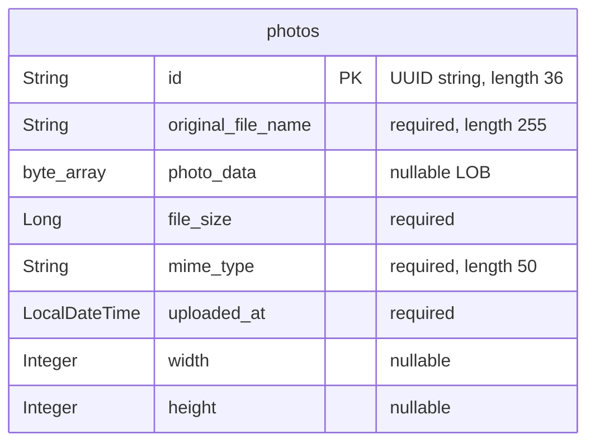

# Data Architecture & Persistence Layer

The data layer contains one JPA entity, `Photo`, persisted through Spring Data JPA/Hibernate to Oracle, with H2 used by the test profile. Photo bytes and metadata reside in the same database row; there is no mapped album or user entity.

## Database Configuration

| Service/Module | DB Type | Profile | Driver | Connection | Migration Tool |
|---|---|---|---|---|---|
| Photo Album | Oracle | Default | `com.oracle.database.jdbc:ojdbc8`; `oracle.jdbc.OracleDriver` | Environment-overridable Oracle Thin connection; fallback targets local Oracle XE. Password supplied externally; credential values omitted. | No Flyway/Liquibase dependency or versioned migrations found. Hibernate recreates the mapped schema at startup. |
| Photo Album | Oracle | `docker` | Same Oracle driver | Environment-overridable Oracle Thin connection; fallback targets the Oracle database host on the container network. Credential values omitted. | Same Hibernate schema recreation behavior. |
| Photo Album test context | H2, in memory | `test` | `com.h2database:h2` (test scope); `org.h2.Driver` | Named in-memory database; test credentials omitted. | Hibernate creates the schema and drops it when the context closes. |

Evidence: `pom.xml:43-54,81-93`; `src/main/resources/application.properties:9-21`; `src/main/resources/application-docker.properties:1-17`; `src/test/resources/application-test.properties:1-10`. The test explicitly activates this profile in `src/test/java/com/photoalbum/PhotoAlbumApplicationTests.java:7-8`.

- **Schema lifecycle:** Default and Docker startup can destroy previously stored photos because schema creation is configured rather than schema validation or incremental migration. The entity mapping, not a checked-in table-creation script, defines `photos`.
- **Initialization:** `oracle-init/01-create-user.sh:19-43` provisions the application schema user, schema-object privileges, and tablespace quota; `oracle-init/create-user.sh:21-40` provides another user-provisioning script. `oracle-init/02-verify-user.sql:1-12` inspects the user and privileges. These are account/bootstrap scripts, not photo seed data or versioned table migrations.
- **Seeds:** No `schema.sql`, `data.sql`, `import.sql`, migration seed files, or programmatic photo seeding found in the inspected application sources/resources.
- **Pooling:** No explicit connection-pool provider, size, timeout, or tuning settings found. The JPA starter supplies the Boot-managed JDBC stack; runtime pool settings were not measured.
- **Portability:** Native repository queries use Oracle-specific functions and pagination. H2 test configuration does not establish that these queries behave identically; the existing test only loads the context.

See `configuration-inventory.md` for the property inventory; this section describes persistence behavior rather than reproducing raw settings.

## Data Ownership per Service

| Service | Tables Owned | ORM Framework | Caching | Notes |
|---|---|---|---|---|
| Photo Album / `PhotoServiceImpl` | `photos` (`Photo`) | Jakarta Persistence annotations, Hibernate through Spring Data JPA | No explicit application/distributed cache | Owns both binary content and descriptive metadata through `PhotoRepository`; `UploadResult` is a non-persistent result object. |

Evidence: `src/main/java/com/photoalbum/model/Photo.java:15-76`; `src/main/java/com/photoalbum/repository/PhotoRepository.java:15-16`; `src/main/java/com/photoalbum/service/impl/PhotoServiceImpl.java:27-46,154-166,190-204`; `src/main/java/com/photoalbum/model/UploadResult.java:3-10`.

## Entity Model

The diagram uses database column names; the following table maps them to Java fields. There are no foreign keys or relationship edges because no associations are declared.

| Java field | Java type | Persistence mapping |
|---|---|---|
| `id` | `String` | Primary key, length 36; assigned a random UUID by the constructor, not by a database sequence. |
| `originalFileName` | `String` | `original_file_name`, non-null, length 255. |
| `photoData` | `byte[]` | `photo_data`, nullable `@Lob`; binary content stored directly in the database. |
| `fileSize` | `Long` | `file_size`, non-null. |
| `mimeType` | `String` | `mime_type`, non-null, length 50. |
| `uploadedAt` | `LocalDateTime` | `uploaded_at`, non-null; initialized with the application clock. No timezone is represented in the Java type. |
| `width` | `Integer` | Nullable column `width`. |
| `height` | `Integer` | Nullable column `height`. |

Source: `src/main/java/com/photoalbum/model/Photo.java:15-90`. A non-unique `idx_photos_uploaded_at` index supports timestamp-oriented access. No explicit version/optimistic-lock field, soft-delete flag, tenant/owner key, cascade mapping, or bidirectional relationship exists in this entity. No explicit lazy-fetch override is declared for its binary LOB.

`PhotoServiceImpl` has class-level `@Transactional`; retrieval and navigation methods override it with read-only transactions (`src/main/java/com/photoalbum/service/impl/PhotoServiceImpl.java:27-29,52-70,215-229`). Upload and deletion use the class-level transaction boundary. Metadata and bytes are saved together as one entity, not coordinated with an external object store.

## Key Repository Methods

| Service | Repository | Notable Methods | Purpose |
|---|---|---|---|
| Photo Album | `PhotoRepository` | `List<Photo> findAllOrderByUploadedAtDesc()` | Native SQL reads all rows, including binary data, newest first; Oracle `NVL` supplies a fallback MIME type. No pagination parameter. |
| Photo Album | `PhotoRepository` | `List<Photo> findPhotosUploadedBefore(LocalDateTime uploadedAt)` | Parameterized native SQL selects strictly older rows ordered newest first, capped at ten using Oracle `ROWNUM`. |
| Photo Album | `PhotoRepository` | `List<Photo> findPhotosUploadedAfter(LocalDateTime uploadedAt)` | Parameterized native SQL selects strictly newer rows up to Oracle `SYSDATE`, ordered oldest first; uses `DUAL` and has no explicit row cap. |

Interface and SQL source: `src/main/java/com/photoalbum/repository/PhotoRepository.java:15-62`. It extends `JpaRepository<Photo, String>` and inherits standard CRUD and paging operations. The service uses inherited lookup/save/delete operations, but these are not custom queries. No custom bulk aggregation finder, derived finder, stored-procedure invocation, or separate metadata projection was found. All three native queries select `photo_data`, so gallery/navigation reads also retrieve image payloads.

## Caching Strategy

| Layer | Observed behavior | Evidence |
|---|---|---|
| Application/repository | No Spring caching annotations, Redis, Caffeine, Ehcache, JCache provider, or explicit cache-aside/read-through/write-through implementation found. No cache TTL, region, or eviction policy declared. | `pom.xml:30-101`; application Java sources; application property files. |
| ORM | No explicit Hibernate second-level/query-cache configuration or entity cache annotations found. Ordinary transaction-scoped persistence-context behavior should not be confused with a shared application cache. | `src/main/java/com/photoalbum/model/Photo.java:15-76`; application property files. |
| Photo response | Explicitly prevents browser/proxy storage and requires revalidation through no-cache/no-store headers; no positive TTL. | `src/main/java/com/photoalbum/controller/PhotoFileController.java:74-79`. |
| Authentication/session | Administrator details are held in memory; authentication is stateless, with no configured persistent/distributed session cache. This is not a cache of photo records. | `src/main/java/com/photoalbum/config/SecurityConfig.java:33-42,48-58`. |

The code explicitly opts out of photo response caching; it does not document a broader performance rationale or measured cache requirements.

## Data Ownership Boundaries

One application persistence boundary uses one datasource and one mapped table. All observed photo reads/writes go through `PhotoServiceImpl` and `PhotoRepository`; no database-per-service topology, cross-service database reads, remote data aggregation, outbox, or separate CQRS read store is present in the inspected code. Read-only transaction annotations separate read intent, not data ownership or physical storage.

Photo payloads are authoritative database LOBs, not filesystem paths. Upload reads file bytes and persists them with the metadata (`src/main/java/com/photoalbum/service/impl/PhotoServiceImpl.java:111-166`); file delivery reads those bytes from the entity (`src/main/java/com/photoalbum/controller/PhotoFileController.java:46-69`). A checked-in image exists under `src/main/resources/static/uploads/`, but the current persistence model contains no filesystem-reference field; that asset is not evidence of a separate active upload datastore.

No persisted user/album ownership relation or row-level tenant boundary is modeled. Authentication uses an in-memory administrator rather than a user table (`src/main/java/com/photoalbum/config/SecurityConfig.java:33-42`). Database bootstrap grants schema-object privileges rather than DBA access (`oracle-init/01-create-user.sh:31-43`); this is a database-account boundary, not per-photo authorization.

### Data Classification & Sensitivity

| Entity | Sensitive Fields | Classification (PII/PHI/PCI/None) | Controls in Place |
|---|---|---|---|
| `Photo` | `photoData`, `originalFileName` | Potential PII: user-supplied images may identify people or contain embedded personal metadata, and filenames may contain names. Actual content was not inspected. No dedicated PHI or PCI fields detected; arbitrary image content cannot be classified conclusively from the schema. | No application field encryption, masking, metadata stripping, or field-/owner-level access controls found. Photo reads are public; selected state-changing operations require authentication. |
| `Photo` | `id`, `uploadedAt`, `fileSize`, `mimeType`, `width`, `height` | Technical metadata; timestamps/identifiers may become identifying when linked to image content. No standalone PHI/PCI fields detected. | No field-specific masking or encryption declared. No owner key restricts access to individual rows. |

Evidence: entity mapping in `src/main/java/com/photoalbum/model/Photo.java:21-81`; original bytes retained by `src/main/java/com/photoalbum/service/impl/PhotoServiceImpl.java:117-160`; public-read/authentication rules in `src/main/java/com/photoalbum/config/SecurityConfig.java:48-58`.

Encryption at rest is not configured in the inspected application/bootstrap files; an external Oracle/storage administrator may provide it, but that cannot be verified from these sources. Logging includes original filenames and a prefix of image bytes, with no masking observed (`src/main/java/com/photoalbum/controller/PhotoFileController.java:53-66`). Credentials are externally supplied and deliberately omitted from this document; administrator passwords are BCrypt-encoded for the in-memory authentication store, which does not encrypt photo data (`src/main/java/com/photoalbum/config/SecurityConfig.java:28-42`).
