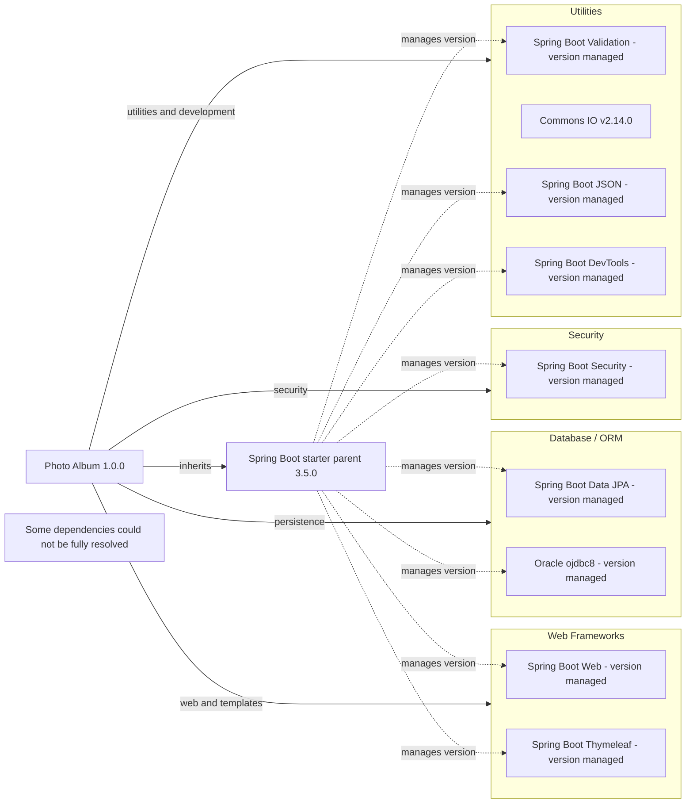

# Dependency Map

Photo Album (`com.photoalbum:photo-album:1.0.0`) declares **11 external dependencies: 9 non-test and 2 test-scoped** in [`pom.xml`](../../../../../../pom.xml). This map covers declared packages only; the parent POM and build plugin are not included in dependency counts.

## Dependencies

Versions marked **managed** are omitted in the local declarations and delegated to the Spring Boot parent. The external parent/BOM contents and a resolved dependency tree were not inspected, so effective versions and transitive packages are not enumerated. The parent also manages both test dependencies below; there is no explicit local BOM import.

### Dependency Summary

| Category | Count | Key Libraries | Notes |
|---|---:|---|---|
| Web Frameworks | 2 | Spring Boot Web, Thymeleaf | Parent-managed versions; default compile scope |
| Database / ORM | 2 | Spring Boot Data JPA, Oracle `ojdbc8` | JPA has default compile scope; Oracle is runtime |
| Security | 1 | Spring Boot Security | Parent-managed version; default compile scope |
| Utilities | 4 | Spring Boot Validation, Commons IO 2.14.0, Spring Boot JSON, DevTools | DevTools is optional; all have default compile scope |
| **Total non-test** | **9** | | Test dependencies excluded |

Declared non-test inventory (Maven scope defaults to `compile` when omitted):

| Group and artifact | Declared version | Scope | Evidence |
|---|---|---|---|
| `org.springframework.boot:spring-boot-starter-web` | Omitted; parent-managed | compile | `pom.xml:31–35` |
| `org.springframework.boot:spring-boot-starter-thymeleaf` | Omitted; parent-managed | compile | `pom.xml:37–41` |
| `org.springframework.boot:spring-boot-starter-data-jpa` | Omitted; parent-managed | compile | `pom.xml:43–47` |
| `com.oracle.database.jdbc:ojdbc8` | Omitted; parent-managed | runtime | `pom.xml:49–54` |
| `org.springframework.boot:spring-boot-starter-validation` | Omitted; parent-managed | compile | `pom.xml:56–60` |
| `org.springframework.boot:spring-boot-starter-security` | Omitted; parent-managed | compile | `pom.xml:62–66` |
| `commons-io:commons-io` | `2.14.0` | compile | `pom.xml:68–73` |
| `org.springframework.boot:spring-boot-starter-json` | Omitted; parent-managed | compile | `pom.xml:75–79` |
| `org.springframework.boot:spring-boot-devtools` | Omitted; parent-managed | compile, optional | `pom.xml:95–100` |

### Version & Compatibility Risks

The project targets Java 21 and inherits Spring Boot `3.5.0` (`pom.xml:8–13,23–28`). Framework upgrades should preserve alignment with the inherited dependency management. Commons IO is explicitly pinned to `2.14.0`, so parent upgrades will not automatically update that declaration. Oracle driver compatibility with Java 21 and the target Oracle database must be checked against its effective managed version; the `ojdbc8` artifact name alone does not establish incompatibility. No lifecycle lookup or vulnerability assessment was performed, so no end-of-life or CVE status is asserted.

### Notable Observations

- Only one recognized build/package manifest was found, the root `pom.xml`; it declares no Maven modules. No dependency lockfile was found, limiting transitive-version evidence.
- DevTools is explicitly optional, not test-scoped (`pom.xml:95–100`); it is therefore counted among non-test declarations, without assuming production packaging behavior.
- The comment above `spring-boot-starter-json` says “Image processing,” but the declared artifact is the JSON starter (`pom.xml:75–79`); no dedicated image-processing library is declared.
- `org.springframework.boot:spring-boot-maven-plugin` is declared without a local version (`pom.xml:103–110`). It is build tooling, excluded from the library diagram and counts. No standalone logging, messaging, caching, or observability dependency is declared; this does not establish their absence transitively.

## Test Dependencies

| Framework | Version | Notes |
|---|---|---|
| `org.springframework.boot:spring-boot-starter-test` | Omitted; parent-managed | Test starter; scope `test` (`pom.xml:81–86`). Individual testing libraries and versions are not declared locally. |
| `com.h2database:h2` | Omitted; parent-managed | Test database; scope `test` (`pom.xml:88–93`). |

Total test-scope dependencies: **2**

No separate integration-testing or contract-testing library is explicitly declared. H2 differs from the declared Oracle runtime driver, so database-specific behavior may need separate validation; build declarations alone do not establish test coverage or execution.
