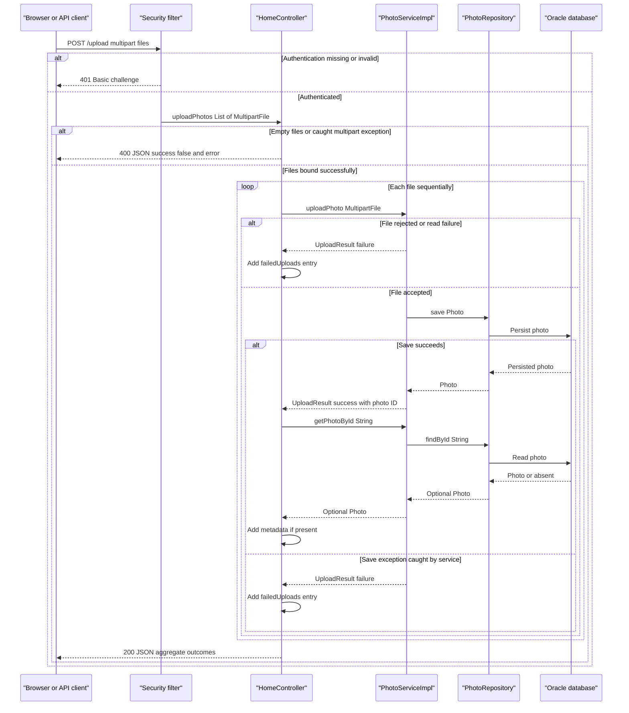

# API & Service Communication Contracts

The application exposes five explicit controller endpoints: two HTML views, a multipart upload returning JSON, a deletion redirect, and a binary photo response. Communication is synchronous; no inter-service HTTP API or asynchronous messaging was found.

## Service Catalog

| Service | Port | Category | Purpose |
|---|---|---|---|
| `photoalbum-java-app` / Maven `com.photoalbum:photo-album` | HTTP 8080, published as 8080 | Business; serves its own API layer | Single source-built deployment providing the gallery, upload, deletion, and photo retrieval. |
| `oracle-db` | 1521; management port 5500 also published | Infrastructure | Third-party Oracle Database Express 21.3.0 XE container, not an application module or REST service. |

The application uses Spring Boot 3.5.0 with Web MVC, Thymeleaf, Data JPA, Validation, Security, JSON/Jackson, and the Oracle JDBC driver. There are no Maven submodules or separately deployed controllers/services. The Compose file defines the two deployments above; no Kubernetes or Helm service definitions were discovered.

Evidence: `pom.xml`, `docker-compose.yml`, `Dockerfile`.

## API Endpoints Inventory

All rows belong to `photoalbum-java-app`. Paths are unversioned; no URL, header, or query-based API versioning was found.

| Service | Method | Path | Request Type | Response Type |
|---|---|---|---|---|
| `HomeController` | GET | `/` | No explicit request parameters | **200** HTML `index` view using `List<Photo>` and a timestamp in its model. Loading errors render an empty gallery rather than an error status. |
| `HomeController` | POST | `/upload` | `multipart/form-data`; required repeated `files` parts bound to `List<MultipartFile>`; authenticated HTTP Basic request | **200** JSON `Map<String,Object>` containing aggregate success and per-file outcomes, including partial or total per-file failure. **400** JSON for an empty list or a caught `MultipartException`; a missing required part is also a framework binding error. **401** for missing/invalid authentication. Uncaught service/transaction failures can produce **500**. |
| `DetailController` | GET | `/detail/{id}` | String path parameter `id` | **200** HTML `detail` view using `Photo` and optional previous/next photo IDs. **302** redirect to `/` for an invalid/missing photo or a caught loading error. |
| `DetailController` | POST | `/detail/{id}/delete` | String path parameter `id`; no request DTO; authenticated HTTP Basic request | **302** redirect to `/` with success/error flash attributes, including when the photo is absent or deletion throws. **401** for missing/invalid authentication. |
| `PhotoFileController` | GET | `/photo/{id}` | String path parameter `id` | **200** `ResponseEntity<Resource>` backed by `ByteArrayResource`, with the stored MIME type. **404** when the ID/photo/content is absent; **500** on caught retrieval or response-construction errors. Error bodies are empty. |

The binary response sets `Cache-Control: no-cache, no-store, must-revalidate, private`, `Pragma: no-cache`, and `Expires: 0`, plus `X-Photo-ID`, `X-Photo-Name`, and `X-Photo-Size`. It does not declare a download attachment contract.

Upload errors have two distinct contracts: request-level failures return 400, whereas handled per-file rejection/failure remains a 200 response. There is no shared application error DTO or global error-envelope handler. Validation implementation details belong in `business-workflows.md`.

Evidence: `src/main/java/com/photoalbum/controller/{HomeController,DetailController,PhotoFileController}.java`.

## Management & Observability Endpoints

| Service | Endpoint | Custom Metrics (if any) |
|---|---|---|
| `photoalbum-java-app` | No explicit management, health, metrics, Prometheus, Swagger UI, or OpenAPI endpoint found | No custom metric registrations or timing annotations found; Actuator is not a declared dependency. |
| `oracle-db` | Port 5500 is published for database management; no HTTP path or application-level contract is defined in this repository | No application metrics contract found. |

Spring Boot's framework error handling is distinct from a management API. The gallery `/` is a business endpoint, not a dedicated readiness contract. Logging is present but does not expose a metrics API.

## DTOs & Contracts

| Class/type | API role | Mutability and serialization |
|---|---|---|
| `Photo` | Service-owned domain entity supplied to HTML view models and read to construct upload metadata and binary responses | Mutable POJO. Controllers do not directly return the complete entity as JSON. Entity fields and persistence details belong in `data-architecture.md`. |
| `UploadResult` | Internal service-to-controller outcome for each upload; not directly returned as the HTTP response DTO | Mutable POJO with setters; translated into maps by `HomeController`. |
| `MultipartFile` / `List<MultipartFile>` | Framework request abstraction for multipart upload parts | Not a custom immutable request DTO or JSON body. |
| `Map<String,Object>` | Ad hoc upload success/error JSON envelope and per-file entries | Mutable maps serialized through the standard Spring Boot Jackson integration. No custom serializer or mapper configuration was found. |
| `Resource` / `ByteArrayResource` | Binary photo response body | Raw bytes, not a JSON DTO. |

The upload envelope contains `success`, `uploadedPhotos`, and `failedUploads`. A handled request-level failure instead contains `success` and `error`. Failed-upload entries carry `fileName` and `error`; successful entries are selected metadata projections, not complete `Photo` objects. Uploaded timestamps are passed to Jackson as Java date/time values without a custom wire-format declaration.

No gateway-level aggregation DTOs, immutable records, OpenAPI/Swagger specifications, protobuf schemas, or GraphQL schemas were discovered.

Evidence: controller sources, `src/main/java/com/photoalbum/model/{Photo,UploadResult}.java`, and `pom.xml`.

## Communication Patterns

- **Synchronous HTTP:** Browsers request HTML and binary images; multipart upload returns JSON. Detail-page forms POST deletion requests. Controller calls to `PhotoService` / `PhotoServiceImpl` and `PhotoRepository` are direct in-process method calls, not separate services.
- **Database communication:** Spring Data JPA uses JDBC to the database. Compose resolves the static database service hostname through container-network DNS; the local configuration targets a local database host. This is not application service discovery.
- **Upload composition:** `HomeController` processes files sequentially. For a successful `UploadResult`, it performs a further lookup by ID and adds a metadata projection only if the photo is found. Failed results become failure entries; an absent post-upload lookup adds neither entry. Overall success means at least one successful metadata entry. This is local response composition, not gateway aggregation.
- **Asynchronous communication:** No message broker, event bus, pub/sub client, background messaging contract, or gRPC service was found.
- **Resilience and timeouts:** No explicit application retry, circuit breaker, bulkhead, fallback service, HTTP-client timeout, or JDBC operation timeout policy was found. Framework/driver defaults are not declared contract guarantees. Compose process restart behavior is not a request retry policy.
- **Error behavior:** Gallery read failures produce an empty gallery; detail read failures redirect home; binary retrieval failures return 500. The upload service converts many validation, file-read, and persistence exceptions into failed results. These catches do not guarantee that transaction-commit errors or the controller's subsequent lookup cannot escape. There is no automatic downstream fallback or retry.
- **Discovery, gateway, and balancing:** No service registry, API gateway, inter-service aggregation, or client-side load balancer is configured.
- **Availability:** Compose starts the application after the database becomes healthy. Database connectivity and required credentials affect availability. Deployment settings and startup mechanisms belong in `configuration-inventory.md`; credential values are intentionally omitted here.
- **Authentication and authorization:** `SecurityConfig` implements stateless HTTP Basic authentication and an in-memory user with BCrypt-encoded credentials. POST `/upload` and `/detail/*/delete` require authentication. Read-only gallery/detail/photo routes and other requests are permitted by the security rule. Although the configured account has an admin role, these routes use `authenticated()`, not role-based checks. No JWT, OAuth2, method-level authorization, or explicit CORS policy was found.
- **Transport and CSRF:** CSRF protection is explicitly disabled. No application HTTPS listener, enforced TLS redirect, or TLS termination component is configured in the inspected deployment; external TLS cannot be inferred. Clients using Basic authentication require an appropriately secured deployment.

Evidence: controller sources, `src/main/java/com/photoalbum/service/impl/PhotoServiceImpl.java`, `src/main/java/com/photoalbum/repository/PhotoRepository.java`, `src/main/java/com/photoalbum/config/SecurityConfig.java`, `docker-compose.yml`, and application configuration files.

## Service Technology Matrix

Capabilities unused by all services—service discovery, gateway functionality, Actuator, application caching, and metrics export—are omitted.

| Service | Web | Data Access |
|---|---|---|
| `photoalbum-java-app` | Spring MVC / Thymeleaf; JSON and binary responses; Spring Security Basic authentication | Spring Data JPA / Hibernate / Oracle JDBC |
| `oracle-db` | No repository-defined web API; database management port published | Oracle database server |

The photo endpoint explicitly disallows HTTP caching; no application caching layer was found.

## Service Communication Sequence

Primary multipart-upload flow, including authentication and per-file failure handling. Solid arrows indicate synchronous invocations; dashed arrows below are responses, not asynchronous events.

An uncaught lookup or transaction-commit failure can interrupt the illustrated aggregation and produce a framework error response; no retry or circuit-breaker path is implemented.
