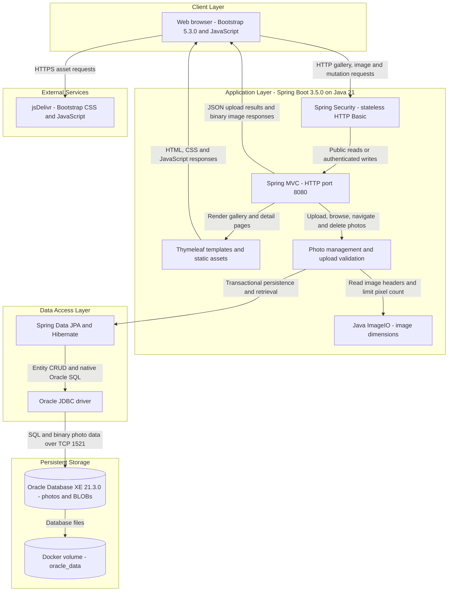
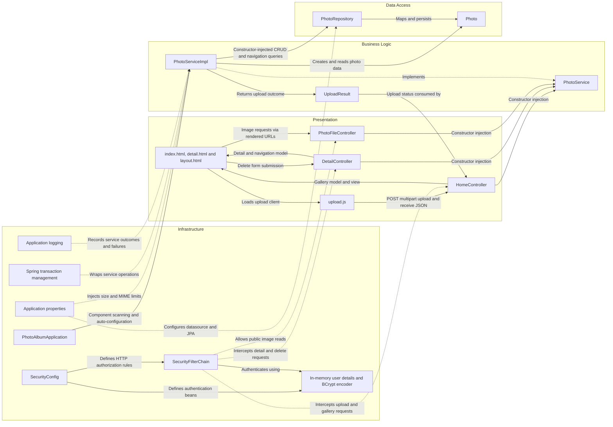

# Architecture Diagram

Photo Album is a single-module Java 21 Spring Boot application providing a public photo gallery and authenticated upload/delete operations. The architecture below reflects the checked-in source and deployment configuration, not a verified running deployment; credential values are omitted.

## Application Architecture

### Technology Stack Summary

| Layer | Technology | Version | Purpose |
|---|---|---|---|
| Runtime | Java / Eclipse Temurin | 21 | Executable JAR runtime; container uses a JRE image |
| Application | Spring Boot | 3.5.0 | Auto-configuration, dependency injection and embedded servlet hosting |
| Presentation | Spring MVC and Thymeleaf | Managed by Spring Boot 3.5.0 | Gallery/detail HTML, multipart upload endpoint and image responses |
| Browser | Bootstrap and plain JavaScript Fetch API | Bootstrap 5.3.0; JavaScript unspecified | Responsive UI, drag-and-drop upload and dynamic gallery updates |
| Security | Spring Security and BCrypt | Managed by Spring Boot 3.5.0 | HTTP Basic authentication using an in-memory administrator account |
| Business logic | Spring transactions and Java ImageIO | Boot-managed transactions; Java 21 ImageIO | Upload validation, dimension extraction, navigation and transactional photo operations |
| Persistence | Spring Data JPA, Hibernate and Oracle JDBC `ojdbc8` | Managed by Spring Boot 3.5.0 | Entity mapping, repository CRUD and Oracle-specific native queries |
| Database | Oracle Database Express Edition | Compose image tag `21.3.0-xe` | Stores photo metadata and binary image contents |
| Build and deployment | Maven, Docker multi-stage build and Docker Compose | Build image Maven 3.9.9; Docker/Compose versions unspecified | Build executable JAR and run application/database containers |
| Test-only storage | H2 | Managed by Spring Boot 3.5.0 | Test-scoped alternative database; not production storage |

### Data Storage & External Services

Oracle holds both metadata and image bytes in the `photos` table; `Photo.photoData` is a JPA LOB. Gallery and detail views reference `/photo/{id}`, which serves the database-backed bytes rather than an uploaded-file directory. Docker Compose places the application and Oracle on a bridge network, waits for database health before application startup, persists Oracle files in `oracle_data`, and mounts `oracle-init` for startup scripts. The default profile targets a local Oracle instance; the Docker profile targets the database service. Both profiles configure `spring.jpa.hibernate.ddl-auto=create`, so schema recreation at startup can remove existing photo data despite the persistent database volume. The browser retrieves Bootstrap assets from jsDelivr; no application cache, message broker, object-storage integration or outbound business API is evident.

### Key Architectural Decisions

- A layered monolith uses constructor injection: MVC controllers depend on a service interface, whose transactional implementation delegates persistence to a Spring Data repository.
- Photos and metadata share database storage. Native queries use Oracle constructs including `NVL`, `ROWNUM`, `SYSDATE` and `DUAL`, coupling retrieval/navigation to Oracle.
- Reads are public; POST upload and delete require authentication. Security uses stateless HTTP Basic, an in-memory account and BCrypt with externally supplied administrator credentials; CSRF is disabled. Multipart limits are 10 MB per file and 50 MB per request, with service MIME/size checks and a 40-million-pixel limit when image headers can be read.

## Component Relationships

### Component Inventory

| Component | Layer | Type | Responsibility |
|---|---|---|---|
| `PhotoAlbumApplication` | Infrastructure | Spring Boot entry point | Starts the application and activates component scanning/auto-configuration |
| `HomeController` | Presentation | MVC controller | Serves `GET /`, accepts multipart `POST /upload`, builds JSON success/failure lists and handles multipart exceptions |
| `DetailController` | Presentation | MVC controller | Serves `GET /detail/{id}`, populates older/newer navigation and handles `POST /detail/{id}/delete` with redirect feedback |
| `PhotoFileController` | Presentation | MVC binary-response controller | Serves database-backed bytes for `GET /photo/{id}`, with MIME type and no-cache headers |
| `index.html`, `detail.html`, `layout.html` | Presentation | Thymeleaf templates | Define gallery/detail screens and a layout template; render metadata, photo links and delete form |
| `upload.js` | Presentation | Browser script | Handles file selection/drop, client MIME/size checks, multipart Fetch requests and upload feedback/gallery updates |
| `PhotoService` | Business logic | Service interface | Defines retrieval, upload, deletion and chronological navigation operations |
| `PhotoServiceImpl` | Business logic | Transactional Spring service | Implements photo operations, validates uploads, extracts image dimensions and calls the repository; read operations use read-only transactions |
| `UploadResult` | Business logic | Result DTO | Carries upload status, original filename, error message and saved photo identifier |
| `PhotoRepository` | Data access | Spring Data JPA repository | Provides `JpaRepository<Photo, String>` CRUD and native Oracle gallery/navigation queries |
| `Photo` | Data access | JPA entity | Maps UUID identifier, filename, BLOB bytes, MIME type, file size, upload timestamp and optional dimensions to `photos`, with an upload-time index |
| `SecurityConfig` | Infrastructure | Spring configuration | Defines password encoder, in-memory administrator and HTTP security chain |
| `SecurityFilterChain` | Infrastructure | Request filter chain | Requires authentication for upload/delete POST routes, permits other requests, enables HTTP Basic and stateless sessions, disables CSRF |
| In-memory user details and BCrypt encoder | Infrastructure | Authentication beans | Hold the configured administrator identity and hash its externally supplied password; credential values are omitted |
| `application.properties`, `application-docker.properties` | Infrastructure | Externalized configuration | Configure Oracle datasource, JPA schema behavior, multipart limits, validation settings, logging and port 8080 |
| Spring transaction management | Infrastructure | Cross-cutting transaction support | Applies service transaction boundaries through Spring-managed proxies |
| Application logging | Infrastructure | SLF4J logging | Records controller/service operations and errors under configured log levels |

Evidence: `pom.xml`, `Dockerfile`, `docker-compose.yml`, `src/main/resources/application*.properties`, `src/main/java/com/photoalbum/PhotoAlbumApplication.java`, and the `config`, `controller`, `service`, `repository`, `model`, `templates` and static JavaScript sources described above. Framework component versions not explicitly pinned are reported as Boot-managed rather than assumed resolved versions.
