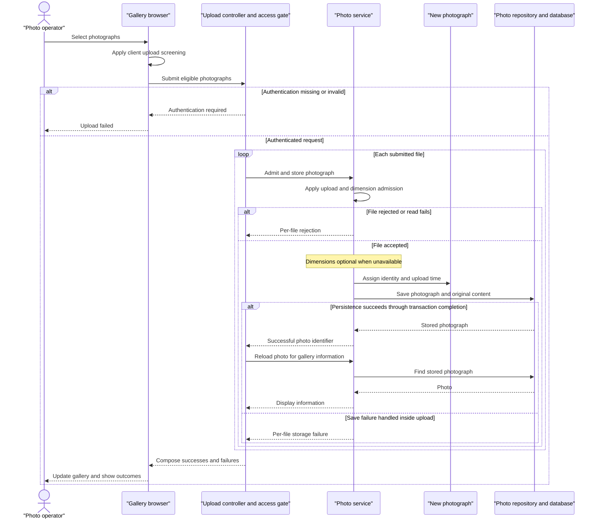

# Core Business Workflows

Photo Album lets visitors browse a shared collection of photographs and view individual images with their upload information. Authenticated operators can add multiple photographs and permanently remove existing ones.

## Domain Entities

| Entity | Service / Bounded Context | Description | Key Relationships |
|---|---|---|---|
| Photo | Photo Album / Photo Management | An uploaded photograph, its original content, and information used for display and chronological navigation. It is the sole persisted business entity. | Belongs to the shared gallery; older and newer photographs are located by upload time, not explicit relationships. |
| UploadResult | Photo Album / Upload Processing | A non-persisted per-file operation outcome identifying an accepted photograph or explaining rejection. Not a separate aggregate. | Associates an upload attempt with the resulting Photo when successful. |

There are no modeled users, named albums, ownership relationships, tags, or separate gallery entities. The configured operator account is an authentication identity, not a business entity.

Sources: `src/main/java/com/photoalbum/model/Photo.java:19-90`, `src/main/java/com/photoalbum/model/UploadResult.java:6-11`, `src/main/java/com/photoalbum/config/SecurityConfig.java:33-43`.

## Service-to-Domain Mapping

This is one application with in-process components, not independently deployed domain services.

| Service | Domain Context | Owned Entities | External Dependencies |
|---|---|---|---|
| Photo Album application — `PhotoServiceImpl` | Photo Management: admission, storage, retrieval, chronology, and removal | Photo; transient UploadResult outcomes | PhotoRepository and the photo database |
| `HomeController`, `DetailController`, `PhotoFileController` | Gallery interaction and presentation within the same context | No independent entity ownership; delegate Photo operations to PhotoService | Browser requests; the same in-process PhotoService |

PhotoService is the business-operation boundary; the database is the source of truth for both photo information and original image content. Controllers do not maintain separate copies or exchange domain events.

Sources: `src/main/java/com/photoalbum/service/impl/PhotoServiceImpl.java:25-46`, `src/main/java/com/photoalbum/repository/PhotoRepository.java:15-29`, `src/main/java/com/photoalbum/controller/PhotoFileController.java:53-83`.

## Primary Workflows

### Workflow 1: Upload photographs and update the gallery

**Entry point:** A user selects or drops files into the gallery; the browser submits `POST /upload`.

1. The browser applies **Client upload screening**, displays progress, and sends eligible files together.
2. The security filter applies **Mutation authorization** before upload handling.
3. HomeController applies **Batch admission**, then processes submitted files sequentially through PhotoService.
4. PhotoService applies **Server upload admission** and **Image dimension admission**. It reads original bytes and attempts to obtain dimensions without fully decoding the image.
5. Accepted content becomes a new Photo and is saved with its display information. **Photo metadata integrity** applies to the entity. Dimension extraction can degrade according to **Optional dimensions**.
6. Each normal service return is an UploadResult. For successful results, HomeController separately reloads the Photo and includes its display information in the success list; failures populate the per-file error list.
7. HomeController returns a combined outcome under **Batch result composition**. The browser prepends successful photographs to the gallery and displays individual failure messages. It requests image content separately.
8. A network failure or non-success HTTP response produces a generic browser upload error. There is no automatic retry or rollback of earlier files.

The batch is designed to permit partial success rather than require all photographs to be accepted together. Some errors outside the service's normal result handling can still abort the request; see transaction and error behavior below.

Sources: `src/main/resources/static/js/upload.js:48-158`, `src/main/java/com/photoalbum/controller/HomeController.java:56-106`, `src/main/java/com/photoalbum/service/impl/PhotoServiceImpl.java:80-184`.

### Workflow 2: Browse the gallery and navigate full-size photographs

**Entry points:** A visitor opens `GET /`, selects a photograph at `GET /detail/{id}`, and the browser retrieves its content at `GET /photo/{id}`.

1. HomeController asks PhotoService for the shared collection under **Gallery chronology** and renders it. A retrieval error is logged and the page renders an empty collection instead.
2. DetailController applies **Photo lookup outcomes**. A found Photo is combined with separate previous-photo and next-photo lookups.
3. PhotoService applies **Chronological navigation**; the detail page renders available navigation links and upload information.
4. The browser requests the original image independently. PhotoFileController looks up the Photo, obtains its stored content, and serves it using the stored media type.
5. Missing content returns not-found; serving errors return a server error. The page and image requests are separate, so successful page rendering does not guarantee image delivery.

Sources: `src/main/java/com/photoalbum/controller/HomeController.java:38-50`, `src/main/java/com/photoalbum/controller/DetailController.java:32-58`, `src/main/java/com/photoalbum/controller/PhotoFileController.java:37-86`, `src/main/java/com/photoalbum/service/impl/PhotoServiceImpl.java:212-229`, `src/main/resources/templates/detail.html:62-94`.

### Workflow 3: Confirm and permanently delete a photograph

**Entry point:** The detail-page form asks for browser confirmation and submits `POST /detail/{id}/delete`.

1. Cancelling the browser confirmation leaves the photograph unchanged. This confirmation is a presentation safeguard, not a server-side approval step.
2. The security filter applies **Mutation authorization**.
3. PhotoService looks up the Photo. If absent, it returns false; otherwise it deletes the stored entity, including its original content.
4. DetailController sets a success or not-found flash message. Exceptions produce a generic failure flash message.
5. The controller redirects to the gallery, which reloads the remaining collection.

There is no soft-delete state, recovery workflow, external file cleanup, or compensating business operation.

Sources: `src/main/resources/templates/detail.html:50-59`, `src/main/java/com/photoalbum/controller/DetailController.java:64-78`, `src/main/java/com/photoalbum/service/impl/PhotoServiceImpl.java:190-208`.

No scheduled jobs, message listeners, batch commands, or business-state initialization routines were found in `src/main/java`; the application entry point only starts the application.

## Cross-Service Data Flows

There are no backend-to-backend service calls, gateways, message brokers, circuit breakers, or cross-context identifiers in the implemented workflows.

- **Upload composition:** Browser file content flows to HomeController, PhotoService, and the database. HomeController uses the returned photo identifier to reload each successful Photo and compose display information with per-file failures. The response omits image bytes; the browser subsequently fetches content by that same identifier.
- **Detail composition:** DetailController combines the selected Photo with identifiers from two chronological queries. These are separate calls within the same application, not a distributed aggregation.
- **Image delivery:** The browser obtains original content from PhotoFileController, using the database-backed Photo as the authoritative source. Cache-busting URLs and no-cache image responses favor freshly retrieved content rather than previously cached copies.
- **Business-relevant degradation:** Gallery read failures look like an empty collection; detail failures redirect to the gallery; missing image content returns not-found rather than a placeholder. Upload can proceed without dimensions and can report mixed per-file outcomes. There is no alternative storage source or offline fallback.

Sources: `src/main/java/com/photoalbum/controller/HomeController.java:39-98`, `src/main/java/com/photoalbum/controller/DetailController.java:38-58`, `src/main/java/com/photoalbum/controller/PhotoFileController.java:44-86`, `src/main/resources/static/js/upload.js:113-132,176-179`.

## Business Workflow Sequence

The diagram shows normal handled outcomes. A transaction-completion exception or subsequent reload failure can escape that per-file response path.

## Business Rules & Decision Logic

### Admission and integrity

- **Client upload screening:** The browser accepts JPEG, PNG, GIF, and WebP MIME types and files no larger than 10 MiB. It does not check empty files or enforce a file-count limit.
- **Batch admission:** A null or empty bound file list returns a bad-request result. HomeController's multipart exception handler also returns a bad-request result with “No files provided,” without distinguishing the underlying multipart failure.
- **Server upload admission:** PhotoService compares the lowercased supplied content type against the configured allowlist, rejects files larger than the configured maximum, and rejects zero-length files. Current application profiles allow JPEG, PNG, GIF, and WebP with a 10 MiB maximum. Multipart configuration additionally limits a request to 50 MB. The configured maximum of ten files per upload is not referenced by the controller, service, or browser code and is not an implemented count rule.
- **Image dimension admission:** When an image reader recognizes the content, the first image's width multiplied by height must not exceed 40,000,000 pixels. This check uses header dimensions rather than full image decoding.
- **Optional dimensions:** An I/O exception while reading content or dimensions rejects the file. Other dimension-extraction exceptions are logged and processing continues; no available reader also permits continuation without dimensions. Supplied MIME type is therefore not equivalent to verified decodable image content.
- **Photo metadata integrity:** Entity validation declares a nonblank original filename of at most 255 characters, a nonblank MIME type of at most 50 characters, a positive nonnull size, and a nonnull upload time. These are model constraints, not explicit controller validation. Missing dimensions are allowed.
- **Identity and lifecycle:** Creation assigns a new random identifier and current application time. A photograph moves from uploaded candidate to persisted Photo and can later be physically deleted. No approval, moderation, editing, duplicate-content detection, or filename uniqueness rule is implemented.

Sources: `src/main/resources/static/js/upload.js:60-87`, `src/main/resources/application.properties:24-30`, `src/main/resources/application-docker.properties:20-27`, `src/main/java/com/photoalbum/service/impl/PhotoServiceImpl.java:80-182`, `src/main/java/com/photoalbum/model/Photo.java:31-90`.

### Composition, ordering, and lookup decisions

- **Batch result composition:** The response's success flag is true only when at least one uploaded Photo was successfully reloaded and added to the result. A processed batch normally returns HTTP success even if all files failed admission. If a successful upload's reload is empty, it is included in neither list.
- **Gallery chronology:** The gallery is loaded newest first. Newly uploaded cards are prepended in the browser rather than refetching the entire gallery.
- **Chronological navigation:** Previous means the first returned photograph strictly older than the current upload time, ordered newest first, with that query limited to ten results. Next means the first strictly newer photograph, ordered oldest first, and excludes timestamps beyond the database's current time. Equal timestamps do not qualify in either direction; no tie-breaking rule is defined.
- **Photo lookup outcomes:** Blank or missing detail identifiers redirect to the gallery; detail retrieval exceptions do the same. Blank identifiers, absent records, or absent/empty image content return not-found for image requests; other image-serving exceptions return a server error.
- **Computed display information:** Optional dimensions are extracted from image headers; upload dates and human-readable sizes are formatted for presentation. No thumbnails, image resizing, pricing, or aggregate business metrics are computed.

Sources: `src/main/java/com/photoalbum/controller/HomeController.java:69-97`, `src/main/java/com/photoalbum/repository/PhotoRepository.java:23-62`, `src/main/java/com/photoalbum/service/impl/PhotoServiceImpl.java:215-229`, `src/main/java/com/photoalbum/controller/DetailController.java:32-58`, `src/main/java/com/photoalbum/controller/PhotoFileController.java:37-86`, `src/main/resources/templates/detail.html:104-125`.

### Cross-cutting business behavior

- **Mutation authorization:** Upload and deletion require authentication; gallery, detail, and image reads are public. The configured account is assigned an administrator role, but endpoint rules check authentication rather than that role. There are no per-photo ownership checks or separate private collections. Credential values are intentionally omitted.
- **Transactions:** PhotoServiceImpl has class-level transaction boundaries; read operations override them as read-only. Each controller-to-service upload call has its own transaction, not one transaction for the whole batch. Metadata reload is another service call. Caught repository save failures become UploadResult failures where possible, but transaction commit/rollback errors can occur after the method returns and escape the controller's per-file loop. A prior file's committed upload is not compensated.
- **Read consistency:** Selected-photo and navigation lookups are separate read transactions, so detail composition is not one atomic snapshot of concurrent additions/deletions.
- **Error handling:** Retrieval and deletion errors are wrapped as runtime exceptions. Gallery/detail/delete controllers handle them as described above; upload has no controller-wide catch around per-file service calls or reloads. No durable retry queue or dead-letter handling exists.
- **Business logging:** Upload acceptance/rejection, deletion, retrieval failures, and image delivery are logged with identifiers or filenames; image delivery also logs a small byte preview. There is no persisted business audit trail, actor attribution, or change history.

Sources: `src/main/java/com/photoalbum/config/SecurityConfig.java:33-59`, `src/main/java/com/photoalbum/service/impl/PhotoServiceImpl.java:27-28,52-74,164-208,215-229`, `src/main/java/com/photoalbum/controller/HomeController.java:39-98`, `src/main/java/com/photoalbum/controller/PhotoFileController.java:45-85`.
