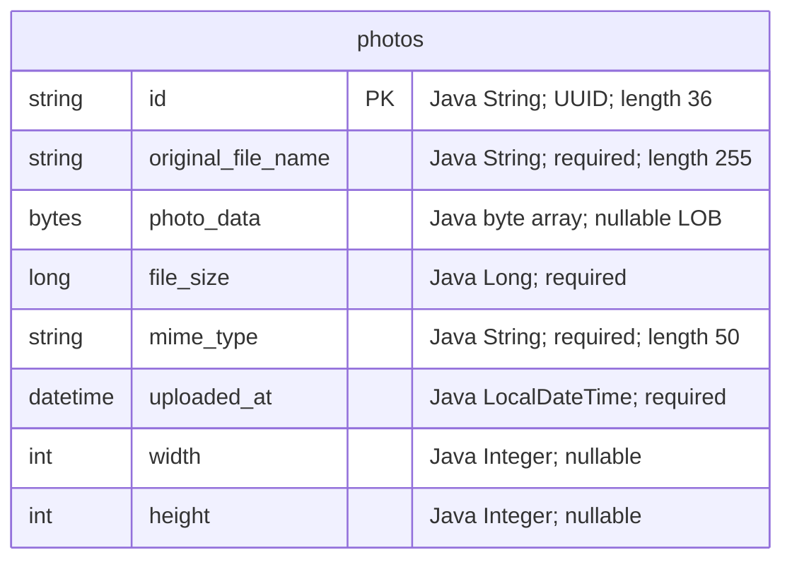

# Data Architecture & Persistence Layer

The persistence layer contains one JPA entity, `Photo`, managed through Spring Data JPA and Hibernate. Oracle stores both photo metadata and binary image content; tests select an H2 in-memory database.

## Database Configuration

| Service/Module | DB Type | Profile | Driver | Connection | Migration Tool |
|---|---|---|---|---|---|
| Photo Album | Oracle | Default | `com.oracle.database.jdbc:ojdbc8`; `oracle.jdbc.OracleDriver` | JDBC Thin connection to localhost, port 1521, XE SID by default; environment-overridable. Credentials: [REDACTED]. | None detected; Hibernate recreates schema at startup. |
| Photo Album | Oracle | `docker` | Same Oracle driver | JDBC Thin connection to `oracle-db`, port 1521, XE SID by default; environment-overridable. Credentials: [REDACTED]. | None detected; Hibernate recreates schema at startup. |
| Photo Album tests | H2 | `test` | `com.h2database:h2` (test scope); `org.h2.Driver` | Named in-memory database `testdb`. Credentials: [REDACTED]. | None detected; Hibernate creates schema and drops it when the persistence context closes. |

- Sources: `pom.xml:43-54,88-93`, `src/main/resources/application.properties`, `src/main/resources/application-docker.properties`, and `src/test/resources/application-test.properties`. Tests explicitly activate `test` in `src/test/java/com/photoalbum/PhotoAlbumApplicationTests.java`.
- Oracle configurations select the Oracle Hibernate dialect; tests select the H2 dialect. Native repository SQL remains Oracle-specific, so selecting H2 does not establish query portability.
- Schema recreation in the Oracle profiles is destructive, not an incremental migration strategy. No Flyway/Liquibase dependency, versioned schema migrations, `schema.sql`, `data.sql`, `import.sql`, or programmatic entity seeding was found.
- Scripts under `oracle-init/` provision/check the Oracle application user and privileges; they are not domain-table migrations or photo seed data.
- No explicit pool provider, pool size, or timeout tuning is configured. The JPA starter normally supplies HikariCP through its JDBC dependencies; this is dependency-based inference, not a verified runtime pool configuration.
- See `configuration-inventory.md` for the property inventory; this document describes persistence behavior rather than raw configuration values.

## Data Ownership per Service

| Service | Tables Owned | ORM Framework | Caching | Notes |
|---|---|---|---|---|
| Photo Album (`com.photoalbum`) | `photos` | Jakarta Persistence / Hibernate via Spring Data JPA | Persistence-context identity scope only; no explicit application or second-level cache | `PhotoServiceImpl` owns data access through `PhotoRepository`; image bytes reside in the same row as metadata. |

## Entity Model

**Mapping source:** `src/main/java/com/photoalbum/model/Photo.java:15-82`.

- `Photo` maps to `photos`. UUID identifiers and upload timestamps are assigned in its constructor rather than through database-generated identifiers/defaults.
- A non-unique index, `idx_photos_uploaded_at`, covers `uploaded_at`. No additional uniqueness constraint, foreign key, optimistic-lock version field, or entity relationship is declared.
- There are no association fetch modes, cascades, or bidirectional links to document. `photoData` is a basic `@Lob` without an explicit lazy-fetch annotation; custom queries select the binary column alongside metadata.
- `UploadResult` is an operation-result model, not a mapped entity.
- `PhotoServiceImpl` is class-level transactional. Its list, lookup, and navigation methods override that default with read-only transactions; upload and deletion retain the write transaction default (`src/main/java/com/photoalbum/service/impl/PhotoServiceImpl.java:27-29,53-54,67-68,216-228`).

## Key Repository Methods

The sole interface is `PhotoRepository extends JpaRepository<Photo, String>` in `src/main/java/com/photoalbum/repository/PhotoRepository.java:15-62`. Standard CRUD, paging, and sorting are inherited; service code uses inherited identifier lookup, save, and delete operations. The table focuses on custom queries.

| Service | Repository | Notable Methods | Purpose |
|---|---|---|---|
| Photo Album | `PhotoRepository` | `List<Photo> findAllOrderByUploadedAtDesc()` | Native SQL selects all photo columns, including image bytes, newest first. Oracle `NVL` supplies a MIME fallback. No pagination or metadata-only projection. |
| Photo Album | `PhotoRepository` | `List<Photo> findPhotosUploadedBefore(LocalDateTime uploadedAt)` | Native SQL finds earlier timestamps in descending order; outer Oracle `ROWNUM` limits results to ten. |
| Photo Album | `PhotoRepository` | `List<Photo> findPhotosUploadedAfter(LocalDateTime uploadedAt)` | Native SQL finds later timestamps in ascending order, capped at Oracle's current database date via `SYSDATE`/`DUAL`. No row-count limit. |

Timestamp parameters are bound through `@Param`, not interpolated into SQL. Navigation service methods consume only the first returned entity. No custom cross-service bulk finder, stored-procedure invocation, or separate JDBC/MyBatis data-access path was found.

## Caching Strategy

| Layer | Observed behavior |
|---|---|
| Application cache | No Spring Cache annotations, Redis, Caffeine, Ehcache, JCache provider, cache regions, TTL, or eviction policy detected in source/build configuration. |
| Hibernate | Normal first-level persistence-context identity semantics apply. No explicit second-level or query-result cache configuration/provider was found. |
| Photo delivery | Responses explicitly discourage client/proxy storage and reuse through no-cache/no-store headers (`src/main/java/com/photoalbum/controller/PhotoFileController.java:74-79`). |
| Session state | Security uses stateless authentication; no shared session cache is configured (`src/main/java/com/photoalbum/config/SecurityConfig.java:46-58`). |

No cache-aside, write-through, or write-behind implementation was found. An architectural rationale for the absence of data caching is not documented; database reads include image payloads rather than a separate cached metadata representation.

## Data Ownership Boundaries

One application and one repository access a single configured database/schema at a time. Oracle and H2 are environment alternatives, not separately owned service stores. Photo metadata and binary content share the `photos` table; no separate object store or independently persisted user/album model was found.

Controllers access persistence through `PhotoService`; no cross-service database access, remote data aggregation, schema-per-service split, or cross-service transaction protocol is present. Reads and writes share the same entity, repository, and database connection configuration; there is no separate CQRS read model. No tenant/user ownership column or row-level ownership predicate is mapped.

### Data Classification & Sensitivity

| Entity | Sensitive Fields | Classification (PII/PHI/PCI/None) | Controls in Place |
|---|---|---|---|
| `Photo` / `photos` | `photoData` may depict identifiable people or include embedded personal metadata; `originalFileName` may contain personal identifiers | Potential PII, content-dependent; no dedicated PHI or PCI fields detected | No application field encryption, image metadata stripping, masking, or per-photo ownership/field-level authorization found. Reads are public; upload/deletion require authentication. |
| `Photo` / `photos` | `id`, `uploadedAt`, `fileSize`, `mimeType`, `width`, `height` | None inherently; potentially linkable metadata | No dedicated masking or field-level controls found. |

Database/storage encryption-at-rest and backup encryption are not established by the repository configuration; their absence at runtime cannot be inferred. No explicit encrypted JDBC transport configuration was found. Original filenames and short binary prefixes are logged by photo-serving code (`PhotoFileController.java:53-66`), so logs can contain user-controlled or potentially sensitive content. Administrative credentials are supplied externally and the authentication user is held in memory with a BCrypt-encoded password, not in the entity model (`SecurityConfig.java:28-42`); credential values are intentionally redacted here.
