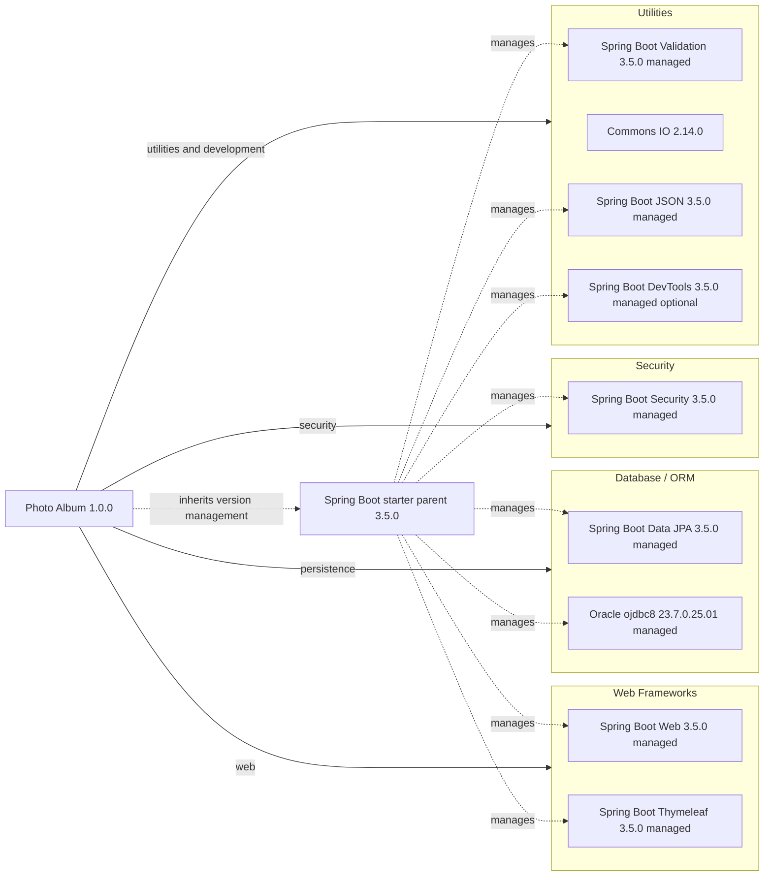

# Dependency Map

Photo Album (`com.photoalbum:photo-album:1.0.0`) declares 11 external dependencies in `pom.xml`: 9 application/development dependencies and 2 test dependencies. The resolved Maven inventory contains 104 dependencies (11 direct and 93 transitive); the diagram and category counts below cover direct declarations only, excluding the parent POM and build plugin.

Resolved versions and paths were verified against the security assessment's `dependency-inventory.json` and `maven-dependency-tree.txt`. The versioned [dependency inventory](../security/dependency-inventory.json) provides all 104 coordinates and dependency paths: 65 compile, 12 runtime, and 27 test-scoped artifacts.

## Dependencies

### Dependency Summary

| Category | Count | Key Libraries | Notes |
|----------|-------|---------------|-------|
| Web Frameworks | 2 | Spring Boot Web, Thymeleaf | Versions inherited from Spring Boot parent 3.5.0; compile scope |
| Database / ORM | 2 | Spring Boot Data JPA 3.5.0, Oracle ojdbc8 23.7.0.25.01 | JPA is compile scope; Oracle driver is runtime scope |
| Security | 1 | Spring Boot Security | Compile scope; version inherited from parent |
| Utilities | 4 | Spring Boot Validation, Commons IO 2.14.0, Spring Boot JSON, Spring Boot DevTools | Compile scope; DevTools is optional |
| **Total** | **9** | | Excludes 2 test dependencies |

Declared coordinates and scopes (`compile` is Maven's default when omitted):

| Category | Dependency | Version declaration / management | Scope |
|----------|------------|----------------------------------|-------|
| Web Frameworks | `org.springframework.boot:spring-boot-starter-web` | Omitted; parent-managed Spring Boot 3.5.0 | compile |
| Web Frameworks | `org.springframework.boot:spring-boot-starter-thymeleaf` | Omitted; parent-managed Spring Boot 3.5.0 | compile |
| Database / ORM | `org.springframework.boot:spring-boot-starter-data-jpa` | Omitted; parent-managed Spring Boot 3.5.0 | compile |
| Database / ORM | `com.oracle.database.jdbc:ojdbc8` | Omitted; parent-managed, resolved to `23.7.0.25.01` | runtime |
| Security | `org.springframework.boot:spring-boot-starter-security` | Omitted; parent-managed Spring Boot 3.5.0 | compile |
| Utilities | `org.springframework.boot:spring-boot-starter-validation` | Omitted; parent-managed Spring Boot 3.5.0 | compile |
| Utilities | `commons-io:commons-io` | Explicit `2.14.0` | compile |
| Utilities | `org.springframework.boot:spring-boot-starter-json` | Omitted; parent-managed Spring Boot 3.5.0 | compile |
| Utilities | `org.springframework.boot:spring-boot-devtools` | Omitted; parent-managed Spring Boot 3.5.0 | compile; optional |

### Version & Compatibility Risks

The project targets Java 21 and uses Spring Boot parent 3.5.0. This initial 3.5 release and the older Commons IO 2.14.0 pin warrant review against current maintenance releases. The separate security assessment checked affected versions against advisories, not runtime exploitability; dependency presence alone does not establish a reachable vulnerability. The resolved Oracle driver is `23.7.0.25.01` and H2 is `2.3.232`; Oracle compatibility with Java 21 and the deployed database still requires compatibility validation, and the `ojdbc8` artifact name alone does not establish incompatibility. Framework upgrades must preserve compatibility with the Jakarta-based Spring Boot 3 stack.

### Notable Observations

- The only declared parent is `org.springframework.boot:spring-boot-starter-parent:3.5.0` (`pom.xml:8–13`). No explicit BOM imports or dependency-management overrides are declared; Commons IO alone has an explicit dependency version.
- The resolved tree includes Logback 1.5.18, SLF4J 2.0.17, Hibernate ORM 6.6.15.Final, and Jackson 2.19.0 as transitive dependencies. These are represented in the full inventory, not added to the 11 direct-declaration count.
- The JSON starter is a JSON serialization dependency, despite its “Image processing” POM comment. The resolved tree attributes Jackson 2.19.0 to the direct JSON starter; shared or omitted dependency paths are not necessarily repeated in Maven's mediated tree.
- DevTools is optional but has default compile scope, not runtime scope. The build also declares `org.springframework.boot:spring-boot-maven-plugin` without an explicit version; it is a build plugin, not an application dependency.

## Test Dependencies

| Framework | Version | Notes |
|-----------|---------|-------|
| `org.springframework.boot:spring-boot-starter-test` | Omitted; parent-managed, resolved to `3.5.0` | Direct test starter |
| `com.h2database:h2` | Omitted; parent-managed, resolved to `2.3.232` | Direct test-scoped in-memory database |
| JUnit Jupiter | `5.12.2` | Transitive via test starter |
| Mockito Core | `5.17.0` | Transitive via test starter |
| AssertJ Core | `3.27.3` | Transitive via test starter |
| Spring Test | `6.2.7` | Transitive via test starter |

Total declared test-scope dependencies: 2. Total resolved test-scope artifacts: 27 (2 direct and 25 transitive); the table lists selected transitive frameworks, not all resolved artifacts.

No separate integration-testing or contract-testing dependency is declared. H2 differs from the production Oracle driver and cannot by itself establish Oracle-specific behavior compatibility; no tests were run or test sources inspected.
